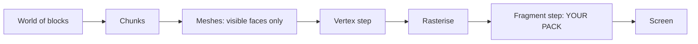

# Bloxd Shader Packs — الدليل الكامل (العربية)

🌐 [جميع اللغات](README.md) · بالعمق: [English](GUIDE-EN.md#part-0--start-from-zero-how-rendering-and-bloxd-shaders-work) · [Français](GUIDE-FR.md)

**اقرأ هذا أولاً.** لا حاجة إلى خبرة. في عشر دقائق ستعرف كيف ترسم اللعبة صورتها، وما هو الـ shader،
وماذا يستطيع الـ shader pack أن يفعل وماذا لا يستطيع، بدقة.

## 1. نسخة الدقيقة الواحدة

- Bloxd.io لعبة voxel: العالم مصنوع من مكعبات (blocks).
- الصورة على شاشتك ترسمها بطاقة الرسومات (GPU)، 60 مرة أو أكثر في الثانية.
- الـ **shader** برنامج صغير جداً يعمل على الـ GPU ويقرر لون البكسلات.
- الـ **shader pack** ملف `.zip` صغير فيه كود shader. تحمّله اللعبة وتدع كودك يعيد تلوين
  **البلكات والماء واللافا** أثناء رسمها.
- أنت لا تغيّر اللعبة. أنت تغيّر الألوان والضياء فقط، في اللحظة الدقيقة التي يُرسم فيها كل بكسل.

## 2. كيف تُرسم الصورة (تصيير الويب، خطوة خطوة)

شاشتك شبكة من النقاط الصغيرة تسمى **بكسلات** (مثلاً 1920 × 1080 = حوالي مليوني بكسل). الصورة
الكاملة واحدة تسمى **frame** (إطار). اللعبة ترسم إطاراً جديداً مرة بعد مرة — هذا ما يجعل الحركة
ناعمة.

يتقاسم العمل معالجان:

| | CPU (المعالج الرئيسي) | GPU (بطاقة الرسومات) |
|---|---|---|
| المهمة | منطق اللعبة، الفيزياء، الشبكة | رسم ملايين البكسلات بسرعة، بالتوازي |
| الأسلوب | عمال قليلون، أذكياء جداً | آلاف العمال، كل واحد بسيط |

على الويب، تبدو السلسلة هكذا:

1. اللعبة تعمل JavaScript في المتصفح (Chrome أو Edge حديث يعمل أفضل).
2. اللعبة تتكلم مع الـ GPU عبر **WebGPU**، واجهة الرسومات الحديثة للمتصفح.
3. داخل المتصفح، يترجم **Dawn** (مع مترجمه **Tint**) لغة الـ shader وهي **WGSL** إلى تعليمات يفهمها
   الـ GPU (Direct3D / Metal / Vulkan، حسب النظام).
4. الـ GPU ينفذ الـ shaders ويضع الصورة الجاهزة على الشاشة.

نفس Bloxd مبنية بمحرك voxel (**noa-engine**) فوق إطار عمل 3D (**Babylon.js**). لكل إطار، يقوم خط أنابيب الرسم بهذا:

1. **الكاكات (Chunks).** العالم مقطّع إلى أعمدة من البلكات تسمى چانكس. فقط الچانكس القريبة منك تجهّز
   للرسم.
2. **البناء الشبكي (Meshing).** لكل چانك، يبني المحرك *شبكة* (mesh): جلد من المثلثات يغطي فقط
   وجوه البلكات المرئية فعلاً. الوجوه المخفية تُتخطّى.
3. **أطلس الخامات (Texture atlas).** كل وجه بلكة يأخذ صورته من صورة كبيرة واحدة، الـ **أطلس**، الذي
   يحتوي كل خامات البلكات جنباً إلى جنب. كل وجه يعرف أي مربع صغير من الأطلس يستخدم (إحداثيات **UV**).
4. **خطوة الرؤوس (Vertex step).** يشغّل الـ GPU *vertex shader* على كل ركن (vertex) من كل مثلث:
   يضع الركن في الموضع الصحيح على شاشتك ويمرّر البيانات (إحداثيات الخامة، قيم الضوء، اتجاه الوجه…).
5. **الرستر (Rasterising).** يملأ الـ GPU كل مثلث بالبكسلات. كل بكسل مغطى يصبح **fragment**
   (جزء): بكسل مرشح ببيانات مستوفاة.
6. **خطوة الـ fragments.** يشغّل الـ GPU *fragment shader* لكل fragment: هنا يُقرّر لون البكسل
   النهائي. **هنا تعيش shader packs الخاصة بـ Bloxd.**
7. **الشاشة.** يُعرض الإطار الجاهز. ثم يتكرر كل شيء للإطار التالي.



الفكرة الأساسية: الـ pack لا يرى "العالم" أبداً. يرى **fragment واحد في كل مرة** — بكسل واحد من
وجه بلكة واحد — بالإضافة إلى بعض البيانات عن ذلك البكسل. كل شيء يفعله pack يجب أن يُحسب من تلك
البيانات المحلية.

## 3. ما هو الـ shader

الـ shader دالة صغيرة (قطعة كود صغيرة) يشغّلها الـ GPU عدداً ضخماً من المرات بالتوازي — مرة لكل
vertex أو مرة لكل fragment. يجب أن يكون سريعاً ومحتوياً على نفسه: بدون ملفات، بدون شبكة، بدون
ذاكرة عن الإطار السابق.

تُكتب packs الخاصة بـ Bloxd بلغة **WGSL** (WebGPU Shading Language). أنت لا تكتب shader كاملاً.
المحرك يملك shaders الخاصة به؛ يدعك تُدخل كودك في أربع نقاط ثابتة تسمى **hooks** (القسم 5). فكّر في أربعة أبواب:
المحرك يمشي في كود رسمه، وعند كل باب يسأل دالتك: "إليك بيانات هذا البكسل — هل تريد تغيير اللون؟"

## 4. ما هو الـ shader pack الخاص بـ Bloxd

الـ pack ملف `.zip` يحتوي:

```
pack.json     (ملف بيانات وصفية صغير)
*.wgsl        (كود WGSL الخاص بك — ملف واحد أو عدة ملفات، بأية مجلدات)
```

يحتاج `pack.json` فقط:

```json
{ "apiVersion": 2, "name": "My Pack", "author": "you" }
```

- يجب أن تكون `apiVersion` الرقم **2**. الـ packs القديمة v1 مرفوضة.
- المُحمِّل يعثُر على **كل** ملف `*.wgsl` في الـ zip ويصل بينها. ترتيب الملفات والمجلدات لا يهم.
- الحد الإجمالي لحجم WGSL: **256 KB**.

للتثبيت في اللعبة: Bloxd → `O` الإعدادات → الرسومات → فعِّل **Use New WebGPU Renderer** →
Shader Pack → **Choose .zip** → **Apply**.

الـ pack يؤثر فقط على **البلكات والماء واللافا**. بعض أنماط اللعبة تعطل الـ packs تماماً.

## 5. الوظائف الأربع (أبوابك الوحيدة)

| Hook | متى يعمل | ما تتحكم فيه |
|---|---|---|
| `bloxdTerrainSurface` | لكل fragment، البلكات الصلبة، أولاً | اللون الأساسي، الشفافية (alpha)، البريق الذاتي (emission) |
| `bloxdTerrainLight` | نفس الـ fragment، مباشرة بعد | اللون النهائي المضيء للبلكات |
| `bloxdLiquidSurface` | لكل fragment، الماء واللافا، أولاً | اللون الأساسي وألفا السوائل |
| `bloxdLiquidLight` | نفس الـ fragment، مباشرة بعد | اللون النهائي المضيء للسوائل |

قواعد الأبواب:

- يعمل Surface **قبل** Light، في نفس الـ fragment. يمكنك تمرير قيمة من surface إلى light
  بمتغير على مستوى الوحدة النمطية (`var<private>`).
- ابدأ دائماً من النتيجة الافتراضية للمحرك: `bloxdDefaultSurface(...)` أو
  `bloxdDefaultLight(...)`، ثم غيِّر ما تحتاجه، ثم ارجعه. لا تبنِ هياكل النتائج بنفسك أبداً.
- تعمل hooks surface قبل اختبار قص الشفافية للمحرك: على الأوراق والبلكات المفرّغة، تحدد
  `out.alpha` ما إن كان البكسل يبقى أم يُرمى؛ وعلى السوائل هي عامل المزج الحقيقي؛ وعلى البلكات
  الصلبة العادية لا تفعل alpha شيئاً.
- البريق الذاتي (`out.emission`) ينتمي إلى hooks الـ **surface** فقط.
- إن كنت كتب لونك النهائي في light hook، فطبِّق الضباب بنفسك في النهاية بـ
  `bloxdApplyFog(colour, light)` — ضباب المحرك دائماً موجود في المشهد، وتخطّيه يجعل البلكات
  البعيدة تلمع عبر الضباب.

## 6. ماذا يخبرك المحرك

لكل fragment، تتلقى الـ hooks الخاصة بك البيانات. أهم الحقول:

| البيانات | المعنى، بكلمات بسيطة |
|---|---|
| `colour` | لون خامة البلكة عند هذا البكسل (من الأطلس)، قبل تعديلاتك |
| `blockId` | الـ **رقم** المعرف الرقمي للبلكة (عدد صحيح). هكذا تعامل نوع بلكة مختلفاً عن آخر — الجدول الكامل في الجزء الثامن |
| `position` | أين هذا البكس في العالم (x, y, z) |
| `normal` | الاتجاه الذي يشير إليه الوجه (أعلى، أسفل، شمال…) على شكل متجه |
| `skyLight` | كم ضوء السماء يصل إلى هذه البلكة، 0 إلى 1 — لكن **مرتبط بنغمة متدرجة**: سماء مفتوحة ≈ 1.0، ومستوى مفقود واحد تحت شجرة ≈ 0.995 (انظر القسم 7) |
| `blockLight` | ضوء المصابيح والمشاعل واللافا… على شكل لون (توجد مصابيح ملوّنة) |
| `heldLight` | ضوء العنصر في يد اللاعب |
| `skyLightColour` | لون السماء الحالي (أزرق داكن في الليل، دافئ عند المغرب) |
| `litColour` | لون المحرك المضيء الخاص بهذه السطحية (مفيد كأساس) |
| `fogVisibility`, `fogColour` | مدى ضبابية هذا البكسل، ولون الضباب (يأتي **أسود** عندما يكون الضباب مغلقاً — تعامل مع هذه الحالة) |

وظائف المحرك التي يمكنك استدعاؤها:

| الوظيفة | ماذا تمنحك |
|---|---|
| `bloxdDefaultSurface(in)` / `bloxdDefaultLight(surface, light)` | النتيجة الطبيعية للمحرك — دائماً نقطة انطلاقك |
| `bloxdApplyFog(colour, light)` | يمزج لونك في الضباب بشكل صحيح |
| `bloxdSunDirection()` | متجه الوحدة باتجاه الشمس؛ `(0,0,0)` في عوالم بدون شمس شبيهة بالأرض؛ القمر هو الاتجاه المعاكس تماماً |
| `bloxdTime()` | ثوانٍ — **تعود إلى 0 كل 3600 ثانية** (`bloxdTimeWrap`). انظر القسم 7 |
| `bloxdEyePosition()` | موضع الكاميرا (لتأثيرات المسافة) |
| `bloxdOriginOffset()` | المحرك يعيد تأسيس إحداثيات العالم دورياً؛ أضف هذا الميل إلى أي نمط موضع في العالم، أو سينطط نمطك بوضوح |
| `bloxdFaceBlock(position, normal)` | خلية البلكة (إحداثيات صحيحة) من الوجه الذي ترسمه — مثالية لتنوع عشوائي لكل بلكة |
| `bloxdOpaqueBehind()` | للسوائل فقط: تجد أول بلكة صلبة خلف سطح السائل — تُستخدم لقياس عمق الماء |

## 7. الفخاخ التي يقع فيها الجميع

**الوقت يعيد نفسه.** يعدّ `bloxdTime()` الثواني لكن يبدأ مجديداً من 3600. إذا استخدمت رسمك
المحرك الوقت الخام، فسينطط مرة واحدة كل ساعة. حرك دائماً بدورات كاملة داخل wrap:

```wgsl
sin(6.2831853 * fract(bloxdTime() / bloxdTimeWrap * cycles + phase))
```

اختر `cycles` كرقم صحيح. عندئذٍ، القيمة عند ثانية 3600 تساوي القيمة عند ثانية 0: بلا قفزات
على الإطلاق.

**skyLight مرتبط بنغمة.** ليس سطوعاً خطياً من 0 إلى 1. يضغط المحرك مستويات الضوء 0–15 في منحنى:
السماء المفتوحة هي ≈ 1.0 وفقدان مستوى واحد لا يزال يقرأ ≈ 0.995. إذا اختبرت `skyLight < 0.5`
متوقعاً "في الظل"، لن يتطابق أي شيء تقريباً. عاير حدودك على المنحنى الحقيقي (الجزء الرابع يعطي
القيم المقيسة).

**الضباب موجود دائماً.** حتى عندما لا تستطيع رؤيته، يحسب المحرك الضباب (أحياناً يُدفع بعيداً جداً).
إذا أعاد light hook لوناً دون `bloxdApplyFog`، فسيبدو التضاريس البعيدة ساطعة جداً وتشقّ الضباب.
طبِّق الضباب أخيراً، بعد عمل الألوان.

**قد تكون الإضاءة مغلقة.** إذا عطّلت لعبة أو إعدادات الإضاءة، قد لا يُرسل `skyLight` على الإطلاق
وتتوقف التأثيرات المتأثرة بالسماء بهدوء عن فعل شيء. اكتب التأثيرات بحيث يبقى الـ pack جمييلاً بدونها.

## 8. كل شيء يمكن للـ pack فعله

- إعادة تلوين أي بلكة أو ماء أو لافا — عالمياً أو بحسب `blockId`.
- جعل الأشياء تتوهج (`out.emission` في hooks surface): اللافا، الخامات، المصابيح…
- تحريك اللون والألفا مع مرور الوقت (نابض، لافا جارية، ماء متلألئ) — بمقاومة للـ wrap
  (القسم 7).
- الاستجابة لدورة الليل والنهار عبر `bloxdSunDirection()` و`skyLightColour` (توهجات غروب
  دافئة، ألوان قمر زرقاء).
- إضافة تفاصيل إجرائية مثبتة في العالم: تنويع خفيف لكل بلكة باستخدام بوتقات
  `bloxdFaceBlock`، ألوان ضباب للمسافة، تعميق تحت الماء باستخدام عمق `bloxdOpaqueBehind()`.
- تصنيف الصورة بأكملها لكل fragment: التباين، التشبع، توازن الدافئ والبارد — طالما وقد طُبّق الضباب في النهاية.
- رسم التأثيرات *على* الأسطح: بريق على الخامات، تعميق شبيه بالمبلل قرب مستوى الماء، ثلوج على
  وجوه متجهة لأعلى (`normal.y`)، وخدع مماثلة — وكلها محسوبة من بيانات الـ fragment نفسه.
- استخدام الاتساع (`bloxdEyePosition()`) لإخفاء التأثيرات المكلفة أو الصاخبة (تفاصيل رخيصة
  على مستوى).

## 9. ما لا يمكن للـ pack فعله (حدود المحرك)

- تُرسم **النباتات العشب والزهور** من قبل جزء من المحرك لا تستطيع الـ packs وصولاً إليه. لا يمكنك
  إعادة تلوينها أو تحريكها.
- **بدون معالجة ما بعدية.** لا تستطيع الوصول إلى الإطار الجهوز، ولا إحداثيات شاشة، ولا تمريرات
  blur/bloom/vignette.
- **بدون عمق مشهد.** الاستعلام الوحيد "ماذا يوجد خلف هذا" هو `bloxdOpaqueBehind()` عبر
  سائل.
- **لا خرائط ظل حقيقية أو ambient occlusion** تجاوز ما يُشفّر قيم ضوء المحرك بالفعل.
- **لا أجسام أو جسيمات جديدة** في العالم. يمكنك الرسم على الأسطح الموجودة فقط. (تدهن الـ
  packs الذكية تأثيرات overlay على الأسطح — انظر الوصفات — لكن الهندسة دائماً للماكنية.)
- **لا خوادم نسيج أو أمثلات خاصة بك**، لا مغذيات بيانات إضافية: مدخلاتك الوحيدة هي
  وسيطات الـ hook ووظائف المحرك.
- **حركة الـ vertex** (ثني الهندسة، أمواج تحرك الأركان) موجودة في المحرك لكنها **تعمل في بضع
  لعب فقط** — لا تعتمد أبداً عليها؛ زوّر الحركة برسم متحرك اللون/ألفا بدلاً من ذلك.
- تُرسم **السماء نفسها** (قرص الشمس، skybox، والغيوم) من قبل المحرك. تستلم الـ packs *بيانات* السماء (الاتجاه، اللون)
  لكنهت لا ترسم السماء.

إذا احتاج التأثير شيء من هذه القائمة، فلا يستطيع أي pack أن يفعلها اليوم — هذا هو السلوك المجرب
من قبل المحرك، وليست مسألة مهارة.

## 10. أول pack لك في خمس خطوات

1. انشئ `pack.json`:

```json
{ "apiVersion": 2, "name": "My First Pack", "author": "you" }
```

2. انشئ `shader.wgsl` بجانبه:

```wgsl
fn bloxdTerrainSurface(surface: BloxdSurfaceIn) -> BloxdSurface {
    var out = bloxdDefaultSurface(surface);
    out.colour = out.colour * vec3f(1.05, 1.0, 0.92);
    return out;
}

fn bloxdTerrainLight(surface: BloxdSurface, light: BloxdLightIn) -> BloxdLight {
    var out = bloxdDefaultLight(surface, light);
    _ = surface;
    return out;
}
```

هذا الـ pack يجعل كل بلكة دافئة قليلاً (أكثر أحمر، أقل أزرق) وتحافظ على إضاءة المحرك.
سطر `_ = surface;` يخبر المترجم "هذا الإدخال غير مستخدم عمداً" — يتطلب WGSL هذا الشكل العاري.

3. ضغط الملفين معاً، مع `pack.json` في جذر الـ zip (وليس داخل مجلد فرعي).
4. في اللعبة: الإعدادات → الرسوميات → **Use New WebGPU Renderer** مفعّل → Shader Pack → اختر .zip → طبِّق.
5. انظر حولك: يجب أن يبدو العالم دافئاً قليلاً. غيِّر الأرقام الثلاثة وحمِّل من جديد للتجريب.

ثم أكبِر خطوة خطوة: تأثير واحد في كل مرة، تفقّده في منتصف النهار، والغروب، والليل، وتحت الماء
وفي كهف قبل أن تضيف التالي.

## 11. القواعد الصارمة التسع

كسر إحدى هذه القواعد يكشر الـ pack أو يرفضه:

1. لا تعرّف شيئاً يبدأ بـ `BLOXD_` — تلك تنتمي للمحرك.
2. لا تبنِ `BloxdSurface` / `BloxdLight` بنفسك — ابدأ من `bloxdDefaultSurface` /
   `bloxdDefaultLight`.
3. `mod` كلمة محجوزة في WGSL — استخدم `%`.
4. لا خوادم، لا أمثلات، لا نقاط دخول أو سمات خاصة بك، لا إحداثيات UV للشاشة.
5. تجنّب `discard` (مرفوض في الوضع الصارم) — استخدم `out.alpha` بدلاً من ذلك.
6. يجب أن تخرج وظائف السائل دائماً ألفا صحيحة، في كل متحول.
7. المدخلات غير المستخدمة: اكتب `_ = value;` — شكل `let _ =` مرفوض.
8. إجمالي WGSL ≤ 256 KB.
9. يجمع المحرك كودك في **8 متحولات** (صارمة/مسموح بها × مضيئة/غير مضيئة ×
   أرض/سائل). يجب أن يتجمع كودك ويتصرف في جميعها. ضع أقواسًا حول تعبيرات البت المتجمع/الشيفت للمترجم Tint الخاص بالمتصفح.

## 12. معجم مصغّر

| كلمة | معنى |
|---|---|
| الإطار | صورة كاملة واحدة على الشاشة |
| بكسل / fragment | نقطة واحدة من الصورة / بكسل مرشح يجري تلوينه |
| Vertex | زاوية مثلّث |
| Mesh | جلد المثلثات المبني من وجوه مرئية لـ chunk |
| atlas (أطلس خامات) | الصورة الكبيرة الوحيدة التي تحتوي على كل خامات البلكات |
| UV | إحداثيات تخبر أي جزء من الأطلس يستخدمه وجه |
| WGSL | لغة الـ shader في WebGPU — لغة الـ packs الخاصة بـ Bloxd |
| Hook | إحدى الوظائف الأربع للمحرك التي قد يعرّفها الـ pack الخاص بك |
| skyLight / blockLight | ضوء من السماء / ضوء من البلكات (المصابيح، اللافا) |
| Wrap (3600 s) | إعادة تشغيل البلوك كل ساعة |
| الضباب | تضاريس بعيدة تمزج في لون الضباب |
| متحول | إحدى الطرق الثمان التي يجمع بها المحرك الـ pack |

## 13. تعمّق أكثر (فصول بالإنكليزية)

| الجزء | ملف | المحتوى |
|---|---|---|
| I | [01-making](GUIDE-EN.md#part-i--making-a-pack) | تنسيق pack، تحميل متعدد الملفات، حدود، توزيع |
| II | [02-api](GUIDE-EN.md#part-ii--the-api-contract) | عقد hook و struct الكامل |
| III | [03-recipes](GUIDE-EN.md#part-iii--recipes) | 12 وصفة إنتاج بكود WGSL |
| IV | [04-realism](GUIDE-EN.md#part-iv--measured-numbers-realism-that-survives-contact-with-the-game) | أرقام مقيسة: وحدات ضوء، ضباب، بصريات الماء |
| V | [05-troubleshooting](GUIDE-EN.md#part-v--troubleshooting) | كل وضعية فشل معروفة وعلاجها |
| VI | [06-implementation](GUIDE-EN.md#part-vi--implementation--local-validation) | التحقق المحلي في الـ 8 متحولات، تدقيقات التغليف |
| VII | [07-internals](GUIDE-EN.md#part-vii--engine-internals) | الداخلينات المحركة (الوقت، خط أنابيب الضوء، السماء، المُحمِّل) |
| VIII | [08-block-ids](GUIDE-EN.md#part-viii--the-numeric-block-id-table) | جدول رقم معرف البلوك الكامل |
| IX | [09-sources](GUIDE-EN.md#part-ix--where-this-knowledge-comes-from-and-what-we-dont-know) | كيف أُسس كل حقيقة في هذا الدليل |
| X | [10-constants](GUIDE-EN.md#part-x--the-constants-register-en) | كل ثابت، مع دوره |

النسخة الفرنسية الكاملة: [fr](GUIDE-FR.md) · جميع اللغات: [فهرس](README.md). ترخيص: MIT.
