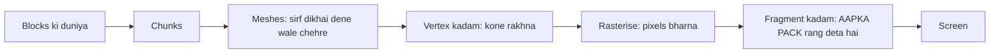

# Bloxd Shader Packs — पूर्ण मार्गदर्शिका (हिन्दी)

🌐 [सभी भाषाएँ](README.md) · गहराई में: [English](GUIDE-EN.md#part-0--start-from-zero-how-rendering-and-bloxd-shaders-work) · [Français](GUIDE-FR.md)

**इसे पहले पढ़ें।** कोई अनुभव ज़रूरी नहीं। दस मिनट में आप जानेंगे कि खेल अपनी तस्वीर कैसे बनाता है,
shader क्या है, और shader pack क्या कर सकता है और क्या नहीं।

> **Scope: API v2.** यह guide `apiVersion: 2` और current WebGPU/Lite path बताता है। Future version हेतु `apiVersion` speculative न बदलें।

## 1. एक मिनट वाला संस्करण

- Bloxd.io एक voxel गेम है: दुनिया घनों (blocks) से बनी है।
- आपके स्क्रीन की तस्वीर आपका ग्राफ़िक्स कार्ड (GPU) हर सेकंड 60 या उससे अधिक बार बनाता है।
- **Shader** एक छोटा-सा प्रोग्राम है जो GPU पर चलता है और pixels का रंग तय करता है।
- **Shader pack** shader कोड वाली एक छोटी `.zip` फ़ाइल है। गेम उसे लोड करता है और आपके कोड को
  **blocks, पानी और लावा** को उनके बनते समय नया रंग देने देता है।
- आप गेम को नहीं बदलते। आप बस रंग और रोशनी बदलते हैं, ठीक उसी क्षण जब हर pixel बनता है।

## 2. तस्वीर कैसे बनती है (web rendering, कदम-दर-कदम)

आपकी स्क्रीन छोटी-छोटी बिंदुओं का जाल है जिन्हें **pixels** कहते हैं (उदाहरण: 1920 × 1080 = लगभग
बीस लाख pixels)। एक पूरी तस्वीर एक **फ्रेम** है। गेम बार-बार नया फ्रेम बनाता है — इसी से गति
चिकनी दिखती है।

दो प्रोसेसर काम बाँटते हैं:

| | CPU (मुख्य प्रोसेसर) | GPU (ग्राफ़िक्स कार्ड) |
|---|---|---|
| काम | गेम की लॉजिक, भौतिकी, नेटवर्क | लाखों pixels बनाना, बहुत तेज़, समानांतर |
| अंदाज़ | कुछ कामगार, बहुत होशियार | हज़ारों कामगार, हर एक बहुत सरल |

वेब पर श्रृंखला ऐसी दिखती है:

1. गेम आपके ब्राउज़र में JavaScript के रूप में चलता है (नया Chrome या Edge सबसे बढ़िया)।
2. गेम GPU से **WebGPU** के ज़रिए बात करता है, ब्राउज़र की आधुनिक ग्राफ़िक्स API।
3. ब्राउज़र के अंदर, **Dawn** (अपने कंपाइलर **Tint** के साथ) shader भाषा **WGSL** को उन निर्देशों में
   बदलता है जो आपका GPU समझता है (आपके सिस्टम के अनुसार Direct3D / Metal / Vulkan)।
4. GPU shaders को चलाता है और तैयार फ्रेम स्क्रीन पर रखता है।

Bloxd खुद एक 3D फ्रेमवर्क (**Babylon.js**) के ऊपर voxel इंजन (**noa-engine**) से बना है। हर फ्रेम
के लिए ड्राइंग पाइपलाइन यह करती है:

1. **Chunks।** दुनिया blocks के स्तंभों में काटी जाती है जिन्हें chunks कहते हैं। केवल आपके पास के chunks
   ड्राइंग के लिए तैयार होते हैं।
2. **Meshing।** हर chunk के लिए इंजन एक *mesh* बनाता है: त्रिभुजों की एक खाल जो केवल सचमुच दिखने
   वाले block-चेहरों को ढकती है। छिपे चेहरे छोड़ दिए जाते हैं।
3. **Texture atlas।** हर block-चेहरा अपनी तस्वीर एक बड़ी तस्वीर से लेता है, **atlas**, जिसमें सारे block
   textures अगल-बगल होते हैं। हर चेहरा जानता है कि atlas का कौन-सा छोटा चौकोर हिस्सा इस्तेमाल करना है
   (उसके **UV** निर्देशांक)।
4. **Vertex चरण।** GPU हर त्रिभुज के हर कोने (vertex) पर *vertex shader* चलाता है: वह कोने को स्क्रीन पर
   सही जगह रखता है और डेटा आगे भेजता है (texture निर्देशांक, रोशनी के मान, चेहरे की दिशा…)।
5. **Rasterising।** GPU हर त्रिभुज को pixels से भरता है। हर ढका हुआ pixel एक **fragment** बन जाता है:
   इंटरपोलेट किए डेटा वाला उम्मीदवार pixel।
6. **Fragment चरण।** GPU हर fragment के लिए *fragment shader* चलाता है: यहीं pixel का अंतिम रंग तय
   होता है। **Bloxd के shader packs यहीं रहते हैं।**
7. **स्क्रीन।** तैयार फ्रेम दिखाया जाता है। फिर अगले फ्रेम के लिए सब दोहराया जाता है।



मुख्य बात: आपका pack कभी "दुनिया" नहीं देखता। वह **एक बार में एक fragment** देखता है — एक block-चेहरे का
एक pixel — और उस pixel के बारे में कुछ डेटा। pack जो कुछ भी करता है, वह उसी स्थानीय डेटा से गणना
करनी पड़ती है।

## 3. Shader क्या है

Shader एक छोटा फ़ंक्शन है (कोड का छोटा टुकड़ा) जिसे GPU भारी संख्या में समानांतर चलाता है — एक बार
हर vertex के लिए, या एक बार हर fragment के लिए। वह तेज़ और खुद में पूरा होना चाहिए: कोई फ़ाइल नहीं,
कोई नेटवर्क नहीं, पिछले फ्रेम की कोई याद नहीं।

Bloxd packs **WGSL** (WebGPU Shading Language) में लिखे जाते हैं। आप पूरा shader नहीं लिखते। इंजन के अपने shaders हैं; वह आपको छह तय बिंदुओं पर कोड डालने देता है जिन्हें **hooks** कहते हैं (खंड 5): दो program (terrain और liquid) × तीन stage (vertex, surface, light)। vertex दरवाज़े पर वह पूछता है कि कोना कहाँ जाए; surface और light पर पूछता है कि यह pixel अंत में कैसा दिखे।

## 4. Bloxd shader pack क्या है

Pack एक `.zip` फ़ाइल है जिसमें ये होते हैं:

```
pack.json     (छोटी मेटाडेटा फ़ाइल)
*.wgsl        (आपका WGSL कोड — एक फ़ाइल या कई, किसी भी फ़ोल्डर में)
```

`pack.json` को बस यह चाहिए:

```json
{ "apiVersion": 2, "name": "My Pack", "author": "you" }
```

- `apiVersion` ठीक JSON नंबर **2** होना चाहिए (string नहीं)। पुराने v1 packs अस्वीकार होते हैं।
- Importer एक folder या **एक** `.zip` लेता है। Path normalise होने के बाद ठीक एक `pack.json` होना चाहिए; सभी files का साझा root folder अपने-आप हट जाता है।
- Manifest UTF-8 JSON object है, ≤ **65,536 bytes**। Trim के बाद `name` खाली नहीं होना चाहिए; `author` optional string या `null` है; बाकी keys ignore होती हैं।
- Sources: **1–256** `.wgsl` files, path से sorted; decompressed कुल ≤ **262,144 bytes**; duplicate path और invalid UTF-8 reject; दूसरी files ignore।
- Zip ≤ **33,554,432 bytes** और ≤ **1,024 entries**; सिर्फ stored/deflate पढ़े जाते हैं; Zip64, multi-disk और encrypted reject।

Install: Bloxd → `O` Settings → Graphics → **Use New WebGPU Renderer** on → Shader Pack → folder या `.zip` चुनें → **Apply** → **page reload करें**। Usable WebGPU न हो तो pack store होकर भी blocked रह सकता है।

Pack सिर्फ़ **blocks, पानी और लावा** को प्रभावित करता है। कुछ गेम मोड packs को पूरी तरह बंद कर देते हैं।

## 5. छह hooks (आपके इकलौते दरवाज़े)

| Hook | कब चलता है | आप क्या नियंत्रित करते हैं |
|---|---|---|
| `bloxdTerrainVertex` | हर vertex, terrain, projection से पहले | हर कोने की world position (सिर्फ allow games) |
| `bloxdTerrainSurface` | हर fragment, ठोस blocks, पहले | आधार रंग, पारदर्शिता (alpha), खुद की चमक (emission) |
| `bloxdTerrainLight` | वही fragment, ठीक बाद में | blocks का अंतिम रोशनी-युक्त रंग |
| `bloxdLiquidVertex` | हर vertex, liquids, projection से पहले | हर liquid कोने की world position (सिर्फ allow games) |
| `bloxdLiquidSurface` | हर fragment, पानी और लावा, पहले | तरलों का आधार रंग और alpha |
| `bloxdLiquidLight` | वही fragment, ठीक बाद में | तरलों का अंतिम रोशनी-युक्त रंग |

दरवाज़ों के नियम:

- Surface, light से **पहले** चलता है, उसी fragment में। आप मॉड्यूल-स्तरीय वैरिएबल (`var<private>`) से surface
  से light को एक मान भेज सकते हैं।
- हमेशा इंजन के डिफ़ॉल्ट परिणाम से शुरू करें: `bloxdDefaultSurface(...)` या `bloxdDefaultLight(...)`,
  ज़रूरी बदलाव करें, फिर उसे लौटाएँ। परिणाम structs कभी खुद न बनाएँ।
- Surface hooks इंजन के पारदर्शिता-कटआउट टेस्ट से पहले चलते हैं: पत्तों और कट-आउट blocks पर `out.alpha`
  तय करता है कि pixel रहेगा या हटेगा; तरलों पर वही असली ब्लेंड फैक्टर है; साधारण ठोस blocks पर alpha
  कुछ नहीं करता।
- खुद की चमक (`out.emission`) सिर्फ़ **surface** hooks का हिस्सा है।
- अगर आप light hook में अपना अंतिम रंग लिखते हैं, तो अंत में फ़ॉग खुद लगाएँ:
  `bloxdApplyFog(colour, light)` — इंजन का फ़ॉग दृश्य में हमेशा मौजूद रहता है, और उसे छोड़ने से दूर के
  blocks फ़ॉग के आर-पार चमकने लगते हैं।

- Liquid stage गायब हो तो matching terrain hook पर fallback होता है; surface/light की जोड़ी गायब हो तो engine default चलता है। Vertex optional है; `bloxdDefaultVertex(...)` से शुरू करें।
- Vertex hook या reachable `discard` pack reject नहीं करता: strict में वह program off हो जाता है, और strict default policy है।
- `out.alpha` सिर्फ `BLOXD_ALPHA` के तहत है (सिर्फ terrain+strict में absent); liquids में alpha हमेशा है। Light का RGB final RGB बदल देता है—fog रखने हेतु `bloxdApplyFog` लगाएँ।

## 6. इंजन आपको क्या बताता है

हर fragment के लिए आपके hooks को डेटा मिलता है। सबसे उपयोगी फ़ील्ड:

| डेटा | सरल शब्दों में अर्थ |
|---|---|
| `colour` | इस pixel पर block के texture का रंग (atlas से), आपके बदलावों से पहले |
| `blockId` | block का **संख्यात्मक id** (पूर्ण संख्या)। इसी से आप एक block-प्रकार को दूसरे से अलग व्यवहार देते हैं — पूरी तालिका भाग VIII में |
| `position` | यह pixel दुनिया में कहाँ है (x, y, z) |
| `normal` | चेहरा किस दिशा में है (ऊपर, नीचे, उत्तर…), वैक्टर के रूप में |
| `skyLight` | इस block तक कितना आकाश-प्रकाश पहुँचता है, 0 से 1 — लेकिन **टोन-मैप्ड**: खुला आकाश ≈ 1.0, पेड़ के नीचे एक स्तर खोना ≈ 0.995 (खंड 7 देखें) |
| `blockLight` | लैंप, मशाल, लावा की रोशनी… रंग के रूप में (रंगीन लैंप होते हैं) |
| `heldLight` | खिलाड़ी के हाथ की वस्तु का प्रकाश |
| `skyLightColour` | आकाश का मौजूदा छटा-रंग (रात को गहरा नीला, सूर्यास्त पर गर्म) |
| `litColour` | इस सतह के लिए इंजन का अपना रोशनी-युक्त रंग (आधार के काम का) |
| `fogVisibility`, `fogColour` | यह pixel कितना फ़ॉगी है, और फ़ॉग का रंग (जब फ़ॉग बंद हो तो **काला** आता है — उस केस को संभालें) |

इंजन फ़ंक्शन्स जो आप बुला सकते हैं:

| फ़ंक्शन | आपको क्या देता है |
|---|---|
| `bloxdDefaultSurface(in)` / `bloxdDefaultLight(surface, light)` | इंजन का सामान्य परिणाम — हमेशा आपकी शुरुआत |
| `bloxdDefaultVertex(in)` | unchanged vertex result — vertex hooks का starting point |
| `bloxdApplyFog(colour, light)` | आपके रंग को फ़ॉग में सही ढंग से मिलाता है |
| `bloxdSunDirection()` | सूर्य की ओर इकाई वैक्टर; बिना पृथ्वी-जैसे सूर्य वाली दुनियाओं में `(0,0,0)`; चंद्रमा ठीक विपरीत दिशा है |
| `bloxdTime()` | सेकंड — **हर 3600 सेकंड में 0 पर वापस** (`bloxdTimeWrap`)। खंड 7 देखें |
| `bloxdEyePosition()` | कैमरा स्थिति (दूरी प्रभावों के लिए) |
| `bloxdOriginOffset()` | इंजन समय-समय पर दुनिया के निर्देशांक फिर से तय करता है; दुनिया-स्थिति वाले किसी भी पैटर्न में यह ऑफ़सेट जोड़ें, वर्ना पैटर्न साफ़ कूदेगा |
| `bloxdFaceBlock(position, normal)` | आप जो चेहरा बना रहे हैं उसका block सेल (पूर्ण-संख्या निर्देशांक) — हर block की बेतरतीब बदल के लिए बिल्कुल सही |
| `bloxdOpaqueBehind()` | सिर्फ liquid surface/light में `BLOXD_SCENE_DEPTH` के तहत: इसी pixel के पीछे `{found, position, distance}`; thickness = `distance` घटा eye→surface |

## 7. वे जाल जिनमें सभी फंसते हैं

**समय लिपट जाता है।** `bloxdTime()` सेकंड गिनता है लेकिन 3600 पर फिर शुरू होता है। अगर आपका
ऐनिमेशन कच्चा समय इस्तेमाल करे, तो वह हर घंटे कूदेगा। हमेशा रैप के अंदर पूरे चक्रों से ऐनिमेट करें:

```wgsl
sin(6.2831853 * fract(bloxdTime() / bloxdTimeWrap * cycles + phase))
```

`cycles` को पूरी संख्या चुनें। तब 3600वें सेकंड का मान 0वें सेकंड के मान बराबर होता है: कभी कोई
कूद नहीं।

**skyLight टोन-मैप्ड है।** यह रेखीय 0–1 चमक नहीं है। इंजन 0–15 प्रकाश-स्तरों को एक वक्र में दबाता है:
खुला आकाश ≈ 1.0 और एक स्तर खोने पर भी ≈ 0.995 पढ़ा जाता है। अगर आप "छाया में" सोचकर `skyLight < 0.5`
जाँचेंगे, तो लगभग कुछ मैच नहीं करेगा। सीमाएँ असली वक्र पर कैलिब्रेट करें (भाग IV मापे हुए मान देता है)।

**फ़ॉग हमेशा मौजूद है।** जब आप उसे देख नहीं पाते, तब भी इंजन फ़ॉग की गणना करता है (कभी बहुत दूर धकेला
हुआ)। अगर आपका light hook बिना `bloxdApplyFog` के रंग लौटाए, तो दूर का भूभाग बहुत उजला दिखेगा और
फ़ॉग को काटेगा। फ़ॉग सबसे अंत में, रंग-काम के बाद लगाएँ।

**Unlit fields नहीं हटाता।** Header neutral values देता है: `skyLight=1`, `blockLight=0`, `heldLight=0`, `directional=0`, white light colours। Sky logic को unlit में off रखना हो तो `#ifdef BLOXD_LIGHTING` से gate करें।

## 8. सब कुछ जो pack कर सकता है

- किसी भी block, पानी या लावा को फिर से रंगना — विश्व स्तर पर या हर `blockId` पर।
- चीज़ों को चमकाना (surface hooks में `out.emission`): लावा, अयस्क, लैंप…
- रंग और alpha को समय के साथ ऐनिमेट करना (धड़कती चमक, बहता लावा, झिलमिल पानी) — रैप-सुरक्षित (खंड 7)।
- `bloxdSunDirection()` और `skyLightColour` से दिन/रात चक्र पर प्रतिक्रिया (गर्म सूर्यास्त, नीली चाँद छटाएँ)।
- दुनिया-बंधी प्रक्रियात्मक बारीकियाँ: `bloxdFaceBlock` हैश से हर block की हल्की बदल, दूरी-फ़ॉग छटाएँ,
  `bloxdOpaqueBehind()` गहराई से पानी के अंदर का अँधेरा।
- हर fragment पर पूरी तस्वीर ग्रेड करना: कंट्रास्ट, संतृप्ति, गर्म/ठंडा संतुलन — बशर्ते अंत में फ़ॉग लगे।
- सतहों *पर* प्रभाव रंगना: अयस्कों पर चिंगारियाँ, जल-स्तर के पास "गीला" अँधेरा, ऊपर-मुँह चेहरों पर बर्फ़
  (`normal.y`), और ऐसी ही तरकीबें — सब fragment के अपने डेटा से गणना।
- दूरी (`bloxdEyePosition()`) से महंगे या शोर वाले प्रभावों को धीरे गायब करना (सस्ता लेवल-ऑफ़-डिटेल)।

## 9. जो pack नहीं कर सकता (इंजन की सीमाएँ)

- **पौधे, घास और फूल** इंजन के उस हिस्से से बनते हैं जहाँ packs पहुँच नहीं सकते। आप उन्हें न रंग सकते
  हैं, न ऐनिमेट कर सकते हैं।
- **कोई पोस्ट-प्रोसेसिंग नहीं।** तैयार फ्रेम तक पहुँच नहीं, स्क्रीन निर्देशांक नहीं, blur/bloom/vignette पास
  नहीं।
- **दृश्य गहराई नहीं।** इकलौता "इसके पीछे क्या है" सवाल तरल के पार `bloxdOpaqueBehind()` है।
- **असली शैडो मैप या ambient occlusion नहीं**, इंजन के प्रकाश-मान जो पहले से कूटबद्ध करते हैं उससे आगे।
- **दुनिया में नई वस्तुएँ या कण नहीं।** आप केवल उन सतहों पर रंग सकते हैं जो पहले से मौजूद हैं। (चतुर packs
  सतहों पर ओवरले प्रभाव रंगते हैं — रेसिपी देखें — लेकिन ज्यामिति हमेशा इंजन की रहती है।)
- **अपने textures या samplers नहीं**, अतिरिक्त डेटा-फ़ीड नहीं: आपके इकलौते इनपुट hook आर्ग्युमेंट और इंजन
  फ़ंक्शन्स हैं।
- **Vertex movement policy-gated है।** Vertex hooks असली हैं पर सिर्फ allow games में चलती हैं; strict default उस program को off कर देता है। Core look/readability को moved corners पर कभी निर्भर न करें।
- **आकाश स्वयं** (सूर्य-चक्र, skybox, बादल) इंजन बनाता है। packs को आकाश का *डेटा* (दिशा, छटा) मिलता है,
  लेकिन वे आकाश नहीं बनाते।

अगर किसी प्रभाव को इस सूची की कोई चीज़ चाहिए, तो आज कोई pack उसे नहीं कर सकता — यह साबित इंजन-व्यवहार
है, कौशल की बात नहीं।

## 10. पाँच कदमों में आपका पहला pack

1. `pack.json` बनाएँ:

```json
{ "apiVersion": 2, "name": "My First Pack", "author": "you" }
```

2. उसके बगल में `shader.wgsl` बनाएँ:

```wgsl
fn bloxdTerrainSurface(surface: BloxdSurfaceIn) -> BloxdSurface {
    var out = bloxdDefaultSurface(surface);
    out.colour = out.colour * vec3f(1.05, 1.0, 0.92);
    return out;
}

fn bloxdTerrainLight(surface: BloxdSurface, light: BloxdLightIn) -> BloxdLight {
    var out = bloxdDefaultLight(surface, light);
    _ = surface;
    return out;
}
```

यह pack हर block को थोड़ा गर्म बनाता है (अधिक लाल, कम नीला) और इंजन की रोशनी रखता है। `_ = surface;`
पंक्ति कंपाइलर को बताती है "यह इनपुट जान-बूझकर अप्रयुक्त है" — WGSL इस अनिवार्य सादे रूप को माँगता है।

3. Folder import हेतु files एक folder में रखें या zip करें। सबसे साफ: `pack.json` WGSL के बगल में top level पर; एक साझा wrapper folder भी accepted है और strip हो जाता है।

4. Game में: Settings → Graphics → **Use New WebGPU Renderer** on → Shader Pack → folder या `.zip` चुनें → Apply → **page reload करें**।

5. चारों ओर देखें: दुनिया थोड़ी गर्म लगनी चाहिए। तीन संख्याएँ बदलें और प्रयोग के लिए फिर लोड करें।

फिर धीरे बढ़ें: एक-एक प्रभाव; अगला जोड़ने से पहले उसे दोपहर, सूर्यास्त, रात, पानी के नीचे और गुफा में
देखें।

## 11. नौ पक्के नियम

इनमें से कोई भी तोड़ने से pack टूटता या अस्वीकार होता है:

1. `BLOXD_*` या छह hooks के अलावा कोई `bloxd*` नाम define न करें। Preprocessor सिर्फ line-start `#define/#ifdef/#ifndef/#else/#endif`; `#define` value-less global flag है और conditional के अंदर नहीं रह सकता।

2. `BloxdVertex` / `BloxdSurface` / `BloxdLight` खुद न बनाएँ — `bloxdDefaultVertex` / `bloxdDefaultSurface` / `bloxdDefaultLight` से शुरू करें।

3. WGSL में `mod` एक आरक्षित शब्द है — `%` इस्तेमाल करें।
4. कोई `@…` attributes, entry points, textures, samplers, `override/enable/requires/diagnostic`, extra storage classes, double-underscore identifiers या screen UV नहीं।

5. Vertex hook या reachable `discard` strict (default) में उस program को off करता है, pack reject नहीं करता। Strict-safe हेतु बचें या gate करें।

6. `out.alpha` सिर्फ `BLOXD_ALPHA` के तहत है (सिर्फ terrain+strict absent)। Liquid alpha हर variant में है; terrain alpha guard करें।

7. अप्रयुक्त इनपुट: `_ = value;` लिखें — `let _ =` रूप अस्वीकार होता है।
8. Exact caps: manifest ≤65,536 bytes; 1–256 WGSL files; total WGSL ≤262,144 bytes; zip ≤33,554,432 bytes और ≤1,024 entries।

9. Engine **8 variants** बनाता है: allow/strict × lit/unlit × terrain/liquid। Defines: `BLOXD_STRICT`, `BLOXD_LIGHTING`, `BLOXD_SCENE_DEPTH` सिर्फ liquid, `BLOXD_ALPHA` सिर्फ terrain+strict absent। सभी में compile/behave जरूरी; Tint हेतु bitwise/shift parenthesise करें।

## 12. छोटी शब्दावली

| शब्द | अर्थ |
|---|---|
| फ्रेम | स्क्रीन पर एक पूरी तस्वीर |
| Pixel / fragment | तस्वीर का एक बिंदु / रँगा जा रहा उम्मीदवार pixel |
| Vertex | त्रिभुज का कोना |
| Mesh | chunk के दृश्य चेहरों से बनी त्रिभुज-खाल |
| Atlas (texture atlas) | वह एक बड़ी तस्वीर जिसमें सारे block textures हैं |
| UV | निर्देशांक जो बताते हैं कि चेहरा atlas का कौन-सा भाग इस्तेमाल करता है |
| WGSL | WebGPU की shader भाषा — Bloxd packs की भाषा |
| Hook | इंजन की छह functions में से एक जिसे pack define कर सकता है (vertex/surface/light × terrain/liquid) |
| skyLight / blockLight | आकाश की रोशनी / blocks की रोशनी (लैंप, लावा) |
| Wrap (3600 s) | `bloxdTime()` हर घंटे 0 से फिर शुरू |
| फ़ॉग | दूर का भूभाग फ़ॉग रंग में मिलता हुआ |
| Variant | इंजन आपके pack को कंपाइल करने के 8 तरीक़ों में से एक |

## 13. API v2 exact reference

यह खंड current exact reference है; कहीं छोटा summary सरल लगे तो यही rules जीतती हैं। यह सिर्फ API v2 बताता है; future API version को नई verification चाहिए।

- **Import:** normalisation के बाद ठीक एक manifest; `apiVersion` number 2; manifest ≤65,536 bytes; 1–256 `.wgsl` path-sorted, कुल ≤262,144 bytes; zip ≤33,554,432 bytes/1,024 entries, सिर्फ stored/deflate।
- **Variants/defines:** allow/strict × lit/unlit × terrain/liquid। `BLOXD_SCENE_DEPTH` सिर्फ liquid; `BLOXD_ALPHA` सिर्फ terrain+strict absent।
- **Strict/unlit:** strict default; vertex/discard reject की जगह strict off; unlit `skyLight=1`, block/held/directional zero, white देता है।
- **Guards:** terrain alpha `BLOXD_ALPHA` के तहत; depth सिर्फ liquid surface/light में `BLOXD_SCENE_DEPTH` के तहत; vertex से `bloxdOpaqueBehind()` error है।
- **Liquid depth:** terrain transparents से पहले snapshot, exact pixel, behind colour नहीं, self/later transparents नहीं दिखते; optical thickness = `behind.distance − distance(eye, surface.position)`।
- **Runtime:** Lite WebGPU जरूरी; WebGL fallback = no pack; changes reload के बाद; `bloxdTime()=performance.now()/1000 mod 3600`; skyLight curve `1−(1−x/(3−2x))³`, `x=level/15`।

## 14. और गहराई में (अंग्रेज़ी अध्याय)

| भाग | फ़ाइल | विषय |
|---|---|---|
| I | [01-making](GUIDE-EN.md#part-i--making-a-pack) | pack फ़ॉर्मैट, कई-फ़ाइल लोडिंग, सीमाएँ, वितरण |
| II | [02-api](GUIDE-EN.md#part-ii--the-api-contract) | hook और struct का पूरा अनुबंध |
| III | [03-recipes](GUIDE-EN.md#part-iii--recipes) | WGSL कोड के साथ 12 प्रोडक्शन रेसिपी |
| IV | [04-realism](GUIDE-EN.md#part-iv--measured-numbers-realism-that-survives-contact-with-the-game) | मापी हुई संख्याएँ: प्रकाश इकाइयाँ, फ़ॉग, जल प्रकाशिकी |
| V | [05-troubleshooting](GUIDE-EN.md#part-v--troubleshooting) | हर ज्ञात विफलता और उसकी मरम्मत |
| VI | [06-implementation](GUIDE-EN.md#part-vi--implementation--local-validation) | सभी 8 variants में स्थानीय मान्यता, पैकेजिंग जाँच |
| VII | [07-internals](GUIDE-EN.md#part-vii--engine-internals) | इंजन के अंदरूनी पहलू (समय, प्रकाश पाइपलाइन, आकाश, लोडर) |
| VIII | [08-block-ids](GUIDE-EN.md#part-viii--the-numeric-block-id-table) | पूरी संख्यात्मक block-id तालिका |
| IX | [09-sources](GUIDE-EN.md#part-ix--where-this-knowledge-comes-from-and-what-we-dont-know) | इस गाइड का हर तथ्य कैसे सिद्ध हुआ |
| X | [10-constants](GUIDE-EN.md#part-x--the-constants-register-en) | हर constant, उसकी भूमिका सहित |

पूरा फ्रेंच संस्करण: [fr](GUIDE-FR.md) · सभी भाषाएँ: [index](README.md)। लाइसेंस: MIT।
