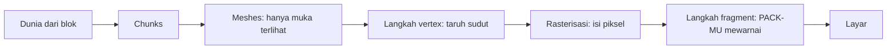

# Bloxd Shader Packs — Panduan lengkap (Bahasa Indonesia)

🌐 [Semua bahasa](README.md) · Lebih dalam: [English](GUIDE-EN.md#part-0--start-from-zero-how-rendering-and-bloxd-shaders-work) · [Français](GUIDE-FR.md)

**Baca ini dulu.** Tidak perlu pengalaman. Dalam sepuluh menit kamu akan tahu bagaimana game
menggambar gambar, apa itu shader, dan apa saja yang bisa dan tidak bisa dilakukan shader pack.

> **Cakupan: API v2.** Panduan ini menjelaskan `apiVersion: 2` dan jalur WebGPU/Lite saat ini. Jangan ubah `apiVersion` secara spekulatif untuk versi mendatang.

## 1. Versi satu menit

- Bloxd.io adalah game voxel: dunia terbuat dari kubus (blok).
- Gambar di layar digambar kartu grafis (GPU), 60 kali atau lebih per detik.
- **Shader** adalah program kecil yang berjalan di GPU dan menentukan warna piksel.
- **Shader pack** adalah file `.zip` kecil berisi kode shader. Game memuatnya dan membiarkan kodemu
  mewarnai ulang **blok, air, dan lava** saat mereka digambar.
- Kamu tidak mengubah game. Kamu hanya mengubah warna dan cahaya, tepat pada saat setiap piksel digambar.

## 2. Bagaimana gambar digambar (web render langkah demi langkah)

Layarmu adalah kisi titik kecil bernama **piksel** (misalnya 1920 × 1080 = sekitar dua juta piksel).
Satu gambar lengkap disebut **frame**. Game menggambar frame baru berulang-ulang — itu yang membuat
gerak terlihat mulus.

Dua prosesor membagi pekerjaan:

| | CPU (prosesor utama) | GPU (kartu grafis) |
|---|---|---|
| Pekerjaan | logika game, fisika, jaringan | menggambar jutaan piksel, sangat cepat, secara paralel |
| Gaya | sedikit pekerja, sangat pintar | ribuan pekerja, masing-masing sangat sederhana |

Di web, rantainya seperti ini:

1. Game berjalan sebagai JavaScript di browser (Chrome atau Edge terbaru terbaik).
2. Game bicara ke GPU lewat **WebGPU**, API grafis modern browser.
3. Di dalam browser, **Dawn** (dengan kompilernya **Tint**) menerjemahkan bahasa shader **WGSL** ke
   instruksi yang dipahami GPU (Direct3D / Metal / Vulkan, tergantung sistem).
4. GPU menjalankan shader dan menaruh frame jadi di layar.

Bloxd sendiri dibangun dengan mesin voxel (**noa-engine**) di atas framework 3D (**Babylon.js**).
Untuk setiap frame, pipeline menggambar melakukan ini:

1. **Chunk.** Dunia dipotong menjadi kolom blok yang disebut chunk. Hanya chunk dekatmu yang disiapkan
   untuk digambar.
2. **Meshing.** Untuk setiap chunk, mesin membangun *mesh*: kulit segitiga yang hanya menutupi
   permukaan blok yang benar-benar terlihat. Permukaan tersembunyi dilewati.
3. **Atlas tekstur.** Setiap muka blok mengambil gambarnya dari satu gambar besar, **atlas**, yang berisi
   semua tekstur blok berdampingan. Setiap muka tahu kotak kecil atlas mana yang dipakainya (koordinat **UV**).
4. **Langkah vertex.** GPU menjalankan *vertex shader* pada setiap sudut (vertex) setiap segitiga:
   menaruh sudut di tempat yang tepat di layarmu dan meneruskan data (koordinat tekstur, nilai cahaya,
   arah muka…).
5. **Rasterisasi.** GPU mengisi setiap segitiga dengan piksel. Setiap piksel tertutup menjadi
   **fragment**: piksel kandidat dengan data terinterpolasi.
6. **Langkah fragment.** GPU menjalankan *fragment shader* untuk setiap fragment: di sinilah warna akhir
   piksel ditentukan. **Di sinilah shader pack Bloxd tinggal.**
7. **Layar.** Frame jadi ditampilkan. Lalu semuanya berulang untuk frame berikutnya.



Ide kunci: pack-mu tidak pernah melihat "dunia". Pack melihat **satu fragment dalam satu waktu** — satu
piksel dari satu muka blok — ditambah beberapa data tentang piksel itu. Segala yang dilakukan pack harus
dihitung dari data lokal itu.

## 3. Apa itu shader

Shader adalah fungsi kecil (sepotong kecil kode) yang dijalankan GPU dalam jumlah besar secara paralel —
sekali per vertex, atau sekali per fragment. Shader harus cepat dan mandiri: tanpa file, tanpa jaringan,
tanpa ingatan frame sebelumnya.

Pack Bloxd ditulis dalam **WGSL** (WebGPU Shading Language). Kamu tidak menulis shader utuh. Mesin sudah punya shadernya; ia membiarkanmu memasukkan kode di enam titik tetap bernama **hooks** (Bagian 5): dua program (terrain dan liquid) × tiga tahap (vertex, surface, light). Di pintu vertex ia bertanya ke mana sudut pergi; di surface dan light ia bertanya bagaimana piksel ini akhirnya terlihat.

## 4. Apa itu shader pack Bloxd

Pack adalah file `.zip` berisi:

```
pack.json     (file metadata kecil)
*.wgsl        (kode WGSL-mu — satu file atau banyak, folder apa pun)
```

`pack.json` hanya perlu:

```json
{ "apiVersion": 2, "name": "My Pack", "author": "kamu" }
```

- `apiVersion` harus persis angka JSON **2** (bukan string). Pack v1 lama ditolak.
- Importer menerima folder atau **satu** `.zip`. Setelah path dinormalkan harus ada tepat satu `pack.json`; folder akar yang dipakai semua file akan dibuang otomatis.
- Manifes adalah objek JSON UTF-8 ≤ **65.536 byte**. `name` tidak boleh kosong setelah dipangkas; `author` opsional string atau `null`; kunci lain diabaikan.
- Sumber: **1–256** file `.wgsl`, diurutkan menurut path; total terdekompresi ≤ **262.144 byte**; path ganda dan UTF-8 tak valid ditolak; file lain diabaikan.
- Zip ≤ **33.554.432 byte** dan ≤ **1.024 entri**; hanya stored/deflate dibaca; Zip64, multi-disk dan terenkripsi ditolak.

Pasang pack: Bloxd → `O` Settings → Graphics → aktifkan **Use New WebGPU Renderer** → Shader Pack → pilih folder atau `.zip` → **Apply** → **muat ulang halaman**. Tanpa WebGPU yang bisa dipakai, pack bisa tersimpan tetapi tetap terblokir.

Pack hanya memengaruhi **blok, air, dan lava**. Beberapa mode game menonaktifkan pack sama sekali.

## 5. Enam hook (satu-satunya pintumu)

| Hook | Kapan berjalan | Apa yang kamu kendalikan |
|---|---|---|
| `bloxdTerrainVertex` | per vertex, terrain, sebelum proyeksi | posisi dunia tiap sudut (hanya game allow) |
| `bloxdTerrainSurface` | per fragment, blok padat, pertama | warna dasar, transparansi (alfa), cahaya sendiri (emission) |
| `bloxdTerrainLight` | fragment yang sama, tepat setelahnya | warna terang akhir blok |
| `bloxdLiquidVertex` | per vertex, cairan, sebelum proyeksi | posisi dunia tiap sudut cairan (hanya game allow) |
| `bloxdLiquidSurface` | per fragment, air dan lava, pertama | warna dasar dan alfa cairan |
| `bloxdLiquidLight` | fragment yang sama, tepat setelahnya | warna terang akhir cairan |

Aturan pintunya:

- Surface berjalan **sebelum** light, di fragment yang sama. Kamu bisa meneruskan nilai dari surface ke
  light dengan variabel level modul (`var<private>`).
- Selalu mulai dari hasil default mesin: `bloxdDefaultSurface(...)` atau `bloxdDefaultLight(...)`, ubah
  yang perlu, lalu kembalikan. Jangan pernah bangun struct hasil sendiri.
- Hook surface berjalan sebelum uji potong transparansi mesin: pada daun dan blok potong, `out.alpha`
  menentukan piksel tetap atau dibuang; pada cairan itu adalah faktor campur sejati; pada blok padat
  biasa alpha tidak berbuat apa-apa.
- Cahaya sendiri (`out.emission`) hanya milik hook **surface**.
- Kalau kamu menulis warna akhirmu sendiri di light hook, terapkan kabut sendiri di akhir dengan
  `bloxdApplyFog(colour, light)` — kabut mesin selalu ada di adegan, dan melewatkannya membuat blok jauh
  bersinar menembus kabut.

- Tahap cairan yang hilang jatuh ke hook terrain pasangannya; pasangan surface/light yang hilang memakai default mesin. Vertex opsional; mulai dari `bloxdDefaultVertex(...)`.
- Hook vertex atau `discard` yang terjangkau tidak menolak pack: program itu mati di strict, dan strict adalah kebijakan default.
- `out.alpha` hanya ada di bawah `BLOXD_ALPHA` (absen hanya terrain+strict); cairan selalu punya alpha. RGB dari light mengganti RGB akhir—pakai `bloxdApplyFog` untuk menjaga fog.

## 6. Apa yang diberitahukan mesin kepadamu

Untuk setiap fragment, hook-mu menerima data. Field paling berguna:

| Data | Arti, dengan kata sederhana |
|---|---|
| `colour` | warna tekstur blok pada piksel ini (dari atlas), sebelum perubahanmu |
| `blockId` | **id numerik** blok (bilangan bulat). Inilah cara memperlakukan satu jenis blok berbeda dari yang lain — tabel lengkap di Bagian VIII |
| `position` | di mana piksel ini di dunia (x, y, z) |
| `normal` | ke mana muka menghadap (atas, bawah, utara…), sebagai vektor |
| `skyLight` | seberapa banyak cahaya langit mencapai blok ini, 0 sampai 1 — tapi **tone-mapped**: langit terbuka ≈ 1.0, kehilangan satu level di bawah pohon ≈ 0.995 (lihat Bagian 7) |
| `blockLight` | cahaya dari lampu, obor, lava… sebagai warna (lampu berwarna ada) |
| `heldLight` | cahaya dari item di tangan pemain |
| `skyLightColour` | warna langit saat ini (biru gelap di malam hari, hangat saat matahari terbenam) |
| `litColour` | warna terang mesin sendiri untuk permukaan ini (berguna sebagai dasar) |
| `fogVisibility`, `fogColour` | seberapa berkabut piksel ini, dan warna kabut (datang **hitam** saat kabut mati — tangani kasus itu) |

Fungsi mesin yang bisa kamu panggil:

| Fungsi | Apa yang kamu dapat |
|---|---|
| `bloxdDefaultSurface(in)` / `bloxdDefaultLight(surface, light)` | hasil normal mesin — selalu titik mulaimu |
| `bloxdDefaultVertex(in)` | hasil vertex tanpa perubahan — titik awal hook vertex |
| `bloxdApplyFog(colour, light)` | mencampurkan warnamu ke kabut dengan benar |
| `bloxdSunDirection()` | vektor satuan menuju Matahari; `(0,0,0)` di dunia tanpa matahari mirip Bumi; bulan persis berlawanan arah |
| `bloxdTime()` | detik — **kembali ke 0 setiap 3600 detik** (`bloxdTimeWrap`). Lihat Bagian 7 |
| `bloxdEyePosition()` | posisi kamera (untuk efek jarak) |
| `bloxdOriginOffset()` | mesin secara berkala mengubah dasar koordinat dunia; tambahkan offset ini ke pola berbasis posisi dunia apa pun, atau pola itu akan meloncat terlihat |
| `bloxdFaceBlock(position, normal)` | sel blok (koordinat bilangan bulat) dari muka yang kamu gambar — sempurna untuk variasi acak per blok |
| `bloxdOpaqueBehind()` | hanya surface/light cairan di bawah `BLOXD_SCENE_DEPTH`: `{found, position, distance}` di belakang piksel tepat ini; ketebalan = `distance` dikurangi mata→permukaan |

## 7. Jebakan yang menjerat semua orang

**Waktu berputar.** `bloxdTime()` menghitung detik tetapi mulai lagi dari 3600. Jika animasimu memakai
waktu mentah, akan ada lompatan sekali per jam. Selalu animasikan dengan siklus utuh di dalam wrap:

```wgsl
sin(6.2831853 * fract(bloxdTime() / bloxdTimeWrap * cycles + phase))
```

Pilih `cycles` sebagai bilangan bulat. Maka nilai di detik 3600 sama dengan di detik 0: tanpa lompatan,
selamanya.

**skyLight di-tone-map.** Itu bukan kecerahan linear 0–1. Mesin memampatkan level cahaya 0–15 menjadi
kurva: langit terbuka ≈ 1.0 dan kehilangan satu level tetap terbaca ≈ 0.995. Jika kamu menguji
`skyLight < 0.5` berharap "di bayangan", hampir tidak ada yang cocok. Kalibrasikan ambang pada kurva
sebenarnya (Bagian IV memberikan nilai terukur).

**Kabut selalu ada.** Bahkan ketika kamu tak bisa melihatnya, mesin menghitung kabut (kadang didorong
sangat jauh). Jika light hook mengembalikan warna tanpa `bloxdApplyFog`, terrain jauh akan terlihat
terlalu terang dan menembus kabut. Terapkan kabut terakhir, setelah pekerjaan warna.

**Unlit tidak menghapus field.** Header memberi nilai netral: `skyLight=1`, `blockLight=0`, `heldLight=0`, `directional=0`, dan warna cahaya putih. Gate logika langit dengan `#ifdef BLOXD_LIGHTING` bila harus mati di unlit.

## 8. Semua yang BISA dilakukan pack

- Mewarnai ulang blok, air, atau lava apa pun — secara global atau per `blockId`.
- Membuat benda bercahaya (`out.emission` di hook surface): lava, bijih, lampu…
- Menganimasikan warna dan alpha seiring waktu (berdenyut, lava mengalir, air berkilau) — tahan wrap
  (Bagian 7).
- Bereaksi terhadap siklus siang/malam lewat `bloxdSunDirection()` dan `skyLightColour` (senja hangat,
  warna bulan biru).
- Menambah detail prosedural yang terjangkar di dunia: variasi halus per blok dengan hash
  `bloxdFaceBlock`, warna kabut jarak jauh, penggelapan bawah air dengan kedalaman `bloxdOpaqueBehind()`.
- Grading seluruh gambar per fragment: kontras, saturasi, keseimbangan hangat/dingin — asalkan kabut
  diterapkan di akhir.
- Mengecat efek *di atas* permukaan: kilau pada bijih, penggelapan "basah" dekat permukaan air, salju
  pada muka yang menghadap ke atas (`normal.y`), dan trik serupa — semuanya dihitung dari data fragment
  itu sendiri.
- Memakai jarak (`bloxdEyePosition()`) untuk memudarkan efek mahal atau berisik (level detail murah).

## 9. Apa yang TIDAK BISA dilakukan pack (batasan mesin)

- **Tanaman, rumput, dan bunga** digambar oleh bagian mesin yang tidak bisa dijangkau pack. Kamu tidak
  bisa mewarnai ulang atau menganimasikan mereka.
- **Tidak ada post-processing.** Tidak ada akses ke frame jadi, tidak ada koordinat layar, tidak ada pass
  blur/bloom/vignette.
- **Tidak ada kedalaman adegan.** Satu-satunya query "apa di belakang ini" ialah `bloxdOpaqueBehind()`
  melalui cairan.
- **Tidak ada shadow map atau ambient occlusion sejati** melampaui apa yang sudah dikode nilai cahaya
  mesin.
- **Tidak ada objek atau partikel baru** di dunia. Kamu hanya bisa melukis pada permukaan yang sudah ada.
  (Pack pintar melukis efek lapisan di atas permukaan — lihat resep — tapi geometri selalu milik mesin.)
- **Tidak ada tekstur atau sampler sendiri**, tidak ada umpan data ekstra: satu-satunya masukanmu ialah
  argumen hook dan fungsi mesin.
- **Gerakan vertex bergantung kebijakan.** Hook vertex nyata, tetapi hanya berjalan di game allow; strict default mematikan program itu. Jangan gantungkan tampilan inti atau keterbacaan pada sudut yang digeser.
- **Langit itu sendiri** (cakram matahari, skybox, awan) digambar oleh mesin. Pack menerima *data* langit
  (arah, corak) tetapi tidak menggambar langit.

Jika efek membutuhkan sesuatu dari daftar ini, tidak ada pack yang bisa melakukannya hari ini — ini
perilaku mesin yang terbukti, bukan masalah keahlian.

## 10. Pack pertamamu dalam lima langkah

1. Buat `pack.json`:

```json
{ "apiVersion": 2, "name": "Pack Pertama Saya", "author": "kamu" }
```

2. Buat `shader.wgsl` di sampingnya:

```wgsl
fn bloxdTerrainSurface(surface: BloxdSurfaceIn) -> BloxdSurface {
    var out = bloxdDefaultSurface(surface);
    out.colour = out.colour * vec3f(1.05, 1.0, 0.92);
    return out;
}

fn bloxdTerrainLight(surface: BloxdSurface, light: BloxdLightIn) -> BloxdLight {
    var out = bloxdDefaultLight(surface, light);
    _ = surface;
    return out;
}
```

Pack ini membuat setiap blok sedikit lebih hangat (lebih merah, kurang biru) dan mempertahankan
pencahayaan mesin. Baris `_ = surface;` memberitahu kompiler "input ini sengaja tidak dipakai" — WGSL
membutuhkan bentuk sederhana ini.

3. Simpan file dalam satu folder untuk impor folder, atau zip bersama. Paling jelas: `pack.json` di samping WGSL pada level atas; satu folder pembungkus bersama juga diterima dan dibuang.

4. Di game: Settings → Graphics → **Use New WebGPU Renderer** on → Shader Pack → pilih folder atau `.zip` → Apply → **muat ulang halaman**.

5. Lihat sekeliling: dunia seharusnya sedikit lebih hangat. Ubah tiga angka dan muat ulang untuk bereksperimen.

Lalu tumbuh selangkah demi selangkah: satu efek pada satu waktu, periksa saat tengah siang, senja, malam,
di bawah air dan di gua sebelum menambah berikutnya.

## 11. Sembilan aturan keras

Melanggar apa pun dari ini merusak pack atau membuatnya ditolak:

1. Jangan definisikan `BLOXD_*` atau nama `bloxd*` selain enam hook. Preprocessor hanya `#define/#ifdef/#ifndef/#else/#endif` di awal baris; `#define` adalah flag global tanpa nilai dan tak boleh di dalam conditional.

2. Jangan bangun `BloxdVertex` / `BloxdSurface` / `BloxdLight` sendiri — mulai dari `bloxdDefaultVertex` / `bloxdDefaultSurface` / `bloxdDefaultLight`.

3. `mod` adalah kata cadangan di WGSL — gunakan `%`.
4. Tanpa atribut `@…`, entry point, tekstur, sampler, `override/enable/requires/diagnostic`, storage class ekstra, identifier double underscore, atau UV layar.

5. Hook vertex atau `discard` terjangkau mematikan program itu di strict (default), bukan menolak pack. Untuk aman di strict, hindari atau gate efeknya.

6. `out.alpha` hanya ada di bawah `BLOXD_ALPHA` (absen hanya terrain+strict). Alpha cairan ada di semua varian; alpha terrain perlu guard.

7. Masukan tak terpakai: tulis `_ = nilai;` — bentuk `let _ =` ditolak.
8. Cap persis: manifes ≤65.536 byte; 1–256 file WGSL; total WGSL ≤262.144 byte; zip ≤33.554.432 byte dan ≤1.024 entri.

9. Mesin membangun **8 varian**: allow/strict × lit/unlit × terrain/liquid. Define: `BLOXD_STRICT`, `BLOXD_LIGHTING`, `BLOXD_SCENE_DEPTH` hanya liquid, `BLOXD_ALPHA` absen hanya terrain+strict. Harus compile dan berperilaku di semua; beri kurung bitwise/shift untuk Tint.

## 12. Glosarium mini

| Kata | Arti |
|---|---|
| Frame | satu gambar lengkap di layar |
| Piksel / fragment | satu titik gambar / piksel kandidat sedang diwarnai |
| Vertex | satu sudut segitiga |
| Mesh | kulit segitiga dibangun dari muka terlihat chunk |
| Atlas (atlas tekstur) | satu gambar besar berisi semua tekstur blok |
| UV | koordinat yang mengatakan bagian atlas mana yang digunakan muka |
| WGSL | bahasa shader WebGPU — bahasa pack Bloxd |
| Hook | salah satu dari enam fungsi mesin yang boleh didefinisikan pack (vertex/surface/light × terrain/liquid) |
| skyLight / blockLight | cahaya dari langit / cahaya dari blok (lampu, lava) |
| Wrap (3600 dtk) | `bloxdTime()` mulai lagi dari 0 setiap jam |
| Kabut (fog) | terrain jauh menyatu ke warna kabut |
| Varian | satu dari 8 cara mesin mengkompilasi pack |

## 13. Referensi persis API v2

Bagian ini adalah referensi persis saat ini; jika ringkasan pendek terdengar lebih sederhana, aturan inilah yang menang. Ini hanya API v2; versi API mendatang perlu verifikasi baru.

- **Impor:** tepat satu manifes setelah normalisasi; `apiVersion` angka 2; manifes ≤65.536 byte; 1–256 `.wgsl` urut path, total ≤262.144 byte; zip ≤33.554.432 byte/1.024 entri, hanya stored/deflate.
- **Varian/define:** allow/strict × lit/unlit × terrain/liquid. `BLOXD_SCENE_DEPTH` hanya liquid; `BLOXD_ALPHA` absen hanya terrain+strict.
- **Strict/unlit:** strict default; vertex/discard mematikan strict alih-alih menolak; unlit memberi `skyLight=1`, block/held/directional nol dan putih.
- **Guard:** alpha terrain di bawah `BLOXD_ALPHA`; depth hanya di surface/light liquid di bawah `BLOXD_SCENE_DEPTH`; `bloxdOpaqueBehind()` dari vertex adalah error.
- **Depth cairan:** snapshot sebelum transparan terrain, piksel tepat, tanpa warna belakang, tak melihat cairan sendiri/transparan sesudahnya; ketebalan optik = `behind.distance − distance(eye, surface.position)`.
- **Runtime:** Lite WebGPU wajib; fallback WebGL = tanpa pack; perubahan berlaku sesudah reload; `bloxdTime()=performance.now()/1000 mod 3600`; kurva skyLight `1−(1−x/(3−2x))³`, `x=level/15`.

## 14. Lebih dalam (bab bahasa Inggris)

| Bagian | File | Isi |
|---|---|---|
| I | [01-making](GUIDE-EN.md#part-i--making-a-pack) | format pack, pemuatan banyak file, batas, distribusi |
| II | [02-api](GUIDE-EN.md#part-ii--the-api-contract) | kontrak hook dan struct lengkap |
| III | [03-recipes](GUIDE-EN.md#part-iii--recipes) | 12 resep produksi dengan kode WGSL |
| IV | [04-realism](GUIDE-EN.md#part-iv--measured-numbers-realism-that-survives-contact-with-the-game) | angka terukur: satuan cahaya, kabut, optik air |
| V | [05-troubleshooting](GUIDE-EN.md#part-v--troubleshooting) | setiap kegagalan yang diketahui dan perbaikannya |
| VI | [06-implementation](GUIDE-EN.md#part-vi--implementation--local-validation) | validasi lokal di 8 varian, pemeriksaan kemasan |
| VII | [07-internals](GUIDE-EN.md#part-vii--engine-internals) | bagian dalam mesin (waktu, pipa cahaya, langit, loader) |
| VIII | [08-block-ids](GUIDE-EN.md#part-viii--the-numeric-block-id-table) | tabel id blok numerik lengkap |
| IX | [09-sources](GUIDE-EN.md#part-ix--where-this-knowledge-comes-from-and-what-we-dont-know) | bagaimana setiap fakta panduan ini ditetapkan |
| X | [10-constants](GUIDE-EN.md#part-x--the-constants-register-en) | setiap konstanta, dengan perannya |

Versi Prancis lengkap: [fr](GUIDE-FR.md) · Semua bahasa: [index](README.md). Lisensi: MIT.
