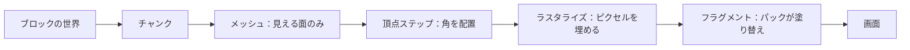

# Bloxd Shader Packs — 完全ガイド（日本語）

🌐 [全言語](README.md) · 深掘り: [English](GUIDE-EN.md#part-0--start-from-zero-how-rendering-and-bloxd-shaders-work) · [Français](GUIDE-FR.md)

**まずこれを読んでください。**経験は要りません。10分で、ゲームがどう絵を描くか、シェーダーとは何か、シェーダーパックにできること・できないことが分かります。

> **対象範囲：API v2。** このガイドは `apiVersion: 2` と現在の WebGPU/Lite 経路を述べます。将来版を予想して `apiVersion` を変えないでください。

## 1. 一分バージョン

- Bloxd.io はボクセルゲームです：世界は立方体（ブロック）でできています。
- 画面の絵はグラフィックカード（GPU）が描きます。1秒に60回以上です。
- **シェーダー**は GPU 上で走る小さなプログラムで、ピクセルの色を決めます。
- **シェーダーパック**はシェーダーコードの入った小さな `.zip` ファイルです。ゲームが読み込み、あなたのコードが描画中の**ブロック・水・溶岩**を塗り替えます。
- ゲーム自体は変わりません。変わるのは色と光だけ、各ピクセルが描かれるその瞬間です。

## 2. 絵はどう描かれるか（Webレンダリング、一歩ずつ）

画面は**ピクセル**という小さな点の格子です（例：1920 × 1080 ≒ 約200万ピクセル）。絵一枚が**フレーム**です。ゲームは新しいフレームを何度も描きます――だから動きがなめらかに見えます。

仕事は2つのプロセッサが分け合います：

| | CPU（メインプロセッサ） | GPU（グラフィックカード） |
|---|---|---|
| 仕事 | ゲームロジック、物理、ネットワーク | 数百万ピクセルを、とても速く、並列に描く |
| スタイル | 少ない労働者、とても賢い | 何千もの労働者、それぞれとても単純 |

Webでは、流れはこうなります：

1. ゲームはブラウザ内の JavaScript として動きます（新しい Chrome か Edge が最適）。
2. ゲームはブラウザの現代グラフィック API、**WebGPU** 経由で GPU と話します。
3. ブラウザ内部で、**Dawn**（コンパイラ **Tint** 付き）がシェーダー言語 **WGSL** を GPU が分かる命令に翻訳します（環境により Direct3D / Metal / Vulkan）。
4. GPU がシェーダーを実行し、完成したフレームを画面に置きます。

Bloxd 自体は、3Dフレームワーク（**Babylon.js**）の上のボクセルエンジン（**noa-engine**）で作られています。各フレーム描画パイプラインはこうします：

1. **チャンク。**世界はチャンクと呼ぶブロックの柱に切られます。描画準備をするのは近くのチャンクだけです。
2. **メッシュ化。**各チャンクについて、エンジンは本当に見えるブロック面だけを覆う三角形の皮、*メッシュ* を作ります。隠れた面は飛ばします。
3. **テクスチャアトラス。**各ブロック面は、全ブロックテクスチャが並んだ一枚の大きな絵、**アトラス** から絵を取ります。各面はアトラスのどの小さい四角を使うか知っています（**UV** 座標）。
4. **頂点ステップ。**GPU は各三角形の各角（頂点）に *頂点シェーダー（バーテックスシェーダー）* を実行します：角を画面の正しい位置に置き、テクスチャ座標や光の値といったデータを流します。
5. **ラスタライズ。**GPU は各三角形をピクセルで埋めます。覆われたピクセルは**フラグメント**になります：補間されたデータつきのピクセル候補です。
6. **フラグメントステップ。**GPU は各フラグメントに *フラグメントシェーダー* を実行します：ピクセルの最終色はここで決まります。**Bloxd のシェーダーパックはここに住みます。**
7. **画面。**完成フレームが表示されます。そして次のフレームのために全部繰り返します。



肝心な点：あなたのパックは「世界」を見ません。見るのは**一度に1フラグメント**――1ブロック面の1ピクセル――と、そのピクセルについての少しのデータです。パックのすることはすべて、その場のデータから計算しなければなりません。

## 3. シェーダーとは

シェーダーは、GPU がおびただしい回数並列に実行する小さい関数（小さいコードのかたまり）です。速くて自己完結でなければなりません：ファイルなし、ネットワークなし、前のフレームの記憶なし。

Bloxd パックは **WGSL**（WebGPU Shading Language）で書きます。シェーダー全体を書くわけではありません。エンジンには既に自前のシェーダーがあり、**フック**と呼ばれる6つの固定点（5節）にあなたのコードを差し込めます：2つのプログラム（terrain と liquid）×3つの段階（vertex、surface、light）です。vertex のドアでは角をどこへ置くか、surface と light のドアではこのピクセルを最終的にどう見せるかを聞かれます.

## 4. Bloxd シェーダーパックとは

パックは次が入った `.zip` ファイルです：

```
pack.json     (小さいメタデータファイル)
*.wgsl        (あなたの WGSL コード — 1ファイルか多数、フォルダ自由)
```

`pack.json` に要るのはこれだけです：

```json
{ "apiVersion": 2, "name": "私のパック", "author": "あなた" }
```

- `apiVersion` はちょうど JSON の数値 **2** でなければなりません（文字列ではありません）。古い v1 パックは拒否されます。
- インポーターはフォルダーか **1つの** `.zip` を受け付けます。パス正規化のあと `pack.json` はちょうど1つでなければならず、全ファイル共通のルートフォルダーは自動で外されます。
- マニフェストは ≤ **65,536 バイト** の UTF-8 JSON オブジェクトです。`name` は前後を削って非空、`author` は任意の文字列または `null`、他のキーは無視されます。
- ソースは **1–256** 個の `.wgsl` をパス順に並べ、展開後合計 ≤ **262,144 バイト**。重複パスと不正な UTF-8 は拒否され、他のファイルは無視されます。
- zip は ≤ **33,554,432 バイト**、≤ **1,024** エントリ。読めるのは stored/deflate だけです。Zip64、マルチディスク、暗号化は拒否されます。

導入手順：Bloxd → `O` 設定 → グラフィックス → **Use New WebGPU Renderer** を有効化 → Shader Pack → フォルダーか `.zip` を選択 → **Apply** → **ページを再読み込み**。使える WebGPU が無い場合、パックは保存されてもブロックされたままです。

パックが影響するのは **ブロック・水・溶岩** だけ。一部ゲームモードはパック全体を無効化します。

## 5. 6つのフック（あなたの唯一のドア）

| フック | いつ走る | あなたが決めること |
|---|---|---|
| `bloxdTerrainVertex` | 頂点ごと、地形、投影前 | 各角のワールド位置（allow ゲームのみ） |
| `bloxdTerrainSurface` | フラグメント毎、固体ブロック、先 | 基本色、透明度（アルファ）、自己発光（emission） |
| `bloxdTerrainLight` | 同一フラグメント、すぐ後 | ブロックの最終的な照らされた色 |
| `bloxdLiquidVertex` | 頂点ごと、液体、投影前 | 各液体の角のワールド位置（allow ゲームのみ） |
| `bloxdLiquidSurface` | フラグメント毎、水・溶岩、先 | 液体の基本色とアルファ |
| `bloxdLiquidLight` | 同一フラグメント、すぐ後 | 液体の最終的な照らされた色 |

ドアの規則：

- Surface は Light **より前に**、同じフラグメントで走ります。module スコープ変数（`var<private>`）で surface から light へ値を渡せます。
- 必ずエンジンのデフォルト結果から始めてください： `bloxdDefaultSurface(...)` か `bloxdDefaultLight(...)`、要るところを変えて、返してください。結果 struct を自分で組み立てるのは厳禁です。
- Surface フックはエンジンの透明カットアウトテストより前に走ります：葉やカットアウトブロックでは `out.alpha` がピクセルを残すか捨てるか決め、液体では本当の合成係数で、普通の固体ブロックでは alpha は無効です。
- 自己発光（`out.emission`）は **surface** フック専用です。
- ライトフックで自分で最終色を書くなら、最後に自分でフォグをかけて下さい： `bloxdApplyFog(colour, light)` 。エンジンのフォグはシーンに常時存在し、飛ばすと遠くのブロックがフォグ越しに光ります。

- 液体の段階が欠ければ対応する terrain フックへ落ちます。surface/light の相手が欠ければ、その fragment 段階はエンジン既定になります。vertex は任意で、`bloxdDefaultVertex(...)` から始めます。
- vertex フックや到達可能な `discard` はパック拒否ではなく、そのプログラムを strict でオフにします。strict は既定の方針です。
- `out.alpha` は `BLOXD_ALPHA` のもとでのみ存在します（terrain+strict のみ欠けます）。液体は常時 alpha を持ちます。light の戻り RGB は最終 RGB を置換するので、霧を保つには `bloxdApplyFog` を使います。

## 6. エンジンが教えてくれること

各フラグメントで、フックはデータを受け取ります。最も便利なフィールド：

| データ | やさしい意味 |
|---|---|
| `colour` | このピクセルのブロックテクスチャ色（アトラスから） |
| `blockId` | ブロックの**数値ID**（整数）。ブロックの種類ごとに扱いを変える手段――完全な表は第VIII部 |
| `position` | このピクセルが世界のどこにあるか (x, y, z) |
| `normal` | 面が向いている方向（上・下・北…）をベクトルで |
| `skyLight` | 空の光がこのブロックにどれほど届くか、0〜1――ただし**トーンマップ済み**：開けた空 ≒ 1.0、木の下で1レベル減 ≒ 0.995（第7節） |
| `blockLight` | ランプ、松明、溶岩の光… 色として（カラーランプ存在） |
| `heldLight` | プレイヤーの手持ちアイテムの光 |
| `skyLightColour` | 現在の空の色合い（夜は暗い青、夕方は暖かい） |
| `litColour` | この面に対するエンジン自身の照らした色（土台に便利） |
| `fogVisibility`, `fogColour` | このピクセルがどれほど霧がかっているか、霧の色（フォグ無効時は**黒**で来る――処理すること） |

呼べるエンジン関数：

| 関数 | 得られるもの |
|---|---|
| `bloxdDefaultSurface(in)` / `bloxdDefaultLight(surface, light)` | エンジンの通常結果――必ず出発点 |
| `bloxdDefaultVertex(in)` | 変更なしの頂点結果 — vertex フックの開始点 |
| `bloxdApplyFog(colour, light)` | 色をフォグへ正しく溶け込ませる |
| `bloxdSunDirection()` | 太陽への単位ベクトル；地球型の太陽がない世界では `(0,0,0)`；月は真反対 |
| `bloxdTime()` | 秒―― **3600秒ごとに0に戻る**（`bloxdTimeWrap`）。第7節参照 |
| `bloxdEyePosition()` | カメラ位置（距離効果に） |
| `bloxdOriginOffset()` | エンジンは定期的に世界座標をリベースします；世界位置ベースのパターンにはこのオフセットを足すこと、さもないとパターンが目に見えて飛ぶ |
| `bloxdFaceBlock(position, normal)` | 描いている面のブロックセル（整数座標）――ブロック単位のランダム変化に最適 |
| `bloxdOpaqueBehind()` | `BLOXD_SCENE_DEPTH` 下の液体 surface/light のみ：このピクセルちょうどの背後にある `{found, position, distance}`。厚さ = `distance` − 目→表面 |

## 7. みんながはまる罠

**時間はラップします。**`bloxdTime()` は秒を数えますが 3600 で再スタート。生の時間を使うとアニメーションが1時間ごとに飛びます。常にラップ内の整数周期でアニメーションしましょう：

```wgsl
sin(6.2831853 * fract(bloxdTime() / bloxdTimeWrap * cycles + phase))
```

`cycles` を整数にすること。3600秒の値が0秒の値と一致します：二度と飛びません。

**skyLight はトーンマップ済み。**線形な0〜1の明るさではありません。エンジンは0〜15の光レベルをカーブへ詰め込みます：開けた空 ≒ 1.0、1レベル減でも ≒ 0.995。`skyLight < 0.5` を「影の中」のつもりでテストすると、ほとんど一致しません。しきい値は実カーブで調整しましょう（第IV部に測定値）。

**フォグは常にある。**見えなくてもエンジンはフォグを計算しています（はるか遠くに押されていることも）。ライトフックが `bloxdApplyFog` なしで返すと、遠くの地形が明るすぎてフォグを突き抜けます。色の仕事の最後にフォグを。

**Unlit はフィールドを消しません。** ヘッダーは中立値を与えます：`skyLight=1`、`blockLight=0`、`heldLight=0`、`directional=0`、白色の光色です。unlit で空のロジックを止める必要があれば `#ifdef BLOXD_LIGHTING` で囲ってください。

## 8. パックにできること全部

- ブロック、水、溶岩の塗り替え――全体でも `blockId` 毎でも。
- 光らせる（surface フックの `out.emission`）：溶岩、鉱石、ランプ…
- 色とアルファの時間アニメーション（脈動、流れる溶岩、きらめく水）――ラップ安全（第7節）。
- `bloxdSunDirection()` と `skyLightColour` で昼夜サイクルに反応（温かい夕焼け、青い月光）。
- 世界に固定の手続きディテール：`bloxdFaceBlock` ハッシュによるブロックごとの僅かな変化、距離フォグ色合い、`bloxdOpaqueBehind()` の深さによる水中暗転。
- フラグメント毎の全画面グレーディング：コントラスト、彩度、寒暖バランス――最後にフォグをかける前提で。
- 面の上に効果を描く：鉱石のきらめき、水位近くの「湿った」暗化、上向き面の雪（`normal.y`）など――すべてフラグメント自身のデータから。
- 距離（`bloxdEyePosition()`）で高い・うるさい効果を薄める（安い詳細度）。

## 9. パックにできないこと（エンジンの限界）

- **植物、草、花**は、パックが届かないエンジン部分が描きます。色替えもアニメーションもできません。
- **ポストプロセスなし。**完成フレームへのアクセスなし、画面座標なし、ブラー/ブルーム/ビネットのパスなし。
- **シーン深度なし。**唯一の「後ろに何がある」は液体越しの `bloxdOpaqueBehind()`。
- **本物のシャドウマップや環境オクルージョンなし**（エンジンが既に光値に込めた以上のものは）。
- **新しい物体や粒子なし。**描けるのは既にある面だけ（賢いパックは面に重ね効果を描けますが――レシピ参照――ジオメトリは常にエンジンのもの）。
- **自分のテクスチャやサンプラーなし**、余分なデータなし：入力はフック引数とエンジン関数だけです。
- **頂点移動は方針に依存します。** vertex フックは実在しますが allow ゲームでのみ動き、既定の strict はそのプログラムをオフにします。中心となる見た目や読みやすさを、動く角に依存させてはいけません。
- **空そのもの**（太陽円盤、スカイボックス、雲）はエンジンが描きます。パックは空の「データ」（方向・色合い）を受け取るだけで空は描きません。

この一覧の何かが要る効果は、今日どのパックにもできません――証明済みのエンジン挙動であり、技量の問題ではありません。

## 10. 5つの手順で初パック

1. `pack.json` を作る：

```json
{ "apiVersion": 2, "name": "私の初パック", "author": "あなた" }
```

2. 隣に `shader.wgsl` を作る：

```wgsl
fn bloxdTerrainSurface(surface: BloxdSurfaceIn) -> BloxdSurface {
    var out = bloxdDefaultSurface(surface);
    out.colour = out.colour * vec3f(1.05, 1.0, 0.92);
    return out;
}

fn bloxdTerrainLight(surface: BloxdSurface, light: BloxdLightIn) -> BloxdLight {
    var out = bloxdDefaultLight(surface, light);
    _ = surface;
    return out;
}
```

このパックはすべてのブロックを少し温かくし（赤多め、青少なめ）、エンジンの照明は保持します。`_ = surface;` はコンパイラへ「この入力はわざと未使用」と伝えます――WGSL はこの裸の形を要求します。

3. フォルダー取り込み用にファイルを1フォルダーへ置くか、zip にまとめます。最も分かりやすいのは最上位で `pack.json` を WGSL の隣に置く形で、全ファイル共通の包みフォルダー1つも受け付けられ、取り除かれます。

4. ゲーム内：設定 → グラフィックス → **Use New WebGPU Renderer** オン → Shader Pack → フォルダーか `.zip` を選択 → Apply → **ページを再読み込み**。

5. 見回してみてください：世界が少し温かくなるはずです。3つの数字を変えて再読み込みし、実験を。

あとは少しずつ育てましょう：効果は1つずつ。次を足す前に、昼、夕方、夜、水中、洞窟で確認を。

## 11. 9つの鉄則

どれか破るとパックが壊れるか拒否されます：

1. `BLOXD_*` や、6つのフック以外の `bloxd*` 名を定義してはいけません。ディレクティブは行頭の `#define/#ifdef/#ifndef/#else/#endif` のみ。`#define` は値なしの全体フラグで、条件分岐内には置けません。

2. `BloxdVertex` / `BloxdSurface` / `BloxdLight` を自作せず、`bloxdDefaultVertex` / `bloxdDefaultSurface` / `bloxdDefaultLight` から始めます。

3. `mod` は WGSL の予約語―― `%` を。
4. `@…` 属性、エントリポイント、テクスチャ、サンプラー、`override/enable/requires/diagnostic`、追加ストレージクラス、二重アンダースコア識別子、画面UVは禁止です。

5. vertex フックや到達可能な `discard` は、拒否ではなく strict（既定）でそのプログラムをオフにします。strict 安全にするには避けるか、効果を囲ってください。

6. `out.alpha` は `BLOXD_ALPHA` のもとでのみ存在します（terrain+strict のみ欠缺）。液体 alpha は全バリアントにあり、地形 alpha はガードが要ります。

7. 未使用入力は `_ = 値;` ―― `let _ =` は拒否されます。
8. 正確な上限制限：マニフェスト ≤65,536 bytes、WGSL 1–256 個、WGSL 合計 ≤262,144 bytes、zip ≤33,554,432 bytes かつ ≤1,024 エントリ。

9. エンジンは **8バリアント**をビルドします：allow/strict × lit/unlit × terrain/liquid。define は `BLOXD_STRICT`、`BLOXD_LIGHTING`、`BLOXD_SCENE_DEPTH`（液体のみ）、`BLOXD_ALPHA`（terrain+strict のみ欠缺）。すべてでコンパイルと動作が必要です。Tint 向けに bitwise/shift を括弧で囲ってください。

## 12. ミニ用語集

| 用語 | 意味 |
|---|---|
| フレーム | 画面の絵一枚 |
| ピクセル / フラグメント | 絵の一点 / 塗られているピクセル候補 |
| 頂点 | 三角形の角 |
| メッシュ | チャンクの見える面から作った三角形の皮 |
| アトラス（テクスチャアトラス） | 全ブロックテクスチャ入りの大きな一枚画 |
| UV | 面がアトラスのどの部分を使うかの座標 |
| WGSL | WebGPU のシェーダー言語――Bloxd パックの言語 |
| フック | パックが定義できる6つのエンジン関数の1つ（vertex/surface/light × terrain/liquid） |
| skyLight / blockLight | 空の光 / ブロックの光（ランプ、溶岩） |
| ラップ（3600秒） | `bloxdTime()` が毎時0に戻ること |
| フォグ | 遠景が霧色へ溶ける |
| バリアント | エンジンがパックをコンパイルする8通り |

## 13. API v2 正確なリファレンス

この節が現在の正確なリファレンスです。短い要約がもっと簡単に聞こえても、ここが優先します。API v2 のみを述べます。将来の API 版は改めて検証が必要です。

- **取り込み：** 正規化後マニフェストはちょうど1つ、`apiVersion` 数値2、マニフェスト ≤65,536 bytes、`.wgsl` 1–256 をパス順で合計 ≤262,144 bytes、zip ≤33,554,432 bytes/1,024 エントリで stored/deflate のみ。
- **バリアント/define：** allow/strict × lit/unlit × terrain/liquid。`BLOXD_SCENE_DEPTH` は液体のみ、`BLOXD_ALPHA` は terrain+strict のみ欠けます。
- **Strict/unlit：** strict が既定。vertex/discard は拒否ではなく strict をオフにします。unlit は `skyLight=1`、block/held/directional 0、白色を与えます。
- **ガード：** 地形 alpha は `BLOXD_ALPHA` 下、深度は `BLOXD_SCENE_DEPTH` 下の液体 surface/light のみ。vertex から `bloxdOpaqueBehind()` はエラーです。
- **液体深度：** 地形の透明物より前のスナップショット、ピクセルちょうど、背後の色なし、自分自身と後続の透明物は見えません。光学的厚さ = `behind.distance − distance(eye, surface.position)`。
- **実行時：** Lite WebGPU が必須。WebGL フォールバックではパックなし。変更は再読み込み後に有効。`bloxdTime()=performance.now()/1000 mod 3600`。skyLight 曲線 `1−(1−x/(3−2x))³`、`x=level/15`。

## 14. 深掘り（英語章）

| 部 | ファイル | 内容 |
|---|---|---|
| I | [01-making](GUIDE-EN.md#part-i--making-a-pack) | パック形式、複数ファイル、制限、配布 |
| II | [02-api](GUIDE-EN.md#part-ii--the-api-contract) | フックと struct の完全契約 |
| III | [03-recipes](GUIDE-EN.md#part-iii--recipes) | WGSLコード付き実用レシピ12 |
| IV | [04-realism](GUIDE-EN.md#part-iv--measured-numbers-realism-that-survives-contact-with-the-game) | 測定値：光・フォグ・水の光学 |
| V | [05-troubleshooting](GUIDE-EN.md#part-v--troubleshooting) | 既知の失敗すべてと修正 |
| VI | [06-implementation](GUIDE-EN.md#part-vi--implementation--local-validation) | 8バリアントのローカル検証、梱包確認 |
| VII | [07-internals](GUIDE-EN.md#part-vii--engine-internals) | エンジン内部（時間、光経路、空、ローダー） |
| VIII | [08-block-ids](GUIDE-EN.md#part-viii--the-numeric-block-id-table) | 数値ブロックID完全表 |
| IX | [09-sources](GUIDE-EN.md#part-ix--where-this-knowledge-comes-from-and-what-we-dont-know) | 本ガイドの各事実の根拠 |
| X | [10-constants](GUIDE-EN.md#part-x--the-constants-register-en) | 役割付きで定数すべて |

フランス語完全版： [fr](GUIDE-FR.md) · 全言語： [目次](README.md)。ライセンス： MIT。
