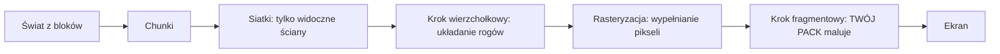

# Bloxd Shader Packs — Kompletny przewodnik (Polski)

🌐 [Wszystkie języki](README.md) · Pogłębienie: [English](GUIDE-EN.md#part-0--start-from-zero-how-rendering-and-bloxd-shaders-work) · [Français](GUIDE-FR.md)

**Przeczytaj to najpierw.** Doświadczenie nie jest potrzebne. Za dziesięć minut będziesz wiedzieć,
jak gra rysuje obraz, czym jest shader i dokładnie, co shader pack może, a czego nie może.

> **Zakres: API v2.** Ten przewodnik opisuje `apiVersion: 2` i bieżącą ścieżkę WebGPU/Lite. Nie zmieniaj `apiVersion` spekulacyjnie pod przyszłą wersję.

## 1. Wersja jednominutowa

- Bloxd.io to gra wokselowa: świat składa się z sześcianów (bloków).
- Obraz na ekranie rysuje karta graficzna (GPU), 60 lub więcej razy na sekundę.
- **Shader** to malutki program, który działa na GPU i decyduje o kolorze pikseli.
- **Shader pack** to mały plik `.zip` z kodem shadera. Gra go ładuje i pozwala twojemu kodowi
  przemalować **bloki, wodę i lawę** w trakcie ich rysowania.
- Nie zmieniasz gry. Zmieniasz tylko kolory i światło, dokładnie w momencie rysowania każdego piksela.

## 2. Jak rysowany jest obraz (rendering webowy krok po kroku)

Ekran to siatka maleńkich punktów zwanych **pikselami** (na przykład 1920 × 1080 = około dwa miliony
pikseli). Jeden pełny obraz to **klatka** (frame). Gra rysuje nową klatkę w kółko — dzięki temu ruch
wygląda płynnie.

Pracę dzielą dwa procesory:

| | CPU (procesor główny) | GPU (karta graficzna) |
|---|---|---|
| Zadanie | logika gry, fizyka, sieć | rysowanie milionów pikseli, bardzo szybko, równolegle |
| Styl | kilku pracowników, bardzo mądrych | tysiące pracowników, każdy bardzo prosty |

W internecie łańcuch wygląda tak:

1. Gra działa jako JavaScript w przeglądarce (najnowszy Chrome lub Edge działa najlepiej).
2. Gra rozmawia z GPU przez **WebGPU**, nowoczesne API graficzne przeglądarki.
3. W przeglądarce **Dawn** (z kompilatorem **Tint**) tłumaczy język shaderów **WGSL** na instrukcje
   zrozumiałe dla twojego GPU (Direct3D / Metal / Vulkan, zależnie od systemu).
4. GPU wykonuje shadery i pokazuje gotową klatkę na ekranie.

Sam Bloxd jest zbudowany na silniku wokselowym (**noa-engine**) na frameworku 3D (**Babylon.js**).
Dla każdej klatki potok rysowania robi to:

1. **Chunki.** Świat jest pocięty na kolumny bloków zwane chunkami. Do rysowania przygotowywane są
   tylko chunki blisko ciebie.
2. **Meshing.** Dla każdego chunka silnik buduje *siatkę* (mesh): skórę z trójkątów pokrywającą tylko
   naprawdę widoczne ściany bloków. Ukryte ściany są pomijane.
3. **Atlas tekstur.** Każda ściana bloku bierze obraz z jednego dużego obrazu — **atlasu** — który zawiera
   wszystkie tekstury bloków obok siebie. Każda ściana wie, którego małego kwadracika atlasu użyć
   (współrzędne **UV**).
4. **Krok wierzchołkowy.** GPU uruchamia *vertex shader* na każdym rogu (wierzchołku) każdego trójkąta:
   stawia róg we właściwym miejscu ekranu i przekazuje dane (współrzędne tekstury, wartości światła,
   kierunek ściany…).
5. **Rasteryzacja.** GPU wypełnia każdy trójkąt pikselami. Każdy pokryty piksel staje się **fragmentem**:
   pikselem-kandydatem z interpolowanymi danymi.
6. **Krok fragmentowy.** GPU uruchamia *fragment shader* dla każdego fragmentu: tutaj decyduje się
   finalny kolor piksela. **Tutaj żyją shader packi Bloxda.**
7. **Ekran.** Gotowa klatka jest pokazywana. Potem wszystko powtarza się dla następnej klatki.



Kluczowa myśl: twój pack nigdy nie widzi „świata". Widzi **jeden fragment naraz** — jeden piksel jednej
ściany bloku — plus trochę danych o tym pikselu. Wszystko, co robi pack, musi być policzone z tych
lokalnych danych.

## 3. Czym jest shader

Shader to mała funkcja (mały kawałek kodu), którą GPU wykonuje ogromną liczbę razy równolegle — raz na
wierzchołek albo raz na fragment. Musi być szybki i samodzielny: bez plików, bez sieci, bez pamięci
poprzedniej klatki.

Paczki Bloxda pisze się w **WGSL** (WebGPU Shading Language). Nie piszesz całego shadera. Silnik ma już własne shadery; pozwala wstawić kod w sześciu stałych punktach zwanych **hookami** (sekcja 5): dwa programy (terrain i liquid) × trzy etapy (vertex, surface, light). Przy drzwiach vertex pyta, gdzie idzie róg; przy surface i light pyta, jak ten piksel ma w końcu wyglądać.

## 4. Czym jest shader pack Bloxda

Pack to plik `.zip` z:

```
pack.json     (mały plik metadanych)
*.wgsl        (twój kod WGSL — jeden plik lub wiele, w dowolnych folderach)
```

`pack.json` potrzebuje tylko:

```json
{ "apiVersion": 2, "name": "Mój Pack", "author": "ty" }
```

- `apiVersion` musi być dokładnie liczbą JSON **2** (nie stringiem). Stare paczki v1 są odrzucane.
- Importer przyjmuje folder albo **jeden** `.zip`. Po normalizacji ścieżek musi zostać dokładnie jeden `pack.json`; wspólny folder główny wszystkich plików jest usuwany automatycznie.
- Manifest to obiekt JSON w UTF-8, ≤ **65 536 bajtów**. `name` nie może być puste po przycięciu; `author` to opcjonalny string albo `null`; inne klucze są ignorowane.
- Źródła: **1–256** plików `.wgsl`, sortowanych po ścieżce; suma po rozpakowaniu ≤ **262 144 bajty**; zduplikowane ścieżki i błędne UTF-8 są odrzucane; inne pliki ignorowane.
- Zip może mieć ≤ **33 554 432 bajty** i ≤ **1 024 wpisy**; czytane są tylko stored/deflate; Zip64, multi-disk i szyfrowane są odrzucane.

Instalacja: Bloxd → `O` Ustawienia → Grafika → włącz **Use New WebGPU Renderer** → Shader Pack → wybierz folder albo `.zip` → **Apply** → **przeładuj stronę**. Bez użytecznego WebGPU paczka może zostać zapisana, ale zablokowana.

Pack wpływa tylko na **bloki, wodę i lawę**. Niektóre tryby gry całkowicie wyłączają packi.

## 5. Sześć hooków (twoje jedyne drzwi)

| Hook | Kiedy działa | Co kontrolujesz |
|---|---|---|
| `bloxdTerrainVertex` | na wierzchołek, teren, przed rzutowaniem | pozycja świata każdego rogu (tylko gry allow) |
| `bloxdTerrainSurface` | per fragment, bloki stałe, najpierw | kolor podstawowy, przezroczystość (alfa), własne świecenie (emission) |
| `bloxdTerrainLight` | ten sam fragment, zaraz potem | finalny oświetlony kolor bloków |
| `bloxdLiquidVertex` | na wierzchołek, ciecze, przed rzutowaniem | pozycja świata każdego rogu cieczy (tylko gry allow) |
| `bloxdLiquidSurface` | per fragment, woda i lawa, najpierw | kolor podstawowy i alfa cieczy |
| `bloxdLiquidLight` | ten sam fragment, zaraz potem | finalny oświetlony kolor cieczy |

Zasady drzwi:

- Surface działa **przed** light, w tym samym fragmencie. Możesz przekazać wartość z surface do light
  zmienną na poziomie modułu (`var<private>`).
- Zawsze zaczynaj od domyślnego wyniku silnika: `bloxdDefaultSurface(...)` lub `bloxdDefaultLight(...)`,
  zmień, co trzeba, i zwróć. Nigdy nie buduj structów wynikowych sam.
- Hooki surface działają przed testem wycinania przezroczystości silnika: na liściach i wycinanych blokach
  `out.alpha` decyduje, czy piksel zostaje czy jest odrzucony; na cieczach to prawdziwy współczynnik
  mieszania; na zwykłych blokach stałych alfa nie robi nic.
- Własne świecenie (`out.emission`) należy tylko do hooków **surface**.
- Jeśli piszesz własny kolor końcowy w hooku light, nałóż mgłę sam na końcu przez
  `bloxdApplyFog(colour, light)` — mgła silnika jest zawsze w scenie, a jej pominięcie sprawia, że dalekie
  bloki świecą przez mgłę.

- Brakujący etap cieczy spada na odpowiadający hook terenu; brakująca para surface/light używa domyślnego etapu silnika. Vertex jest opcjonalny; startuj od `bloxdDefaultVertex(...)`.
- Hook vertex albo osiągalny `discard` nie odrzuca paczki: wyłącza ten program w strict, a strict to polityka domyślna.
- `out.alpha` istnieje tylko pod `BLOXD_ALPHA` (brakuje tylko terrain+strict); ciecze zawsze mają alpha. RGB zwrócone przez light zastępuje finalne RGB — użyj `bloxdApplyFog`, by zachować mgłę.

## 6. Co silnik ci mówi

Dla każdego fragmentu twoje hooki dostają dane. Najprzydatniejsze pola:

| Dane | Znaczenie, prostymi słowami |
|---|---|
| `colour` | kolor tekstury bloku w tym pikselu (z atlasu), przed twoimi zmianami |
| `blockId` | **numeryczne id** bloku (liczba całkowita). Tak traktujesz jeden typ bloku inaczej niż inny — pełna tabela w Części VIII |
| `position` | gdzie ten piksel jest w świecie (x, y, z) |
| `normal` | w którą stronę patrzy ściana (góra, dół, północ…), jako wektor |
| `skyLight` | ile światła nieba dociera do bloku, 0 do 1 — ale **po tone mappingu**: otwarte niebo ≈ 1.0, jeden zgubiony poziom pod drzewem ≈ 0.995 (zobacz Sekcję 7) |
| `blockLight` | światło lamp, pochodni, lawy… jako kolor (kolorowe lampy istnieją) |
| `heldLight` | światło przedmiotu w ręce gracza |
| `skyLightColour` | aktualny odcień nieba (ciemnoniebieski nocą, ciepły o zachodzie) |
| `litColour` | własny oświetlony kolor silnika dla tej powierzchni (przydatny jako baza) |
| `fogVisibility`, `fogColour` | jak zamglony jest piksel i kolor mgły (przychodzi **czarny**, gdy mgła jest wyłączona — obsłuż ten przypadek) |

Funkcje silnika, które możesz wywołać:

| Funkcja | Co ci daje |
|---|---|
| `bloxdDefaultSurface(in)` / `bloxdDefaultLight(surface, light)` | normalny wynik silnika — zawsze twój punkt startu |
| `bloxdDefaultVertex(in)` | niezmieniony wynik vertex — punkt startu hooków vertex |
| `bloxdApplyFog(colour, light)` | poprawnie wtapia twój kolor we mgłę |
| `bloxdSunDirection()` | wektor jednostkowy do słońca; `(0,0,0)` w światach bez słońca ziemskiego typu; księżyc to dokładnie przeciwny kierunek |
| `bloxdTime()` | sekundy — **wraca do 0 co 3600 sekund** (`bloxdTimeWrap`). Zobacz Sekcję 7 |
| `bloxdEyePosition()` | pozycja kamery (do efektów odległości) |
| `bloxdOriginOffset()` | silnik okresowo przebazowuje współrzędne świata; dodaj ten offset do każdego wzoru opartego na pozycji w świecie, bo wzór będzie widocznie skakał |
| `bloxdFaceBlock(position, normal)` | komórka bloku (współrzędne całkowite) rysowanej ściany — idealna do losowej wariacji per blok |
| `bloxdOpaqueBehind()` | tylko surface/light cieczy pod `BLOXD_SCENE_DEPTH`: `{found, position, distance}` za dokładnie tym pikselem; grubość = `distance` minus oko→powierzchnia |

## 7. Pułapki, w które wpadają wszyscy

**Czas się zawija.** `bloxdTime()` liczy sekundy, ale zaczyna od nowa przy 3600. Jeśli animacja używa
surowego czasu, skoczy raz na godzinę. Zawsze animuj pełnymi cyklami wewnątrz wrapa:

```wgsl
sin(6.2831853 * fract(bloxdTime() / bloxdTimeWrap * cycles + phase))
```

Wybierz `cycles` jako liczbę całkowitą. Wtedy wartość w sekundzie 3600 równa się tej w sekundzie 0:
żadnych skoków, nigdy.

**skyLight ma tone mapping.** To nie jest liniowa jasność 0–1. Silnik ściska poziomy światła 0–15 w krzywą:
otwarte niebo to ≈ 1.0, a utrata jednego poziomu to wciąż ≈ 0.995. Jeśli testujesz `skyLight < 0.5` w
oczekiwaniu „w cieniu", prawie nic nie pasuje. Kalibruj progi na prawdziwej krzywej (Część IV podaje
zmierzone wartości).

**Mgła jest zawsze.** Nawet gdy jej nie widzisz, silnik liczy mgłę (czasem odepchniętą bardzo daleko).
Jeśli twój hook light zwróci kolor bez `bloxdApplyFog`, daleki teren będzie za jasny i przebije mgłę.
Mgłę nakładaj na końcu, po pracy z kolorem.

**Unlit nie usuwa pól.** Nagłówek daje wartości neutralne: `skyLight=1`, `blockLight=0`, `heldLight=0`, `directional=0` i białe kolory światła. Bramkuj logikę nieba przez `#ifdef BLOXD_LIGHTING`, gdy w unlit ma być wyłączona.

## 8. Wszystko, co pack MOŻE

- Przemalować dowolny blok, wodę czy lawę — globalnie albo per `blockId`.
- Świecić rzeczami (`out.emission` w hookach surface): lawa, rudy, lampy…
- Animować kolor i alfę w czasie (pulsowanie, płynąca lawa, migocząca woda) — odporne na wrap (Sekcja 7).
- Reagować na cykl dnia i nocy przez `bloxdSunDirection()` i `skyLightColour` (ciepłe zachody, niebieskie
  odcienie księżyca).
- Dodawać proceduralne detale zakotwiczone w świecie: subtelna wariacja per blok hashami
  `bloxdFaceBlock`, odcienie mgły z odległością, przyciemnienie pod wodą z głębokością
  `bloxdOpaqueBehind()`.
- Kolorować (gradować) cały obraz per fragment: kontrast, nasycenie, balans ciepły/zimny — pod warunkiem
  nałożenia mgły na końcu.
- Malować efekty *na* powierzchniach: błyski na rudach, „mokre" przyciemnienie przy poziomie wody, śnieg
  na ścianach do góry (`normal.y`) i podobne triki — wszystko liczone z danych samego fragmentu.
- Używać odległości (`bloxdEyePosition()`), by wygaszać drogie albo zaszumione efekty (tani poziom detali).

## 9. Czego pack NIE MOŻE (granice silnika)

- **Rośliny, trawa i kwiaty** są rysowane przez część silnika niedostępną dla packów. Nie możesz ich
  przemalować ani animować.
- **Brak post-processingu.** Brak dostępu do gotowej klatki, brak współrzędnych ekranu, brak przejść
  blur/bloom/winieta.
- **Brak głębi sceny.** Jedyne zapytanie „co jest za tym" to `bloxdOpaqueBehind()` przez ciecz.
- **Brak prawdziwych map cieni ani ambient occlusion** ponad to, co wartości światła silnika już kodują.
- **Brak nowych obiektów ani cząsteczek** w świecie. Możesz malować tylko na powierzchniach, które już
  istnieją. (Sprytne packi malują efekty nakładane na powierzchnie — zobacz przepisy — ale geometria zawsze
  należy do silnika.)
- **Brak własnych tekstur i samplerów**, brak dodatkowych źródeł danych: twoje jedyne wejścia to argumenty
  hooków i funkcje silnika.
- **Ruch wierzchołków zależy od polityki.** Hooki vertex są prawdziwe, ale działają tylko w grach allow; domyślny strict wyłącza ten program. Nie opieraj kluczowego wyglądu ani czytelności na ruszonych rogach.
- **Samo niebo** (tarcza słońca, skybox, chmury) rysuje silnik. Packi dostają *dane* nieba (kierunek,
  odcień), ale nie rysują nieba.

Jeśli efekt potrzebuje czegoś z tej listy, dziś żaden pack tego nie zrobi — to udowodnione zachowanie
silnika, nie kwestia umiejętności.

## 10. Twój pierwszy pack w pięciu krokach

1. Utwórz `pack.json`:

```json
{ "apiVersion": 2, "name": "Mój Pierwszy Pack", "author": "ty" }
```

2. Utwórz obok `shader.wgsl`:

```wgsl
fn bloxdTerrainSurface(surface: BloxdSurfaceIn) -> BloxdSurface {
    var out = bloxdDefaultSurface(surface);
    out.colour = out.colour * vec3f(1.05, 1.0, 0.92);
    return out;
}

fn bloxdTerrainLight(surface: BloxdSurface, light: BloxdLightIn) -> BloxdLight {
    var out = bloxdDefaultLight(surface, light);
    _ = surface;
    return out;
}
```

Ten pack robi każdy blok trochę cieplejszym (więcej czerwieni, mniej niebieskiego) i zachowuje oświetlenie
silnika. Linia `_ = surface;` mówi kompilatorowi „to wejście jest celowo nieużywane" — WGSL wymaga tej
prostej formy.

3. Zostaw pliki w jednym folderze do importu folderu albo spakuj je zipem. Najczytelniej: `pack.json` obok WGSL na najwyższym poziomie; jeden wspólny folder-opakowanie też jest akceptowany i usuwany.

4. W grze: Ustawienia → Grafika → **Use New WebGPU Renderer** wł. → Shader Pack → wybierz folder albo `.zip` → Apply → **przeładuj stronę**.

5. Rozejrzyj się: świat powinien być trochę cieplejszy. Zmień trzy liczby i przeładuj, by eksperymentować.

Potem rośnij krok po kroku: jeden efekt naraz, sprawdź go w południe, o zachodzie, nocą, pod wodą i w
jaskini, zanim dodasz następny.

## 11. Dziewięciu twardych zasad

Złamanie którejkolwiek psuje pack albo kończy się odrzuceniem:

1. Nie definiuj `BLOXD_*` ani żadnej nazwy `bloxd*` poza sześcioma hookami. Dyrektywy tylko `#define/#ifdef/#ifndef/#else/#endif` na początku linii; `#define` to bezwartościowa globalna flaga i nie może być w conditionalu.

2. Nie buduj `BloxdVertex` / `BloxdSurface` / `BloxdLight` sam — startuj od `bloxdDefaultVertex` / `bloxdDefaultSurface` / `bloxdDefaultLight`.

3. `mod` to słowo zastrzeżone w WGSL — używaj `%`.
4. Bez atrybutów `@…`, entry pointów, tekstur, samplerów, `override/enable/requires/diagnostic`, ekstra storage class, nazw z podwójnym podkreśleniem i UV ekranu.

5. Hook vertex albo osiągalny `discard` wyłącza ten program w strict (domyślnie), zamiast odrzucać paczkę. Dla bezpieczeństwa strict unikaj ich albo bramkuj efekt.

6. `out.alpha` istnieje tylko pod `BLOXD_ALPHA` (brak tylko terrain+strict). Alpha cieczy istnieje w każdym wariancie; alpha terenu trzeba bramkować.

7. Nieużywane wejścia: pisz `_ = wartość;` — forma `let _ =` jest odrzucana.
8. Dokładne limity: manifest ≤65 536 bajtów; 1–256 plików WGSL; WGSL razem ≤262 144 bajty; zip ≤33 554 432 bajty i ≤1 024 wpisy.

9. Silnik buduje **8 wariantów**: allow/strict × lit/unlit × terrain/liquid. Define'y: `BLOXD_STRICT`, `BLOXD_LIGHTING`, `BLOXD_SCENE_DEPTH` tylko liquid, `BLOXD_ALPHA` brak tylko terrain+strict. Ma się kompilować i działać we wszystkich; nawiasuj bitwise/shift dla Tint.

## 12. Mini słowniczek

| Słowo | Znaczenie |
|---|---|
| Klatka (frame) | jeden kompletny obraz na ekranie |
| Piksel / fragment | jeden punkt obrazu / piksel-kandydat w trakcie kolorowania |
| Wierzchołek | róg trójkąta |
| Siatka (mesh) | skóra trójkątów zbudowana z widocznych ścian chunka |
| Atlas (atlas tekstur) | jeden duży obraz ze wszystkimi teksturami bloków |
| UV | współrzędne mówiące, którą część atlasu używa ściana |
| WGSL | język shaderów WebGPU — język packów Bloxda |
| Hook | jedna z sześciu funkcji silnika, które paczka może definiować (vertex/surface/light × terrain/liquid) |
| skyLight / blockLight | światło z nieba / światło z bloków (lampy, lawa) |
| Wrap (3600 s) | `bloxdTime()` wraca do 0 co godzinę |
| Mgła (fog) | daleki teren wtapia się w kolor mgły |
| Wariant | jeden z 8 sposobów, w jaki silnik kompiluje twój pack |

## 13. Dokładna referencja API v2

Ta sekcja to bieżąca dokładna referencja; jeśli krótki opis gdzie indziej brzmi prościej, wygrywają te zasady. Opisuje tylko API v2; przyszła wersja API będzie wymagać nowego sprawdzenia.

- **Import:** dokładnie jeden manifest po normalizacji; `apiVersion` liczba 2; manifest ≤65 536 bajtów; 1–256 `.wgsl` po ścieżce, suma ≤262 144 bajty; zip ≤33 554 432 bajty/1 024 wpisy, tylko stored/deflate.
- **Warianty/define'y:** allow/strict × lit/unlit × terrain/liquid. `BLOXD_SCENE_DEPTH` tylko liquid; `BLOXD_ALPHA` brak tylko terrain+strict.
- **Strict/unlit:** strict jest domyślny; vertex/discard wyłączają strict zamiast odrzucać; unlit daje `skyLight=1`, block/held/directional zero i biel.
- **Bramki:** alpha terenu pod `BLOXD_ALPHA`; głębia tylko w liquid surface/light pod `BLOXD_SCENE_DEPTH`; `bloxdOpaqueBehind()` z vertex to błąd.
- **Głębia cieczy:** snapshot przed transparentami terenu, dokładnie jeden piksel, bez koloru z tyłu, nie widzi siebie ani późniejszych transparentów; grubość optyczna = `behind.distance − distance(eye, surface.position)`.
- **Runtime:** wymagane Lite WebGPU; fallback WebGL = brak paczki; zmiany po reloadzie; `bloxdTime()=performance.now()/1000 mod 3600`; krzywa skyLight `1−(1−x/(3−2x))³`, `x=level/15`.

## 14. Głębiej (rozdziały po angielsku)

| Część | Plik | Zawartość |
|---|---|---|
| I | [01-making](GUIDE-EN.md#part-i--making-a-pack) | format packa, ładowanie wieloplikowe, limity, dystrybucja |
| II | [02-api](GUIDE-EN.md#part-ii--the-api-contract) | pełny kontrakt hooków i structów |
| III | [03-recipes](GUIDE-EN.md#part-iii--recipes) | 12 przepisów produkcyjnych z kodem WGSL |
| IV | [04-realism](GUIDE-EN.md#part-iv--measured-numbers-realism-that-survives-contact-with-the-game) | zmierzone liczby: światło, mgła, optyka wody |
| V | [05-troubleshooting](GUIDE-EN.md#part-v--troubleshooting) | każdy znany błąd i jego naprawa |
| VI | [06-implementation](GUIDE-EN.md#part-vi--implementation--local-validation) | lokalna walidacja w 8 wariantach |
| VII | [07-internals](GUIDE-EN.md#part-vii--engine-internals) | wnętrze silnika (czas, światło, niebo, loader) |
| VIII | [08-block-ids](GUIDE-EN.md#part-viii--the-numeric-block-id-table) | pełna numeryczna tabela id bloków |
| IX | [09-sources](GUIDE-EN.md#part-ix--where-this-knowledge-comes-from-and-what-we-dont-know) | jak ustalono każdy fakt tego przewodnika |
| X | [10-constants](GUIDE-EN.md#part-x--the-constants-register-en) | każda stała (551) z jej rolą |

Pełna wersja francuska: [fr](GUIDE-FR.md) · Wszystkie języki: [index](README.md). Licencja: MIT.
