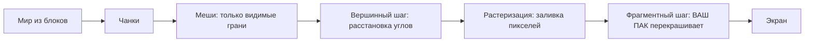

# Bloxd Shader Packs — Полное руководство (Русский)

🌐 [Все языки](README.md) · Углублённо: [English](GUIDE-EN.md#part-0--start-from-zero-how-rendering-and-bloxd-shaders-work) · [Français](GUIDE-FR.md)

**Прочитайте это первым.** Опыт не нужен. За десять минут вы узнаете, как игра рисует картинку,
что такое шейдер, и что именно шейдерпак может и не может.

> **Область: API v2.** Этот гид описывает `apiVersion: 2` и текущий путь WebGPU/Lite. Не меняй `apiVersion` спекулятивно под будущую версию.

## 1. Версия на минуту

- Bloxd.io — воксельная игра: мир сделан из кубов (блоков).
- Картинку на экране рисует ваша видеокарта (GPU) — 60 и больше раз в секунду.
- **Шейдер** — крошечная программа, которая выполняется на GPU и решает, какого цвета будут пиксели.
- **Шейдерпак** — небольшой файл `.zip` с шейдерным кодом. Игра загружает его и позволяет вашему
  коду перекрашивать **блоки, воду и лаву** прямо во время отрисовки.
- Вы не меняете игру. Вы меняете только цвета и свет — в точный момент, когда рисуется каждый пиксель.

## 2. Как рисуется картинка (веб-рендер, шаг за шагом)

Экран — сетка крошечных точек, **пикселей** (например, 1920 × 1080 ≈ два миллиона пикселей). Одно
полное изображение — **кадр** (фрейм). Игра снова и снова рисует новый кадр — поэтому движение выглядит
плавным.

Работу делят два процессора:

| | CPU (главный процессор) | GPU (видеокарта) |
|---|---|---|
| Задача | логика игры, физика, сеть | рисовать миллионы пикселей, очень быстро, параллельно |
| Стиль | мало работников, очень умных | тысячи работников, каждый очень простой |

В вебе цепочка выглядит так:

1. Игра работает как JavaScript в браузере (лучше всего свежий Chrome или Edge).
2. Игра общается с GPU через **WebGPU** — современный графический API браузера.
3. Внутри браузера **Dawn** (с компилятором **Tint**) переводит шейдерный язык **WGSL** в
   инструкции, понятные вашему GPU (Direct3D / Metal / Vulkan — зависит от системы).
4. GPU выполняет шейдеры и выводит готовый кадр на экран.

Сам Bloxd построен на воксельном движке (**noa-engine**) поверх 3D-фреймворка (**Babylon.js**). Для
каждого кадра конвейер отрисовки делает следующее:

1. **Чанки.** Мир нарезан на столбцы блоков — чанки. К отрисовке готовятся только чанки рядом с вами.
2. **Мешинг.** Для каждого чанка движок строит *mesh* — оболочку из треугольников, покрывающую только
   реально видимые грани блоков. Скрытые грани пропускаются.
3. **Текстуровый атлас.** Каждая грань блока берёт картинку из одного большого изображения — **атласа**,
   где все текстуры блоков лежат рядом. Каждая грань знает, какой квадратик атласа использовать
   (координаты **UV**).
4. **Вершинный шаг.** GPU запускает *vertex shader* на каждом уголке (вершине) каждого треугольника: он
   ставит уголок в правильное место на экране и передаёт данные дальше (координаты текстуры, значения
   света, направление грани…).
5. **Растеризация.** GPU заливает каждый треугольник пикселями. Каждый накрытый пиксель становится
   **фрагментом**: кандидатом в пиксели с интерполированными данными.
6. **Фрагментный шаг.** GPU запускает *fragment shader* для каждого фрагмента: именно здесь решается
   финальный цвет пикселя. **Здесь живут шейдерпаки Bloxd.**
7. **Экран.** Готовый кадр показывается. Затем всё повторяется для следующего кадра.



Ключевая мысль: ваш пак никогда не видит «мир». Он видит **один фрагмент за раз** — один пиксель одной
грани блока — плюс немного данных об этом пикселе. Всё, что делает пак, должно вычисляться из этих
локальных данных.

## 3. Что такое шейдер

Шейдер — маленькая функция (маленький кусок кода), которую GPU выполняет огромное число раз параллельно —
по разу на вершину или по разу на фрагмент. Она должна быть быстрой и самодостаточной: без файлов, без
сети, без памяти о предыдущем кадре.

Паки Bloxd пишут на **WGSL** (WebGPU Shading Language). Вы не пишете целый шейдер. У движка уже есть свои шейдеры; он даёт вставить код в шесть фиксированных точек — **хуки** (раздел 5): две программы (terrain и liquid) × три этапа (vertex, surface, light). У vertex-двери он спрашивает, куда идёт угол; у surface и light — как этот пиксель должен выглядеть в итоге.

## 4. Что такое шейдерпак Bloxd

Пак — файл `.zip` с содержимым:

```
pack.json     (маленький файл метаданных)
*.wgsl        (ваш WGSL-код — один файл или много, любые папки)
```

`pack.json` нужно только:

```json
{ "apiVersion": 2, "name": "Мой Пак", "author": "вы" }
```

- `apiVersion` должен быть ровно JSON-числом **2** (не строкой). Старые v1-паки отклоняются.
- Импортёр принимает папку или **один** `.zip`. После нормализации путей должен остаться ровно один `pack.json`; общая корневая папка всех файлов снимается автоматически.
- Манифест — JSON-объект в UTF-8, ≤ **65 536 байт**. `name` не должен быть пустым после обрезки; `author` необязателен: строка или `null`; прочие ключи игнорируются.
- Исходники: **1–256** файлов `.wgsl`, сортировка по пути; суммарно после распаковки ≤ **262 144 байт**; дубль пути и битый UTF-8 отклоняются; прочие файлы игнорируются.
- Zip может быть ≤ **33 554 432 байт** и ≤ **1 024 записи**; читаются только stored/deflate; Zip64, мультидиск и шифрование отклоняются.

Установка: Bloxd → `O` Настройки → Графика → включить **Use New WebGPU Renderer** → Shader Pack → выбрать папку или `.zip` → **Apply** → **перезагрузить страницу**. Без рабочего WebGPU пак может сохраниться, но останется заблокирован.

Пак влияет только на **блоки, воду и лаву**. Некоторые режимы игры полностью отключают паки.

## 5. Шесть хуков (ваши единственные двери)

| Хук | Когда выполняется | Что вы контролируете |
|---|---|---|
| `bloxdTerrainVertex` | на вершину, террейн, до проекции | мировая позиция каждого угла (только allow-игры) |
| `bloxdTerrainSurface` | на фрагмент, твёрдые блоки, первым | базовый цвет, прозрачность (альфа), собственное свечение (emission) |
| `bloxdTerrainLight` | тот же фрагмент, сразу следом | финальный освещённый цвет блоков |
| `bloxdLiquidVertex` | на вершину, жидкости, до проекции | мировая позиция каждого жидкого угла (только allow-игры) |
| `bloxdLiquidSurface` | на фрагмент, вода и лава, первым | базовый цвет и альфа жидкостей |
| `bloxdLiquidLight` | тот же фрагмент, сразу следом | финальный освещённый цвет жидкостей |

Правила дверей:

- Surface выполняется **до** light, в том же фрагменте. Значение из surface в light можно передать
  переменной уровня модуля (`var<private>`).
- Всегда начинайте со стандартного результата движка — `bloxdDefaultSurface(...)` или
  `bloxdDefaultLight(...)`, меняйте нужное и возвращайте. Никогда не собирайте итоговые struct сами.
- Surface-хуки выполняются до теста вырезания по прозрачности: на листве и вырезанных блоках `out.alpha`
  решает, останется пиксель или будет выброшен; на жидкостях это настоящий коэффициент смешивания; на
  обычных твёрдых блоках альфа ничего не делает.
- Собственное свечение (`out.emission`) принадлежит только **surface**-хукам.
- Если вы пишете собственный финальный цвет в light-хуке, примените туман в конце сами через
  `bloxdApplyFog(colour, light)` — туман движка всегда присутствует в сцене, и его пропуск заставляет
  дальние блоки светиться сквозь туман.

- Не хватает жидкого этапа — он падает на соответствующий terrain-хук; не хватает пары surface/light — тот этап берёт дефолт движка. Vertex необязателен; старт — `bloxdDefaultVertex(...)`.
- Vertex-хук или достижимый `discard` не отклоняет пак: он выключает эту программу в strict, а strict — политика по умолчанию.
- `out.alpha` есть только под `BLOXD_ALPHA` (нет только в terrain+strict); у жидкостей alpha есть всегда. RGB из light заменяет итоговый RGB — используй `bloxdApplyFog`, чтобы сохранить туман.

## 6. Что движок вам даёт

Для каждого фрагмента ваши хуки получают данные. Самые полезные поля:

| Данные | Смысл простыми словами |
|---|---|
| `colour` | цвет текстуры блока в этом пикселе (из атласа) до ваших изменений |
| `blockId` | **числовой id** блока (целое число). Так обрабатывают один тип блока иначе — полная таблица в Части VIII |
| `position` | где этот пиксель находится в мире (x, y, z) |
| `normal` | куда смотрит грань (вверх, вниз, на север…) — вектором |
| `skyLight` | сколько света неба доходит до блока, от 0 до 1 — но **с tone mapping**: открытое небо ≈ 1.0, один потерянный уровень под деревом ≈ 0.995 (см. Раздел 7) |
| `blockLight` | свет ламп, факелов, лавы… как цвет (цветные лампы существуют) |
| `heldLight` | свет предмета в руке игрока |
| `skyLightColour` | текущий оттенок неба (тёмно-синий ночью, тёплый на закате) |
| `litColour` | собственный освещённый цвет движка для этой поверхности (полезен как база) |
| `fogVisibility`, `fogColour` | насколько пиксель в тумане и цвет тумана (приходит **чёрным**, когда туман выключен — обрабатывайте этот случай) |

Функции движка, которые можно вызывать:

| Функция | Что даёт |
|---|---|
| `bloxdDefaultSurface(in)` / `bloxdDefaultLight(surface, light)` | обычный результат движка — всегда ваша стартовая точка |
| `bloxdDefaultVertex(in)` | неизменный результат вершины — старт для vertex-хуков |
| `bloxdApplyFog(colour, light)` | правильно смешивает ваш цвет с туманом |
| `bloxdSunDirection()` | единичный вектор к солнцу; `(0,0,0)` в мирах без «земного» солнца; луна — ровно противоположное направление |
| `bloxdTime()` | секунды — **сбрасывается в 0 каждые 3600 секунд** (`bloxdTimeWrap`). См. Раздел 7 |
| `bloxdEyePosition()` | позиция камеры (для эффектов расстояния) |
| `bloxdOriginOffset()` | движок периодически перебазирует мировые координаты; прибавляйте это смещение в любой мировой узор, иначе узор будет заметно прыгать |
| `bloxdFaceBlock(position, normal)` | ячейка блока (целые координаты) грани, которую вы рисуете — идеально для случайной вариации на блок |
| `bloxdOpaqueBehind()` | только liquid surface/light под `BLOXD_SCENE_DEPTH`: `{found, position, distance}` за ровно этим пикселем; толщина = `distance` минус глаз→поверхность |

## 7. Ловушки, в которые попадают все

**Время оборачивается.** `bloxdTime()` считает секунды, но на 3600 начинается заново. Если анимация
использует сырое время, раз в час будет скачок. Всегда анимируйте целыми циклами внутри wrap:

```wgsl
sin(6.2831853 * fract(bloxdTime() / bloxdTimeWrap * cycles + phase))
```

Выбирайте `cycles` целым числом. Тогда значение на секунде 3600 равно значению на секунде 0: никаких
скачков никогда.

**skyLight проходит tone mapping.** Это не линейная яркость 0–1. Движок сжимает уровни света 0–15 в
кривую: открытое небо ≈ 1.0, а потеря одного уровня всё ещё ≈ 0.995. Если проверять `skyLight < 0.5` в
ожидании «в тени», почти ничего не совпадёт. Калибруйте пороги по настоящей кривой (Часть IV даёт
замеренные значения).

**Туман есть всегда.** Даже когда вы его не видите, движок считает туман (иногда отодвинутый очень далеко).
Если light-хук вернёт цвет без `bloxdApplyFog`, дальний ландшафт будет слишком ярким и «прорежет» туман.
Применяйте туман последним, после работы с цветом.

**Unlit не убирает поля.** Заголовок даёт нейтральные значения: `skyLight=1`, `blockLight=0`, `heldLight=0`, `directional=0` и белые цвета света. Закрывай небесную логику через `#ifdef BLOXD_LIGHTING`, если в unlit она должна выключаться.

## 8. Всё, что пак МОЖЕТ

- Перекрасить любой блок, воду или лаву — глобально или по `blockId`.
- Заставить вещи светиться (`out.emission` в surface-хуках): лава, руды, лампы…
- Анимировать цвет и альфу во времени (пульсация, текущая лава, блики воды) — устойчиво к wrap (Раздел 7).
- Реагировать на цикл дня и ночи через `bloxdSunDirection()` и `skyLightColour` (тёплые закаты, синие
  лунные оттенки).
- Добавлять привязанные к миру процедурные детали: тонкую вариацию по блокам хешами `bloxdFaceBlock`,
  оттенки тумана по расстоянию, подводное затемнение по глубине `bloxdOpaqueBehind()`.
- Грейдить всю картинку по фрагменту: контраст, насыщенность, баланс тёплого/холодного — если туман
  применён в конце.
- Рисовать эффекты *на* поверхностях: блёстки на рудах, «мокрое» затемнение у уровня воды, снег на гранях
  вверх (`normal.y`) и подобные приёмы — всё вычисляется из данных самого фрагмента.
- Использовать расстояние (`bloxdEyePosition()`), чтобы прятать дорогие или шумные эффекты (дешёвый уровень
  детализации).

## 9. Чего пак НЕ МОЖЕТ (пределы движка)

- **Растения, трава и цветы** рисует часть движка, недоступная пакам. Их нельзя перекрасить или анимировать.
- **Нет пост-обработки.** Нет доступа к готовому кадру, нет экранных координат, нет проходов blur/bloom/виньетки.
- **Нет глубины сцены.** Единственный запрос «что позади» — `bloxdOpaqueBehind()` сквозь жидкость.
- **Нет настоящих теневых карт и ambient occlusion** сверх того, что уже закодировано в значениях света
  движка.
- **Нет новых объектов и частиц** в мире. Можно только рисовать на поверхностях, которые уже есть. (Умные
  паки рисуют наложенные эффекты на поверхностях — см. рецепты, — но геометрия всегда принадлежит движку.)
- **Нет собственных текстур и семплеров**, нет дополнительных источников данных: ваши единственные входы —
  аргументы хуков и функции движка.
- **Движение вершин зависит от политики.** Vertex-хуки реальны, но работают только в allow-играх; strict по умолчанию выключает эту программу. Не вешай ключевой вид или читаемость на сдвинутые углы.
- **Само небо** (диск солнца, skybox, облака) рисует движок. Паки получают *данные* неба (направление,
  оттенок), но небо не рисуют.

Если эффекту нужно что-то из этого списка, сегодня ни один пак его не сделает — это доказанное поведение
движка, а не вопрос умения.

## 10. Ваш первый пак за пять шагов

1. Создайте `pack.json`:

```json
{ "apiVersion": 2, "name": "Мой Первый Пак", "author": "вы" }
```

2. Рядом создайте `shader.wgsl`:

```wgsl
fn bloxdTerrainSurface(surface: BloxdSurfaceIn) -> BloxdSurface {
    var out = bloxdDefaultSurface(surface);
    out.colour = out.colour * vec3f(1.05, 1.0, 0.92);
    return out;
}

fn bloxdTerrainLight(surface: BloxdSurface, light: BloxdLightIn) -> BloxdLight {
    var out = bloxdDefaultLight(surface, light);
    _ = surface;
    return out;
}
```

Этот пак делает каждый блок чуть теплее (больше красного, меньше синего) и сохраняет освещение движка.
Строка `_ = surface;` говорит компилятору: «этот вход намеренно не используется» — WGSL требует именно
эту голую форму.

3. Оставь файлы в одной папке для импорта папкой или упакуй zip. Ясно лучше всего: `pack.json` рядом с WGSL на верхнем уровне; одна общая папка-обёртка тоже принимается и снимается.

4. В игре: Настройки → Графика → **Use New WebGPU Renderer** вкл. → Shader Pack → выбрать папку или `.zip` → Apply → **перезагрузить страницу**.

5. Осмотритесь: мир должен стать чуть теплее. Меняйте три числа и перезагружайте пак для экспериментов.

Дальше растите шаг за шагом: по одному эффекту; проверяйте его в полдень, на закате, ночью, под водой и в
пещере, прежде чем добавлять следующий.

## 11. Девять жёстких правил

Нарушение любого ломает пак или приводит к отклонению:

1. Не определяй `BLOXD_*` и никакие имена `bloxd*`, кроме шести хуков. Директивы только `#define/#ifdef/#ifndef/#else/#endif` в начале строки; `#define` — глобальный флаг без значения и не может жить в conditional.

2. Не строй `BloxdVertex` / `BloxdSurface` / `BloxdLight` сам — старт от `bloxdDefaultVertex` / `bloxdDefaultSurface` / `bloxdDefaultLight`.

3. `mod` — зарезервированное слово WGSL — используйте `%`.
4. Без атрибутов `@…`, entry point'ов, текстур, сэмплеров, `override/enable/requires/diagnostic`, лишних storage class, двойного подчёркивания и экранных UV.

5. Vertex-хук или достижимый `discard` выключает эту программу в strict (по умолчанию), а не отклоняет пак. Для strict-безопасности избегай их или закрывай эффект условием.

6. `out.alpha` есть только под `BLOXD_ALPHA` (нет только terrain+strict). У жидкостей alpha есть в каждом варианте; террейновой нужен guard.

7. Неиспользуемые входы: пишите `_ = значение;` — форма `let _ =` отклоняется.
8. Точные лимиты: манифест ≤65 536 байт; 1–256 WGSL; WGSL суммарно ≤262 144 байт; zip ≤33 554 432 байт и ≤1 024 записи.

9. Движок собирает **8 вариантов**: allow/strict × lit/unlit × terrain/liquid. Define'ы: `BLOXD_STRICT`, `BLOXD_LIGHTING`, `BLOXD_SCENE_DEPTH` только liquid, `BLOXD_ALPHA` нет только terrain+strict. Должен компилироваться и вести себя во всех; скобки в bitwise/shift для Tint.

## 12. Мини-словарь

| Слово | Значение |
|---|---|
| Кадр (frame) | одно полное изображение на экране |
| Пиксель / фрагмент | одна точка картинки / пиксель-кандидат в момент окраски |
| Вершина | уголок треугольника |
| Mesh (меш) | оболочка из треугольников, построенная из видимых граней чанка |
| Атлас (текстуровый атлас) | одно большое изображение со всеми текстурами блоков |
| UV | координаты, какой кусочек атласа использует грань |
| WGSL | шейдерный язык WebGPU — язык паков Bloxd |
| Хук | одна из шести функций движка, которые пак может определить (vertex/surface/light × terrain/liquid) |
| skyLight / blockLight | свет неба / свет блоков (лампы, лава) |
| Wrap (3600 с) | `bloxdTime()` каждый час стартует с 0 |
| Туман (fog) | дальний ландшафт растворяется в цвете тумана |
| Вариант | один из 8 способов, как движок компилирует ваш пак |

## 13. Точная справка API v2

Этот раздел — текущая точная справка; если короткий пересказ в другом месте звучит проще, побеждают эти правила. Описана только API v2; будущая версия потребует новой проверки.

- **Импорт:** ровно один манифест после нормализации; `apiVersion` число 2; манифест ≤65 536 байт; 1–256 `.wgsl` по пути, сумма ≤262 144 байт; zip ≤33 554 432 байт/1 024 записи, только stored/deflate.
- **Варианты/define'ы:** allow/strict × lit/unlit × terrain/liquid. `BLOXD_SCENE_DEPTH` только liquid; `BLOXD_ALPHA` нет только terrain+strict.
- **Strict/unlit:** strict по умолчанию; vertex/discard выключают strict вместо отклонения; unlit даёт `skyLight=1`, block/held/directional ноль и белый.
- **Guard'ы:** alpha террейна под `BLOXD_ALPHA`; глубина только в liquid surface/light под `BLOXD_SCENE_DEPTH`; `bloxdOpaqueBehind()` из vertex — ошибка.
- **Глубина жидкости:** снимок до прозрачностей террейна, ровно один пиксель, без цвета сзади, не видит саму жидкость и поздние прозрачности; оптическая толщина = `behind.distance − distance(eye, surface.position)`.
- **Runtime:** нужен Lite WebGPU; fallback WebGL = без пака; изменения после reload; `bloxdTime()=performance.now()/1000 mod 3600`; кривая skyLight `1−(1−x/(3−2x))³`, `x=level/15`.

## 14. Глубже (главы на английском)

| Часть | Файл | Содержание |
|---|---|---|
| I | [01-making](GUIDE-EN.md#part-i--making-a-pack) | формат пака, мультифайловая загрузка, лимиты, распространение |
| II | [02-api](GUIDE-EN.md#part-ii--the-api-contract) | полный контракт хуков и struct |
| III | [03-recipes](GUIDE-EN.md#part-iii--recipes) | 12 рабочих рецептов с кодом WGSL |
| IV | [04-realism](GUIDE-EN.md#part-iv--measured-numbers-realism-that-survives-contact-with-the-game) | замеренные числа: свет, туман, оптика воды |
| V | [05-troubleshooting](GUIDE-EN.md#part-v--troubleshooting) | каждая известная поломка и её ремонт |
| VI | [06-implementation](GUIDE-EN.md#part-vi--implementation--local-validation) | локальная валидация в 8 вариантах |
| VII | [07-internals](GUIDE-EN.md#part-vii--engine-internals) | внутренности движка (время, свет, небо, загрузчик) |
| VIII | [08-block-ids](GUIDE-EN.md#part-viii--the-numeric-block-id-table) | полная числовая таблица id блоков |
| IX | [09-sources](GUIDE-EN.md#part-ix--where-this-knowledge-comes-from-and-what-we-dont-know) | как был установлен каждый факт этого руководства |
| X | [10-constants](GUIDE-EN.md#part-x--the-constants-register-en) | каждая константа (551) с её ролью |

Полная французская версия: [fr](GUIDE-FR.md) · Все языки: [index](README.md). Лицензия: MIT.
