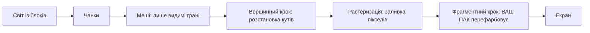

# Bloxd Shader Packs — Повний посібник (Українська)

🌐 [Усі мови](README.md) · Поглиблено: [English](GUIDE-EN.md#part-0--start-from-zero-how-rendering-and-bloxd-shaders-work) · [Français](GUIDE-FR.md)

**Прочитайте це першим.** Досвід не потрібен. За десять хвилин ви дізнаєтесь, як гра малює
картинку, що таке шейдер і що саме шейдерпак може й не може.

## 1. Версія на хвилину

- Bloxd.io — воксельна гра: світ зроблено з кубів (блоків).
- Картинку на екрані малює ваша відеокарта (GPU) — 60 і більше разів на секунду.
- **Шейдер** — крихітна програма, що виконується на GPU і вирішує, якого кольору будуть пікселі.
- **Шейдерпак** — невеликий файл `.zip` із шейдерним кодом. Гра завантажує його й дозволяє
  вашому коду перефарбовувати **блоки, воду та лаву** просто під час малювання.
- Ви не змінюєте гру. Ви змінюєте лише кольори й світло — у точну мить, коли малюється кожен
  піксель.

## 2. Як малюється картинка (веб-рендер, крок за кроком)

Екран — це сітка крихітних крапок, **пікселів** (наприклад, 1920 × 1080 ≈ два мільйони пікселів).
Одне повне зображення — **кадр** (фрейм). Гра знову й знову малює новий кадр — тому рух виглядає
плавним.

Роботу ділять два процесори:

| | CPU (головний процесор) | GPU (відеокарта) |
|---|---|---|
| Завдання | логіка гри, фізика, мережа | малювати мільйони пікселів, дуже швидко, паралельно |
| Стиль | мало працівників, дуже розумних | тисячі працівників, кожен дуже простий |

У вебі ланцюг виглядає так:

1. Гра працює як JavaScript у браузері (найкраще — свіжий Chrome або Edge).
2. Гра спілкується з GPU через **WebGPU** — сучасний графічний API браузера.
3. Усередині браузера **Dawn** (зі своїм компілятором **Tint**) перекладає шейдерну мову **WGSL**
   на інструкції, зрозумілі вашому GPU (Direct3D / Metal / Vulkan — залежить від системи).
4. GPU виконує шейдери й виводить готовий кадр.

Сам Bloxd зроблено на воксельному движку (**noa-engine**) поверх 3D-фреймворку (**Babylon.js**).
Для кожного кадру конвеєр малювання робить таке:

1. **Чанки.** Світ порізано на стовпці блоків — чанки. До малювання готуються тільки чанки поруч
   із вами.
2. **Мешинг.** Для кожного чанка движок будує *mesh* — оболонку з трикутників, що покриває лише
   реально видимі грані блоків. Приховані грані пропускаються.
3. **Текстуровий атлас.** Кожна грань блоку бере картинку з одного великого зображення —
   **атласу**, де всі текстури блоків лежать поруч. Кожна грань знає, який квадратик атласу
   використовувати (координати **UV**).
4. **Вершинний крок.** GPU запускає *vertex shader* на кожному куточку (вершині) кожного
   трикутника: ставить куточок у правильне місце на екрані й передає дані далі (координати
   текстури, значення світла, напрям грані…).
5. **Растеризація.** GPU заповнює кожен трикутник пікселями. Кожен накритий піксель стає
   **фрагментом**: кандидатом у пікселі з інтерпольованими даними.
6. **Фрагментний крок.** GPU запускає *fragment shader* для кожного фрагмента: саме тут вирішується
   кінцевий колір пікселя. **Тут живуть шейдерпаки Bloxd.**
7. **Екран.** Готовий кадр показується. Потім усе повторюється для наступного кадру.



Ключова думка: ваш пак ніколи не бачить «світ». Він бачить **один фрагмент за раз** — один піксель
однієї грані блока — плюс трохи даних про цей піксель. Усе, що робить пак, має обчислюватися з
цих локальних даних.

## 3. Що таке шейдер

Шейдер — маленька функція (маленький шматок коду), яку GPU виконує величезну кількість разів
паралельно — по разу на вершину чи по разу на фрагмент. Вона має бути швидкою та самодостатньою:
без файлів, без мережі, без пам'яті про попередній кадр.

Паки Bloxd пишуть на **WGSL** (WebGPU Shading Language). Ви не пишете шейдер повністю. У движка
вже є власні шейдери; він дозволяє вставити свій код у чотири фіксовані точки — **хуки** (Розділ 5).
Уявіть четверо дверей: движок іде своїм кодом малювання й біля кожних дверей питає вашу функцію:
«ось дані цього пікселя — хочеш змінити колір?»

## 4. Що таке шейдерпак Bloxd

Пак — файл `.zip` із вмістом:

```
pack.json     (маленький файл метаданих)
*.wgsl        (ваш WGSL-код — один файл чи багато, будь-які теки)
```

`pack.json` потрібно тільки:

```json
{ "apiVersion": 2, "name": "Мій Пак", "author": "ви" }
```

- `apiVersion` має бути числом **2**. Старі v1-паки відхиляються.
- Завантажувач знаходить **кожен** файл `*.wgsl` у зипі й склеює їх. Порядок файлів і теки не
  важливі.
- Ліміт загального WGSL: **256 KB**.

Встановлення: Bloxd → `O` Налаштування → Графіка → ввімкнути **Use New WebGPU Renderer** →
Shader Pack → **Choose .zip** → **Apply**.

Пак впливає лише на **блоки, воду й лаву**. Деякі режими гри повністю вимикають паки.

## 5. Чотири хуки (ваші єдині двері)

| Хук | Коли виконується | Що ви контролюєте |
|---|---|---|
| `bloxdTerrainSurface` | на фрагмент, тверді блоки, першим | базовий колір, прозорість (альфа), власне світіння (emission) |
| `bloxdTerrainLight` | той самий фрагмент, одразу після | кінцевий освітлений колір блоків |
| `bloxdLiquidSurface` | на фрагмент, вода й лава, першим | базовий колір та альфа рідин |
| `bloxdLiquidLight` | той самий фрагмент, одразу після | кінцевий освітлений колір рідин |

Правила дверей:

- Surface виконується **до** light, у тому ж фрагменті. Значення від surface до light можна
  передати змінною рівня модуля (`var<private>`).
- Завжди стартуйте зі звичайного результату движка: `bloxdDefaultSurface(...)` або
  `bloxdDefaultLight(...)`, змінюйте потрібне й повертайте. Ніколи не збирайте кінцеві struct самі.
- Surface-хуки виконуються до тесту відсікання за прозорістю: на листі й вирізаних блоках
  `out.alpha` вирішує, чи лишиться піксель, чи буде викинутий; на рідинах це справжній коефіцієнт
  змішування; на звичайних твердих блоках альфа нічого не робить.
- Власне світіння (`out.emission`) належить лише **surface**-хукам.
- Якщо пишете свій кінцевий колір у light-хуку, застосуйте туман наприкінці самі через
  `bloxdApplyFog(colour, light)` — туман движка завжди є в сцені, і пропуск змусить далекі блоки
  світитися крізь туман.

## 6. Що движок вам дає

Для кожного фрагмента ваші хуки отримують дані. Найкорисніші поля:

| Дані | Сенс простими словами |
|---|---|
| `colour` | колір текстури блока в цьому пікселі (з атласу) до ваших змін |
| `blockId` | **числовий id** блока (ціле число). Так оброблено один тип блока інакше — повна таблиця в Частині VIII |
| `position` | де цей піксель у світі (x, y, z) |
| `normal` | куди дивиться грань (угору, вниз, на північ…) — вектором |
| `skyLight` | скільки світла неба доходить до блока, від 0 до 1 — але **з tone mapping**: відкрите небо ≈ 1.0, один загублений рівень під деревом ≈ 0.995 (див. Розділ 7) |
| `blockLight` | світло ламп, смолоскипів, лави… як колір (кольорові лампи існують) |
| `heldLight` | світло предмета в руці гравця |
| `skyLightColour` | поточний відтінок неба (темно-синій уночі, теплий на заході) |
| `litColour` | власний освітлений колір движка для цієї поверхні (корисний як база) |
| `fogVisibility`, `fogColour` | наскільки піксель у тумані й колір туману (приходить **чорним**, коли туман вимкнено — опрацюйте цей випадок) |

Функції движка, які можна викликати:

| Функція | Що дає |
|---|---|
| `bloxdDefaultSurface(in)` / `bloxdDefaultLight(surface, light)` | звичайний результат движка — завжди ваша стартова точка |
| `bloxdApplyFog(colour, light)` | правильно змішує ваш колір із туманом |
| `bloxdSunDirection()` | одиничний вектор до сонця; `(0,0,0)` у світах без «земного» сонця; місяць — рівно протилежний напрям |
| `bloxdTime()` | секунди — **повертається на 0 кожні 3600 секунд** (`bloxdTimeWrap`). Див. Розділ 7 |
| `bloxdEyePosition()` | позиція камери (для ефектів відстані) |
| `bloxdOriginOffset()` | движок періодично перебазовує світові координати; додавайте цей зсув у будь-який світовий візерунок, інакше він помітно стрибатиме |
| `bloxdFaceBlock(position, normal)` | клітинка блока (цілі координати) грані, яку ви малюєте — ідеально для випадкової варіації на блок |
| `bloxdOpaqueBehind()` | тільки рідини: знаходить перший твердий блок позаду поверхні рідини — вимірює глибину води |

## 7. Пастки, у які потрапляють усі

**Час повертається.** `bloxdTime()` рахує секунди, але на 3600 починається спочатку. Якщо анімація
використовує сирий час, раз на годину буде стрибок. Завжди анімуйте повними циклами всередині wrap:

```wgsl
sin(6.2831853 * fract(bloxdTime() / bloxdTimeWrap * cycles + phase))
```

Обирайте `cycles` цілим числом. Тоді значення на секунді 3600 дорівнює значенню на секунді 0:
стрибків не буває, ніколи.

**skyLight проходить tone mapping.** Це не лінійна яскравість 0–1. Движок стискає рівні світла 0–15
у криву: відкрите небо ≈ 1.0, а втрата одного рівня все ще ≈ 0.995. Якщо перевіряти `skyLight < 0.5`
очікуючи «у тіні», майже нічого не зійдеться. Калібруйте пороги за справжньою кривою (Частина IV
дає заміряні значення).

**Туман є завжди.** Навіть коли ви його не бачите, движок рахує туман (часом відсунутий дуже далеко).
Якщо light-хук поверне колір без `bloxdApplyFog`, далекий ландшафт буде надто світлий і «проріже»
туман. Застосовуйте туман останнім, після роботи з кольором.

**Освітлення може бути вимкнене.** Якщо гра чи налаштування вимкне освітлення, `skyLight` може
взагалі не надсилатися, і ефекти на небі мовчки виробляться нічим. Пишіть ефекти так, щоб пакет і
без них виглядав добре.

## 8. Все, що пакет МОЖЕ

- Перефарбувати будь-який блок, воду чи лаву — глобально або за `blockId`.
- Примушувати речі світитися (`out.emission` у surface-хуках): лава, руди, лампи…
- Анімувати колір і альфу в часі (пульс, текіча лава, мерехтлива вода) — стійко до wrap (Розділ 7).
- Реагувати на цикл дня і ночі через `bloxdSunDirection()` і `skyLightColour` (теплі заходи, сині
  місячні відтінки).
- Додавати процедурний дрібний декор, прив'язаний до світу: тонка варіація на блок хешами
  `bloxdFaceBlock`, відтінки туману з відстанню, підводне затемнення за глибиною
  `bloxdOpaqueBehind()`.
- Грейдити всю картинку на фрагменті: контраст, насиченість, баланс теплого/холодного — за умови
  туману наприкінці.
- Малювати ефекти *на* поверхнях: іскри на рудах, «мокре» затемнення біля рівня води, сніг на
  гранях догори (`normal.y`) і подібні прийоми — все з даних самого фрагмента.
- Використовувати відстань (`bloxdEyePosition()`), ховаючи дорогі чи гучні ефекти (дешевий рівень
  детальності).

## 9. Чого пакет НЕ МОЖЕ (межі движка)

- **Рослини, трава та квіти** малює частина движка, недоступна пакам. Їх не можна перефарбувати чи
  анімувати.
- **Немає постобробки.** Немає доступу до готового кадру, екранних координат, проходів
  blur/bloom/віньєтки.
- **Немає глибини сцени.** Єдине запитання «що позаду» — `bloxdOpaqueBehind()` крізь рідину.
- **Немає справжніх карт тіней та ambient occlusion** понад те, що вже закодовано у світлі движка.
- **Немає нових об'єктів і частинок** у світі. Можна лише малювати на поверхнях, які вже існують.
  (Хитрі паки малюють накладні ефекти поверх поверхонь — див. рецепти, — але геометрія завжди належить
  движку.)
- **Немає власних текстур і семплерів**, додаткових потоків даних: ваші єдині входи — аргументи хуків
  та функції движка.
- **Рух вершин** (гнути геометрію, хвилі рухають кути) у движку є, але **працює лише в декількох
  іграх** — ніколи не покладайтеся на нього; підробляйте рух анімацією кольору/альфи.
- **Саме небо** (диск сонця, skybox, хмари) малює движок. Паки отримують *дані* неба (напрям,
  відтінок), але не малюють небо.

Якщо ефекту потрібне щось із цього переліку, пакет цього не зробить — це доведена поведінка движка,
а не питання вміння.

## 10. Ваш перший пакет за п'ять кроків

1. Створіть `pack.json`:

```json
{ "apiVersion": 2, "name": "Мій Перший Пак", "author": "ви" }
```

2. Поруч створіть `shader.wgsl`:

```wgsl
fn bloxdTerrainSurface(surface: BloxdSurfaceIn) -> BloxdSurface {
    var out = bloxdDefaultSurface(surface);
    out.colour = out.colour * vec3f(1.05, 1.0, 0.92);
    return out;
}

fn bloxdTerrainLight(surface: BloxdSurface, light: BloxdLightIn) -> BloxdLight {
    var out = bloxdDefaultLight(surface, light);
    _ = surface;
    return out;
}
```

Цей пакет робить кожен блок трохи теплішим (більше червоного, менше синього) і зберігає освітлення
движка. Рядок `_ = surface;` каже компілятору: «цей вхід умисно не використовується» — WGSL вимагає
саме цю форму.

3. Спакуйте два файли в zip із `pack.json` у корені зипу (не у вкладеній течці).
4. У грі: Налаштування → Графіка → **Use New WebGPU Renderer** увімкнено → Shader Pack →
   Choose .zip → Apply.
5. Подивіться довкола: світ має бути трохи тепліший. Міняйте три числа й завантажуйте пакет для
   експериментів.

Далі ростіть крок за кроком: по одному ефекту; перевіряйте його опівдні, на заході, вночі, під водою
та в печері, перш ніж додати наступний.

## 11. Дев'ять твердих правил

Порушення будь-якого ламає пакет або призводить до відхилення:

1. Ніколи не визначений нічого з іменем, що починається на `BLOXD_` — ці імена належать движку.
2. Ніколи не складайте `BloxdSurface` / `BloxdLight` самі — починайте від `bloxdDefaultSurface` /
   `bloxdDefaultLight`.
3. `mod` — слово зарезервоване WGSL — використовуйте `%`.
4. Без текстур, без семплерів, без своїх entry point та атрибутів, без екранних UV.
5. Уникайте `discard` (відхиляється в strict) — використовуйте `out.alpha`.
6. Хуки рідин завжди повинні давати допустиму альфу в кожному варіанті.
7. Невикористані входи: пишіть `_ = значення;` — форма `let _ =` відхиляється.
8. Загальний WGSL ≤ 256 KB.
9. Движок компілює ваш код у **8 варіантах** (strict/allow × lit/unlit × terrain/liquid). Код повинен
   скомпілюватися і поводитися у всіх. Мішайте бітові/зсувні вирази дужками заради браузерного
   компілятора Tint.

# 12. Міні-словник

| Слово | Значення |
|---|---|
| Кадр (frame) | одне повне зображення на екрані |
| Піксель / фрагмент | один точковий елемент картинки / піксель-кандидат на фарбування |
| Вершина | куточок трикутника |
| Mesh (меш) | шкіра з трикутників, збудована з видимих граней чанка |
| Атлас (текстуровий атлас) | одне велике зображення зі всіма текстурами блоків |
| UV | координати якої частини атласу використовує грань |
| WGSL | мова шейдерів WebGPU — мова паків Bloxd |
| Хук | одна з чотирьох функцій движка, які пакет може визначити |
| skyLight / blockLight | світло неба / світло блоків (лампи, лава) |
| Wrap (3600 с) | `bloxdTime()` щогодини стартує з 0 |
| Туман (fog) | далекий ландшафт розчиняється в кольорі туману |
| Варіант | один із 8 способів, як движок компілює пакет |

## 13. Поглиблене (глави англійською)

| Частина | Файл | Зміст |
|---|---|---|
| I | [01-making](GUIDE-EN.md#part-i--making-a-pack) | формат пакета, багатозавантаження, обмеження, поширення |
| II | [02-api](GUIDE-EN.md#part-ii--the-api-contract) | повний контракт хуків і структур |
| III | [03-recipes](GUIDE-EN.md#part-iii--recipes) | 12 робочих рецептів із кодом WGSL |
| IV | [04-realism](GUIDE-EN.md#part-iv--measured-numbers-realism-that-survives-contact-with-the-game) | заміряні числа: світло, туман, оптика води |
| V | [05-troubleshooting](GUIDE-EN.md#part-v--troubleshooting) | кожна відома несправність і її ремонт |
| VI | [06-implementation](GUIDE-EN.md#part-vi--implementation--local-validation) | локальна валідація у 8 варіантах |
| VII | [07-internals](GUIDE-EN.md#part-vii--engine-internals) | всередині движку (час, світло, небо, завантажувач) |
| VIII | [08-block-ids](GUIDE-EN.md#part-viii--the-numeric-block-id-table) | повна числова таблиця id блоків |
| IX | [09-sources](GUIDE-EN.md#part-ix--where-this-knowledge-comes-from-and-what-we-dont-know) | як встановлено кожен факт цього посібника |
| X | [10-constants](GUIDE-EN.md#part-x--the-constants-register-en) | кожна константа (551) з її роллю |

Повна французька версія: [fr](GUIDE-FR.md) · Усі мови: [index](README.md). Ліцензія: MIT.
