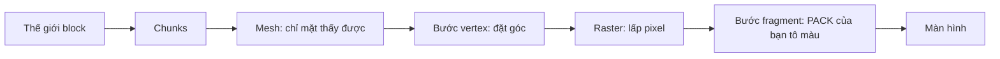

# Bloxd Shader Packs — Hướng dẫn đầy đủ (Tiếng Việt)

🌐 [Tất cả ngôn ngữ](README.md) · Sâu hơn: [English](GUIDE-EN.md#part-0--start-from-zero-how-rendering-and-bloxd-shaders-work) · [Français](GUIDE-FR.md)

**Đọc cái này trước.** Không cần kinh nghiệm. Trong mười phút bạn sẽ biết game vẽ hình như thế nào,
shader là gì, và chính xác shader pack làm được gì và không làm được gì.

## 1. Bản một phút

- Bloxd.io là game voxel: thế giới làm từ những khối lập phương (block).
- Hình trên màn hình của bạn do card đồ họa (GPU) vẽ, 60 lần hoặc hơn mỗi giây.
- **Shader** là chương trình tí hon chạy trên GPU và quyết định màu của các pixel.
- **Shader pack** là một file `.zip` nhỏ chứa code shader. Game nạp nó và để code của bạn tô lại
  **block, nước và dung nham** trong lúc chúng được vẽ.
- Bạn không thay đổi game. Bạn chỉ thay màu và ánh sáng, đúng khoảnh khắc mỗi pixel được vẽ.

## 2. Hình được vẽ như thế nào (render web, từng bước)

Màn hình của bạn là lưới những chấm nhỏ gọi là **pixel** (ví dụ 1920 × 1080 ≈ hai triệu pixel). Một
hình trọn vẹn là một **frame**. Game vẽ frame mới lặp đi lặp lại — đó là thứ làm chuyển động mượt.

Hai bộ xử lý chia nhau việc:

| | CPU (bộ xử lý chính) | GPU (card đồ họa) |
|---|---|---|
| Việc | logic game, vật lý, mạng | vẽ hàng triệu pixel, rất nhanh, song song |
| Phong cách | ít thợ, rất giỏi | hàng nghìn thợ, mỗi thợ rất đơn giản |

Trên web, chuỗi trông như thế này:

1. Game chạy dạng JavaScript trong trình duyệt (Chrome hoặc Edge mới là tốt nhất).
2. Game nói chuyện với GPU qua **WebGPU**, API đồ họa hiện đại của trình duyệt.
3. Bên trong trình duyệt, **Dawn** (với trình biên dịch **Tint**) dịch ngôn ngữ shader **WGSL**
   sang lệnh mà GPU của bạn hiểu (Direct3D / Metal / Vulkan tùy hệ thống).
4. GPU chạy các shader và đưa frame hoàn chỉnh lên màn hình.

Chính Bloxd được xây bằng engine voxel (**noa-engine**) trên framework 3D (**Babylon.js**). Với mỗi
frame, đường ống vẽ làm như sau:

1. **Chunk.** Thế giới bị cắt thành cột block gọi là chunk. Chỉ chunk gần bạn mới được chuẩn bị để vẽ.
2. **Meshing.** Với mỗi chunk, engine dựng một *mesh*: lớp vỏ tam giác chỉ phủ các mặt block thật
   sự nhìn thấy. Mặt khuất bị bỏ qua.
3. **Atlas texture.** Mỗi mặt block lấy hình từ một hình lớn duy nhất, **atlas**, chứa mọi texture
   block cạnh nhau. Mỗi mặt biết dùng ô vuông nhỏ nào của atlas (tọa độ **UV**).
4. **Bước vertex.** GPU chạy *vertex shader* trên mỗi góc (vertex) của mỗi tam giác: đặt góc vào
   đúng chỗ trên màn hình của bạn và truyền dữ liệu (tọa độ texture, giá trị sáng, hướng mặt…).
5. **Raster hóa.** GPU lấp đầy mỗi tam giác bằng pixel. Mỗi pixel bị phủ trở thành một **fragment**:
   pixel ứng viên với dữ liệu đã nội suy.
6. **Bước fragment.** GPU chạy *fragment shader* cho mỗi fragment: đây là nơi quyết định màu cuối
   của pixel. **Đây là nơi các shader pack của Bloxd sống.**
7. **Màn hình.** Frame hoàn chỉnh được hiển thị. Rồi mọi thứ lặp lại cho frame tiếp theo.



Ý chính: pack của bạn không bao giờ thấy "thế giới". Nó thấy **một fragment mỗi lần** — một pixel
của một mặt block — cộng vài dữ liệu về pixel đó. Mọi thứ pack làm phải tính từ dữ liệu cục bộ đó.

## 3. Shader là gì

Shader là một hàm nhỏ (một đoạn code nhỏ) mà GPU chạy số lần khổng lồ song song — một lần cho mỗi
vertex, hoặc một lần cho mỗi fragment. Nó phải nhanh và tự chứa: không file, không mạng, không nhớ
frame trước.

Pack Bloxd viết bằng **WGSL** (WebGPU Shading Language). Bạn không viết cả shader. Engine đã có
shader riêng; nó cho bạn chèn code tại bốn điểm cố định gọi là **hook** (Mục 5). Hãy nghĩ như bốn
cánh cửa: engine đi qua code vẽ của nó, và tại mỗi cửa hỏi hàm của bạn: "đây là dữ liệu của pixel
này — bạn muốn đổi màu không?"

## 4. Shader pack Bloxd là gì

Pack là file `.zip` chứa:

```
pack.json     (file metadata nhỏ)
*.wgsl        (code WGSL của bạn — một hay nhiều file, thư mục tùy ý)
```

`pack.json` chỉ cần:

```json
{ "apiVersion": 2, "name": "Pack của tôi", "author": "bạn" }
```

- `apiVersion` phải là số **2**. Pack v1 cũ bị từ chối.
- Loader tìm **mọi** file `*.wgsl` trong zip và nối chúng lại. Thứ tự file và thư mục không quan trọng.
- Giới hạn tổng WGSL: **256 KB**.

Cài trong game: Bloxd → `O` Cài đặt → Đồ họa → bật **Use New WebGPU Renderer** → Shader Pack →
**Choose .zip** → **Apply**.

Pack chỉ ảnh hưởng **block, nước và dung nham**. Một số mode game tắt pack hoàn toàn.

## 5. Bốn hook (cửa duy nhất của bạn)

| Hook | Khi nào chạy | Bạn điều khiển gì |
|---|---|---|
| `bloxdTerrainSurface` | mỗi fragment, block rắn, trước | màu nền, độ trong suốt (alpha), tự phát sáng (emission) |
| `bloxdTerrainLight` | cùng fragment, ngay sau | màu đã chiếu sáng cuối cùng của block |
| `bloxdLiquidSurface` | mỗi fragment, nước và dung nham, trước | màu nền và alpha của chất lỏng |
| `bloxdLiquidLight` | cùng fragment, ngay sau | màu đã chiếu sáng cuối cùng của chất lỏng |

Luật của các cửa:

- Surface chạy **trước** light, trong cùng fragment. Bạn truyền giá trị từ surface sang light bằng
  biến cấp module (`var<private>`).
- Luôn bắt đầu từ kết quả mặc định của engine: `bloxdDefaultSurface(...)` hoặc
  `bloxdDefaultLight(...)`, đổi thứ cần đổi, rồi trả về. Đừng bao giờ tự dựng struct kết quả.
- Hook surface chạy trước test cắt trong suốt của engine: trên lá và block cắt rỗng, `out.alpha`
  quyết định pixel ở lại hay bị bỏ; trên chất lỏng đó là hệ số trộn thật; trên block rắn thường
  alpha không làm gì.
- Tự phát sáng (`out.emission`) chỉ thuộc về hook **surface**.
- Nếu bạn tự viết màu cuối trong light hook, hãy tự áp sương mù ở cuối bằng
  `bloxdApplyFog(colour, light)` — sương của engine luôn có trong cảnh, và bỏ qua nó làm block xa
  sáng xuyên qua sương.

## 6. Engine cho bạn biết gì

Với mỗi fragment, hook của bạn nhận dữ liệu. Các field hữu ích nhất:

| Dữ liệu | Ý nghĩa, nói đơn giản |
|---|---|
| `colour` | màu texture của block tại pixel này (từ atlas), trước khi bạn sửa |
| `blockId` | **id số** của block (số nguyên). Đây là cách xử lý một loại block khác loại khác — bảng đầy đủ ở Phần VIII |
| `position` | pixel này ở đâu trong thế giới (x, y, z) |
| `normal` | mặt chỉ hướng nào (lên, xuống, bắc…), dạng vector |
| `skyLight` | lượng sáng trời tới được block này, 0 đến 1 — nhưng **đã tone-map**: trời quang ≈ 1.0, mất một mức dưới cây ≈ 0.995 (xem Mục 7) |
| `blockLight` | sáng từ đèn, đuốc, dung nham… dạng màu (đèn màu có thật) |
| `heldLight` | sáng từ vật trong tay người chơi |
| `skyLightColour` | sắc trời hiện tại (xanh đậm ban đêm, ấm lúc hoàng hôn) |
| `litColour` | màu đã chiếu sáng của chính engine cho bề mặt này (hữu ích làm nền) |
| `fogVisibility`, `fogColour` | pixel bị sương mức nào, và màu sương (đến **đen** khi sương tắt — hãy xử lý trường hợp đó) |

Các hàm engine bạn gọi được:

| Hàm | Cho bạn gì |
|---|---|
| `bloxdDefaultSurface(in)` / `bloxdDefaultLight(surface, light)` | kết quả thường của engine — luôn là điểm bắt đầu |
| `bloxdApplyFog(colour, light)` | trộn màu của bạn vào sương đúng cách |
| `bloxdSunDirection()` | vector đơn vị tới mặt trời; `(0,0,0)` ở thế giới không có mặt trời kiểu Trái Đất; mặt trăng đúng hướng ngược lại |
| `bloxdTime()` | giây — **về 0 mỗi 3600 giây** (`bloxdTimeWrap`). Xem Mục 7 |
| `bloxdEyePosition()` | vị trí camera (cho hiệu ứng khoảng cách) |
| `bloxdOriginOffset()` | engine định kỳ đặt lại gốc tọa độ thế giới; cộng offset này vào mọi pattern theo vị trí thế giới, không thì pattern sẽ nhảy thấy rõ |
| `bloxdFaceBlock(position, normal)` | ô block (tọa độ nguyên) của mặt bạn đang vẽ — hoàn hảo để biến thiên ngẫu nhiên theo block |
| `bloxdOpaqueBehind()` | chỉ chất lỏng: tìm block rắn đầu tiên sau mặt chất lỏng — dùng đo độ sâu nước |

## 7. Những cái bẫy ai cũng rơi vào

**Thời gian quay vòng.** `bloxdTime()` đếm giây nhưng bắt đầu lại ở 3600. Nếu animation của bạn dùng
thời gian thô, nó sẽ nhảy mỗi giờ một lần. Luôn animate bằng chu kỳ nguyên trong vòng wrap:

```wgsl
sin(6.2831853 * fract(bloxdTime() / bloxdTimeWrap * cycles + phase))
```

Chọn `cycles` là số nguyên. Khi đó giá trị ở giây 3600 bằng giá trị ở giây 0: không bao giờ nhảy.

**skyLight bị tone-map.** Nó không phải độ sáng tuyến tính 0–1. Engine nén các mức sáng 0–15 thành
đường cong: trời quang ≈ 1.0 và mất một mức vẫn đọc ≈ 0.995. Nếu bạn test `skyLight < 0.5` mong
"trong bóng", hầu như không gì khớp. Hiệu chỉnh ngưỡng trên đường cong thật (Phần IV cho số đo thật).

**Sương mù luôn ở đó.** Dù không thấy, engine vẫn tính sương (đôi khi bị đẩy rất xa). Nếu light hook
trả màu mà không có `bloxdApplyFog`, địa hình xa sẽ quá sáng và cắt xuyên sương. Áp sương sau cùng,
sau phần màu.

**Ánh sáng có thể tắt.** Nếu game hoặc cài đặt tắt chiếu sáng, `skyLight` có thể không được gửi và
hiệu ứng theo trời lặng lẽ không làm gì. Viết hiệu ứng sao cho pack vẫn đẹp khi thiếu chúng.

## 8. Mọi thứ pack LÀM ĐƯỢC

- Tô lại bất kỳ block, nước hay dung nham nào — toàn cục hoặc theo `blockId`.
- Làm vật phát sáng (`out.emission` trong hook surface): dung nham, quặng, đèn…
- Animate màu và alpha theo thời gian (nhấp nháy, dung nham chảy, nước lấp lánh) — an toàn với wrap
  (Mục 7).
- Phản ứng chu kỳ ngày/đêm qua `bloxdSunDirection()` và `skyLightColour` (hoàng hôn ấm, sắc trăng xanh).
- Thêm chi tiết thủ tục neo theo thế giới: biến thiên nhẹ theo block bằng hash `bloxdFaceBlock`, sắc
  sương theo khoảng cách, tối dần dưới nước bằng độ sâu `bloxdOpaqueBehind()`.
- Grade cả hình theo fragment: tương phản, bão hòa, cân bằng ấm/lạnh — miễn là sương áp ở cuối.
- Vẽ hiệu ứng *lên* bề mặt: lấp lánh trên quặng, tối "ướt" gần mặt nước, tuyết trên mặt ngửa lên
  (`normal.y`) và mẹo tương tự — tất cả tính từ dữ liệu của chính fragment.
- Dùng khoảng cách (`bloxdEyePosition()`) để làm mờ dần hiệu ứng đắt hoặc nhiễu (level-of-detail rẻ).

## 9. Điều pack KHÔNG làm được (giới hạn engine)

- **Cây cỏ và hoa** do phần engine mà pack không chạm tới được vẽ. Bạn không tô lại hay animate chúng được.
- **Không hậu xử lý.** Không truy cập frame hoàn chỉnh, không tọa độ màn hình, không pass blur/bloom/vignette.
- **Không độ sâu cảnh.** Truy vấn "phía sau là gì" duy nhất là `bloxdOpaqueBehind()` xuyên chất lỏng.
- **Không shadow map hay ambient occlusion thật** ngoài những gì giá trị sáng của engine đã mã hoá.
- **Không vật thể hay hạt mới** trong thế giới. Bạn chỉ vẽ lên bề mặt đã có. (Pack khéo vẽ hiệu ứng phủ
  lên bề mặt — xem recipes — nhưng hình học luôn của engine.)
- **Không texture hay sampler riêng**, không nguồn dữ liệu thêm: đầu vào duy nhất của bạn là tham số
  hook và hàm engine.
- **Di chuyển vertex** (uốn hình học, sóng làm góc chuyển động) có trong engine nhưng **chỉ chạy ở ít
  game** — đừng bao giờ phụ thuộc; giả chuyển động bằng animation màu/alpha.
- **Chính bầu trời** (đĩa mặt trời, skybox, mây) do engine vẽ. Pack nhận *dữ liệu* trời (hướng, sắc)
  nhưng không vẽ trời.

Nếu hiệu ứng cần thứ gì trong danh sách này, hôm nay không pack nào làm được — đó là hành vi engine đã
chứng minh, không phải chuyện kỹ năng.

## 10. Pack đầu tiên của bạn trong năm bước

1. Tạo `pack.json`:

```json
{ "apiVersion": 2, "name": "Pack đầu tiên của tôi", "author": "bạn" }
```

2. Tạo `shader.wgsl` cạnh nó:

```wgsl
fn bloxdTerrainSurface(surface: BloxdSurfaceIn) -> BloxdSurface {
    var out = bloxdDefaultSurface(surface);
    out.colour = out.colour * vec3f(1.05, 1.0, 0.92);
    return out;
}

fn bloxdTerrainLight(surface: BloxdSurface, light: BloxdLightIn) -> BloxdLight {
    var out = bloxdDefaultLight(surface, light);
    _ = surface;
    return out;
}
```

Pack này làm mỗi block ấm hơn một chút (đỏ hơn, ít xanh hơn) và giữ chiếu sáng của engine. Dòng
`_ = surface;` nói với trình biên dịch "đầu vào này cố ý không dùng" — WGSL đòi dạng trần này.

3. Nén hai file thành zip, với `pack.json` ở gốc zip (không trong thư mục con).
4. Trong game: Cài đặt → Đồ họa → bật **Use New WebGPU Renderer** → Shader Pack → Choose .zip → Apply.
5. Nhìn quanh: thế giới nên ấm hơn một chút. Đổi ba con số và nạp lại để thử nghiệm.

Rồi lớn dần từng bước: mỗi lần một hiệu ứng, kiểm tra lúc trưa, hoàng hôn, đêm, dưới nước và trong hang
trước khi thêm cái tiếp theo.

## 11. Chín luật cứng

Phá bất kỳ luật nào sẽ hỏng pack hoặc bị từ chối:

1. Đừng định nghĩa gì có tên bắt đầu bằng `BLOXD_` — chúng của engine.
2. Đừng tự dựng `BloxdSurface` / `BloxdLight` — bắt đầu từ `bloxdDefaultSurface` / `bloxdDefaultLight`.
3. `mod` là từ khoá trong WGSL — dùng `%`.
4. Không texture, không sampler, không entry point hay attribute riêng, không UV màn hình.
5. Tránh `discard` (bị từ chối ở strict mode) — dùng `out.alpha`.
6. Hook chất lỏng luôn phải xuất alpha hợp lệ, ở mọi variant.
7. Đầu vào không dùng: viết `_ = giá trị;` — dạng `let _ =` bị từ chối.
8. Tổng WGSL ≤ 256 KB.
9. Engine biên dịch code của bạn thành **8 variant** (strict/permissive × lit/unlit × terrain/liquid). Code
   phải biên dịch và hoạt động ở tất cả. Đặt ngoặc cho biểu thức bitwise/shift hỗn hợp vì trình biên dịch
   Tint của trình duyệt.

## 12. Từ điển mini

| Từ | Nghĩa |
|---|---|
| Frame | một hình trọn trên màn hình |
| Pixel / fragment | một chấm của hình / pixel ứng viên đang được tô |
| Vertex | một góc của tam giác |
| Mesh | lớp vỏ tam giác dựng từ mặt thấy được của chunk |
| Atlas (texture atlas) | một hình lớn duy nhất chứa mọi texture block |
| UV | tọa độ nói mặt dùng phần nào của atlas |
| WGSL | ngôn ngữ shader của WebGPU — ngôn ngữ của pack Bloxd |
| Hook | một trong bốn hàm engine mà pack của bạn có thể định nghĩa |
| skyLight / blockLight | sáng từ trời / sáng từ block (đèn, dung nham) |
| Wrap (3600 s) | `bloxdTime()` về 0 mỗi giờ |
| Sương (fog) | địa hình xa hoà vào màu sương |
| Variant | một trong 8 cách engine biên dịch pack |

## 13. Đi sâu hơn (chương tiếng Anh)

| Phần | File | Nội dung |
|---|---|---|
| I | [01-making](GUIDE-EN.md#part-i--making-a-pack) | định dạng pack, nạp nhiều file, giới hạn, phân phối |
| II | [02-api](GUIDE-EN.md#part-ii--the-api-contract) | hợp đồng hook và struct đầy đủ |
| III | [03-recipes](GUIDE-EN.md#part-iii--recipes) | 12 công thức production với code WGSL |
| IV | [04-realism](GUIDE-EN.md#part-iv--measured-numbers-realism-that-survives-contact-with-the-game) | số đo thật: đơn vị sáng, sương, quang học nước |
| V | [05-troubleshooting](GUIDE-EN.md#part-v--troubleshooting) | mọi lỗi đã biết và cách sửa |
| VI | [06-implementation](GUIDE-EN.md#part-vi--implementation--local-validation) | kiểm chứng cục bộ ở 8 variant, kiểm tra đóng gói |
| VII | [07-internals](GUIDE-EN.md#part-vii--engine-internals) | nội tình engine (thời gian, đường ống sáng, trời, loader) |
| VIII | [08-block-ids](GUIDE-EN.md#part-viii--the-numeric-block-id-table) | bảng id block số đầy đủ |
| IX | [09-sources](GUIDE-EN.md#part-ix--where-this-knowledge-comes-from-and-what-we-dont-know) | mỗi sự thật của hướng dẫn này được xác lập ra sao |
| X | [10-constants](GUIDE-EN.md#part-x--the-constants-register-en) | mọi hằng số, kèm vai trò |

Bản Pháp đầy đủ: [fr](GUIDE-FR.md) · Mọi ngôn ngữ: [mục lục](README.md). Giấy phép: MIT.
