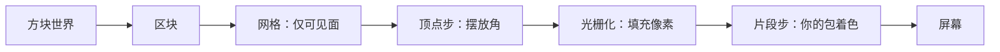

# Bloxd Shader Packs — 完整指南（简体中文）

🌐 [所有语言](README.md) · 深挖： [English](GUIDE-EN.md#part-0--start-from-zero-how-rendering-and-bloxd-shaders-work) · [Français](GUIDE-FR.md)

**先读这个。** 无需任何经验。十分钟内，你将知道游戏如何绘制画面、什么是着色器，以及着色器包能
做什么和不能做什么。

> **范围：API v2。** 本指南描述 `apiVersion: 2` 与当前 WebGPU/Lite 路径。不要为未来版本预先改 `apiVersion`。

## 1. 一分钟版本

- Bloxd.io 是体素游戏：世界由立方体（方块）构成。
- 屏幕上的画面由显卡（GPU）绘制，每秒 60 次或更多。
- **着色器**是一个在 GPU 上运行的小程序，决定像素的颜色。
- **着色器包**是一个包含着色器代码的小 `.zip` 文件。游戏加载它并让你的代码在**方块、水、熔岩**
  被绘制的同时重新着色。
- 你不改变游戏。你只在每个像素被绘制的那一瞬间改变颜色和光。

## 2. 画面如何绘制（网络渲染，一步步）

屏幕是称为**像素**的小点的网格（比如 1920 × 1080 = 约两百万像素）。一幅完整的画面是一个**帧**。
游戏反复绘制新帧 — 运动因此显得流畅。

两台处理器分工：

| | CPU（主处理器） | GPU（显卡） |
|---|---|---|
| 工作 | 游戏逻辑、物理、网络 | 以极快速度并行绘制数百万像素 |
| 风格 | 很少的工人，非常聪明 | 数千名工人，每人非常简单 |

在网络上，链路是这样的：

1. 游戏以 JavaScript 在浏览器中运行（最新版 Chrome 或 Edge 最好）。
2. 游戏通过浏览器现代图形 API **WebGPU** 与 GPU 对话。
3. 在浏览器内部，**Dawn**（带其编译器 **Tint**）把着色器语言 **WGSL** 翻译成 GPU 理解的指令
   （取决于系统的 Direct3D / Metal / Vulkan）。
4. GPU 执行着色器并把完成的帧放上画面。

Bloxd 本身由 3D 框架 **Babylon.js** 上的体素引擎 **noa-engine** 构建。每一帧，绘图流水线做以下
事情：

1. **区块。** 世界被切成叫 chunk 的方块柱。只有你旁边的区块会被准备绘制。
2. **网格化。** 对每个区块，引擎构建一张 *mesh*：一层只覆盖真正可见方块面的三角形皮。隐藏的面
   被跳过。
3. **纹理图集。** 每个方块面从一张大图片，即 **atlas**，取得图片，其中包含所有并排的方块纹理。
   每个面都知道使用图集哪一小块（它的 **UV** 坐标）。
4. **顶点步骤。** GPU 对每个三角形的每个角（顶点）运行 *vertex shader*：将角放置在屏幕上正确位置，
   并沿途传递数据（纹理坐标、光照值、面方向等）。
5. **光栅化。** GPU 用像素填满每个三角形。每个被覆盖的像素成为一个 **fragment**：带插值数据的
   像素候选者。
6. **片段步骤。** GPU 为每片 fragment 运行 *fragment shader*：这里决定像素的最终颜色。
   **Bloxd 着色器包就住在这里。**
7. **屏幕。** 完成的帧被显示。然后为下一帧重复全部。



核心思路：你的包从不看到"世界"。它只能看到**每次一片 fragment** — 一个方块面的一个像素 —
加该像素的一些数据。包做的一切必须从那些局部数据计算。

## 3. 什么是着色器

着色器是一个小函数（一小段代码），GPU 以巨量并行地运行 — 每顶点一次或每片 fragment 一次。
它必须快且自包含：无文件、无网络、无上一帧记忆。

Bloxd 包用 **WGSL**（WebGPU Shading Language）写。你不写整个着色器；引擎已有自己的着色器，只让你把代码插到六个固定点，叫**钩子**（第 5 节）：两个程序（terrain 与 liquid）×三个阶段（vertex、surface、light）。在 vertex 门，它问角点去哪；在 surface 与 light 门，它问这个像素最后该是什么样。

## 4. 什么是 Bloxd 着色器包

一个包是带以下内容的 `.zip` 文件：

```
pack.json     （小元数据文件）
*.wgsl        （你的 WGSL 代码 — 一个文件或许多，任何文件夹）
```

`pack.json` 只需要：

```json
{ "apiVersion": 2, "name": "我的包", "author": "你" }
```

- `apiVersion` 必须是正好 JSON 数字 **2**（不是字符串）。老 v1 包会被拒。
- 导入器接受文件夹或**一个** `.zip`。路径规范化后必须正好剩一个 `pack.json`；所有文件共享的根文件夹会被自动剥掉。
- 清单是 ≤ **65,536 字节**的 UTF-8 JSON 对象。`name` 去空格后不能为空；`author` 可选，为字符串或 `null`；其他键被忽略。
- 源码：**1–256** 个 `.wgsl`，按路径排序；解压后总计 ≤ **262,144 字节**；重复路径和无效 UTF-8 被拒；其他文件忽略。
- Zip ≤ **33,554,432 字节**且 ≤ **1,024** 条目；只读 stored/deflate；Zip64、多盘和加密被拒。

安装：Bloxd → `O` 设置 → 图形 → 开启 **Use New WebGPU Renderer** → Shader Pack → 选择文件夹或 `.zip` → **Apply** → **重载页面**。没有可用的 WebGPU 时，包可以被存下但仍被阻止。

包只影响**方块、水、熔岩**。某些游戏模式完全禁用包。

## 5. 六个钩子（你唯一的门）

| Hook | 何时运行 | 你控制什么 |
|---|---|---|
| `bloxdTerrainVertex` | 每顶点，地形，投影前 | 每个角点的世界位置（仅 allow 游戏） |
| `bloxdTerrainSurface` | 每片 fragment，固体方块，先运行 | 基础颜色、透明度（alpha）、自发光（emission） |
| `bloxdTerrainLight` | 同一 fragment，随后马上 | 方块最终受光色 |
| `bloxdLiquidVertex` | 每顶点，液体，投影前 | 每个液体角点的世界位置（仅 allow 游戏） |
| `bloxdLiquidSurface` | 每片 fragment，水和熔岩，先运行 | 液体基础色与 alpha |
| `bloxdLiquidLight` | 同一 fragment，随后马上 | 液体最终受光色 |

门的规则：

- Surface 在 light **之前**运行，处于同一 fragment 。你可用模块级变量（`var<private>`）
  将数值从 surface 传给 light。
- 始终从引擎默认结果开始：`bloxdDefaultSurface(...)` 或 `bloxdDefaultLight(...)`，
  改变需要的地方，然后返回。永远不要自己搭建结果结构体。
- Surface 钩子在引擎的透明镂空测试之前运行：在树叶和镂空方块上，`out.alpha` 决定像素保留
  还是丢弃；在液体上它是真实的混合因子；在普通固体方块上 alpha 没作用。
- 自发光（`out.emission`）仅属于 **surface** 钩子。
- 若在 light 钩子里写你自己的最终色，最后用 `bloxdApplyFog(colour, light)` 自己加雾 —
  引擎的雾总是在场景中，跳过会让远方方块透过雾发亮。

- 缺某个液体阶段时会落回对应的 terrain 钩子；缺 surface/light 的另一半时，该片元阶段用引擎默认。vertex 可选；从 `bloxdDefaultVertex(...)` 开始。
- vertex 钩子或可达的 `discard` 不会拒绝整个包：它会在 strict 中关掉该程序，而 strict 是默认政策。
- `out.alpha` 只在 `BLOXD_ALPHA` 下存在（仅 terrain+strict 缺失）；液体总有 alpha。light 返回的 RGB 会替换最终 RGB——用 `bloxdApplyFog` 保留雾。

## 6. 引擎告诉你什么

每片 fragment，你的钩子都会收到数据。最有用的字段：

| 数据 | 简单的意思 |
|---|---|
| `colour` | 该像素的方块纹理色（来自图集），在被你更改之前 |
| `blockId` | 方块的**数字 ID**（整数）。这就是区分不同方块类型的方法 — 完整表格在 Part VIII |
| `position` | 该像素在世界中的位置 (x, y, z) |
| `normal` | 面朝向哪里（上、下、北…），以向量的形式 |
| `skyLight` | 天空光到达这方块多少，0 到 1 — 但它是**色调映射后的**：开阔天空 ≈ 1.0，树下少去一层仍 ≈ 0.995（看第 7 节） |
| `blockLight` | 灯具、火炬、熔岩的光… 以颜色形式（存在彩色灯） |
| `heldLight` | 玩家手持物品的光 |
| `skyLightColour` | 当前天空色调（夜晚深蓝、黄昏暖色） |
| `litColour` | 引擎对这表面的自身受光色（作基底用很好） |
| `fogVisibility`、`fogColour` | 此像素有多"雾"和雾色（雾关闭时以**黑色**到 — 要处理此情况） |

你可以调用的引擎函数：

| 函数 | 给你什么 |
|---|---|
| `bloxdDefaultSurface(in)` / `bloxdDefaultLight(surface, light)` | 引擎的通常结果 — 永远是你的出发点 |
| `bloxdDefaultVertex(in)` | 未改动的顶点结果——vertex 钩子的起点 |
| `bloxdApplyFog(colour, light)` | 正确将你的色混合入雾 |
| `bloxdSunDirection()` | 指向太阳的单位向量；在无地球型太阳的世界是 `(0,0,0)`；月亮恰好在反方向 |
| `bloxdTime()` | 秒数 — **每 3600 秒回到 0**（`bloxdTimeWrap`）。看第 7 节 |
| `bloxdEyePosition()` | 相机位置（用于距离效果） |
| `bloxdOriginOffset()` | 引擎周期性重新定基世界坐标；将这个偏移加进任何基于世界位置的图案，否则图案会可见地跳 |
| `bloxdFaceBlock(position, normal)` | 你正在绘制的面所在的方块单元格（整数坐标）— 非常适合每方块随机变化 |
| `bloxdOpaqueBehind()` | 仅在 `BLOXD_SCENE_DEPTH` 下的液体 surface/light：正好这个像素后面的 `{found, position, distance}`；厚度 = `distance` 减眼→表面 |

## 7. 所有人都会掉的陷阱

**时间会回绕。** `bloxdTime()` 数秒，但到 3600 就会重启。若用裸时间做动画，它每小时跳一次。
总是以整周期动画回绕内：

```wgsl
sin(6.2831853 * fract(bloxdTime() / bloxdTimeWrap * cycles + phase))
```

将 `cycles` 选为整数。那么在 3600 秒的值等于在 0 秒的值：从不跳跃。

**skyLight 是色调映射后的。** 它不是线性 0–1 亮度。引擎把 0–15 光照等级压缩成曲线：开阔天
约 1.0，减一级仍读作约 0.995。如果你用 `skyLight < 0.5` 等待"在阴影"，几乎什么都不匹配。
在真实曲线上校准阈值（Part IV 给出实测数值）。

**雾始终存在。** 即使看不见，引擎也会计算雾（有时被推得很远）。如果 light 钩子返回没有
`bloxdApplyFog` 的颜色，远方地形会过亮且穿透雾气。在最后、在你的颜色工作后应用雾。

**Unlit 不会移除字段。** 头部给中性值：`skyLight=1`、`blockLight=0`、`heldLight=0`、`directional=0`、白色光色。若天空逻辑在 unlit 必须关闭，用 `#ifdef BLOXD_LIGHTING` 守住。

## 8. 包能做的一切

- 重新着色任意方块、水、熔岩 — 全局或按 `blockId`。
- 使物体发光（surface 钩子的 `out.emission`）：熔岩、矿石、灯具…
- 随时间动画颜色与 alpha（脉动、熔岩流动、水波闪烁）— 抗回绕（第 7 节）。
- 通过 `bloxdSunDirection()` 与 `skyLightColour` 反应昼夜周期（暖色日落、蓝色月光色调）。
- 加入世界锚定的程序细节：以 `bloxdFaceBlock` 哈希实现每块细微差异、距离雾色调、水下变暗深度
  来自 `bloxdOpaqueBehind()`。
- 每片 fragment 调色整幅图像：对比度、饱和度、冷暖平衡 — 前提是雾在最后应用。
- 在表面上绘制效果：矿石上的闪点、水位线附近的"潮湿"变暗、朝上的面的雪（`normal.y`），以及
  类似的技巧 — 全部由 fragment 本身数据计算。
- 利用距离（`bloxdEyePosition()`）淡出昂贵或噪点效果（廉价细节层次）。

## 9. 包不能做到什么（引擎限制）

- **植物、草、花**由引擎中包触不到的部分绘制。无法重新上色或动画它们。
- **无后期处理。** 无访问完成帧、无屏幕坐标、无模糊/辉光/暗角 pass。
- **无场景深度。** 唯一的"后面有什么"查询是穿透液体的 `bloxdOpaqueBehind()`。
- **无真实阴影贴图或环境遮蔽**，超越引擎光照值本身编码的程度。
- **无世界中新物体或粒子。** 只能在已存在的表面上绘画。(聪明的包会在表面上画叠加效果 —
  见食谱 — 但几何体始终是引擎的。)
- **无自有纹理或采样器**，没有额外数据来源：你唯一的输入是钩子参数和引擎函数。
- **顶点移动受政策限制。** vertex 钩子是真的，但只在 allow 游戏运行；默认 strict 会关掉该程序。不要让核心外观或可读性依赖被移动的角点。
- **天空本身**（太阳盘、skybox、云）由引擎绘制。包只能收到天空*数据*（方向、色调），
  但不画天空。

若效果需要该清单中的某样东西，那么今天没有任何包能做到 — 这是引擎已证行为，不是技术
问题。

## 10. 五步完成你的第一个包

1. 创建 `pack.json`：

```json
{ "apiVersion": 2, "name": "我的第一个包", "author": "你" }
```

2. 在其旁边创建 `shader.wgsl`：

```wgsl
fn bloxdTerrainSurface(surface: BloxdSurfaceIn) -> BloxdSurface {
    var out = bloxdDefaultSurface(surface);
    out.colour = out.colour * vec3f(1.05, 1.0, 0.92);
    return out;
}

fn bloxdTerrainLight(surface: BloxdSurface, light: BloxdLightIn) -> BloxdLight {
    var out = bloxdDefaultLight(surface, light);
    _ = surface;
    return out;
}
```

这个包使每个方块都稍暖一点（更红，更少蓝）并保留引擎的光照。`_ = surface;`
行告诉编译器"这个输入故意未使用" — WGSL 要求这个裸形式。

3. 文件夹导入就把文件放一个文件夹里，或一起打包 zip。最清楚：`pack.json` 在顶层与 WGSL 相邻；一个所有文件共享的包装文件夹也可接受并会被剥掉。

4. 游戏里：设置 → 图形 → 开启 **Use New WebGPU Renderer** → Shader Pack → 选择文件夹或 `.zip` → Apply → **重载页面**。

5. 环视：世界应该稍暖一点。改变那三个数字并重载实验。

之后一步步成长：一次一个效果，先在正午、黄昏、夜晚、水下和洞中检查，然后再加下一个。

## 11. 九条铁律

打破任意一条都会使包破碎或被拒：

1. 不要定义 `BLOXD_*` 或六个钩子之外的任何 `bloxd*` 名字。指令只能是行首的 `#define/#ifdef/#ifndef/#else/#endif`；`#define` 是无值全局标志，不能放在条件块里。

2. 不要自己构造 `BloxdVertex` / `BloxdSurface` / `BloxdLight`——从 `bloxdDefaultVertex` / `bloxdDefaultSurface` / `bloxdDefaultLight` 开始。

3. `mod` 是 WGSL 的保留字 — 使用 `%`。
4. 不要 `@…` 属性、入口点、纹理、采样器、`override/enable/requires/diagnostic`、额外存储类、双下划线标识符或屏幕 UV。

5. vertex 钩子或可达的 `discard` 会在 strict（默认）中关掉该程序，而不是拒绝包。想 strict 安全就避免它们或给效果加守卫。

6. `out.alpha` 只在 `BLOXD_ALPHA` 下存在（仅 terrain+strict 缺失）。液体 alpha 每个变体都有；地形 alpha 需要守卫。

7. 未使用的输入：写 `_ = 值;` — `let _ =` 的形式会被拒。
8. 精确上限：清单 ≤65,536 bytes；WGSL 1–256 个；WGSL 总计 ≤262,144 bytes；zip ≤33,554,432 bytes 且 ≤1,024 条目。

9. 引擎构建 **8 个变体**：allow/strict × lit/unlit × terrain/liquid。宏：`BLOXD_STRICT`、`BLOXD_LIGHTING`、`BLOXD_SCENE_DEPTH` 仅液体、`BLOXD_ALPHA` 仅 terrain+strict 缺失。必须在全部变体编译并表现正确；为 Tint 给位运算/移位加括号。

## 12. 迷你词表

| 词 | 含义 |
|---|---|
| 帧 | 屏幕上一幅完整的画面 |
| 像素 / fragment | 图像的一个点 / 正在上色的候选像素 |
| 顶点 | 三角形的一个角 |
| Mesh | 由区块可见面构建的三角形皮 |
| Atlas（纹理图集） | 含所有方块纹理的单张大图 |
| UV | 告诉每个面用图集哪部分的坐标 |
| WGSL | WebGPU 的着色器语言 — Bloxd 包的语言 |
| Hook | 包可以定义的六个引擎函数之一（vertex/surface/light × terrain/liquid） |
| skyLight / blockLight | 天空的光 / 方块的光（灯、熔岩） |
| 回绕（3600 秒） | `bloxdTime()` 每小时重新从 0 开始 |
| 雾 | 远地形融入雾色 |
| 变体 | 引擎编译你的包的 8 种方式之一 |

## 13. API v2 精确参考

本节是当前精确参考；若别处短摘要听起来更简单，以这里为准。它只描述 API v2；未来 API 版本需要重新验证。

- **导入：** 规范化后正好一个清单；`apiVersion` 数字 2；清单 ≤65,536 bytes；`.wgsl` 1–256 按路径，总计 ≤262,144 bytes；zip ≤33,554,432 bytes/1,024 条目，仅 stored/deflate。
- **变体/宏：** allow/strict × lit/unlit × terrain/liquid。`BLOXD_SCENE_DEPTH` 仅液体；`BLOXD_ALPHA` 仅 terrain+strict 缺失。
- **Strict/unlit：** strict 默认；vertex/discard 不是拒绝而是关 strict；unlit 给 `skyLight=1`、block/held/directional 为零和白色。
- **守卫：** 地形 alpha 在 `BLOXD_ALPHA` 下；深度仅在 `BLOXD_SCENE_DEPTH` 下的液体 surface/light；从 vertex 可达 `bloxdOpaqueBehind()` 是错误。
- **液体深度：** 在地形透明物之前的快照，正好一个像素，无后面颜色，看不见液体自身和之后透明物；光学厚度 = `behind.distance − distance(eye, surface.position)`。
- **运行时：** 需要 Lite WebGPU；WebGL 回退 = 无包；改动在重载后生效；`bloxdTime()=performance.now()/1000 mod 3600`；skyLight 曲线 `1−(1−x/(3−2x))³`，`x=level/15`。

## 14. 更进一步（英语章节）

| Part | 文件 | 内容 |
|---|---|---|
| I | [01-making](GUIDE-EN.md#part-i--making-a-pack) | 包格式、多文件加载、限制、发行 |
| II | [02-api](GUIDE-EN.md#part-ii--the-api-contract) | 完整的钩子与结构体契约 |
| III | [03-recipes](GUIDE-EN.md#part-iii--recipes) | 12 个生产食谱，带 WGSL 代码 |
| IV | [04-realism](GUIDE-EN.md#part-iv--measured-numbers-realism-that-survives-contact-with-the-game) | 实测数值：光照、雾、水的光学 |
| V | [05-troubleshooting](GUIDE-EN.md#part-v--troubleshooting) | 每个已知故障与其修复 |
| VI | [06-implementation](GUIDE-EN.md#part-vi--implementation--local-validation) | 8 变体本地验证、打包检查 |
| VII | [07-internals](GUIDE-EN.md#part-vii--engine-internals) | 引擎内部（时间、光路、天空、加载器） |
| VIII | [08-block-ids](GUIDE-EN.md#part-viii--the-numeric-block-id-table) | 完整数值方块 ID 表格 |
| IX | [09-sources](GUIDE-EN.md#part-ix--where-this-knowledge-comes-from-and-what-we-dont-know) | 本指南中每个事实立论的方法 |
| X | [10-constants](GUIDE-EN.md#part-x--the-constants-register-en) | 每一个常量及其角色（551 个） |

法文完整版：[fr](GUIDE-FR.md) · 所有语言：[索引](README.md)。授权：MIT。
