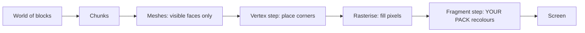

# Part 0 — Start from zero: how rendering and Bloxd shaders work

**Read this first.** No experience needed. In ten minutes you will know how the game draws
its picture, what a shader is, and exactly what a shader pack can and cannot do.
The deep chapters (Parts I–X) come after.

## 1. The one-minute version

- Bloxd.io is a voxel game: the world is made of cubes (blocks).
- The picture on your screen is drawn by your graphics card (GPU), 60 or more times per second.
- A **shader** is a tiny program that runs on the GPU and decides the colour of pixels.
- A **shader pack** is a small `.zip` with shader code. The game loads it and lets your code
  recolour **blocks, water and lava** while they are drawn.
- You do not change the game. You only change colours and light, at the exact moment each
  pixel is drawn.

## 2. How the picture is drawn (web rendering, step by step)

Your screen is a grid of tiny dots called **pixels** (for example 1920 × 1080 = about two
million pixels). One full picture is a **frame**. The game draws a new frame again and again —
that is what makes movement look smooth.

Two processors share the work:

| | CPU (main processor) | GPU (graphics card) |
|---|---|---|
| Job | game logic, physics, network | drawing millions of pixels, very fast, in parallel |
| Style | few workers, very smart | thousands of workers, each one simple |

On the web, the chain looks like this:

1. The game runs as JavaScript in your browser (recent Chrome or Edge works best).
2. The game talks to the GPU through **WebGPU**, the modern graphics API of the browser.
3. Inside the browser, **Dawn** (with its compiler **Tint**) translates the shader language
   **WGSL** into instructions your GPU understands (Direct3D / Metal / Vulkan, depending on
   your system).
4. The GPU executes the shaders and puts the finished frame on screen.

Bloxd itself is built with a voxel engine (**noa-engine**) on top of a 3D framework
(**Babylon.js**). For every frame, the drawing pipeline does this:

1. **Chunks.** The world is cut into columns of blocks called chunks. Only chunks near you
   are prepared for drawing.
2. **Meshing.** For each chunk, the engine builds a *mesh*: a skin of triangles covering only
   the block faces you can actually see. Hidden faces are skipped.
3. **Texture atlas.** Every block face gets its picture from one big image, the **atlas**,
   which contains all block textures side by side. Each face knows which small square of the
   atlas to use (its **UV** coordinates).
4. **Vertex step.** The GPU runs a *vertex shader* on every corner (vertex) of every triangle:
   it places the corner at the right position on your screen and passes data along (texture
   coordinates, light values, face direction…).
5. **Rasterising.** The GPU fills each triangle with pixels. Every covered pixel becomes a
   **fragment**: a candidate pixel with interpolated data.
6. **Fragment step.** The GPU runs a *fragment shader* for every fragment: this is where the
   final colour of the pixel is decided. **This is where Bloxd shader packs live.**
7. **Screen.** The finished frame is shown. Then everything repeats for the next frame.



Key idea: your pack never sees "the world". It sees **one fragment at a time** — one pixel of
one block face — plus some data about that pixel. Everything a pack does must be computed
from that local data.

## 3. What a shader is

A shader is a small function (a small piece of code) that the GPU runs an enormous number of
times in parallel — once per vertex, or once per fragment. It must be fast and self-contained:
no files, no network, no memory of the previous frame.

Bloxd packs are written in **WGSL** (WebGPU Shading Language). You do not write a whole
shader. The engine already has its own shaders; it lets you insert your code at four fixed
points, called **hooks** (Section 5). Think of it as four doors: the engine walks through its
drawing code, and at each door it asks your function: "here is this pixel's data — do you want
to change the colour?"

## 4. What a Bloxd shader pack is

A pack is a `.zip` file with:

```
pack.json     (small metadata file)
*.wgsl        (your WGSL code — one file or many, any folders)
```

`pack.json` only needs:

```json
{ "apiVersion": 2, "name": "My Pack", "author": "you" }
```

- `apiVersion` must be the number **2**. Old v1 packs are rejected.
- The loader finds **every** `*.wgsl` file in the zip and joins them together. File order and
  folders do not matter.
- Total WGSL size limit: **256 KB**.

To install a pack in the game: Bloxd → `O` Settings → Graphics → enable **Use New WebGPU
Renderer** → Shader Pack → **Choose .zip** → **Apply**.

A pack only affects **blocks, water and lava**. Some game modes disable packs completely.

## 5. The four hooks (your only doors)

| Hook | When it runs | What you control |
|---|---|---|
| `bloxdTerrainSurface` | per fragment, solid blocks, first | base colour, transparency (alpha), self-glow (emission) |
| `bloxdTerrainLight` | same fragment, right after | final lit colour of blocks |
| `bloxdLiquidSurface` | per fragment, water and lava, first | base colour and alpha of liquids |
| `bloxdLiquidLight` | same fragment, right after | final lit colour of liquids |

Rules of the doors:

- Surface runs **before** light, in the same fragment. You can pass a value from surface to
  light with a module-scope variable (`var<private>`).
- Always start from the engine's default result: `bloxdDefaultSurface(...)` or
  `bloxdDefaultLight(...)`, change what you need, then return it. Never build the result
  structs yourself.
- Surface hooks run before the engine's transparency cut-out test: on leaves and cut-out
  blocks, `out.alpha` decides if the pixel is kept or discarded; on liquids it is the real
  blend factor; on plain solid blocks alpha does nothing.
- Self-glow (`out.emission`) belongs to the **surface** hooks only.
- If you write your own final colour in a light hook, apply the fog yourself at the end with
  `bloxdApplyFog(colour, light)` — the engine's fog is always present in the scene, and
  skipping it makes distant blocks shine through the fog.

## 6. What the engine tells you

For every fragment, your hooks receive data. The most useful fields:

| Data | Meaning, in simple words |
|---|---|
| `colour` | the block's texture colour at this pixel (from the atlas), before your changes |
| `blockId` | the **numeric id** of the block (a whole number). This is how you treat one block type differently from another — full table in Part VIII |
| `position` | where this pixel is in the world (x, y, z) |
| `normal` | which way the face points (up, down, north…), as a vector |
| `skyLight` | how much sky light reaches this block, 0 to 1 — but **tone-mapped**: open sky ≈ 1.0, one light level lost under a tree ≈ 0.995 (see Section 7) |
| `blockLight` | light from lamps, torches, lava… as a colour (coloured lamps exist) |
| `heldLight` | light from the item in the player's hand |
| `skyLightColour` | the current tint of the sky (dark blue at night, warm at sunset) |
| `litColour` | the engine's own lit colour for this surface (useful as a base) |
| `fogVisibility`, `fogColour` | how fogged this pixel is, and the fog colour (arrives **black** when fog is off — handle that case) |

Engine functions you can call:

| Function | What it gives you |
|---|---|
| `bloxdDefaultSurface(in)` / `bloxdDefaultLight(surface, light)` | the engine's normal result — always your starting point |
| `bloxdApplyFog(colour, light)` | blends your colour into the fog correctly |
| `bloxdSunDirection()` | unit vector towards the sun; `(0,0,0)` in worlds without an earth-like sun; the moon is exactly the opposite direction |
| `bloxdTime()` | seconds — **wraps back to 0 every 3600 seconds** (`bloxdTimeWrap`). See Section 7 |
| `bloxdEyePosition()` | the camera position (for distance effects) |
| `bloxdOriginOffset()` | the engine periodically rebases world coordinates; add this offset into any world-position pattern, or your pattern will visibly jump |
| `bloxdFaceBlock(position, normal)` | the block cell (whole-number coordinates) of the face you are drawing — perfect for per-block random variation |
| `bloxdOpaqueBehind()` | liquids only: finds the first solid block behind the liquid surface — used to measure water depth |

## 7. The traps everyone falls into

**Time wraps.** `bloxdTime()` counts seconds but restarts at 3600. If your animation uses raw
time, it will jump once per hour. Always animate with whole cycles inside the wrap:

```wgsl
sin(6.2831853 * fract(bloxdTime() / bloxdTimeWrap * cycles + phase))
```

Choose `cycles` as a whole number. Then the value at second 3600 equals the value at second
0: no jump, ever.

**skyLight is tone-mapped.** It is not a linear 0–1 brightness. The engine compresses the
0–15 light levels into a curve: open sky is ≈ 1.0 and losing one level still reads ≈ 0.995.
If you test `skyLight < 0.5` expecting "in shadow", almost nothing will match. Calibrate
thresholds on the real curve (Part IV gives measured values).

**Fog is always there.** Even when you cannot see it, the engine computes fog (sometimes
pushed very far away). If your light hook returns a colour without `bloxdApplyFog`, distant
terrain will look too bright and cut through the fog. Apply fog last, after your colour work.

**Lighting can be off.** If a game or setting disables lighting, `skyLight` may not be sent
at all and sky-driven effects silently do nothing. Write effects so the pack still looks fine
without them.

## 8. Everything a pack CAN do

- Recolour any block, water or lava — globally or per `blockId`.
- Make things glow (`out.emission` in surface hooks): lava, ores, lamps…
- Animate colour and alpha over time (pulsing, flowing lava, shimmering water) — wrap-safe
  (Section 7).
- React to the day/night cycle through `bloxdSunDirection()` and `skyLightColour` (warm
  sunsets, blue moonlight tints).
- Add world-anchored procedural detail: subtle per-block variation with `bloxdFaceBlock`
  hashes, distance fog tints, underwater darkening with `bloxdOpaqueBehind()` depth.
- Grade the whole image per fragment: contrast, saturation, warm/cold balance — as long as
  fog is applied at the end.
- Paint effects *on* surfaces: sparkles on ore, wet-looking darkening near water level, snow
  on upward faces (`normal.y`), and similar tricks — all computed from the fragment's own data.
- Use distance (`bloxdEyePosition()`) to fade expensive or noisy effects out (cheap
  level-of-detail).

## 9. What a pack CANNOT do (engine limits)

- **Plants, grass and flowers** are drawn by a part of the engine packs cannot reach. You
  cannot recolour or animate them.
- **No post-processing.** You have no access to the finished frame, no screen coordinates, no
  blur/bloom/vignette passes.
- **No scene depth.** The only "what is behind this" query is `bloxdOpaqueBehind()` through
  a liquid.
- **No real shadow maps or ambient occlusion** beyond what the engine's light values already
  encode.
- **No new objects or particles** in the world. You can only paint on surfaces that already
  exist. (Clever packs paint overlay effects onto surfaces — see the recipes — but the
  geometry is always the engine's.)
- **No textures or samplers** of your own, no extra data feeds: your only inputs are the
  hook arguments and the engine functions.
- **Vertex movement** (bending geometry, waves that move corners) exists in the engine but
  **only runs in a few games** — never depend on it; fake movement with colour/alpha
  animation instead.
- **The sky itself** (sun disc, skybox, clouds) is drawn by the engine. Packs receive sky
  *data* (direction, tint) but do not draw the sky.

If an effect needs something from this list, no pack can do it today — this is proven engine
behaviour, not a skill issue.

## 10. Your first pack in five steps

1. Create `pack.json`:

```json
{ "apiVersion": 2, "name": "My First Pack", "author": "you" }
```

2. Create `shader.wgsl` next to it:

```wgsl
fn bloxdTerrainSurface(surface: BloxdSurfaceIn) -> BloxdSurface {
    var out = bloxdDefaultSurface(surface);
    out.colour = out.colour * vec3f(1.05, 1.0, 0.92);
    return out;
}

fn bloxdTerrainLight(surface: BloxdSurface, light: BloxdLightIn) -> BloxdLight {
    var out = bloxdDefaultLight(surface, light);
    _ = surface;
    return out;
}
```

This pack makes every block slightly warmer (more red, less blue) and keeps the engine's
lighting. The `_ = surface;` line tells the compiler "this input is intentionally unused" —
WGSL requires this bare form.

3. Zip the two files together, with `pack.json` at the root of the zip (not inside a
   subfolder).
4. In the game: Settings → Graphics → **Use New WebGPU Renderer** on → Shader Pack →
   Choose .zip → Apply.
5. Look around: the world should be a little warmer. Change the three numbers and reload to
   experiment.

Then grow step by step: one effect at a time, check it at midday, sunset, night, underwater
and in a cave before adding the next.

## 11. The nine hard rules

Breaking any of these breaks or rejects the pack:

1. Never define anything whose name starts with `BLOXD_` — those belong to the engine.
2. Never build `BloxdSurface` / `BloxdLight` yourself — start from `bloxdDefaultSurface` /
   `bloxdDefaultLight`.
3. `mod` is a reserved word in WGSL — use `%`.
4. No textures, no samplers, no entry points or attributes of your own, no screen UVs.
5. Avoid `discard` (rejected in strict mode) — use `out.alpha` instead.
6. Liquid hooks must always output a valid alpha, in every variant.
7. Unused inputs: write `_ = value;` — the form `let _ =` is rejected.
8. Total WGSL ≤ 256 KB.
9. The engine compiles your code in **8 variants** (strict/permissive × lit/unlit ×
   terrain/liquid). Your code must compile and behave in all of them. Parenthesise mixed
   bitwise/shift expressions for the browser's Tint compiler.

## 12. Mini glossary

| Word | Meaning |
|---|---|
| Frame | one complete picture on the screen |
| Pixel / fragment | one dot of the picture / a candidate pixel being coloured |
| Vertex | a corner of a triangle |
| Mesh | the skin of triangles built from a chunk's visible faces |
| Atlas (texture atlas) | the one big image containing all block textures |
| UV | coordinates that say which part of the atlas a face uses |
| WGSL | the shader language of WebGPU — the language of Bloxd packs |
| Hook | one of the four engine functions your pack may define |
| skyLight / blockLight | light from the sky / light from blocks (lamps, lava) |
| Wrap (3600 s) | `bloxdTime()` restarting at 0 every hour |
| Fog | distant terrain blending into the fog colour |
| Variant | one of the 8 ways the engine compiles your pack |

## 13. Go deeper

| Part | File | Content |
|---|---|---|
| I | [01-making](01-making.md) | pack format, multi-file loading, caps, distribution |
| II | [02-api](02-api.md) | the complete hook and struct contract |
| III | [03-recipes](03-recipes.md) | 12 production recipes with WGSL code |
| IV | [04-realism](04-realism.md) | measured numbers: light units, fog, water optics |
| V | [05-troubleshooting](05-troubleshooting.md) | every known failure mode and its fix |
| VI | [06-implementation](06-implementation.md) | local validation in all 8 variants, packaging checks |
| VII | [07-internals](07-internals.md) | engine internals (time, light pipeline, sky, loader) |
| VIII | [08-block-ids](08-block-ids.md) | the full numeric block-id table |
| IX | [09-sources](09-sources.md) | how every fact in this guide was established |
| X | [10-constants](10-constants.md) | every constant, with its role |

Other languages: [guide index](../README.md).
