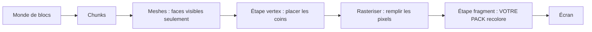

# Partie 0 — Partir de zéro : comment le rendu et les shaders Bloxd fonctionnent

**Lisez ceci en premier.** Aucune expérience requise. Dans dix minutes, vous saurez comment
le jeu dessine son image, ce qu'est un shader, et exactement ce qu'un shader pack peut faire
et ne pas faire. Les chapitres approfondis (Parties I à X) viennent après.

## 1. La version une minute

- Bloxd.io est un jeu voxel : le monde est fait de cubes (blocs).
- L'image sur votre écran est dessinée par votre carte graphique (GPU), 60 fois par seconde
  ou plus.
- Un **shader** est un minuscule programme qui tourne sur le GPU et décide de la couleur des
  pixels.
- Un **shader pack** est un petit fichier `.zip` avec du code shader. Le jeu le charge et
  laisse votre code recolorer **les blocs, l'eau et la lave** pendant qu'ils sont dessinés.
- Vous ne modifiez pas le jeu. Vous ne changez que les couleurs et la lumière, au moment
  précis où chaque pixel est dessiné.

## 2. Comment l'image est dessinée (le rendu web, étape par étape)

Votre écran est une grille de minuscules points appelés **pixels** (par exemple 1920 × 1080
= environ deux millions de pixels). Une image complète est une **frame**. Le jeu dessine une
nouvelle frame encore et encore — c'est ce qui rend le mouvement fluide.

Deux processeurs se partagent le travail :

| | CPU (processeur principal) | GPU (carte graphique) |
|---|---|---|
| Travail | logique du jeu, physique, réseau | dessiner des millions de pixels, très vite, en parallèle |
| Style | quelques ouvriers, très intelligents | des milliers d'ouvriers, chacun très simple |

Sur le web, la chaîne ressemble à ceci :

1. Le jeu tourne en JavaScript dans votre navigateur (Chrome ou Edge récent = le meilleur).
2. Le jeu parle au GPU via **WebGPU**, l'API graphique moderne du navigateur.
3. Dans le navigateur, **Dawn** (avec son compilateur **Tint**) traduit le langage shader
   **WGSL** en instructions que votre GPU comprend (Direct3D / Metal / Vulkan selon votre
   système).
4. Le GPU exécute les shaders et affiche la frame terminée à l'écran.

Bloxd lui-même est construit avec un moteur voxel (**noa-engine**) au-dessus d'un framework
3D (**Babylon.js**). Pour chaque frame, le pipeline de dessin fait ceci :

1. **Chunks.** Le monde est coupé en colonnes de blocs appelées chunks. Seuls les chunks
   près de vous sont préparés pour le dessin.
2. **Meshing.** Pour chaque chunk, le moteur construit un *mesh* : une peau de triangles qui
   couvre uniquement les faces de blocs réellement visibles. Les faces cachées sont ignorées.
3. **Atlas de textures.** Chaque face de bloc prend son image dans une seule grande image,
   l'**atlas**, qui contient toutes les textures des blocs côte à côte. Chaque face sait
   quel petit carré de l'atlas utiliser (ses coordonnées **UV**).
4. **Étape vertex.** Le GPU exécute un *vertex shader* sur chaque coin (vertex) de chaque
   triangle : il place le coin au bon endroit sur votre écran et transmet des données
   (coordonnées de texture, valeurs de lumière, direction de la face…).
5. **Rasterisation.** Le GPU remplit chaque triangle de pixels. Chaque pixel couvert devient
   un **fragment** : un pixel candidat avec ses données interpolées.
6. **Étape fragment.** Le GPU exécute un *fragment shader* pour chaque fragment : c'est là
   que la couleur finale du pixel est décidée. **C'est là que vivent les shader packs de
   Bloxd.**
7. **Écran.** La frame terminée s'affiche. Puis tout recommence pour la frame suivante.



Idée clé : votre pack ne voit jamais « le monde ». Il voit **un fragment à la fois** — un
pixel d'une face de bloc — plus quelques données sur ce pixel. Tout ce qu'un pack fait doit
être calculé à partir de ces données locales.

## 3. Ce qu'est un shader

Un shader est une petite fonction (un petit morceau de code) que le GPU exécute un nombre
énorme de fois en parallèle — une fois par vertex, ou une fois par fragment. Il doit être
rapide et autonome : pas de fichiers, pas de réseau, pas de mémoire de la frame précédente.

Les packs Bloxd s'écrivent en **WGSL** (WebGPU Shading Language). Vous n'écrivez pas un
shader entier. Le moteur a déjà ses propres shaders ; il vous laisse insérer votre code à
quatre points fixes, appelés **hooks** (Section 5). Voyez cela comme quatre portes : le
moteur avance dans son code de dessin, et à chaque porte il demande à votre fonction :
« voici les données de ce pixel — veux-tu changer la couleur ? »

## 4. Ce qu'est un shader pack Bloxd

Un pack est un fichier `.zip` contenant :

```
pack.json     (petit fichier de métadonnées)
*.wgsl        (votre code WGSL — un fichier ou plusieurs, n'importe quels dossiers)
```

`pack.json` n'a besoin que de ceci :

```json
{ "apiVersion": 2, "name": "Mon Pack", "author": "vous" }
```

- `apiVersion` doit être le nombre **2**. Les vieux packs v1 sont rejetés.
- Le chargeur trouve **tous** les fichiers `*.wgsl` du zip et les relie ensemble. L'ordre
  des fichiers et les dossiers n'ont aucune importance.
- Limite totale de taille WGSL : **256 Ko**.

Pour installer un pack en jeu : Bloxd → `O` Paramètres → Graphismes → activer **Use New
WebGPU Renderer** → Shader Pack → **Choose .zip** → **Apply**.

Un pack n'affecte que **les blocs, l'eau et la lave**. Certains modes de jeu désactivent les
packs complètement.

## 5. Les quatre hooks (vos seules portes)

| Hook | Quand il tourne | Ce que vous contrôlez |
|---|---|---|
| `bloxdTerrainSurface` | par fragment, blocs solides, en premier | couleur de base, transparence (alpha), émission lumineuse propre (emission) |
| `bloxdTerrainLight` | même fragment, juste après | couleur finale éclairée des blocs |
| `bloxdLiquidSurface` | par fragment, eau et lave, en premier | couleur de base et alpha des liquides |
| `bloxdLiquidLight` | même fragment, juste après | couleur finale éclairée des liquides |

Les règles des portes :

- Surface tourne **avant** light, dans le même fragment. Vous pouvez passer une valeur de
  surface à light avec une variable au niveau module (`var<private>`).
- Commencez toujours par le résultat par défaut du moteur : `bloxdDefaultSurface(...)` ou
  `bloxdDefaultLight(...)`, changez ce qu'il faut, puis retournez-le. Ne construisez jamais
  les structs de résultat vous-même.
- Les hooks surface tournent avant le test de découpe de transparence du moteur : sur les
  feuilles et les blocs découpés, `out.alpha` décide si le pixel est gardé ou jeté ; sur
  les liquides, c'est le vrai facteur de mélange ; sur les blocs solides ordinaires, alpha
  ne fait rien.
- L'émission lumineuse propre (`out.emission`) appartient uniquement aux hooks **surface**.
- Si vous écrivez votre propre couleur finale dans un hook light, appliquez le brouillard
  vous-même à la fin avec `bloxdApplyFog(colour, light)` — le brouillard du moteur est
  toujours présent dans la scène, et l'omettre fait briller les blocs lointains à travers.

## 6. Ce que le moteur vous donne

Pour chaque fragment, vos hooks reçoivent des données. Les champs les plus utiles :

| Donnée | Signification, en mots simples |
|---|---|
| `colour` | la couleur de texture du bloc à ce pixel (depuis l'atlas), avant vos changements |
| `blockId` | l'**identifiant numérique** du bloc (un nombre entier). C'est ainsi qu'on traite un type de bloc différemment d'un autre — table complète en Partie VIII |
| `position` | où se trouve ce pixel dans le monde (x, y, z) |
| `normal` | vers où pointe la face (haut, bas, nord…), sous forme de vecteur |
| `skyLight` | combien de lumière du ciel atteint ce bloc, de 0 à 1 — mais **tone-mappé** : ciel ouvert ≈ 1.0, un niveau perdu sous un arbre ≈ 0.995 (voir Section 7) |
| `blockLight` | lumière des lampes, torches, lave… sous forme de couleur (les lampes colorées existent) |
| `heldLight` | lumière de l'objet tenu dans la main du joueur |
| `skyLightColour` | la teinte actuelle du ciel (bleu foncé la nuit, chaude au coucher du soleil) |
| `litColour` | la couleur éclairée propre du moteur pour cette surface (utile comme base) |
| `fogVisibility`, `fogColour` | à quel point ce pixel est brumeux, et la couleur du brouillard (arrive **noire** quand le brouillard est désactivé — gérez ce cas) |

Fonctions moteur que vous pouvez appeler :

| Fonction | Ce qu'elle vous donne |
|---|---|
| `bloxdDefaultSurface(in)` / `bloxdDefaultLight(surface, light)` | le résultat normal du moteur — toujours votre point de départ |
| `bloxdApplyFog(colour, light)` | fond correctement votre couleur dans le brouillard |
| `bloxdSunDirection()` | vecteur unitaire vers le soleil ; `(0,0,0)` dans les mondes sans soleil type terrestre ; la lune est exactement la direction opposée |
| `bloxdTime()` | secondes — **retombe à 0 toutes les 3600 secondes** (`bloxdTimeWrap`). Voir Section 7 |
| `bloxdEyePosition()` | la position de la caméra (pour les effets de distance) |
| `bloxdOriginOffset()` | le moteur recale périodiquement les coordonnées du monde ; ajoutez cet offset à tout motif basé sur la position dans le monde, sinon votre motif sautera visiblement |
| `bloxdFaceBlock(position, normal)` | la cellule de bloc (coordonnées entières) de la face que vous dessinez — parfait pour varier au hasard par bloc |
| `bloxdOpaqueBehind()` | liquides seulement : trouve le premier bloc solide derrière la surface du liquide — sert à mesurer la profondeur de l'eau |

## 7. Les pièges dans lesquels tout le monde tombe

**Le temps repart à zéro.** `bloxdTime()` compte les secondes mais recommence à partir de
3600. Si votre animation utilise le temps brut, elle sautera une fois par heure. Animez
toujours avec des cycles entiers à l'intérieur du wrap :

```wgsl
sin(6.2831853 * fract(bloxdTime() / bloxdTimeWrap * cycles + phase))
```

Choisissez `cycles` comme nombre entier. Alors la valeur à la seconde 3600 égale celle à la
seconde 0 : aucun saut, jamais.

**skyLight est tone-mappé.** Ce n'est pas une luminosité linéaire 0–1. Le moteur compresse
les 16 niveaux de lumière (0–15) en une courbe : le ciel ouvert vaut ≈ 1.0 et perdre un
niveau donne encore ≈ 0.995. Si vous testez `skyLight < 0.5` en pensant « à l'ombre »,
presque rien ne correspondra. Calibrez vos seuils sur la vraie courbe (la Partie IV donne
les valeurs mesurées).

**Le brouillard est toujours là.** Même quand vous ne le voyez pas, le moteur calcule le
brouillard (parfois repoussé très loin). Si votre hook light retourne une couleur sans
`bloxdApplyFog`, le terrain lointain paraîtra trop lumineux et traversera le brouillard.
Appliquez le brouillard en dernier, après votre travail de couleur.

**L'éclairage peut être désactivé.** Si un jeu ou un réglage désactive l'éclairage,
`skyLight` peut ne pas être envoyé du tout et les effets pilotés par le ciel ne font
silencieusement rien. Écrivez vos effets pour que le pack reste beau sans eux.

## 8. Tout ce qu'un pack PEUT faire

- Recolorer n'importe quel bloc, l'eau ou la lave — globalement ou par `blockId`.
- Faire briller les choses (`out.emission` dans les hooks surface) : lave, minerais,
  lampes…
- Animer couleur et alpha dans le temps (pulsations, lave qui coule, eau qui scintille) —
  à l'épreuve du wrap (Section 7).
- Réagir au cycle jour/nuit via `bloxdSunDirection()` et `skyLightColour` (couchers de
  soleil chauds, teintes de lune bleues).
- Ajouter du détail procédural ancré dans le monde : variation subtile par bloc avec des
  hashs `bloxdFaceBlock`, teintes de brouillard par distance, assombrissement sous-marin
  avec la profondeur `bloxdOpaqueBehind()`.
- Étalonner toute l'image par fragment : contraste, saturation, balance chaud/froid — tant
  que le brouillard est appliqué à la fin.
- Peindre des effets *sur* les surfaces : étincelles sur les minerais, assombrissement
  « mouillé » près du niveau de l'eau, neige sur les faces vers le haut (`normal.y`), et
  des astuces similaires — tout est calculé à partir des données du fragment lui-même.
- Utiliser la distance (`bloxdEyePosition()`) pour estomper les effets coûteux ou bruités
  (niveau de détail à bon marché).

## 9. Ce qu'un pack NE PEUT PAS faire (limites du moteur)

- **Plantes, herbe et fleurs** sont dessinées par une partie du moteur que les packs ne
  peuvent pas atteindre. Vous ne pouvez ni les recolorer ni les animer.
- **Pas de post-traitement.** Vous n'avez pas accès à l'image finale, pas de coordonnées
  d'écran, pas de passes de flou/bloom/vignette.
- **Pas de profondeur de scène.** La seule requête « qu'y a-t-il derrière » est
  `bloxdOpaqueBehind()` à travers un liquide.
- **Pas de vraies ombres portées ni d'occlusion ambiante** au-delà de ce que les valeurs de
  lumière du moteur encodent déjà.
- **Pas de nouveaux objets ni particules** dans le monde. Vous ne pouvez que peindre sur des
  surfaces déjà existantes. (Les packs malins peignent des effets en surcouche sur des
  surfaces — voir les recettes — mais la géométrie reste toujours celle du moteur.)
- **Pas de textures ni de samplers** à vous, pas d'autres sources de données : vos seuls
  apports sont les arguments des hooks et les fonctions du moteur.
- **Le déplacement de sommets** (plier la géométrie, des vagues qui bougent les coins)
  existe dans le moteur mais **ne tourne que dans quelques jeux** — ne comptez jamais
  dessus ; simulez le mouvement avec une animation de couleur/alpha à la place.
- **Le ciel lui-même** (disque solaire, skybox, nuages) est dessiné par le moteur. Les
  packs reçoivent les *données* du ciel (direction, teinte) mais ne dessinent pas le ciel.

Si un effet exige quelque chose de cette liste, aucun pack ne peut le faire aujourd'hui —
c'est un comportement moteur prouvé, pas un problème de compétence.

## 10. Votre premier pack en cinq étapes

1. Créez `pack.json` :

```json
{ "apiVersion": 2, "name": "Mon Premier Pack", "author": "vous" }
```

2. Créez `shader.wgsl` à côté :

```wgsl
fn bloxdTerrainSurface(surface: BloxdSurfaceIn) -> BloxdSurface {
    var out = bloxdDefaultSurface(surface);
    out.colour = out.colour * vec3f(1.05, 1.0, 0.92);
    return out;
}

fn bloxdTerrainLight(surface: BloxdSurface, light: BloxdLightIn) -> BloxdLight {
    var out = bloxdDefaultLight(surface, light);
    _ = surface;
    return out;
}
```

Ce pack rend chaque bloc légèrement plus chaud (plus de rouge, moins de bleu) et garde
l'éclairage du moteur. La ligne `_ = surface;` dit au compilateur « cette entrée est
volontairement inutilisée » — WGSL exige cette forme nue.

3. Zippez les deux fichiers ensemble, avec `pack.json` à la racine du zip (pas dans un
   sous-dossier).
4. En jeu : Paramètres → Graphismes → **Use New WebGPU Renderer** activé → Shader Pack →
   Choose .zip → Apply.
5. Regardez autour de vous : le monde devrait être un peu plus chaud. Changez les trois
   nombres et rechargez pour expérimenter.

Grandissez ensuite étape par étape : un effet à la fois, vérifiez-le à midi, au couchant,
la nuit, sous l'eau et dans une grotte avant d'ajouter le suivant.

## 11. Les neuf règles dures

Briser l'une d'elles casse ou fait rejeter le pack :

1. Ne définissez jamais rien dont le nom commence par `BLOXD_` — ils appartiennent au
   moteur.
2. Ne construisez jamais `BloxdSurface` / `BloxdLight` vous-même — partez de
   `bloxdDefaultSurface` / `bloxdDefaultLight`.
3. `mod` est un mot réservé en WGSL — utilisez `%`.
4. Pas de textures, pas de samplers, pas de points d'entrée ni d'attributs à vous, pas d'UV
   d'écran.
5. Évitez `discard` (rejeté en mode strict) — utilisez `out.alpha` à la place.
6. Les hooks liquides doivent toujours produire un alpha valide, dans chaque variante.
7. Entrées inutilisées : écrivez `_ = valeur;` — la forme `let _ =` est rejetée.
8. WGSL total ≤ 256 Ko.
9. Le moteur compile votre code en **8 variantes** (strict/permissif × éclairé/non éclairé ×
   terrain/liquide). Votre code doit compiler et se comporter dans toutes. Parentésez les
   expressions bit à bit/décalage mélangées pour le compilateur Tint du navigateur.

## 12. Mini glossaire

| Mot | Signification |
|---|---|
| Frame | une image complète à l'écran |
| Pixel / fragment | un point de l'image / un pixel candidat en cours de coloration |
| Vertex | un coin d'un triangle |
| Mesh | la peau de triangles construite à partir des faces visibles d'un chunk |
| Atlas (atlas de textures) | la seule grande image contenant toutes les textures des blocs |
| UV | coordonnées qui disent quelle partie de l'atlas une face utilise |
| WGSL | le langage shader de WebGPU — la langue des packs Bloxd |
| Hook | l'une des quatre fonctions moteur qu'un pack peut définir |
| skyLight / blockLight | lumière du ciel / lumière des blocs (lampes, lave) |
| Wrap (3600 s) | `bloxdTime()` qui repart à 0 toutes les heures |
| Brouillard (fog) | le terrain lointain qui se fond dans la couleur du brouillard |
| Variante | l'une des 8 façons dont le moteur compile votre pack |

## 13. Aller plus loin

| Partie | Fichier | Contenu |
|---|---|---|
| I | [01-creation](01-creation.md) | format du pack, chargement multi-fichiers, limites, distribution |
| II | [02-api](02-api.md) | le contrat complet hooks et structs |
| III | [03-recettes](03-recettes.md) | 12 recettes de production avec code WGSL |
| IV | [04-realisme](04-realisme.md) | nombres mesurés : unités de lumière, brouillard, optique de l'eau |
| V | [05-depannage](05-depannage.md) | chaque mode de défaillance connu et sa réparation |
| VI | [06-implementation](06-implementation.md) | validation locale en 8 variantes, contrôles de packaging |
| VII | [07-internes](07-internes.md) | internes du moteur (temps, pipeline de lumière, ciel, chargeur) |
| VIII | [08-ids-blocs](08-ids-blocs.md) | la table numérique complète des ids de blocs |
| IX | [09-sources](09-sources.md) | comment chaque fait de ce guide a été établi |
| X | [10-constantes](10-constantes.md) | chaque constante, avec son rôle |

Autres langues : [index du guide](../README.md) · [sommaire français](README.md).
