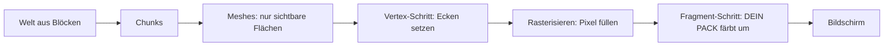

# Bloxd Shader Packs — Der komplette Leitfaden (Deutsch)

🌐 [Alle Sprachen](../README.md) · Vertiefung: [English](GUIDE-EN.md#part-0--start-from-zero-how-rendering-and-bloxd-shaders-work) · [Français](GUIDE-FR.md)

**Lies dies zuerst.** Keine Vorkenntnisse nötig. In zehn Minuten weißt du, wie das Spiel sein
Bild zeichnet, was ein Shader ist und genau, was ein Shader-Pack kann und nicht kann.

## 1. Die Ein-Minuten-Version

- Bloxd.io ist ein Voxelspiel: Die Welt besteht aus Würfeln (Blöcken).
- Das Bild auf deinem Bildschirm zeichnet deine Grafikkarte (GPU), 60-mal pro Sekunde oder öfter.
- Ein **Shader** ist ein winziges Programm, das auf der GPU läuft und die Farbe der Pixel entscheidet.
- Ein **Shader-Pack** ist eine kleine `.zip`-Datei mit Shader-Code. Das Spiel lädt es und lässt
  deinen Code **Blöcke, Wasser und Lava** umfärben, während sie gezeichnet werden.
- Du änderst nicht das Spiel. Du änderst nur Farben und Licht — in dem Moment, in dem jeder Pixel
  gezeichnet wird.

## 2. Wie das Bild gezeichnet wird (Web-Rendering, Schritt für Schritt)

Dein Bildschirm ist ein Raster winziger Punkte, **Pixel** genannt (zum Beispiel 1920 × 1080 =
etwa zwei Millionen Pixel). Ein vollständiges Bild ist ein **Frame**. Das Spiel zeichnet immer
wieder einen neuen Frame — dadurch wirkt Bewegung flüssig.

Zwei Prozessoren teilen sich die Arbeit:

| | CPU (Hauptprozessor) | GPU (Grafikkarte) |
|---|---|---|
| Aufgabe | Spiellogik, Physik, Netzwerk | Millionen Pixel zeichnen, sehr schnell, parallel |
| Stil | wenige Arbeiter, sehr schlau | tausende Arbeiter, jeder sehr einfach |

Im Web sieht die Kette so aus:

1. Das Spiel läuft als JavaScript in deinem Browser (aktuelles Chrome oder Edge ist am besten).
2. Das Spiel spricht mit der GPU über **WebGPU**, die moderne Grafik-API des Browsers.
3. Im Browser übersetzt **Dawn** (mit seinem Compiler **Tint**) die Shader-Sprache **WGSL** in
   Anweisungen, die deine GPU versteht (Direct3D / Metal / Vulkan, je nach System).
4. Die GPU führt die Shader aus und zeigt den fertigen Frame auf dem Bildschirm.

Bloxd selbst ist mit einer Voxel-Engine (**noa-engine**) auf einem 3D-Framework (**Babylon.js**)
gebaut. Für jeden Frame macht die Zeichen-Pipeline Folgendes:

1. **Chunks.** Die Welt ist in Blockspalten namens Chunks geteilt. Nur Chunks in deiner Nähe
   werden zum Zeichnen vorbereitet.
2. **Meshing.** Für jeden Chunk baut die Engine ein *Mesh*: eine Haut aus Dreiecken, die nur die
   wirklich sichtbaren Blockflächen bedeckt. Versteckte Flächen werden übersprungen.
3. **Textur-Atlas.** Jede Blockfläche holt ihr Bild aus einem einzigen großen Bild, dem **Atlas**,
   der alle Blocktexturen nebeneinander enthält. Jede Fläche weiß, welches kleine Quadrat des
   Atlas sie benutzt (ihre **UV**-Koordinaten).
4. **Vertex-Schritt.** Die GPU führt einen *Vertex-Shader* auf jeder Ecke (Vertex) jedes Dreiecks
   aus: Er setzt die Ecke an die richtige Stelle auf deinem Bildschirm und gibt Daten weiter
   (Texturkoordinaten, Lichtwerte, Flächenrichtung …).
5. **Rasterisieren.** Die GPU füllt jedes Dreieck mit Pixeln. Jeder bedeckte Pixel wird ein
   **Fragment**: ein Pixelkandidat mit interpolierten Daten.
6. **Fragment-Schritt.** Die GPU führt einen *Fragment-Shader* für jedes Fragment aus: Hier wird
   die endgültige Farbe des Pixels entschieden. **Hier leben die Bloxd-Shader-Packs.**
7. **Bildschirm.** Der fertige Frame wird gezeigt. Dann wiederholt sich alles für den nächsten Frame.



Kernidee: Dein Pack sieht nie „die Welt". Es sieht **ein Fragment nach dem anderen** — einen Pixel
einer Blockfläche — plus einige Daten über diesen Pixel. Alles, was ein Pack tut, muss aus diesen
lokalen Daten berechnet werden.

## 3. Was ein Shader ist

Ein Shader ist eine kleine Funktion (ein kleines Stück Code), die die GPU unglaublich oft parallel
ausführt — einmal pro Vertex oder einmal pro Fragment. Er muss schnell und eigenständig sein: keine
Dateien, kein Netzwerk, keine Erinnerung an den vorigen Frame.

Bloxd-Packs werden in **WGSL** (WebGPU Shading Language) geschrieben. Du schreibst keinen ganzen
Shader. Die Engine hat schon ihre eigenen Shader; sie lässt dich deinen Code an vier festen Punkten
einfügen, den **Hooks** (Abschnitt 5). Stell dir vier Türen vor: Die Engine geht durch ihren
Zeichen-Code, und an jeder Tür fragt sie deine Funktion: „Hier sind die Daten dieses Pixels — willst
du die Farbe ändern?"

## 4. Was ein Bloxd-Shader-Pack ist

Ein Pack ist eine `.zip`-Datei mit:

```
pack.json     (kleine Metadaten-Datei)
*.wgsl        (dein WGSL-Code — eine Datei oder viele, beliebige Ordner)
```

`pack.json` braucht nur:

```json
{ "apiVersion": 2, "name": "Mein Pack", "author": "du" }
```

- `apiVersion` muss die Zahl **2** sein. Alte v1-Packs werden abgelehnt.
- Der Loader findet **jede** `*.wgsl`-Datei im Zip und fügt sie zusammen. Dateireihenfolge und
  Ordner sind egal.
- Gesamtes WGSL-Größenlimit: **256 KB**.

Pack installieren: Bloxd → `O` Einstellungen → Grafik → **Use New WebGPU Renderer** aktivieren →
Shader Pack → **Choose .zip** → **Apply**.

Ein Pack betrifft nur **Blöcke, Wasser und Lava**. Manche Spielmodi deaktivieren Packs vollständig.

## 5. Die vier Hooks (deine einzigen Türen)

| Hook | Wann er läuft | Was du steuerst |
|---|---|---|
| `bloxdTerrainSurface` | pro Fragment, feste Blöcke, zuerst | Grundfarbe, Transparenz (Alpha), Eigenleuchten (Emission) |
| `bloxdTerrainLight` | gleiches Fragment, direkt danach | endgültige beleuchtete Farbe der Blöcke |
| `bloxdLiquidSurface` | pro Fragment, Wasser und Lava, zuerst | Grundfarbe und Alpha der Flüssigkeiten |
| `bloxdLiquidLight` | gleiches Fragment, direkt danach | endgültige beleuchtete Farbe der Flüssigkeiten |

Regeln der Türen:

- Surface läuft **vor** Light, im selben Fragment. Du kannst einen Wert von Surface an Light mit
  einer Variable auf Modulebene (`var<private>`) weitergeben.
- Beginne immer mit dem Standard-Ergebnis der Engine: `bloxdDefaultSurface(...)` oder
  `bloxdDefaultLight(...)`, ändere was nötig ist, gib es dann zurück. Baue die Ergebnis-Strukturen
  niemals selbst.
- Surface-Hooks laufen vor dem Transparenz-Ausschnitt-Test der Engine: Bei Blättern und
  ausgeschnittenen Blöcken entscheidet `out.alpha`, ob der Pixel bleibt oder verworfen wird; bei
  Flüssigkeiten ist es der echte Mischfaktor; bei normalen festen Blöcken tut Alpha nichts.
- Eigenleuchten (`out.emission`) gehört nur in die **Surface**-Hooks.
- Wenn du in einem Light-Hook deine eigene Endfarbe schreibst, wende am Ende selbst den Nebel mit
  `bloxdApplyFog(colour, light)` an — der Nebel der Engine ist immer in der Szene, und ohne ihn
  leuchten ferne Blöcke durch den Nebel hindurch.

## 6. Was die Engine dir gibt

Für jedes Fragment erhalten deine Hooks Daten. Die nützlichsten Felder:

| Daten | Bedeutung in einfachen Worten |
|---|---|
| `colour` | die Texturfarbe des Blocks an diesem Pixel (aus dem Atlas), vor deinen Änderungen |
| `blockId` | die **numerische ID** des Blocks (eine ganze Zahl). So behandelst du einen Blocktyp anders als andere — volle Tabelle in Teil VIII |
| `position` | wo dieser Pixel in der Welt liegt (x, y, z) |
| `normal` | wohin die Fläche zeigt (oben, unten, Norden …), als Vektor |
| `skyLight` | wie viel Himmelslicht diesen Block erreicht, 0 bis 1 — aber **tonemapped**: offener Himmel ≈ 1.0, eine verlorene Lichtstufe unter einem Baum ≈ 0.995 (siehe Abschnitt 7) |
| `blockLight` | Licht von Lampen, Fackeln, Lava … als Farbe (farbige Lampen existieren) |
| `heldLight` | Licht des Gegenstands in der Hand des Spielers |
| `skyLightColour` | die aktuelle Tönung des Himmels (nachts dunkelblau, abends warm) |
| `litColour` | die eigene beleuchtete Farbe der Engine für diese Fläche (nützlich als Basis) |
| `fogVisibility`, `fogColour` | wie neblig dieser Pixel ist, und die Nebelfarbe (kommt **schwarz**, wenn Nebel aus ist — behandle diesen Fall) |

Engine-Funktionen, die du aufrufen kannst:

| Funktion | Was sie dir gibt |
|---|---|
| `bloxdDefaultSurface(in)` / `bloxdDefaultLight(surface, light)` | das normale Ergebnis der Engine — immer dein Ausgangspunkt |
| `bloxdApplyFog(colour, light)` | mischt deine Farbe korrekt in den Nebel |
| `bloxdSunDirection()` | Einheitsvektor zur Sonne; `(0,0,0)` in Welten ohne erdähnliche Sonne; der Mond ist genau die Gegenrichtung |
| `bloxdTime()` | Sekunden — **springt alle 3600 Sekunden auf 0 zurück** (`bloxdTimeWrap`). Siehe Abschnitt 7 |
| `bloxdEyePosition()` | die Kameraposition (für Distanzeffekte) |
| `bloxdOriginOffset()` | die Engine setzt Weltkoordinaten periodisch neu auf; addiere diesen Offset in jedes weltbasierte Muster, sonst springt dein Muster sichtbar |
| `bloxdFaceBlock(position, normal)` | die Blockzelle (ganzzahlige Koordinaten) der Fläche, die du zeichnest — perfekt für zufällige Variation pro Block |
| `bloxdOpaqueBehind()` | nur Flüssigkeiten: findet den ersten festen Block hinter der Flüssigkeitsoberfläche — misst die Wassertiefe |

## 7. Die Fallen, in die alle tappen

**Die Zeit springt zurück.** `bloxdTime()` zählt Sekunden, startet aber bei 3600 neu. Nutzt deine
Animation rohe Zeit, springt sie einmal pro Stunde. Animiere immer mit ganzen Zyklen innerhalb des
Wrap:

```wgsl
sin(6.2831853 * fract(bloxdTime() / bloxdTimeWrap * cycles + phase))
```

Wähle `cycles` als ganze Zahl. Dann ist der Wert bei Sekunde 3600 gleich dem bei Sekunde 0: kein
Sprung, niemals.

**skyLight ist tonemapped.** Es ist keine lineare 0–1-Helligkeit. Die Engine komprimiert die
Lichtstufen 0–15 in eine Kurve: Offener Himmel ist ≈ 1.0 und eine verlorene Stufe liest sich noch
≈ 0.995. Testest du `skyLight < 0.5` für „im Schatten", trifft fast nichts zu. Kalibriere Schwellen
auf der echten Kurve (Teil IV gibt gemessene Werte).

**Nebel ist immer da.** Auch wenn du ihn nicht siehst, berechnet die Engine Nebel (manchmal sehr
weit weggeschoben). Gibt dein Light-Hook eine Farbe ohne `bloxdApplyFog` zurück, wirkt fernes
Terrain zu hell und schneidet durch den Nebel. Wende Nebel zuletzt an, nach deiner Farbarbeit.

**Beleuchtung kann aus sein.** Deaktiviert ein Spiel oder eine Einstellung die Beleuchtung, wird
`skyLight` eventuell gar nicht gesendet, und himmelsbasierte Effekte tun still nichts. Schreibe
Effekte so, dass das Pack auch ohne sie gut aussieht.

## 8. Alles, was ein Pack KANN

- Jeden Block, Wasser oder Lava umfärben — global oder pro `blockId`.
- Dinge leuchten lassen (`out.emission` in Surface-Hooks): Lava, Erze, Lampen …
- Farbe und Alpha über die Zeit animieren (Pulsieren, fließende Lava, schimmerndes Wasser) —
  wrap-sicher (Abschnitt 7).
- Auf den Tag/Nacht-Zyklus reagieren über `bloxdSunDirection()` und `skyLightColour` (warme
  Sonnenuntergänge, blaue Mondlicht-Tönungen).
- Weltverankerte prozedurale Details hinzufügen: subtile Variation pro Block mit
  `bloxdFaceBlock`-Hashes, Distanz-Nebeltönungen, Unterwasser-Abdunkelung mit
  `bloxdOpaqueBehind()`-Tiefe.
- Das ganze Bild pro Fragment graden: Kontrast, Sättigung, Warm/Kalt-Balance — solange am Ende
  Nebel angewendet wird.
- Effekte *auf* Flächen malen: Glitzern auf Erz, nass wirkende Abdunkelung nahe der Wasserlinie,
  Schnee auf Flächen nach oben (`normal.y`) und ähnliche Tricks — alles aus den Daten des Fragments
  selbst berechnet.
- Distanz nutzen (`bloxdEyePosition()`), um teure oder laute Effekte auszublenden (billiges
  Level-of-Detail).

## 9. Was ein Pack NICHT kann (Engine-Grenzen)

- **Pflanzen, Gras und Blumen** zeichnet ein Teil der Engine, den Packs nicht erreichen können. Du
  kannst sie weder umfärben noch animieren.
- **Kein Post-Processing.** Kein Zugriff auf den fertigen Frame, keine Bildschirmkoordinaten, keine
  Blur/Bloom/Vignette-Pässe.
- **Keine Szenentiefe.** Die einzige „Was ist dahinter?"-Abfrage ist `bloxdOpaqueBehind()` durch
  eine Flüssigkeit.
- **Keine echten Shadow-Maps oder Ambient Occlusion** über das hinaus, was die Lichtwerte der
  Engine schon enthalten.
- **Keine neuen Objekte oder Partikel** in der Welt. Du kannst nur auf Flächen malen, die schon
  existieren. (Klug gebaute Packs malen Overlay-Effekte auf Flächen — siehe die Rezepte — aber die
  Geometrie gehört immer der Engine.)
- **Keine eigenen Texturen oder Sampler**, keine zusätzlichen Datenquellen: Deine einzigen Eingaben
  sind die Hook-Argumente und die Engine-Funktionen.
- **Vertex-Bewegung** (Geometrie biegen, Wellen, die Ecken bewegen) existiert in der Engine, läuft
  aber **nur in wenigen Spielen** — verlass dich nie darauf; simuliere Bewegung stattdessen mit
  Farb-/Alpha-Animation.
- **Der Himmel selbst** (Sonnenscheibe, Skybox, Wolken) wird von der Engine gezeichnet. Packs
  erhalten Himmel-*Daten* (Richtung, Tönung), zeichnen den Himmel aber nicht.

Braucht ein Effekt etwas aus dieser Liste, kann heute kein Pack ihn umsetzen — das ist bewiesenes
Engine-Verhalten, keine Frage des Könnens.

## 10. Dein erstes Pack in fünf Schritten

1. Erstelle `pack.json`:

```json
{ "apiVersion": 2, "name": "Mein Erstes Pack", "author": "du" }
```

2. Erstelle daneben `shader.wgsl`:

```wgsl
fn bloxdTerrainSurface(surface: BloxdSurfaceIn) -> BloxdSurface {
    var out = bloxdDefaultSurface(surface);
    out.colour = out.colour * vec3f(1.05, 1.0, 0.92);
    return out;
}

fn bloxdTerrainLight(surface: BloxdSurface, light: BloxdLightIn) -> BloxdLight {
    var out = bloxdDefaultLight(surface, light);
    _ = surface;
    return out;
}
```

Dieses Pack macht jeden Block etwas wärmer (mehr Rot, weniger Blau) und behält die Beleuchtung der
Engine. Die Zeile `_ = surface;` sagt dem Compiler: „Diese Eingabe ist absichtlich ungenutzt" —
WGSL verlangt diese nackte Form.

3. Zippe beide Dateien zusammen, mit `pack.json` an der Wurzel des Zip (nicht in einem Unterordner).
4. Im Spiel: Einstellungen → Grafik → **Use New WebGPU Renderer** an → Shader Pack → Choose .zip → Apply.
5. Schau dich um: Die Welt sollte etwas wärmer sein. Ändere die drei Zahlen und lade neu, um zu
   experimentieren.

Dann Schritt für Schritt wachsen: ein Effekt nach dem anderen, prüfe ihn mittags, bei
Sonnenuntergang, nachts, unter Wasser und in einer Höhle, bevor du den nächsten hinzufügst.

## 11. Die neun harten Regeln

Jede dieser Regeln zu brechen, zerbricht das Pack oder führt zur Ablehnung:

1. Definiere niemals etwas, dessen Name mit `BLOXD_` beginnt — die gehören der Engine.
2. Baue `BloxdSurface` / `BloxdLight` niemals selbst — beginne mit `bloxdDefaultSurface` /
   `bloxdDefaultLight`.
3. `mod` ist ein reserviertes Wort in WGSL — nutze `%`.
4. Keine Texturen, keine Sampler, keine eigenen Entry Points oder Attribute, keine Screen-UVs.
5. Vermeide `discard` (im Strict-Modus abgelehnt) — nutze stattdessen `out.alpha`.
6. Liquid-Hooks müssen in jeder Variante immer ein gültiges Alpha ausgeben.
7. Ungenutzte Eingaben: Schreibe `_ = wert;` — die Form `let _ =` wird abgelehnt.
8. Gesamtes WGSL ≤ 256 KB.
9. Die Engine kompiliert deinen Code in **8 Varianten** (strikt/permissiv × beleuchtet/unbeleuchtet
   × Terrain/Flüssigkeit). Dein Code muss in allen kompilieren und sich richtig verhalten. Klammere
   gemischte Bitwise-/Shift-Ausdrücke für den Tint-Compiler des Browsers.

## 12. Mini-Glossar

| Wort | Bedeutung |
|---|---|
| Frame | ein vollständiges Bild auf dem Bildschirm |
| Pixel / Fragment | ein Bildpunkt / ein Pixelkandidat, der gerade gefärbt wird |
| Vertex | eine Ecke eines Dreiecks |
| Mesh | die Dreieckshaut aus den sichtbaren Flächen eines Chunks |
| Atlas (Textur-Atlas) | das eine große Bild mit allen Blocktexturen |
| UV | Koordinaten, die sagen, welchen Teil des Atlas eine Fläche nutzt |
| WGSL | die Shader-Sprache von WebGPU — die Sprache der Bloxd-Packs |
| Hook | eine der vier Engine-Funktionen, die dein Pack definieren darf |
| skyLight / blockLight | Licht vom Himmel / Licht von Blöcken (Lampen, Lava) |
| Wrap (3600 s) | `bloxdTime()` startet jede Stunde bei 0 neu |
| Nebel (Fog) | fernes Terrain geht in die Nebelfarbe über |
| Variante | eine der 8 Arten, wie die Engine dein Pack kompiliert |

## 13. tiefer gehen (englische Vertiefungskapitel)

| Teil | Datei | Inhalt |
|---|---|---|
| I | [01-making](GUIDE-EN.md#part-i--making-a-pack) | Pack-Format, Multi-Datei-Laden, Limits, Distribution |
| II | [02-api](GUIDE-EN.md#part-ii--the-api-contract) | der komplette Hook- und Struct-Vertrag |
| III | [03-recipes](GUIDE-EN.md#part-iii--recipes) | 12 Produktionsrezepte mit WGSL-Code |
| IV | [04-realism](GUIDE-EN.md#part-iv--measured-numbers-realism-that-survives-contact-with-the-game) | gemessene Zahlen: Licht, Nebel, Wasseroptik |
| V | [05-troubleshooting](GUIDE-EN.md#part-v--troubleshooting) | jeder bekannte Fehlermodus und seine Lösung |
| VI | [06-implementation](GUIDE-EN.md#part-vi--implementation--local-validation) | lokale Validierung in allen 8 Varianten |
| VII | [07-internals](GUIDE-EN.md#part-vii--engine-internals) | Engine-Interna (Zeit, Licht, Himmel, Loader) |
| VIII | [08-block-ids](GUIDE-EN.md#part-viii--the-numeric-block-id-table) | die komplette numerische Block-ID-Tabelle |
| IX | [09-sources](GUIDE-EN.md#part-ix--where-this-knowledge-comes-from-and-what-we-dont-know) | wie jeder Fakt dieses Leitfadens belegt wurde |
| X | [10-constants](GUIDE-EN.md#part-x--the-constants-register-en) | jede Konstante (551) mit ihrer Rolle |

Französische Vollversion: [fr](GUIDE-FR.md) · Alle Sprachen: [Index](../README.md). Lizenz: MIT.
