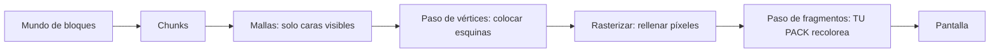

# Bloxd Shader Packs — Guía completa (Español)

🌐 [Todos los idiomas](../README.md) · En profundidad: [English](GUIDE-EN.md#part-0--start-from-zero-how-rendering-and-bloxd-shaders-work) · [Français](GUIDE-FR.md)

**Lee esto primero.** No necesitas experiencia. En diez minutos sabrás cómo el juego dibuja su
imagen, qué es un shader y exactamente qué puede y qué no puede hacer un shader pack.

## 1. La versión de un minuto

- Bloxd.io es un juego voxel: el mundo está hecho de cubos (bloques).
- La imagen en tu pantalla la dibuja tu tarjeta gráfica (GPU), 60 o más veces por segundo.
- Un **shader** es un programa diminuto que corre en la GPU y decide el color de los píxeles.
- Un **shader pack** es un pequeño archivo `.zip` con código shader. El juego lo carga y deja que
  tu código recoloree **bloques, agua y lava** mientras se dibujan.
- No cambias el juego. Solo cambias colores y luz, en el momento exacto en que cada píxel se dibuja.

## 2. Cómo se dibuja la imagen (renderizado web, paso a paso)

Tu pantalla es una cuadrícula de puntos diminutos llamados **píxeles** (por ejemplo 1920 × 1080 =
unos dos millones de píxeles). Una imagen completa es un **frame**. El juego dibuja un frame nuevo
una y otra vez: eso hace que el movimiento se vea suave.

Dos procesadores comparten el trabajo:

| | CPU (procesador principal) | GPU (tarjeta gráfica) |
|---|---|---|
| Trabajo | lógica del juego, física, red | dibujar millones de píxeles, muy rápido, en paralelo |
| Estilo | pocos trabajadores, muy inteligentes | miles de trabajadores, cada uno muy simple |

En la web, la cadena es así:

1. El juego corre como JavaScript en tu navegador (Chrome o Edge reciente es lo mejor).
2. El juego habla con la GPU mediante **WebGPU**, la API gráfica moderna del navegador.
3. Dentro del navegador, **Dawn** (con su compilador **Tint**) traduce el lenguaje de shaders
   **WGSL** a instrucciones que tu GPU entiende (Direct3D / Metal / Vulkan, según tu sistema).
4. La GPU ejecuta los shaders y pone el frame terminado en pantalla.

Bloxd está construido con un motor voxel (**noa-engine**) sobre un framework 3D (**Babylon.js**).
Para cada frame, la tubería de dibujo hace esto:

1. **Chunks.** El mundo se corta en columnas de bloques llamadas chunks. Solo se preparan para
   dibujar los chunks cercanos a ti.
2. **Meshing.** Para cada chunk, el motor construye una *malla* (mesh): una piel de triángulos que
   cubre solo las caras de bloque realmente visibles. Las caras ocultas se saltan.
3. **Atlas de texturas.** Cada cara de bloque toma su imagen de una sola imagen grande, el **atlas**,
   que contiene todas las texturas de bloques una junto a otra. Cada cara sabe qué cuadradito del
   atlas usar (sus coordenadas **UV**).
4. **Paso de vértices.** La GPU ejecuta un *vertex shader* en cada esquina (vértice) de cada
   triángulo: coloca la esquina en el lugar correcto de tu pantalla y pasa datos (coordenadas de
   textura, valores de luz, dirección de la cara…).
5. **Rasterización.** La GPU rellena cada triángulo con píxeles. Cada píxel cubierto se convierte en
   un **fragmento**: un píxel candidato con datos interpolados.
6. **Paso de fragmentos.** La GPU ejecuta un *fragment shader* por cada fragmento: aquí se decide el
   color final del píxel. **Aquí viven los shader packs de Bloxd.**
7. **Pantalla.** Se muestra el frame terminado. Luego todo se repite para el siguiente frame.



Idea clave: tu pack nunca ve «el mundo». Ve **un fragmento a la vez** — un píxel de una cara de
bloque — más algunos datos sobre ese píxel. Todo lo que hace un pack debe calcularse desde esos
datos locales.

## 3. Qué es un shader

Un shader es una función pequeña (un trozo de código) que la GPU ejecuta un número enorme de veces
en paralelo — una vez por vértice, o una vez por fragmento. Debe ser rápido y autosuficiente: sin
archivos, sin red, sin memoria del frame anterior.

Los packs de Bloxd se escriben en **WGSL** (WebGPU Shading Language). No escribes un shader
completo. El motor ya tiene sus propios shaders; te deja insertar tu código en cuatro puntos fijos
llamados **hooks** (Sección 5). Piensa en cuatro puertas: el motor avanza por su código de dibujo y,
en cada puerta, pregunta a tu función: «aquí están los datos de este píxel, ¿quieres cambiar el
color?»

## 4. Qué es un shader pack de Bloxd

Un pack es un archivo `.zip` con:

```
pack.json     (pequeño archivo de metadatos)
*.wgsl        (tu código WGSL — un archivo o muchos, en cualquier carpeta)
```

`pack.json` solo necesita:

```json
{ "apiVersion": 2, "name": "Mi Pack", "author": "tú" }
```

- `apiVersion` debe ser el número **2**. Los packs v1 antiguos se rechazan.
- El cargador encuentra **todos** los archivos `*.wgsl` del zip y los une. El orden y las carpetas
  no importan.
- Límite total de WGSL: **256 KB**.

Para instalar un pack: Bloxd → `O` Ajustes → Gráficos → activar **Use New WebGPU Renderer** →
Shader Pack → **Choose .zip** → **Apply**.

Un pack solo afecta a **bloques, agua y lava**. Algunos modos de juego desactivan los packs por
completo.

## 5. Los cuatro hooks (tus únicas puertas)

| Hook | Cuándo corre | Qué controlas |
|---|---|---|
| `bloxdTerrainSurface` | por fragmento, bloques sólidos, primero | color base, transparencia (alfa), brillo propio (emission) |
| `bloxdTerrainLight` | el mismo fragmento, justo después | color final iluminado de los bloques |
| `bloxdLiquidSurface` | por fragmento, agua y lava, primero | color base y alfa de los líquidos |
| `bloxdLiquidLight` | el mismo fragmento, justo después | color final iluminado de los líquidos |

Reglas de las puertas:

- Surface corre **antes** que light, en el mismo fragmento. Puedes pasar un valor de surface a light
  con una variable a nivel de módulo (`var<private>`).
- Empieza siempre desde el resultado por defecto del motor: `bloxdDefaultSurface(...)` o
  `bloxdDefaultLight(...)`, cambia lo que necesites y devuélvelo. Nunca construyas tú mismo las
  estructuras de resultado.
- Los hooks de surface corren antes de la prueba de recorte por transparencia del motor: en hojas y
  bloques recortados, `out.alpha` decide si el píxel se queda o se descarta; en líquidos es el factor
  real de mezcla; en bloques sólidos normales el alfa no hace nada.
- El brillo propio (`out.emission`) pertenece solo a los hooks de **surface**.
- Si escribes tu propio color final en un hook de light, aplica la niebla tú mismo al final con
  `bloxdApplyFog(colour, light)`: la niebla del motor siempre está en la escena, y saltarla hace que
  los bloques lejanos brillen a través de la niebla.

## 6. Qué te dice el motor

Para cada fragmento, tus hooks reciben datos. Los campos más útiles:

| Dato | Significado, en palabras simples |
|---|---|
| `colour` | el color de textura del bloque en este píxel (desde el atlas), antes de tus cambios |
| `blockId` | el **id numérico** del bloque (un número entero). Así tratas un tipo de bloque distinto de otro — tabla completa en la Parte VIII |
| `position` | dónde está este píxel en el mundo (x, y, z) |
| `normal` | hacia dónde apunta la cara (arriba, abajo, norte…), como vector |
| `skyLight` | cuánta luz del cielo llega a este bloque, de 0 a 1 — pero **con tone mapping**: cielo abierto ≈ 1.0, un nivel perdido bajo un árbol ≈ 0.995 (ver Sección 7) |
| `blockLight` | luz de lámparas, antorchas, lava… como color (existen lámparas de colores) |
| `heldLight` | luz del objeto en la mano del jugador |
| `skyLightColour` | el tinte actual del cielo (azul oscuro de noche, cálido al atardecer) |
| `litColour` | el color iluminado propio del motor para esta superficie (útil como base) |
| `fogVisibility`, `fogColour` | qué tan nublado está este píxel y el color de la niebla (llega **negro** cuando la niebla está apagada — maneja ese caso) |

Funciones del motor que puedes llamar:

| Función | Qué te da |
|---|---|
| `bloxdDefaultSurface(in)` / `bloxdDefaultLight(surface, light)` | el resultado normal del motor — siempre tu punto de partida |
| `bloxdApplyFog(colour, light)` | mezcla tu color en la niebla correctamente |
| `bloxdSunDirection()` | vector unitario hacia el sol; `(0,0,0)` en mundos sin sol tipo Tierra; la luna es exactamente la dirección opuesta |
| `bloxdTime()` | segundos — **vuelve a 0 cada 3600 segundos** (`bloxdTimeWrap`). Ver Sección 7 |
| `bloxdEyePosition()` | la posición de la cámara (para efectos de distancia) |
| `bloxdOriginOffset()` | el motor recentra periódicamente las coordenadas del mundo; suma este offset a cualquier patrón basado en posición del mundo, o tu patrón saltará visiblemente |
| `bloxdFaceBlock(position, normal)` | la celda de bloque (coordenadas enteras) de la cara que dibujas — perfecta para variación aleatoria por bloque |
| `bloxdOpaqueBehind()` | solo líquidos: encuentra el primer bloque sólido tras la superficie del líquido — sirve para medir la profundidad del agua |

## 7. Las trampas en las que caen todos

**El tiempo se reinicia.** `bloxdTime()` cuenta segundos pero vuelve a empezar en 3600. Si tu
animación usa el tiempo crudo, saltará una vez por hora. Anima siempre con ciclos enteros dentro del
reinicio (wrap):

```wgsl
sin(6.2831853 * fract(bloxdTime() / bloxdTimeWrap * cycles + phase))
```

Elige `cycles` como número entero. Entonces el valor en el segundo 3600 iguala al del segundo 0: sin
saltos, nunca.

**skyLight tiene tone mapping.** No es un brillo lineal 0–1. El motor comprime los niveles de luz
0–15 en una curva: el cielo abierto es ≈ 1.0 y perder un nivel aún se lee ≈ 0.995. Si pruebas
`skyLight < 0.5` esperando «en sombra», casi nada coincidirá. Calibra los umbrales sobre la curva
real (la Parte IV da valores medidos).

**La niebla siempre está.** Aunque no la veas, el motor calcula niebla (a veces empujada muy lejos).
Si tu hook de light devuelve un color sin `bloxdApplyFog`, el terreno lejano se verá demasiado
brillante y atravesará la niebla. Aplica la niebla al final, después de tu trabajo de color.

**La iluminación puede estar apagada.** Si un juego o ajuste desactiva la iluminación, `skyLight`
puede no enviarse en absoluto y los efectos guiados por el cielo no harán nada en silencio. Escribe
los efectos de modo que el pack se vea bien sin ellos.

## 8. Todo lo que un pack SÍ puede hacer

- Recolorear cualquier bloque, agua o lava — globalmente o por `blockId`.
- Hacer brillar cosas (`out.emission` en hooks de surface): lava, minerales, lámparas…
- Animar color y alfa con el tiempo (pulsos, lava que fluye, agua que brilla) — a prueba de
  reinicio (Sección 7).
- Reaccionar al ciclo día/noche mediante `bloxdSunDirection()` y `skyLightColour` (atardeceres
  cálidos, tintes azules de luna).
- Añadir detalle procedural anclado al mundo: variación sutil por bloque con hashes
  `bloxdFaceBlock`, tintes de niebla por distancia, oscurecimiento bajo el agua con la profundidad
  de `bloxdOpaqueBehind()`.
- Etalonar toda la imagen por fragmento: contraste, saturación, balance cálido/frío — siempre que
  la niebla se aplique al final.
- Pintar efectos *sobre* superficies: destellos en minerales, oscurecimiento «mojado» cerca del
  nivel del agua, nieve en caras hacia arriba (`normal.y`) y trucos similares — todo calculado desde
  los datos del propio fragmento.
- Usar la distancia (`bloxdEyePosition()`) para desvanecer efectos caros o ruidosos (nivel de
  detalle barato).

## 9. Lo que un pack NO puede hacer (límites del motor)

- **Plantas, hierba y flores** las dibuja una parte del motor que los packs no pueden alcanzar. No
  puedes recolorearlas ni animarlas.
- **Sin post-proceso.** No tienes acceso al frame terminado, ni coordenadas de pantalla, ni pases de
  desenfoque/bloom/viñeta.
- **Sin profundidad de escena.** La única consulta «qué hay detrás» es `bloxdOpaqueBehind()` a través
  de un líquido.
- **Sin mapas de sombras reales ni oclusión ambiental** más allá de lo que los valores de luz del
  motor ya codifican.
- **Sin objetos ni partículas nuevas** en el mundo. Solo puedes pintar sobre superficies que ya
  existen. (Los packs ingeniosos pintan efectos superpuestos sobre superficies — ver las recetas —
  pero la geometría siempre es del motor.)
- **Sin texturas ni samplers** propios, sin fuentes de datos extra: tus únicos datos son los
  argumentos de los hooks y las funciones del motor.
- **El movimiento de vértices** (doblar geometría, olas que mueven esquinas) existe en el motor pero
  **solo corre en unos pocos juegos**: nunca dependas de ello; simula el movimiento con animación de
  color/alfa.
- **El cielo mismo** (disco solar, skybox, nubes) lo dibuja el motor. Los packs reciben *datos* del
  cielo (dirección, tinte) pero no dibujan el cielo.

Si un efecto necesita algo de esta lista, hoy ningún pack puede hacerlo: es comportamiento probado
del motor, no un problema de habilidad.

## 10. Tu primer pack en cinco pasos

1. Crea `pack.json`:

```json
{ "apiVersion": 2, "name": "Mi Primer Pack", "author": "tú" }
```

2. Crea `shader.wgsl` junto a él:

```wgsl
fn bloxdTerrainSurface(surface: BloxdSurfaceIn) -> BloxdSurface {
    var out = bloxdDefaultSurface(surface);
    out.colour = out.colour * vec3f(1.05, 1.0, 0.92);
    return out;
}

fn bloxdTerrainLight(surface: BloxdSurface, light: BloxdLightIn) -> BloxdLight {
    var out = bloxdDefaultLight(surface, light);
    _ = surface;
    return out;
}
```

Este pack hace cada bloque un poco más cálido (más rojo, menos azul) y mantiene la iluminación del
motor. La línea `_ = surface;` le dice al compilador «esta entrada no se usa a propósito»: WGSL
exige esta forma simple.

3. Comprime los dos archivos en un zip, con `pack.json` en la raíz del zip (no dentro de una
   subcarpeta).
4. En el juego: Ajustes → Gráficos → **Use New WebGPU Renderer** activado → Shader Pack →
   Choose .zip → Apply.
5. Mira a tu alrededor: el mundo debería verse un poco más cálido. Cambia los tres números y recarga
   para experimentar.

Luego crece paso a paso: un efecto cada vez, compruébalo al mediodía, al atardecer, de noche, bajo
el agua y en una cueva antes de añadir el siguiente.

## 11. Las nueve reglas duras

Romper cualquiera rompe el pack o hace que lo rechacen:

1. Nunca definas nada cuyo nombre empiece con `BLOXD_`: pertenecen al motor.
2. Nunca construyas `BloxdSurface` / `BloxdLight` tú mismo: parte de `bloxdDefaultSurface` /
   `bloxdDefaultLight`.
3. `mod` es palabra reservada en WGSL: usa `%`.
4. Sin texturas, sin samplers, sin entry points ni atributos propios, sin UV de pantalla.
5. Evita `discard` (rechazado en modo estricto): usa `out.alpha`.
6. Los hooks de líquidos deben dar siempre un alfa válido, en cada variante.
7. Entradas sin uso: escribe `_ = valor;` — la forma `let _ =` se rechaza.
8. WGSL total ≤ 256 KB.
9. El motor compila tu código en **8 variantes** (estricto/permisivo × iluminado/sin iluminar ×
   terreno/líquido). Tu código debe compilar y comportarse en todas. Pon paréntesis en expresiones
   mezcladas de bits/desplazamiento para el compilador Tint del navegador.

## 12. Mini glosario

| Palabra | Significado |
|---|---|
| Frame | una imagen completa en pantalla |
| Pixel / fragment | un punto de la imagen / un píxel candidato que se está coloreando |
| Vertex | una esquina de un triángulo |
| Mesh (malla) | la piel de triángulos construida desde las caras visibles de un chunk |
| Atlas (atlas de texturas) | la única imagen grande con todas las texturas de bloques |
| UV | coordenadas que dicen qué parte del atlas usa una cara |
| WGSL | el lenguaje de shaders de WebGPU — el idioma de los packs de Bloxd |
| Hook | una de las cuatro funciones del motor que tu pack puede definir |
| skyLight / blockLight | luz del cielo / luz de bloques (lámparas, lava) |
| Wrap (3600 s) | `bloxdTime()` reiniciándose a 0 cada hora |
| Fog (niebla) | el terreno lejano fundiéndose en el color de la niebla |
| Variante | una de las 8 formas en que el motor compila tu pack |

## 13. Profundizar (capítulos en inglés)

| Parte | Archivo | Contenido |
|---|---|---|
| I | [01-making](GUIDE-EN.md#part-i--making-a-pack) | formato del pack, carga multi-archivo, límites, distribución |
| II | [02-api](GUIDE-EN.md#part-ii--the-api-contract) | el contrato completo de hooks y structs |
| III | [03-recipes](GUIDE-EN.md#part-iii--recipes) | 12 recetas de producción con código WGSL |
| IV | [04-realism](GUIDE-EN.md#part-iv--measured-numbers-realism-that-survives-contact-with-the-game) | números medidos: luz, niebla, óptica del agua |
| V | [05-troubleshooting](GUIDE-EN.md#part-v--troubleshooting) | cada fallo conocido y su arreglo |
| VI | [06-implementation](GUIDE-EN.md#part-vi--implementation--local-validation) | validación local en las 8 variantes |
| VII | [07-internals](GUIDE-EN.md#part-vii--engine-internals) | internos del motor (tiempo, luz, cielo, cargador) |
| VIII | [08-block-ids](GUIDE-EN.md#part-viii--the-numeric-block-id-table) | la tabla numérica completa de ids de bloques |
| IX | [09-sources](GUIDE-EN.md#part-ix--where-this-knowledge-comes-from-and-what-we-dont-know) | cómo se estableció cada hecho de esta guía |
| X | [10-constants](GUIDE-EN.md#part-x--the-constants-register-en) | cada constante (551) con su rol |

Versión completa en francés: [fr](GUIDE-FR.md) · Todos los idiomas: [índice](../README.md). Licencia: MIT.
