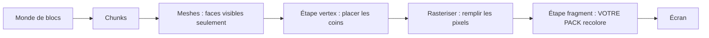

# Bloxd Shader Packs — Le Guide Complet (Français)

🌐 [Toutes les langues](../README.md) · [English](GUIDE-EN.md)

**Tout ce qu'on sait sur les shader packs Bloxd.io, expliqué le plus simplement
possible :** comment le rendu web dessine l'image, comment les shaders fonctionnent,
ce qu'un pack peut faire, ce qu'il ne peut pas faire, et comment en construire un —
fondé sur des données moteur mesurées, une table numérique complète des ids de
blocs, des packs de la communauté disséqués, et une validation locale dans les 8
variantes du moteur.

**Un seul fichier, tout est dedans.** Utilisez le sommaire ci-dessous — ou le plan (bouton ≡) de GitHub — pour aller droit à une partie.

## Sommaire

- [Partie 0 — Partir de zéro : comment le rendu et les shaders Bloxd fonctionnent](#partie-0--partir-de-zéro--comment-le-rendu-et-les-shaders-bloxd-fonctionnent)
- [Partie I — Créer un pack (FR)](#partie-i--créer-un-pack-fr)
- [Partie II — Le contrat API (FR)](#partie-ii--le-contrat-api-fr)
- [Partie III — Recettes (FR)](#partie-iii--recettes-fr)
- [Partie IV — Nombres mesurés (FR)](#partie-iv--nombres-mesurés-fr)
- [Partie V — Dépannage (FR)](#partie-v--dépannage-fr)
- [Partie VI — Implémentation & validation locale (FR)](#partie-vi--implémentation--validation-locale-fr)
- [Partie VII — Internals moteur (FR)](#partie-vii--internals-moteur-fr)
- [Partie VIII — La table numérique des ids de blocs (FR)](#partie-viii--la-table-numérique-des-ids-de-blocs-fr)
- [Partie IX — D'où vient cette connaissance (et ce qu'on ne sait pas) (FR)](#partie-ix--doù-vient-cette-connaissance-et-ce-quon-ne-sait-pas-fr)
- [Part X — The constants register (FR)](#part-x--the-constants-register-fr)


---

# Partie 0 — Partir de zéro : comment le rendu et les shaders Bloxd fonctionnent

**Lisez ceci en premier.** Aucune expérience requise. Dans dix minutes, vous saurez comment
le jeu dessine son image, ce qu'est un shader, et exactement ce qu'un shader pack peut faire
et ne pas faire. Les chapitres approfondis (Parties I à X) viennent après.

## 1. La version une minute

- Bloxd.io est un jeu voxel : le monde est fait de cubes (blocs).
- L'image sur votre écran est dessinée par votre carte graphique (GPU), 60 fois par seconde
  ou plus.
- Un **shader** est un minuscule programme qui tourne sur le GPU et décide de la couleur des
  pixels.
- Un **shader pack** est un petit fichier `.zip` avec du code shader. Le jeu le charge et
  laisse votre code recolorer **les blocs, l'eau et la lave** pendant qu'ils sont dessinés.
- Vous ne modifiez pas le jeu. Vous ne changez que les couleurs et la lumière, au moment
  précis où chaque pixel est dessiné.

## 2. Comment l'image est dessinée (le rendu web, étape par étape)

Votre écran est une grille de minuscules points appelés **pixels** (par exemple 1920 × 1080
= environ deux millions de pixels). Une image complète est une **frame**. Le jeu dessine une
nouvelle frame encore et encore — c'est ce qui rend le mouvement fluide.

Deux processeurs se partagent le travail :

| | CPU (processeur principal) | GPU (carte graphique) |
|---|---|---|
| Travail | logique du jeu, physique, réseau | dessiner des millions de pixels, très vite, en parallèle |
| Style | quelques ouvriers, très intelligents | des milliers d'ouvriers, chacun très simple |

Sur le web, la chaîne ressemble à ceci :

1. Le jeu tourne en JavaScript dans votre navigateur (Chrome ou Edge récent = le meilleur).
2. Le jeu parle au GPU via **WebGPU**, l'API graphique moderne du navigateur.
3. Dans le navigateur, **Dawn** (avec son compilateur **Tint**) traduit le langage shader
   **WGSL** en instructions que votre GPU comprend (Direct3D / Metal / Vulkan selon votre
   système).
4. Le GPU exécute les shaders et affiche la frame terminée à l'écran.

Bloxd lui-même est construit avec un moteur voxel (**noa-engine**) au-dessus d'un framework
3D (**Babylon.js**). Pour chaque frame, le pipeline de dessin fait ceci :

1. **Chunks.** Le monde est coupé en colonnes de blocs appelées chunks. Seuls les chunks
   près de vous sont préparés pour le dessin.
2. **Meshing.** Pour chaque chunk, le moteur construit un *mesh* : une peau de triangles qui
   couvre uniquement les faces de blocs réellement visibles. Les faces cachées sont ignorées.
3. **Atlas de textures.** Chaque face de bloc prend son image dans une seule grande image,
   l'**atlas**, qui contient toutes les textures des blocs côte à côte. Chaque face sait
   quel petit carré de l'atlas utiliser (ses coordonnées **UV**).
4. **Étape vertex.** Le GPU exécute un *vertex shader* sur chaque coin (vertex) de chaque
   triangle : il place le coin au bon endroit sur votre écran et transmet des données
   (coordonnées de texture, valeurs de lumière, direction de la face…).
5. **Rasterisation.** Le GPU remplit chaque triangle de pixels. Chaque pixel couvert devient
   un **fragment** : un pixel candidat avec ses données interpolées.
6. **Étape fragment.** Le GPU exécute un *fragment shader* pour chaque fragment : c'est là
   que la couleur finale du pixel est décidée. **C'est là que vivent les shader packs de
   Bloxd.**
7. **Écran.** La frame terminée s'affiche. Puis tout recommence pour la frame suivante.



Idée clé : votre pack ne voit jamais « le monde ». Il voit **un fragment à la fois** — un
pixel d'une face de bloc — plus quelques données sur ce pixel. Tout ce qu'un pack fait doit
être calculé à partir de ces données locales.

## 3. Ce qu'est un shader

Un shader est une petite fonction (un petit morceau de code) que le GPU exécute un nombre
énorme de fois en parallèle — une fois par vertex, ou une fois par fragment. Il doit être
rapide et autonome : pas de fichiers, pas de réseau, pas de mémoire de la frame précédente.

Les packs Bloxd s'écrivent en **WGSL** (WebGPU Shading Language). Vous n'écrivez pas un
shader entier. Le moteur a déjà ses propres shaders ; il vous laisse insérer votre code à
quatre points fixes, appelés **hooks** (Section 5). Voyez cela comme quatre portes : le
moteur avance dans son code de dessin, et à chaque porte il demande à votre fonction :
« voici les données de ce pixel — veux-tu changer la couleur ? »

## 4. Ce qu'est un shader pack Bloxd

Un pack est un fichier `.zip` contenant :

```
pack.json     (petit fichier de métadonnées)
*.wgsl        (votre code WGSL — un fichier ou plusieurs, n'importe quels dossiers)
```

`pack.json` n'a besoin que de ceci :

```json
{ "apiVersion": 2, "name": "Mon Pack", "author": "vous" }
```

- `apiVersion` doit être le nombre **2**. Les vieux packs v1 sont rejetés.
- Le chargeur trouve **tous** les fichiers `*.wgsl` du zip et les relie ensemble. L'ordre
  des fichiers et les dossiers n'ont aucune importance.
- Limite totale de taille WGSL : **256 Ko**.

Pour installer un pack en jeu : Bloxd → `O` Paramètres → Graphismes → activer **Use New
WebGPU Renderer** → Shader Pack → **Choose .zip** → **Apply**.

Un pack n'affecte que **les blocs, l'eau et la lave**. Certains modes de jeu désactivent les
packs complètement.

## 5. Les quatre hooks (vos seules portes)

| Hook | Quand il tourne | Ce que vous contrôlez |
|---|---|---|
| `bloxdTerrainSurface` | par fragment, blocs solides, en premier | couleur de base, transparence (alpha), émission lumineuse propre (emission) |
| `bloxdTerrainLight` | même fragment, juste après | couleur finale éclairée des blocs |
| `bloxdLiquidSurface` | par fragment, eau et lave, en premier | couleur de base et alpha des liquides |
| `bloxdLiquidLight` | même fragment, juste après | couleur finale éclairée des liquides |

Les règles des portes :

- Surface tourne **avant** light, dans le même fragment. Vous pouvez passer une valeur de
  surface à light avec une variable au niveau module (`var<private>`).
- Commencez toujours par le résultat par défaut du moteur : `bloxdDefaultSurface(...)` ou
  `bloxdDefaultLight(...)`, changez ce qu'il faut, puis retournez-le. Ne construisez jamais
  les structs de résultat vous-même.
- Les hooks surface tournent avant le test de découpe de transparence du moteur : sur les
  feuilles et les blocs découpés, `out.alpha` décide si le pixel est gardé ou jeté ; sur
  les liquides, c'est le vrai facteur de mélange ; sur les blocs solides ordinaires, alpha
  ne fait rien.
- L'émission lumineuse propre (`out.emission`) appartient uniquement aux hooks **surface**.
- Si vous écrivez votre propre couleur finale dans un hook light, appliquez le brouillard
  vous-même à la fin avec `bloxdApplyFog(colour, light)` — le brouillard du moteur est
  toujours présent dans la scène, et l'omettre fait briller les blocs lointains à travers.

## 6. Ce que le moteur vous donne

Pour chaque fragment, vos hooks reçoivent des données. Les champs les plus utiles :

| Donnée | Signification, en mots simples |
|---|---|
| `colour` | la couleur de texture du bloc à ce pixel (depuis l'atlas), avant vos changements |
| `blockId` | l'**identifiant numérique** du bloc (un nombre entier). C'est ainsi qu'on traite un type de bloc différemment d'un autre — table complète en Partie VIII |
| `position` | où se trouve ce pixel dans le monde (x, y, z) |
| `normal` | vers où pointe la face (haut, bas, nord…), sous forme de vecteur |
| `skyLight` | combien de lumière du ciel atteint ce bloc, de 0 à 1 — mais **tone-mappé** : ciel ouvert ≈ 1.0, un niveau perdu sous un arbre ≈ 0.995 (voir Section 7) |
| `blockLight` | lumière des lampes, torches, lave… sous forme de couleur (les lampes colorées existent) |
| `heldLight` | lumière de l'objet tenu dans la main du joueur |
| `skyLightColour` | la teinte actuelle du ciel (bleu foncé la nuit, chaude au coucher du soleil) |
| `litColour` | la couleur éclairée propre du moteur pour cette surface (utile comme base) |
| `fogVisibility`, `fogColour` | à quel point ce pixel est brumeux, et la couleur du brouillard (arrive **noire** quand le brouillard est désactivé — gérez ce cas) |

Fonctions moteur que vous pouvez appeler :

| Fonction | Ce qu'elle vous donne |
|---|---|
| `bloxdDefaultSurface(in)` / `bloxdDefaultLight(surface, light)` | le résultat normal du moteur — toujours votre point de départ |
| `bloxdApplyFog(colour, light)` | fond correctement votre couleur dans le brouillard |
| `bloxdSunDirection()` | vecteur unitaire vers le soleil ; `(0,0,0)` dans les mondes sans soleil type terrestre ; la lune est exactement la direction opposée |
| `bloxdTime()` | secondes — **retombe à 0 toutes les 3600 secondes** (`bloxdTimeWrap`). Voir Section 7 |
| `bloxdEyePosition()` | la position de la caméra (pour les effets de distance) |
| `bloxdOriginOffset()` | le moteur recale périodiquement les coordonnées du monde ; ajoutez cet offset à tout motif basé sur la position dans le monde, sinon votre motif sautera visiblement |
| `bloxdFaceBlock(position, normal)` | la cellule de bloc (coordonnées entières) de la face que vous dessinez — parfait pour varier au hasard par bloc |
| `bloxdOpaqueBehind()` | liquides seulement : trouve le premier bloc solide derrière la surface du liquide — sert à mesurer la profondeur de l'eau |

## 7. Les pièges dans lesquels tout le monde tombe

**Le temps repart à zéro.** `bloxdTime()` compte les secondes mais recommence à partir de
3600. Si votre animation utilise le temps brut, elle sautera une fois par heure. Animez
toujours avec des cycles entiers à l'intérieur du wrap :

```wgsl
sin(6.2831853 * fract(bloxdTime() / bloxdTimeWrap * cycles + phase))
```

Choisissez `cycles` comme nombre entier. Alors la valeur à la seconde 3600 égale celle à la
seconde 0 : aucun saut, jamais.

**skyLight est tone-mappé.** Ce n'est pas une luminosité linéaire 0–1. Le moteur compresse
les 16 niveaux de lumière (0–15) en une courbe : le ciel ouvert vaut ≈ 1.0 et perdre un
niveau donne encore ≈ 0.995. Si vous testez `skyLight < 0.5` en pensant « à l'ombre »,
presque rien ne correspondra. Calibrez vos seuils sur la vraie courbe (la Partie IV donne
les valeurs mesurées).

**Le brouillard est toujours là.** Même quand vous ne le voyez pas, le moteur calcule le
brouillard (parfois repoussé très loin). Si votre hook light retourne une couleur sans
`bloxdApplyFog`, le terrain lointain paraîtra trop lumineux et traversera le brouillard.
Appliquez le brouillard en dernier, après votre travail de couleur.

**L'éclairage peut être désactivé.** Si un jeu ou un réglage désactive l'éclairage,
`skyLight` peut ne pas être envoyé du tout et les effets pilotés par le ciel ne font
silencieusement rien. Écrivez vos effets pour que le pack reste beau sans eux.

## 8. Tout ce qu'un pack PEUT faire

- Recolorer n'importe quel bloc, l'eau ou la lave — globalement ou par `blockId`.
- Faire briller les choses (`out.emission` dans les hooks surface) : lave, minerais,
  lampes…
- Animer couleur et alpha dans le temps (pulsations, lave qui coule, eau qui scintille) —
  à l'épreuve du wrap (Section 7).
- Réagir au cycle jour/nuit via `bloxdSunDirection()` et `skyLightColour` (couchers de
  soleil chauds, teintes de lune bleues).
- Ajouter du détail procédural ancré dans le monde : variation subtile par bloc avec des
  hashs `bloxdFaceBlock`, teintes de brouillard par distance, assombrissement sous-marin
  avec la profondeur `bloxdOpaqueBehind()`.
- Étalonner toute l'image par fragment : contraste, saturation, balance chaud/froid — tant
  que le brouillard est appliqué à la fin.
- Peindre des effets *sur* les surfaces : étincelles sur les minerais, assombrissement
  « mouillé » près du niveau de l'eau, neige sur les faces vers le haut (`normal.y`), et
  des astuces similaires — tout est calculé à partir des données du fragment lui-même.
- Utiliser la distance (`bloxdEyePosition()`) pour estomper les effets coûteux ou bruités
  (niveau de détail à bon marché).

## 9. Ce qu'un pack NE PEUT PAS faire (limites du moteur)

- **Plantes, herbe et fleurs** sont dessinées par une partie du moteur que les packs ne
  peuvent pas atteindre. Vous ne pouvez ni les recolorer ni les animer.
- **Pas de post-traitement.** Vous n'avez pas accès à l'image finale, pas de coordonnées
  d'écran, pas de passes de flou/bloom/vignette.
- **Pas de profondeur de scène.** La seule requête « qu'y a-t-il derrière » est
  `bloxdOpaqueBehind()` à travers un liquide.
- **Pas de vraies ombres portées ni d'occlusion ambiante** au-delà de ce que les valeurs de
  lumière du moteur encodent déjà.
- **Pas de nouveaux objets ni particules** dans le monde. Vous ne pouvez que peindre sur des
  surfaces déjà existantes. (Les packs malins peignent des effets en surcouche sur des
  surfaces — voir les recettes — mais la géométrie reste toujours celle du moteur.)
- **Pas de textures ni de samplers** à vous, pas d'autres sources de données : vos seuls
  apports sont les arguments des hooks et les fonctions du moteur.
- **Le déplacement de sommets** (plier la géométrie, des vagues qui bougent les coins)
  existe dans le moteur mais **ne tourne que dans quelques jeux** — ne comptez jamais
  dessus ; simulez le mouvement avec une animation de couleur/alpha à la place.
- **Le ciel lui-même** (disque solaire, skybox, nuages) est dessiné par le moteur. Les
  packs reçoivent les *données* du ciel (direction, teinte) mais ne dessinent pas le ciel.

Si un effet exige quelque chose de cette liste, aucun pack ne peut le faire aujourd'hui —
c'est un comportement moteur prouvé, pas un problème de compétence.

## 10. Votre premier pack en cinq étapes

1. Créez `pack.json` :

```json
{ "apiVersion": 2, "name": "Mon Premier Pack", "author": "vous" }
```

2. Créez `shader.wgsl` à côté :

```wgsl
fn bloxdTerrainSurface(surface: BloxdSurfaceIn) -> BloxdSurface {
    var out = bloxdDefaultSurface(surface);
    out.colour = out.colour * vec3f(1.05, 1.0, 0.92);
    return out;
}

fn bloxdTerrainLight(surface: BloxdSurface, light: BloxdLightIn) -> BloxdLight {
    var out = bloxdDefaultLight(surface, light);
    _ = surface;
    return out;
}
```

Ce pack rend chaque bloc légèrement plus chaud (plus de rouge, moins de bleu) et garde
l'éclairage du moteur. La ligne `_ = surface;` dit au compilateur « cette entrée est
volontairement inutilisée » — WGSL exige cette forme nue.

3. Zippez les deux fichiers ensemble, avec `pack.json` à la racine du zip (pas dans un
   sous-dossier).
4. En jeu : Paramètres → Graphismes → **Use New WebGPU Renderer** activé → Shader Pack →
   Choose .zip → Apply.
5. Regardez autour de vous : le monde devrait être un peu plus chaud. Changez les trois
   nombres et rechargez pour expérimenter.

Grandissez ensuite étape par étape : un effet à la fois, vérifiez-le à midi, au couchant,
la nuit, sous l'eau et dans une grotte avant d'ajouter le suivant.

## 11. Les neuf règles dures

Briser l'une d'elles casse ou fait rejeter le pack :

1. Ne définissez jamais rien dont le nom commence par `BLOXD_` — ils appartiennent au
   moteur.
2. Ne construisez jamais `BloxdSurface` / `BloxdLight` vous-même — partez de
   `bloxdDefaultSurface` / `bloxdDefaultLight`.
3. `mod` est un mot réservé en WGSL — utilisez `%`.
4. Pas de textures, pas de samplers, pas de points d'entrée ni d'attributs à vous, pas d'UV
   d'écran.
5. Évitez `discard` (rejeté en mode strict) — utilisez `out.alpha` à la place.
6. Les hooks liquides doivent toujours produire un alpha valide, dans chaque variante.
7. Entrées inutilisées : écrivez `_ = valeur;` — la forme `let _ =` est rejetée.
8. WGSL total ≤ 256 Ko.
9. Le moteur compile votre code en **8 variantes** (strict/permissif × éclairé/non éclairé ×
   terrain/liquide). Votre code doit compiler et se comporter dans toutes. Parentésez les
   expressions bit à bit/décalage mélangées pour le compilateur Tint du navigateur.

## 12. Mini glossaire

| Mot | Signification |
|---|---|
| Frame | une image complète à l'écran |
| Pixel / fragment | un point de l'image / un pixel candidat en cours de coloration |
| Vertex | un coin d'un triangle |
| Mesh | la peau de triangles construite à partir des faces visibles d'un chunk |
| Atlas (atlas de textures) | la seule grande image contenant toutes les textures des blocs |
| UV | coordonnées qui disent quelle partie de l'atlas une face utilise |
| WGSL | le langage shader de WebGPU — la langue des packs Bloxd |
| Hook | l'une des quatre fonctions moteur qu'un pack peut définir |
| skyLight / blockLight | lumière du ciel / lumière des blocs (lampes, lave) |
| Wrap (3600 s) | `bloxdTime()` qui repart à 0 toutes les heures |
| Brouillard (fog) | le terrain lointain qui se fond dans la couleur du brouillard |
| Variante | l'une des 8 façons dont le moteur compile votre pack |

## 13. Aller plus loin

| Partie | Fichier | Contenu |
|---|---|---|
| I | [01-creation](#partie-i--créer-un-pack-fr) | format du pack, chargement multi-fichiers, limites, distribution |
| II | [02-api](#partie-ii--le-contrat-api-fr) | le contrat complet hooks et structs |
| III | [03-recettes](#partie-iii--recettes-fr) | 12 recettes de production avec code WGSL |
| IV | [04-realisme](#partie-iv--nombres-mesurés-fr) | nombres mesurés : unités de lumière, brouillard, optique de l'eau |
| V | [05-depannage](#partie-v--dépannage-fr) | chaque mode de défaillance connu et sa réparation |
| VI | [06-implementation](#partie-vi--implémentation--validation-locale-fr) | validation locale en 8 variantes, contrôles de packaging |
| VII | [07-internes](#partie-vii--internals-moteur-fr) | internes du moteur (temps, pipeline de lumière, ciel, chargeur) |
| VIII | [08-ids-blocs](#partie-viii--la-table-numérique-des-ids-de-blocs-fr) | la table numérique complète des ids de blocs |
| IX | [09-sources](#partie-ix--doù-vient-cette-connaissance-et-ce-quon-ne-sait-pas-fr) | comment chaque fait de ce guide a été établi |
| X | [10-constantes](#part-x--the-constants-register-fr) | chaque constante, avec son rôle |

Autres langues : [index du guide](#bloxd-shader-packs--le-guide-complet-français) · [sommaire français](#bloxd-shader-packs--le-guide-complet-français).

---

# Partie I — Créer un pack (FR)

## Ce qu'est un pack

Un **.zip** contenant `pack.json` (métadonnées) + un ou plusieurs `.wgsl`, n'importe quelle
arborescence.

```json
{ "apiVersion": 2, "name": "Mon Pack", "author": "toi" }
```

- `apiVersion` doit être le **nombre** 2 — les packs v1 sont rejetés par le jeu actuel.
- Aucune liste de fichiers dans pack.json (voir multi-fichiers).

## Installation (ce que feront tes utilisateurs)

Bloxd → `O` Réglages → Graphismes → cocher **Use New WebGPU Renderer** → Shader Pack →
**Choose .zip** → **Apply**. Navigateur WebGPU récent requis ; certains jeux désactivent les packs.

## Ce qu'un pack peut toucher

**Blocs, eau et lave uniquement** (+ quelques chemins de couleur exposés par le hook light).
Les plantes/fleurs sont dessinées par une partie du moteur **inaccessible aux packs** (prouvé
par dissection). La déformation de sommets existe mais **ne tourne que dans quelques jeux**.

## Multi-fichiers — IMPORTANT (prouvé sur le terrain)

Le loader **globbe tous les `*.wgsl` du zip et les concatène**. Aucun `shader.wgsl` racine
requis : le pack n°1 du workshop envoie 10 fichiers en sous-dossiers sans racine. Le scope
module WGSL étant indépendant de l'ordre, l'ordre des fichiers est libre. Les deux layouts sont
valides ; le multi-fichiers est plus maintenable, le mono-fichier plus facile à partager.

## Caps

- **256 Ko** de `.wgsl` total après concaténation (cap loader).
- WGSL uniquement, pas de `#include`, pas de préprocesseur maison.
- Le coût par fragment est à ta charge : gate les effets coûteux (distance / blockId, Partie III).

## Distribution

- **Le workshop bloxdhub** est la vitrine de fait ; chaque page item expose un lien zip direct
  `media.bloxdhub.com/workshop-files/<token>.zip`. Liens Drive/GitHub également valables.
- Les utilisateurs retéléchargent manuellement à chaque mise à jour (cadence « hot »).

## Pack minimal qui marche

`shader.wgsl` :

```wgsl
fn bloxdTerrainSurface(surface: BloxdSurfaceIn) -> BloxdSurface {
    var out = bloxdDefaultSurface(surface);
    out.colour = out.colour * vec3f(1.02, 1.0, 0.96);
    return out;
}

fn bloxdTerrainLight(surface: BloxdSurface, light: BloxdLightIn) -> BloxdLight {
    var out = bloxdDefaultLight(surface, light);
    _ = surface; // forme nue obligatoire en v2
    return out;
}
```

Zip avec pack.json **à la racine du zip**. Ensuite : Partie II.

---

# Partie II — Le contrat API (FR)

Provenances : **[publié]** = prouvé dans un pack en production · **[local]** = exercé par des
packs validés localement.

## Les quatre hooks

| Hook | Rôle |
|---|---|
| `bloxdTerrainSurface(BloxdSurfaceIn) -> BloxdSurface` | recolorie/alpha du terrain opaque |
| `bloxdTerrainLight(BloxdSurface, BloxdLightIn) -> BloxdLight` | couleur finale éclairée (fog via `bloxdApplyFog`) |
| `bloxdLiquidSurface(BloxdSurfaceIn) -> BloxdSurface` | couleur/alpha des liquides |
| `bloxdLiquidLight(BloxdSurface, BloxdLightIn) -> BloxdLight` | couleur finale des liquides |

Faits structurants :

- **Surface puis light, dans le même fragment** : passe de données par `var<private>` de scope
  module **[publié]**.
- Surface tourne **avant l'alphaTest** : `out.alpha` pilote le discard des cutouts (plantes,
  feuilles) et est la vraie transparence des liquides ; sans effet sur l'opaque simple.
- **`out.emission` appartient au hook surface**.
- Toujours repartir de `bloxdDefault*` ; paramètres inutilisés → forme nue `_ = param;`.

## Structs (champs prouvés en usage)

```wgsl
BloxdSurfaceIn { colour, alpha, position, normal, blockId: u32, /* … */ }
BloxdSurface   { colour, alpha, emission, /* … */ }
BloxdLightIn   { position, normal, blockId, skyLight, blockLight, heldLight,
                 skyLightColour, litColour, fogVisibility, fogColour /* … */ }
BloxdLight     { colour /* … */ }
```

- `blockId : u32` — **l'id numérique** (table Partie VIII) = la clé du shading par bloc.
- `skyLight` — **tone-mappé** (Partie IV) ; ciel ouvert ≈ 1 ; un niveau perdu sous canopée ≈ 0.995.
- `blockLight` / `heldLight` — canaux couleur (lampes colorées possibles).
- `skyLightColour` — teinte du ciel, s'assombrit la nuit **[publié]**.
- `litColour` — la couleur éclairée propre de la surface **[publié]**.
- `fogColour` arrive **noir** quand le fog est en mode NONE.

## Fonctions moteur

| Fonction | Rôle |
|---|---|
| `bloxdDefaultSurface` / `bloxdDefaultLight` | point de départ obligatoire |
| `bloxdApplyFog(colour, light)` | mix(fogColour, colour, fogVisibility) — en dernier, après ton grade |
| `bloxdSunDirection()` | vecteur soleil ; **(0,0,0) sans ciel de type terre** ; lune = −soleil ; statique en monde défaut |
| `bloxdTime()` / `bloxdTimeWrap` | secondes, wrap 3600 — animer en **cycles entiers** |
| `bloxdEyePosition()` | caméra (distances, LOD, vecteurs de vue) |
| `bloxdOriginOffset()` | rebase floating-origin — **à injecter dans tout hash monde** |
| `bloxdFaceBlock(pos, normal)` | les **coordonnées** du bloc de la face courante — entrée de hash par bloc ; l'id est `surface.blockId` / `light.blockId` **[publié]** |
| `bloxdOpaqueBehind()` | `{found, position}` — épaisseur d'eau, approx réfraction **[publié]** |

## Règles dures

1. Jamais de `#define BLOXD_*` (macros owned par le moteur, par variante).
2. Jamais de construction littérale des structs — toujours `bloxdDefault*`.
3. `mod` est **réservé** — utiliser `%`.
4. Pas de textures, samplers, builtins, UV écran, `discard` en strict.
5. Liquides : alpha écrit dans toutes les variantes (reconstruit depuis l'alpha enregistré).
6. `let _ =` rejeté — forme nue `_ = expr;`.
7. Total `.wgsl` ≤ 256 Ko.
8. Viser le compilateur Tint du navigateur, pas juste naga : parenthéser les chaînes
   bitwise/décalages.

## Les 8 variantes à survivre

strict × lit × {terrain, liquide} et allow × lit × {terrain, liquide} (+ variantes unlit).
« Strict » = serveurs durcis : pas de discard, features réduites. Sans « Lighting », le jeu
n'envoie **aucun skyLight** : la logique d'ombre s'éteint silencieusement (prouvé par un pack
publié). Le comportement des hooks light en unlit n'est **pas encore mesuré** — écrire des hooks
indifférents à cette question. Tout hook doit compiler dans les 8 variantes (Partie VI).

## Capacités & frontières — la matrice définitive

| Les packs PEUVENT | Les packs NE PEUVENT PAS |
|---|---|
| recolorier terrain & liquides **par blockId** (Partie VIII) | toucher plantes/fleurs (chemin moteur inaccessible **[publié]**) |
| régler l'alpha des cutouts (discard) et des liquides (blend) | post-traiter l'image (aucun accès écran) |
| auto-luminance via `out.emission` (hook surface) | lire la profondeur de scène — sauf `bloxdOpaqueBehind()` à travers un liquide |
| grader, teinter, agir avant le fog, termes ciel | vrai shadow-mapping ou SSAO au-delà de ce que skyLight encode |
| effets procéduraux ancrés monde (hash + rebase) | ajouter objets/particules au monde (peindre des surmontes, R14) |
| données `var<private>` surface→light par fragment | textures/samplers/binds supplémentaires |
| déformation de sommets | en dépendre — **quelques jeux seulement** **[publié]** |
| réagir à blockLight/heldLight, soleil, temps | connaître la direction du faisceau tenu ; avoir une UI de config par monde |

---

# Partie III — Recettes (FR)

Snippets originaux ; constantes citées créditées. Conformes aux règles de la Partie II.

## R1 — Détection de bloc (la fondation)

```wgsl
fn isLeaf(id: u32) -> bool {
    switch id {
        case 100u, 101u, 102u, 103u, 491u, 492u, 493u, 653u, 911u, 1226u: { return true; }
        default: { return false; }
    }
}
```

Groupes d'ids en Partie VIII. Hook light → `light.blockId` ; hook surface →
`surface.blockId` — `bloxdFaceBlock(surface.position, surface.normal)` donne les coordonnées
du bloc, l'entrée que veulent les hashs par bloc.

## R2 — Ombre de canopée (l'astuce des « soft tree shadows »)

Sous un arbre, exactement un niveau de skyLight est perdu — mais skyLight est tone-mappé :
ce niveau ≈ 0.995, pas 0.93. On le compte :

```wgsl
const CANOPY_SPREAD = 0.0035;
var covered = clamp((1.0 - light.skyLight) / CANOPY_SPREAD, 0.0, 1.0)
            * smoothstep(0.35, 0.6, light.skyLight); // les grottes restent ouvertes
```

Crédit : pack publié Breeze (Crownix, d'après Ellie). À combiner avec la garde lampes (R4).

## R3 — Teinte directionnelle soleil par face

```wgsl
let sun = bloxdSunDirection();
let day = smoothstep(0.0, 0.12, sun.y);            // off la nuit & sans ciel soleil
let lit = smoothstep(-0.1, 0.35, dot(light.normal, sun));
let strength = day * smoothstep(0.4, 0.9, light.skyLight);
out.colour *= mix(vec3f(0.76, 0.8, 0.88), vec3f(1.1, 1.04, 0.94), lit) * strength;
```

## R4 — Garde lampes (la lumière doit percer ton shading)

```wgsl
let lamp = 1.0 - smoothstep(0.4, 0.9,
             max(light.blockLight.r, max(light.blockLight.g, light.blockLight.b)));
strength *= lamp;   // tout facteur d'assombrissement multiplie par ceci
```

## R5 — Lift de luminosité sans clipping (grade avant fog)

```wgsl
const BRIGHTEN = 1.45; const VIBRANCE = 0.22;
fn grade(c: vec3f) -> vec3f {
    let l = max(c, vec3f(0.0));
    let b = l * BRIGHTEN / (1.0 + l * (BRIGHTEN - 1.0)); // pente B au noir, blanc = blanc
    let grey = dot(b, vec3f(0.2126, 0.7152, 0.0722));
    let chroma = max(b.r, max(b.g, b.b)) - min(b.r, min(b.g, b.b));
    return clamp(mix(vec3f(grey), b, 1.0 + VIBRANCE * (1.0 - chroma)), vec3f(0.0), vec3f(1.0));
}
// usage : out.colour = bloxdApplyFog(grade(lit) + surface.emission, light);
```

Crédit : Breeze. Grade **avant** fog ; emission ajoutée avant fog.

## R6 — Profondeur d'eau réelle (Beer-Lambert, données moteur)

```wgsl
let behind = bloxdOpaqueBehind();
let depth = select(64.0, max(surface.position.y - behind.position.y, 0.0), behind.found);
let depthFade = 1.0 - exp(-depth * 0.32);   // ~1/3 à 1 bloc
```

Crédit : Breeze. `depth = 64` si rien d'opaque derrière (ciel ouvert = profond).

## R7 — Réflexion ciel respectueuse de la nuit

```wgsl
let grazing = 1.0 - clamp(dot(toEye, n), 0.0, 1.0);
let fresnel = 0.02 + 0.98 * grazing * grazing * grazing * grazing * grazing; // Schlick, eau
let skyExposure = smoothstep(0.45, 0.98, light.skyLight); // l'eau de grotte ne reflète pas
colour = mix(colour, light.skyLightColour * TEINTE, fresnel * 0.45 * skyExposure);
```

Jamais `normalize(toEye + bloxdSunDirection())` sans garde de longueur — somme exactement nulle
quand le soleil est opposé à la vue (NaN garanti).

## R8 — Hash stable monde sous floating origin

```wgsl
fn mixBits(v: u32) -> u32 {
    var h = v; h ^= h >> 16u; h *= 0x7feb352du; h ^= h >> 15u; h *= 0x846ca68bu; h ^= h >> 16u;
    return h;
}
let place = light.position + vec3f(bloxdOriginOffset() % vec3i(4096)); // OBLIGATOIRE
```

Crédit : Breeze. Sans le terme d'origine, tes motifs glissent quand le moteur rebasse le monde.

## R9 — Animation wrap-sûre (précision loin du spawn)

```wgsl
let value = 0.5 + 0.5 * sin(6.2831853 * fract(bloxdTime() / bloxdTimeWrap * cycles + phase));
```

`cycles` entier ⇒ sans couture au wrap. La seule façon sûre d'animer ancré monde.

## R10 — Fondu LOD pour que la distance ne coûte rien

```wgsl
let near = 1.0 - smoothstep(FAR * 0.6, FAR, distance(bloxdEyePosition(), position));
if (near > 0.0) { /* détail coûteux uniquement ici */ }
```

Packs publiés : grain 14 m, rides 24-40 m, taches 48 m. Toute boucle par fragment doit être gated.

## R13 — Bruit value-noise immortel (réseaux entiers tournés)

L'astuce des packs publiés pour un bruit qui ne perd jamais la précision et ne saute jamais au
rebase : un réseau dont les coins sont des **entiers qui wrappent**, approché par strides entiers :

```wgsl
const CELLULES = 8;  const PERIODE = 289;          // wrap des coins (sûr en float)
const STRIDE = 2000;  const DECAL = vec2i(117, 44); // 0,5 cellule réseau/bloc, tourné 20,6°
fn octave(cellule: vec2i) -> vec3f {
    let reste  = ((cellule % STRIDE) + STRIDE) % STRIDE;
    let compte = ((cellule - reste) / STRIDE) % PERIODE;   // base petite pour toujours
    let base   = compte.x * DECAL + compte.y * vec2i(-DECAL.y, DECAL.x);
    // hash des coins de base + point tourné ; blend quintique ; gradient analytique + valeur
}
```

Crédit : pack publié Breeze (deux octaves tournées ; octave fine fondue 24→40 m et sautée au-delà).
Combiné à R8/R9 : vagues/grain/brume qui survivent des heures loin du spawn.

## R14 — Peindre des surmontes : ajouter des « objets » sans rien ajouter

Les packs ne peuvent pas ajouter d'objets au monde — alors **peignez-les dans la couleur**.
Marchez quelques pas le long du rayon de vue dans un repère qui glisse vers le bas (les cellules
hashées tombent), testez un quad hashé par cellule, et si touché **retournez sa couleur à la
place de celle du terrain** :

```wgsl
for (var i = 0; i < PAS; i++) {
    let s = (f32(i) + 0.5) * pas;
    let glissant = oeil + origine + d * s + vec3f(0.0, t * CHUTE, 0.0); // repère tombant
    let h = hashCellule(vec3i(floor(glissant / CELLULE)) + SEL);
    if (hashUnit(h) > CHANCE) { continue; }
    // placer un quad hashé dans la cellule ; si le pixel est dessus : return couleur * niveau;
}
```

Gater (`isLeaf(blockId) ∥ sousCanopee`, portée ≤ 10 m) — le raymarch 6 pas non-borné est la
plainte FPS n°1 du workshop. Crédit : pack publié Breeze (feuilles tombantes), technique
généralisable à toute « particule ».

## R11 — Alpha liquide strict-sûr

```wgsl
var out = bloxdDefaultSurface(surface);
out.alpha = clamp(surface.alpha / ALPHA_ENREGISTRE * mix(OP_PEUP, OP_PROF, depthFade), 0.0, 1.0);
out.alpha = max(out.alpha, ecume * 0.95); // les surmontes poussent l'alpha vers le haut
```

## R12 — Variation par cellule sans répétition de texture

```wgsl
let cell = vec3i(floor(surface.position * CELLULES - surface.normal * 0.5))
         + bloxdOriginOffset() * CELLULES + vec3i(0, 104729, 0); // décalage anti-collision
```

Le demi-cellule par la normale évite le scintillement des faces latérales.

---

# Partie IV — Nombres mesurés (FR)

Étiquettes : **[mesuré]** (nos pipelines) · **[publié]** (prouvé dans un pack) · **[tierce]**
(restauré du JS de production par la communauté — vérifier avant d'en dépendre).

## Unités de lumière

- skyLight 0-15 (flood-fill) ; **ciel ouvert = 15** ; un niveau perdu sous canopée ≈ **0.995
  après tone-mapping** — la « perte de niveau » est visible, l'échelle n'est pas linéaire.
- **La courbe de tone est saturante** [mesuré] : nos fits de sonde correspondent à une famille
  type `raw = 45·b/(1+2b)` — les niveaux du haut sont comprimés, c'est pourquoi la discrimination
  d'ombre se joue tout en haut de l'échelle.
- **Les ombres de terrain vivent dans skyLight 13.6–14.95 / 15** [mesuré] : toute la bande
  d'ombre du jour = le 1,5 niveau supérieur. Tout test d'ombre sous ≈13,5 est de la logique de
  grotte, pas de soleil.
- skyLight arrive **tone-mappé** aux packs : ciel franc ≥ ≈0.98 ; rejet grotte/nuit < ≈0.45 ;
  niveau perdu de canopée ≈ 0.995 **[publié]**.
- Les couleurs de lumière packées ont un **plancher 35 % par canal** relatif au canal max
  **[tierce]** — un rouge pur arrive (1.0, 0.35, 0) : voilà pourquoi les lampes paraissent roses.
- Propriétés lumineuses des blocs (docs scripting officielles **[tierce-officielle]**):
  `lightEmission` 0-15 et **`lightFilter`** — combien de lumière un bloc retire (1 air / 3
  fluide / 15 opaque). Voilà pourquoi les pièces s'assombrissent et l'eau atténue les dégradés.
- `l.ambient` = material.ambient × sceneAmbient (réglage utilisateur, défaut 0.5). Ne jamais
  coder le défaut en dur **[tierce]**.

## Soleil, lune, ciel

- Mondes défaut : soleil statique ≈ **(−0.56, 0.81, −0.18)** **[tierce]** ; mondes jour/nuit le
  mettent à jour ; **lune = −soleil exactement** ; nuit ⇔ `sun.y < 0`.
- Ciels non-terre (gloomy/interstellar/espace) : `bloxdSunDirection()` = **(0,0,0)** — un facteur
  jour basé sur `sun.y` désactive tout seul tes effets soleil **[publié]**.
- La lumière directionnelle du terrain = 2 lampes figées : **la luminosité du terrain ne suit
  PAS le soleil toute seule** ; le « moment de la journée » est 100 % ton travail.

## Fog

- Rampes **linéaires** : `fogVisibility = (fogEnd−dist)/(fogEnd−fogStart)`, `fogStart = 32×D`,
  `fogEnd = 32×(D+1)` — la bande n'a que **32 blocs** **[tierce]** (notre ancienne note « EXP2 »
  venait du wiki ; priorité à la figure production-JS, à re-vérifier sonde si ton effet en dépend).
- Couleur défaut `rgb(183, 191, 195)` ; overridable par les créateurs de monde ; **mode 0 (NONE)
  → fogColour arrive noir** — d'où `bloxdApplyFog`, sûr à visibilité 1.
- Damier fin aux bords de chunks pendant le chargement = fade Bayer 4×4 du moteur, **pas ton bug**.

## Optique de l'eau (valeurs prouvées)

- Obscurcissement Beer-Lambert `1 − exp(−0.32·d)` (≈⅓ à 1 bloc) **[publié]** ; notre plan P0
  utilisait 0.45/0.08/0.03 par canal — les deux marchent.
- Schlick F0 = 0.02 ; sheen large `0.05·pow(nDotH, 24)·sunUp` **[publié]**.
- Eau enregistrée : couleur (0.5, 0.5, 0.8), alpha 0.9 — reconstruire l'alpha, ne pas coder en dur.

## Grading

- Lift `c·B/(1+c·(B−1))` : pente **B au noir, exactement 1.0 au blanc** — le blanc ne clippe
  jamais. Breeze publie B = 1.45 **[publié]** ; notre pack cinématique cale B par canal sur des
  frames réelles.
- Vibrance avec garde chroma (`1 − chroma`) : les pixels ternes se saturent, les déjà-colorés
  restent intacts.

## Pourquoi mesurer

Tous les packs disséqués règlent à l'œil. Caler ta courbe sur des captures (régression log-log)
prend un après-midi et transforme le « feeling » en reproductible. Voir Partie VI.

---

# Partie V — Dépannage (FR)

## À la compilation

| Symptôme | Cause / correctif |
|---|---|
| `'mod' is a reserved word in WGSL` | renommer ou utiliser `%` |
| `no definition in scope: bloxdOpaqueBehind` dans TON harnais | stub trop étroit, pas le pack — le symbole est réel (utilisé par un pack publié) |
| `#define BLOXD_…` rejeté | macros owned par le moteur ; autre préfixe |
| `direct struct construction` | partir de `bloxdDefaultSurface(...)` |
| `let _ =` rejeté | forme nue `_ = expr;` |
| naga OK, jeu rejette | Tint est plus strict sur la précédence : parenthéser `a ^= b >> c` |
| pack ignoré silencieusement | `apiVersion` pas le nombre 2, JSON invalide, ou zip emboîté dans un dossier |

## Charge mais rend mal

| Symptôme | Cause / correctif |
|---|---|
| rien ne change dans certains jeux | ces jeux désactivent les packs |
| plantes non teignables | chemin de rendu inaccessible aux packs (prouvé par dissection) |
| ombres disparues | « Lighting » off → aucun skyLight envoyé ; tes portes d'ombre s'éteignent (normal) |
| lampes cassées | assombrissement sans garde lampes (R4) |
| motifs qui glissent | `bloxdOriginOffset()` manquant dans le hash (R8) ou `bloxdTime()` non wrappé (R9) |
| eau noire en grotte | termes ciel sans porte `skyExposure` (R7) |
| NaN / scintillement noir à un angle | `normalize(toEye + sunDir)` = 0 exact quand soleil opposé à la vue — garder la longueur |
| damier pendant le chargement | fade Bayer 4×4 moteur, pas toi |
| blocs blancs en mode fog 0 | fogColour utilisé hors `bloxdApplyFog` — il arrive noir |
| shimmer/zoom loin du spawn | précision flottante : cellules entières + rebase (R8) |

## Performance

- Les **boucles** par fragment tuent : un raymarch 6 pas gated à 10 m près des arbres est fin,
  non-borné c'est la ruine (plainte visible dans les commentaires du pack n°1).
- Tout détaillé se fond par distance (R10) ; `if` (pas `mix`) quand la porte vaut 0.
- Le hash par cellule bat le bruit par pixel pour tout ce que l'œil lit comme « texture ».

## Distribution

- Retéléchargement manuel à chaque mise à jour (spam « Updated 2 hours ago » normal).
- Même nom de zip ≠ même contenu : publier le sha256.
- Les packs v1 **ne chargent plus** : migrer vers `apiVersion: 2` (Partie I).

---

# Partie VI — Implémentation & validation locale (FR)

## Layout maintenable

```
mon-pack/
├── pack.json
├── lib/hash.wgsl        # hash + rebase origine (R8/R9)
├── terrain/*.wgsl       # une préoccupation par fichier
├── water/*.wgsl
└── effects/*.wgsl
```

Le loader concatène : dépendances inter-fichiers sans ordre (fonctions pures au scope module,
`var<private>` confiné à une préoccupation).

## Pipeline local (avant chaque release)

1. **Test de concat** — reconstruire la concaténation du loader ; compiler CE fichier aussi.
2. **Compile 8 variantes** — naga local avec prelude moteur stubé par variante :
   strict/allow × lit/unlit × terrain/liquide. 8/8 localement n'a jamais échoué en jeu chez nous.
   Si ton stub manque un symbole (ex. `bloxdOpaqueBehind`), corrige le STUB, pas le pack.
3. **Checks statiques** — mots réservés (`mod`), `#define BLOXD_`, structs littéraux, `let _`,
   marqueurs TODO, taille ≤ 256 Ko.
4. **Audit boucles/logique** — toute boucle par fragment bornée ET gated (distance/blockId) ;
   tout facteur d'assombrissement multiplié par la garde lampes.
5. **Packaging** — zip avec pack.json **à la racine** ; publier le sha256 avec la release.
6. **Smoke test en jeu** — monde jour, nuit, grotte, un arbre, bord d'eau, lampe, monde ciel
   sans soleil ; captures ; comparaison à la release précédente.
7. **Matrice de stress via les options de monde** — les mondes peuvent surcharger ce que les
   packs reçoivent = environnements de test gratuits : override `fogColour`, overrides
   skyLight / lumière ambiante, `lightingOverride`, types de skybox (earth, gloomy,
   interstellar/espace ⇒ **vecteur soleil nul**), mondes jour/nuit, plus mondes Lighting off.
   Un pack qui survit à cette matrice (effets soleil auto-off, fog-sûr, grottes correctes)
   est de qualité release.

## Mesurer plutôt que deviner

- Monde « sonde » (seed fixe, bande horaire fixe) + captures à caméra fixe.
- Cale ta courbe de grade sur des paires log-log de luminance des captures.
- Packs sondes (jamais publiés) : écrire les grandeurs moteur dans les canaux couleur (skyLight
  → rouge, blockLight → vert…) et relire à la pipette — c'est ainsi que les seuils de tone-mapping
  de la Partie IV ont été mesurés.

## Checklist de release

- [ ] `apiVersion: 2` en nombre
- [ ] 8/8 variantes en local + parenthèses paranoïaques Tint
- [ ] pas de `#define BLOXD_`, struct littérale, `let _`, `mod`, discard en chemin strict
- [ ] alpha liquide écrit dans toutes les branches
- [ ] garde lampes sur tout facteur d'assombrissement
- [ ] boucles bornées + gated
- [ ] taille ≤ 256 Ko
- [ ] sha256 du zip publié
- [ ] smoke testé : jour, nuit, grotte, canopée, bord d'eau, lampe, ciel sans soleil

---

# Partie VII — Internals moteur (FR)

Chaque item porte sa provenance : **[mesuré]** · **[publié]** · **[tierce]** (JS de production
restauré par la communauté — vérifier toute dépendance critique).

## Temps et espace

- `bloxdTime()` = uptime navigateur wrappé à 1 h (`bloxdTimeWrap` = 3600), sans lien avec une
  horloge de jeu **[tierce + usage publié]**.
- **Floating origin** : `bloxdOriginOffset()` rebasse périodiquement les coordonnées monde
  (moteur noa). Tout motif ancré monde doit injecter l'offset dans son hash **[publié]**.
- Le jour/nuit **n'est pas** un changement d'éclairage terrain : 2 lampes directionnelles
  figées à la création de la scène ; seul le ciel et `bloxdSunDirection()` portent le temps
  **[tierce]**.

## Pipeline lumière

- skyLight 0-15 flood-fill ; ciel ouvert = 15 ; **tone-mappé avant les packs** (un niveau perdu
  ≈ 0.995 post-courbe) **[seuils publiés]**.
- Décodage `aPackedLightLevels` : plancher **35 % du canal max** **[tierce]**.
- `heldLight` : portée = canal max, ≤ 15 blocs, distance pré-déformée `^0.75`, valeur
  pré-boost-ambiant **[tierce]**.
- Propriétés lumineuses des blocs (docs scripting officielles **[tierce-officielle]**):
  `lightEmission` 0-15 (alimente le BFS blockLight) et `lightFilter` — 1 air / 3 fluide /
  15 opaque — voilà pourquoi les pièces vont au noir et les fluides atténuent les dégradés.
- `skyLightEmission` (0-15, blocs custom) **injecté dans le canal skyLight lui-même**, hors BFS
  blockLight — les tests soleil/ombre fondés sur skyLight seul peuvent être trompés ; combiner
  avec blockLight **[tierce]**.
- `l.ambient` = material.ambient × sceneAmbient (réglage utilisateur, défaut 0.5) **[tierce]**.

## Surfaces

- Hooks surface **avant alphaTest** : `out.alpha` pilote le discard des cutouts et est le vrai
  facteur de blend des liquides ; sans effet sur l'opaque simple **[tierce]**.
- `out.emission` = sortie du hook surface (ou sommée dans la couleur avant fog) **[publié]**.
- Plantes/fleurs : chemin de rendu **inaccessible aux packs** **[publié]** ; déformation de
  sommets existante mais **certains jeux seulement** **[publié]** → vent « shading only ».
- Fondu de chargement = dither **Bayer 4×4 écran** du moteur **[tierce]**.

## Ids

- Le rendu identifie les blocs par **`blockId : u32` numérique** (Partie VIII) ; le scripting
  utilise des ids string — deux espaces pour les mêmes blocs.
- L'espace d'ids **grandit** : un dump fini à 2089 manque déjà des ids jusqu'à 3254 utilisés par
  un pack publié. Ré-énumérer à chaque release (méthode Partie VIII).

## Ciel

- Mondes défaut : soleil statique ≈ (−0.56, 0.81, −0.18) ; **lune = −soleil** ; ciels sans
  soleil → vecteur nul **[tierce]**.
- Fog : bande linéaire de 32 blocs au bord de chargement ; couleur défaut rgb(183,191,195) ;
  fogColour **noir** en mode NONE **[tierce]**.

## Loader

- Glob `**/*.wgsl` + concaténation ; pas de fichier racine requis ; scope module indépendant de
  l'ordre **[publié]**.
- Cap 256 Ko total ; `apiVersion` v1 rejeté d'office **[tierce]**.

---

# Partie VIII — La table numérique des ids de blocs (FR)

Le `blockId : u32` du rendu est la clé du shading par bloc. Table curée pour le shading ;
régénérer la liste complète en jeu :

```
for (i = 2; i < 3400; i++) api.log(i + " = " + api.blockIdToBlockName(i))
```

(dans un Code Block ; l'espace d'ids grandit — un dump 2026 finissait à 2089 alors qu'un pack
publié cible jusqu'à 3254.)

## Groupes pertinents pour le shading (entrées vérifiées à la lecture)

| Groupe | Ids |
|---|---|
| **Naturels** | 2 Dirt · 3 Messy Dirt · 4 **Grass Block** · 5 Sand · 6 Clay · 7 Gravel · 8 Snow · 28 Stone · 29 Messy Stone · 31 Smooth Stone · 32-37 Diorite/Andesite/Granite (+smooth) · 38 Sandstone · 39 Yellowstone · 139 Ice · 140 Obsidian · 147 Bedrock · 650 Red Sand · 652 Rocky Dirt · 472 Useless Soil · 1295 Melting Ice |
| **Magma** | 471 **Magma** (le bloc lave solide) |
| **Minerai / métaux** | 40 Coal · 41 Iron · 42 Gold · 43 Lapis · 44 Emerald · 45 Diamond · 465 Moonstone Ore · blocs 46-50 · 172 Diamond · 470 Moonstone |
| **Feuilles** | 100 Pine · 101 Aspen · 102 Maple · 103 Elm · 491 Plum · 492 Cedar · 493 Palm · 911 Pear · 653 Autumn Maple · 1226 Cherry · canopées 208-211, 494-496, 938, 654, 1259 |
| **Bois** | 9 Maple · 10 Pine · 11 Plum · 12 Cedar · 13 Aspen · 14 Elm · 502 Palm · 909 Pear · 1222 Cherry · écorcés 21-26, 1112-1121 |
| **Plantes** | **150 Grass** (la plante) · 151-163 fleurs · **1109 Tall Grass** · 1110 Tall Grass\|Top · 149 Cactus · 213 Fat Cactus · 219 Vines · 105 Watermelon · 975 Pumpkin · 957 Cobweb |
| **Liquides** | **126 Water** · **1491 Lava** |
| **Lumière** | 124 Dim Lamp On · 125 Off · 143 Beacon · 164 Furnace · 168 Workbench · 980 Jack o'Lantern · 145 Golden Decoration · 146 Moonstone Explosive |
| **Vitres** | 106 Glass · 107-122 les 16 teintées · 992-1007 Patterned |
| **Colorés** | 51-66 Wool · 67-83 Baked Clay · 84-99 Concrete · 228-243 Planks · 245-308 Ceramic · 1040-1055 Carpet |
| **Spéciaux** | 0 Air · 1 Unloaded · 127 Invisible Solid · 1510 Code Block · 1512 worldedit-ghost |

## Annexe live — ids au-delà du dump 2026 (prouvés par un pack publié)

Un pack publié (Breeze v1) cible ces ids, absents du dump à 2089 — le jeu a grandi ; noms
exacts en attente d'un dump frais :

- **Feuilles** (leur `isLeaf`) : **1636 · 1969 · 2019 · 2020 · 2021 · 2022 · 2023 · 2024 · 2025 · 2085**
- **Grass Blocks** (leur `isGrassBlock`) : **1694 · 1955 · 3071 · 3072 · 3073 · 3253 · 3254**

## Pièges

- **Deux espaces de noms** : scripting = ids string ; le u32 du shader = id de rendu. Mapper via
  des boucles `api.blockIdToBlockName(i)`, jamais en devinant.
- Préférer des **switch de groupes** aux égalités : les variantes de biome arrivent comme de
  nouveaux ids dans la même famille (voir l'annexe).
- Id 4 = le **bloc** d'herbe (effets sur la face du dessus) ; 150 = la **plante** (inatteignable,
  sway côté moteur). Les deux ont un précédent dans des packs publiés.

---

# Partie IX — D'où vient cette connaissance (et ce qu'on ne sait pas) (FR)

Chaque affirmation de ce guide porte une étiquette de provenance. Cette page est la méthode
derrière les étiquettes — parce qu'un guide qui dit *comment il sait* vaut dix qui affirment.

## Les trois classes de provenance

| Étiquette | Signification | Politique de confiance |
|---|---|---|
| **[mesuré]** | produit par des instruments locaux : packs sondes écrivant les grandeurs moteur dans les canaux couleur, pipelines de captures à caméra/monde fixés, fits de courbes sur frames réelles | confiance dans l'enveloppe mesurée |
| **[publié]** | prouvé par un pack communautaire publié tournant dans le jeu live (ex. Breeze v1, disséqué fichier par fichier) | confiance — le jeu lui-même l'a accepté |
| **[tierce]** | restauré du JS de production par l'analyse communautaire (internals imu31465, dumps npm, wiki) | jamais porteur tant que non mesuré ; cité car il a guidé nos sondes |

## Les instruments

- **Harnais naga 8 variantes** — prelude moteur stubé par variante (strict/allow × lit/unlit ×
  terrain/liquide). Chaque release compile 8/8 avant de partir ; ce bilan a prédit l'acceptation
  en jeu sur des dizaines de releases.
- **Fuzz WGSL 42 cas** — formes malformées passées au compilateur pour cartographier ce qui
  casse naga vs ce qui casse le Tint du navigateur (deux compilateurs différents ; le jeu
  utilise celui du navigateur).
- **Packs sondes** (jamais publiés) — skyLight→rouge, blockLight→vert, fog→bleu ; relu à la
  pipette dans des mondes contrôlés. C'est de là que viennent les seuils de tone-mapping et la
  bande d'ombre (13.6-14.95/15).
- **Fit de courbes** — captures à dispositifs connus, régression log-log des paires de
  luminance : la vraie courbe de réponse au lieu d'un gamma deviné.
- **Dissection en oracle inversé** — compiler un pack *publié* dans notre harnais : chaque échec
  = notre harnais qui se trompe, pas le pack (c'est ainsi que `bloxdFaceBlock`,
  `bloxdOpaqueBehind`, `skyLightColour`, `litColour` et le multi-fichiers ont été confirmés).
- **Triangulation multi-sources** — un fait n'est promu que si des sources indépendantes
  concordent (manuel communautaire + wiki + dumps client + nos sondes). Les désaccords sont
  gardés et étiquetés (la rampe de fog, Partie IV).

## Questions ouvertes honnêtes

1. **Forme de la rampe de fog** — linéaire 32×D [tierce] vs EXP2 (ancienne note wiki). Figure
   production-JS privilégiée ; mesure sonde en attente.
2. **Hooks light en unlit** — tournent-ils du tout ? Pas encore mesuré ; écrire des hooks
   indifférents.
3. **Hygiène du loader** — messages d'erreur exacts et chemins de récupération du loader in-game
   (le bundle client existe dans des archives publiques ; lecture dédiée prévue).
4. **Noms des nouveaux ids** — les ids jusqu'à 3254 sont *utilisés* par un pack publié ; les noms
   officiels attendent un dump frais de `api.blockIdToBlockName`.

## Les chiffres derrière ce guide

Table numérique complète des ids (0 → 3254+) · dizaines de releases validées sur deux packs de
production · 4 API moteur documentées ici pour la première fois depuis l'usage publié · 2 packs
publiés disséqués jusqu'à la constante · chaque constante citée porte le crédit de son auteur.

---

<!-- CONSTANTS:START — generated by zz-gen_var_registry.py, do not edit by hand -->

# Part X — The constants register (FR)

## Variables exposées par le moteur (ce que le jeu te donne)

Les identifiants restent en anglais (ce sont les noms réels du code). Signification en contexte
FR dans la Partie II. Valeurs internes clés : wrap temps **3600 s** ; échelle lumière **0-15**,
ciel ouvert = 15 ; courbe de tone ≈ **45·b/(1+2b)** [mesuré] ; bande d'ombre terrain
**13.6-14.95/15** [mesuré] ; plancher des canaux packés **35 %** ; bande de fog **32×D →
32×(D+1)** [tierce, question ouverte] ; couleur fog défaut **rgb(183,191,195)** ; showFog off →
**3200-3328** ; ambient scène défaut **0.5** ; cap loader **256 Ko** ; 2 lampes directionnelles
figées. Détails et provenances : [Partie IV](#partie-iv--nombres-mesurés-fr) et Partie VII.

## Registre des constantes (packs locaux et packs disséqués)

Généré mécaniquement depuis les sources de ce dépôt (`zz-gen_var_registry.py`) —
valeur exacte du code, rôle par constante (individuel ou par famille), pack d'origine.


## cinematic-v5 (pack local — baseline gelée) — 183 constants

| Constant | Value | Role |
|---|---|---|
| `TR_ALT_HAZE` | 0.15 | brume d'altitude : force du voile au-dessus de 55 blocs |
| `TR_AURORA_WATER` | 0.08 | eau : force de l'aurore nocturne reflétée (dans notre reflet seulement) |
| `TR_BACKLIGHT` | 0.18 | contre-jour : force de la lueur de la végétation dos au soleil |
| `TR_BACKLIGHT_COL` | vec3f(1.0, 0.62, 0.28) | contre-jour : couleur chaude de la lueur |
| `TR_BAT_CHANCE` | 0.12 | chauves-souris : proportion de cellules au crépuscule |
| `TR_BAT_COL` | vec3f(0.10, 0.09, 0.08) | chauves-souris : couleur de la silhouette sombre |
| `TR_BAT_ROAM` | 0.8 | chauves-souris : rayon d'errance saccadée |
| `TR_BAT_SIZE` | 0.09 | chauves-souris : taille du corps |
| `TR_BAT_T_WING` | 9.424778 | chauves-souris : vitesse de battement rapide (verrouillée au wrap) |
| `TR_BFLY_BODY` | 0.012 | papillons : demi-largeur du corps |
| `TR_BFLY_CHANCE` | 0.25 | papillons : proportion de cellules d'air occupées |
| `TR_BFLY_COL1` | vec3f(0.95, 0.93, 0.85) | papillons : variante blanche |
| `TR_BFLY_COL2` | vec3f(0.98, 0.85, 0.30) | papillons : variante jaune |
| `TR_BFLY_COL3` | vec3f(0.90, 0.55, 0.25) | papillons : variante orange |
| `TR_BFLY_GAP` | 0.035 | papillons : demi-séparation des deux ailes |
| `TR_BFLY_ROAM` | 0.4 | papillons : rayon d'errance autour de la cellule |
| `TR_BFLY_SIZE` | 0.05 | papillons : taille du corps |
| `TR_BFLY_TALL` | 1.35 | papillons : ratio de hauteur du disque d'ailes |
| `TR_BFLY_T_WING` | 3.1415927 | papillons : vitesse de battement des ailes (verrouillée au wrap) |
| `TR_BUG_COL` | vec3f(0.72, 0.06, 0.05) | coccinelles : rouge de la carapace |
| `TR_BUG_SHARE` | 0.12 | papillons : part qui sont des coccinelles |
| `TR_CANOPY_HI` | 0.9995 | fenêtre effets d'arbres : skyLight du ciel ouvert (les plaines restent nues) |
| `TR_CANOPY_LO` | 0.90 | fenêtre effets d'arbres : skyLight minimum (les grottes restent nues) |
| `TR_CINEMA_BOOST` | 1.6 | mode cinéma : multiplicateur de brume dorée et contre-jour |
| `TR_CINEMA_MODE` | false | mode cinéma : false = normal, true = atmosphère poussée |
| `TR_EDGE_AO` | 0.92 | force de l'AO d'arête (pondérée skyLight, loi) |
| `TR_EMBER_CHANCE` | 0.18 | lave : proportion de cellules émettant des braises |
| `TR_EMBER_HEIGHT` | 2.2 | lave : hauteur de montée des braises (blocs) |
| `TR_EMBER_SIZE` | 0.03 | lave : taille angulaire d'une braise à 1 bloc |
| `TR_EMBER_T_RISE` | 4.0 | lave : période de montée des braises (doit diviser 3600) |
| `TR_EPSILON` | 0.0001 | garde epsilon générique |
| `TR_FLY_CHANCE` | 0.18 | lucioles : proportion de cellules d'air occupées |
| `TR_FLY_COLOUR` | vec3f(1.0, 0.85, 0.45) | lucioles : couleur de la lueur |
| `TR_FLY_SIZE` | 0.035 | lucioles : rayon du point lumineux |
| `TR_FLY_W_BLINK` | 0.0698132 | lucioles : vitesse angulaire de clignotement (verrouillée au wrap) |
| `TR_FLY_W_BOB` | 0.7853981 | lucioles : vitesse angulaire du flottement (verrouillée au wrap) |
| `TR_GLASS_MIRROR` | 0.30 | verre : force du reflet du ciel (fresnel) |
| `TR_GLASS_RIM` | 0.22 | verre : éclaircissement des bords aux angles rasants |
| `TR_GOLDEN_GAIN` | 0.50 | gain heure dorée |
| `TR_GOLDEN_TINT` | vec3f(1.06, 1.005, 0.90) | teinte heure dorée |
| `TR_GRAIN` | 0.0 | quantité de grain (fondu par distance) |
| `TR_HZN_CLOUD_STR` | 0.45 | force du banc de nuages d'horizon |
| `TR_LAMP_FLICKER` | 0.10 | vacillement lampes : profondeur de modulation (0 = off) |
| `TR_LAMP_SOFT_AO` | 0.55 | adoucissement lampes : AO de bord conservée près des lampes |
| `TR_LAMP_SOFT_GAIN` | 2.5 | adoucissement lampes : gain blockLight → facteur de lavage |
| `TR_LAMP_SOFT_GRAIN` | 0.5 | adoucissement lampes : grain conservé près des lampes |
| `TR_LAVA_FLOW_SCALE` | 0.55 | lave : échelle de la texture de flot visqueux (bien plus lente que l'eau) |
| `TR_LEAF_AUTUMN` | 0.12 | feuilles tombantes : proportion de feuilles teintées automne |
| `TR_LEAF_AUTUMN_GOLD` | vec3f(0.87, 0.60, 0.16) | feuilles tombantes : teinte dorée d'automne |
| `TR_LEAF_AUTUMN_RUST` | vec3f(0.62, 0.28, 0.09) | feuilles tombantes : teinte rouille d'automne |
| `TR_LEAF_BACKLIT` | 0.35 | feuilles tombantes : halo en contre-jour quand le soleil est derrière |
| `TR_LEAF_CELL` | 3.0 | feuilles tombantes : taille des cellules d'air (une feuille max par cellule) |
| `TR_LEAF_CHANCE` | 0.3 | feuilles tombantes : proportion de cellules occupées |
| `TR_LEAF_DRIFT` | 0.06 | feuilles tombantes : dérive sous le vent (direction des nuages) |
| `TR_LEAF_FADE_LO` | 5.0 | feuilles tombantes : distance de début de fondu |
| `TR_LEAF_FALL` | 0.6 | feuilles tombantes : vitesse de chute (= WRAP*CELL/3600 exactement) |
| `TR_LEAF_FLUTTER` | 0.15 | feuilles tombantes : amplitude du flottement vertical |
| `TR_LEAF_GUST` | 0.5 | feuilles tombantes : surcroît de balancement pendant les rafales |
| `TR_LEAF_LEN` | 1.7 | feuilles tombantes : rapport longueur/largeur de la feuille |
| `TR_LEAF_LOD_SHRINK` | 0.45 | feuilles tombantes : rétrécissement au loin |
| `TR_LEAF_ON` | true | interrupteur : feuilles tombantes |
| `TR_LEAF_RANGE` | 10.0 | feuilles tombantes : distance de dessin depuis l'œil |
| `TR_LEAF_RIM` | 0.22 | feuilles tombantes : force du rim-light au centre |
| `TR_LEAF_SIZE` | 0.09 | feuilles tombantes : demi-largeur d'une feuille |
| `TR_LEAF_SIZE_VAR` | 0.30 | feuilles tombantes : variation de taille par feuille (+/-) |
| `TR_LEAF_STEPS` | 6 | feuilles tombantes : échantillons du march de rayon le long de la ligne de vue |
| `TR_LEAF_TIP` | 0.55 | feuilles tombantes : force de la pointe effilée |
| `TR_LEAF_TWOTONE` | 0.18 | feuilles tombantes : variation bicolore par feuille |
| `TR_LEAF_WRAP` | 720 | feuilles tombantes : wrap en y des cellules pour une boucle 3600 s sans saut |
| `TR_LEAF_W_FLIP` | 2.199115 | feuilles tombantes : vitesse angulaire de retournement (verrouillée au wrap) |
| `TR_LEAF_W_GUST` | 0.1047197 | feuilles tombantes : vitesse angulaire du cycle de rafales (verrouillée au wrap) |
| `TR_LEAF_W_SPIN` | 1.600467 | feuilles tombantes : vitesse angulaire de rotation (verrouillée au wrap) |
| `TR_LEAF_W_SWAY_A` | 1.300270 | feuilles tombantes : vitesse angulaire de balancement x (verrouillée au wrap) |
| `TR_LEAF_W_SWAY_B` | 0.900590 | feuilles tombantes : vitesse angulaire de balancement z (verrouillée au wrap) |
| `TR_LITTER_DENS` | 0.82 | litière de feuilles : proportion de cellules laissées nues |
| `TR_LITTER_MIX` | 0.22 | litière de feuilles : force du mélange au sol sous canopée |
| `TR_LITTER_SCALE` | 3.0 | litière de feuilles : cellules de mouchetis par bloc |
| `TR_MIST_GOLDEN` | 0.10 | perspective aérienne / brume |
| `TR_MIST_GOLDEN_COL` | vec3f(0.93, 0.96, 1.0) | perspective aérienne / brume |
| `TR_MIST_GROUND` | 0.12 | brume au sol : force à l'heure dorée |
| `TR_MIST_GROUND_BAND` | 3.5 | brume au sol : bande de hauteur autour de l'œil (blocs) |
| `TR_MIST_GROUND_COL` | vec3f(0.93, 0.96, 1.0) | brume au sol : couleur du voile |
| `TR_MIST_GROUND_HI` | 90.0 | brume au sol : fin du fondu de distance (blocs) |
| `TR_MIST_GROUND_LO` | 16.0 | brume au sol : début du fondu de distance (blocs) |
| `TR_MOONLIGHT` | vec3f(0.30, 0.38, 0.55) | teinte clair de lune |
| `TR_MOON_COLUMN` | 0.10 | eau : force de la colonne de clair de lune sur le fleuve |
| `TR_MOON_GAIN` | 0.30 | gain clair de lune |
| `TR_MOTE_CHANCE` | 0.2 | motes d'air : proportion de cellules occupées (spores de grottes / pollens du jour) |
| `TR_MOTE_COL` | vec3f(0.55, 0.75, 1.0) | motes d'air : couleur des spores de grottes |
| `TR_MOTE_SIZE` | 0.035 | motes d'air : taille angulaire à 1 bloc |
| `TR_POLLEN_COL` | vec3f(1.0, 0.85, 0.45) | motes d'air : couleur des pollens dorés |
| `TR_RELIEF_EPS` | 0.30 | pas epsilon du relief |
| `TR_RELIEF_GAIN` | 1.6 | gain d'éclairage du relief |
| `TR_RELIEF_HEIGHT` | 0.16 | amplitude du champ de hauteur |
| `TR_RELIEF_SCALE` | 1.7 | échelle de hauteur du relief |
| `TR_SCOTO` | 0.5 | force du mix scotopique (vision des bâtonnets) |
| `TR_SKY2_BAND_A` | -0.22 | élévation solaire : nuit complète en dessous |
| `TR_SKY2_BAND_B` | -0.04 | élévation solaire : le crépuscule commence ici |
| `TR_SKY2_BAND_C` | 0.10 | élévation solaire : le jour commence ici |
| `TR_SKY2_BAND_D` | 0.30 | élévation solaire : jour complet au-dessus |
| `TR_SKY2_GLOW_DAWN` | vec3f(1.0, 0.70, 0.38) | couleur du halo solaire à l'aube |
| `TR_SKY2_GLOW_DUSK` | vec3f(1.0, 0.50, 0.26) | couleur du halo solaire au crépuscule |
| `TR_SKY2_GLOW_NIGHT` | vec3f(0.50, 0.62, 0.92) | couleur du halo de lune |
| `TR_SKY2_NIGHT_LOW` | vec3f(0.07, 0.10, 0.20) | couleur d'horizon du ciel de nuit (bleu profond) |
| `TR_SKY2_NIGHT_TOP` | vec3f(0.01, 0.02, 0.06) | couleur zénithale du ciel de nuit |
| `TR_SKY2_TWI_LOW` | vec3f(0.98, 0.62, 0.42) | couleur d'horizon du ciel d'aube/crépuscule (pêche-or) |
| `TR_SKY2_TWI_TOP` | vec3f(0.34, 0.34, 0.62) | couleur zénithale du ciel d'aube/crépuscule (mauve) |
| `TR_SKYF_CURVE` | 1.6 | ciel-brouillard : pente de la courbe d'élévation (prouvée Blocky Day) |
| `TR_SKYF_FOG_MIX` | 0.9 | ciel-brouillard : part de la couleur de brouillard moteur remplacée par le dégradé de ciel |
| `TR_SKYF_GLOW` | 0.55 | ciel-brouillard : force du halo solaire (HORIZON_GLOW de Blocky Day) |
| `TR_SKYF_GLOW_COL` | vec3f(1.00, 0.78, 0.50) | ciel-brouillard : couleur du halo solaire dans le faux ciel |
| `TR_SKYF_HAZE_DESAT` | 0.10 | désaturation grise de la brume aérienne (plus bas = ciel plus bleu) |
| `TR_SKYF_HORIZON_MIX` | 0.85 | ciel-brouillard : fusion de la brume d'horizon dans le faux ciel |
| `TR_SKYF_LOW` | vec3f(0.70, 0.80, 0.96) | ciel-brouillard : couleur d'horizon du faux ciel (prouvée Blocky Day) |
| `TR_SKYF_TOP` | vec3f(0.25, 0.45, 0.85) | ciel-brouillard : couleur zénithale du faux ciel (prouvée Blocky Day) |
| `TR_SOFTEN_AMOUNT` | 0.0 | force du lissage du speckle des faces (anti-séparations) |
| `TR_SOFTEN_GRAIN_NEAR` | 14.0 | distance d'arrêt de la couche de grain fin |
| `TR_SOFTEN_LEVEL` | 0.5 | luminance cible des faces lissées |
| `TR_SOFTEN_MIST` | 0.0 | force des taches nuageuses douces sur les faces |
| `TR_SOFTEN_MIST_FAR` | 48.0 | distance de disparition des taches |
| `TR_SOFTEN_MIST_SIZE` | 5.0 | fréquence des taches par bloc |
| `TR_SPLASH_BRIGHT` | 1.6 | lave : éclat des gouttes |
| `TR_SPLASH_CHANCE` | 0.35 | lave : proportion de cellules avec source d'éclaboussure active |
| `TR_SPLASH_COL` | vec3f(1.0, 0.55, 0.15) | lave : couleur des gouttes |
| `TR_SPLASH_HEIGHT` | 0.45 | lave : hauteur d'apogée des gouttes |
| `TR_SPLASH_SIZE` | 0.045 | lave : taille angulaire d'une goutte à 1 bloc |
| `TR_SPLASH_TRAIL` | 0.05 | lave : espacement de la traînée derrière la goutte (fraction de cycle) |
| `TR_SPLASH_T_RISE` | 3.0 | lave : période montée-descente (doit diviser 3600) |
| `TR_SWAY_FLOWER_HI` | 163u | fin de la plage d'ids des fleurs (gate de sway) |
| `TR_SWAY_FLOWER_LO` | 151u | début de la plage d'ids des fleurs (gate de sway) |
| `TR_SWAY_VINE_W` | 0.5 | poids de sway des vignes (id 219) |
| `TR_VIBRANCE` | 0.16 | grade pré-fog (lift + vibrance à garde chroma) |
| `TR_WATER_CLARITY` | 0.82 | clarté de l'eau |
| `TR_WATER_DAY_TINT` | vec3f(0.34, 0.78, 0.82) | teinte d'eau, bande jour |
| `TR_WATER_DUSK_TINT` | vec3f(0.20, 0.48, 0.66) | teinte d'eau, bande crépuscule |
| `TR_WATER_GLINT` | 0.82 | force du scintillement solaire |
| `TR_WATER_MIRROR_CAP` | 1.05 | optique de l'eau |
| `TR_WATER_MIRROR_CHROMA` | 0.80 | optique de l'eau |
| `TR_WATER_MIRROR_PRESS` | 1.60 | optique de l'eau |
| `TR_WATER_MOON_GLINT` | vec3f(0.48, 0.66, 0.88) | optique de l'eau |
| `TR_WATER_NIGHT_TINT` | vec3f(0.075, 0.19, 0.34) | teinte d'eau, bande nuit |
| `TR_WATER_REFLECTIVITY` | 0.78 | réflectivité de l'eau |
| `TR_WATER_RIPPLE` | 0.105 | amplitude des rides |
| `TR_WATER_TINT` | 0.48 | force du mix de teinte d'eau |
| `TR_WAVE_OMEGA_A` | 0.502655 | fréquence angulaire bande A (gel R17) |
| `TR_WAVE_OMEGA_B` | 0.726057 | fréquence angulaire bande B (gel R17) |
| `TR_WAVE_OMEGA_C` | 0.949459 | fréquence angulaire bande C (gel R17) |
| `TR_WAVE_OMEGA_D` | 1.605703 | fréquence angulaire bande D (gel R17) |
| `TR_WAVE_OMEGA_E` | 1.982694 | fréquence angulaire bande E (gel R17) |
| `TR_WAVE_OMEGA_F` | 2.415536 | fréquence angulaire bande F (gel R17) |
| `TR_WAVE_SWELL_AMP` | 0.15 | eau : amplitude de la houle longue dans la normale |
| `TR_WAVE_SWELL_FOAM` | 0.20 | eau : force de l'écume sur les crêtes de houle |
| `TR_WAVE_SWELL_SCALE` | 0.10 | eau : fréquence spatiale de la houle (radians par bloc) |
| `bloom_spill` | 0.5 | quantité de diffusion bloom |
| `cloud_height` | 100.0 | altitude de la couche nuages cv5 |
| `cloud_scale` | 0.006 | échelle du bruit nuages cv5 |
| `cloud_speed` | vec2f(1.2, 0.7) | vitesse de dérive des nuages cv5 |
| `cloud_strength` | 0.3 | force de la couche nuages 2D cv5 |
| `grade_contrast` | 0.16 | contraste final |
| `grade_saturation` | 1.2 | multiplicateur de saturation final |
| `grass_id` | 150u | l'id du bloc PLANTE herbe (gate de sway par bloc) |
| `haze_base_height` | 40.0 | altitude de référence du brouillard |
| `haze_density` | 0.006 | densité du brouillard de hauteur |
| `haze_height_falloff` | 0.012 | décroissance du brouillard avec l'altitude |
| `haze_strength` | 0.48 | force du brouillard de hauteur |
| `hot_glow_strength` | 0.2 | lueur des émetteurs chauds |
| `leaf_glow` | 0.6 | lueur de translucence des feuilles |
| `luma` | vec3f(0.299, 0.587, 0.114) | poids de luminance Rec.709 |
| `ray_sky_max` | 0.90 | porte d'exposition ciel des god-rays (haut) |
| `ray_sky_min` | 0.60 | porte d'exposition ciel des god-rays (bas) |
| `ray_strength` | 0.3 | force des god-rays |
| `shadow_ambient_drop` | 0.55 | perte ambiante dans l'ombre |
| `shadow_softness` | 0.04 | douceur du bord d'ombre |
| `shadow_strength` | 0.85 | force des ombres directionnelles |
| `shadow_threshold` | 0.95 | seuil skyLight de déclenchement des ombres |
| `shadow_tint` | vec3f(0.62, 0.74, 1.0) | teinte froide des ombres |
| `sun_fallback` | vec3f(0.42, 0.85, 0.0) | teinte soleil de repli |
| `sway_amount` | 0.3 | amplitude du sway |
| `sway_mode` | 2 | sélecteur d'implémentation du sway ; 2 = couleur seule (partout) |
| `sway_speed` | 1.0 | multiplicateur de temps du sway |
| `tall_grass_id` | 1109u | l'id de la plante Tall Grass (même gate) |
| `tall_grass_top_id` | 1110u | id du bloc moitié haute de Tall Grass (gate de sway) |
| `underwater_strength` | 0.30 | force de l'étalonnage sous-marin |

## titan-bsl-ultra-v2 (pack local — vitrine ciel/nuages/eau) — 288 constants

| Constant | Value | Role |
|---|---|---|
| `TR_AERIAL_DESAT` | 0.55 | perspective aérienne / brume |
| `TR_AERIAL_SCALE` | 46.0 | perspective aérienne / brume |
| `TR_AERIAL_SLANT` | 1.35 | perspective aérienne / brume |
| `TR_AERIAL_STRENGTH` | 0.22 | perspective aérienne / brume |
| `TR_AIR_SCATTER` | 0.055 | perspective aérienne / brume |
| `TR_AMBIENT_HUE_AMOUNT` | 0.45 | façonnage de teinte ambiante/rebond |
| `TR_AO_EDGE_MIN` | 0.10 | système d'AO (pondéré skyLight) |
| `TR_AO_EDGE_SOFT` | 2.60 | système d'AO (pondéré skyLight) |
| `TR_AO_LEVEL_HIGH` | 14.60 | système d'AO (pondéré skyLight) |
| `TR_AO_LEVEL_LOW` | 3.00 | système d'AO (pondéré skyLight) |
| `TR_AO_SHADE_FLOOR` | 0.34 | système d'AO (pondéré skyLight) |
| `TR_AURORA_A` | vec3f(0.22, 0.95, 0.55) | traits du ciel nocturne (étoiles/voie lactée/aurores/météores) |
| `TR_AURORA_B` | vec3f(0.85, 0.30, 0.95) | traits du ciel nocturne (étoiles/voie lactée/aurores/météores) |
| `TR_AURORA_GAIN` | 0.34 | traits du ciel nocturne (étoiles/voie lactée/aurores/météores) |
| `TR_AURORA_HIGH` | 0.62 | traits du ciel nocturne (étoiles/voie lactée/aurores/météores) |
| `TR_AURORA_LOW` | 0.06 | traits du ciel nocturne (étoiles/voie lactée/aurores/météores) |
| `TR_BACKLIGHT` | 0.30 | contre-jour : force de la lueur de la végétation dos au soleil |
| `TR_BLOCK_AMBIENT` | 0.55 | réponse ambiante & rugosité à la lumière de bloc |
| `TR_BLOCK_ROUGH_SPREAD` | 0.06 | réponse ambiante & rugosité à la lumière de bloc |
| `TR_BLOCK_VARIATION` | 0.018 | variation de luminosité par bloc / cellule |
| `TR_BOUNCE_AMBIENT_HUE` | vec3f(1.05, 0.99, 0.925) | façonnage de teinte ambiante/rebond |
| `TR_BUMP_STRENGTH` | 0.85 | micro-détail & normales du terrain |
| `TR_CANOPY_DAPPLE` | 0.55 | ombre de canopée (niveau skyLight perdu) |
| `TR_CANOPY_OPEN_HI` | 0.85 | ombre de canopée (niveau skyLight perdu) |
| `TR_CANOPY_OPEN_LO` | 0.35 | ombre de canopée (niveau skyLight perdu) |
| `TR_CANOPY_SCALE` | 0.36 | ombre de canopée (niveau skyLight perdu) |
| `TR_CANOPY_SWIRL` | 0.351111 | ombre de canopée (niveau skyLight perdu) |
| `TR_CAUSTIC_COLOUR` | vec3f(0.62, 0.94, 0.86) | caustiques de l'eau sur le sol inondé |
| `TR_CAUSTIC_DISP_B` | 0.80 | caustiques de l'eau sur le sol inondé |
| `TR_CAUSTIC_DISP_R` | 1.25 | caustiques de l'eau sur le sol inondé |
| `TR_CAUSTIC_FALLOFF` | 0.22 | caustiques de l'eau sur le sol inondé |
| `TR_CAUSTIC_FAST` | 0.30 | caustiques de l'eau sur le sol inondé |
| `TR_CAUSTIC_SCALE` | 0.22 | caustiques de l'eau sur le sol inondé |
| `TR_CAUSTIC_SPIN` | 0.508889 | caustiques de l'eau sur le sol inondé |
| `TR_CIRRUS_DENSITY` | 0.62 | couche cirrus |
| `TR_CIRRUS_GAIN` | 0.30 | couche cirrus |
| `TR_CIRRUS_HEIGHT` | 420.0 | couche cirrus |
| `TR_CIRRUS_SCALE` | 0.0022 | couche cirrus |
| `TR_CLOUD_AMBIENT_DIM` | 0.22 | atténuation ambiante sous l'ombre des nuages |
| `TR_CLOUD_BOTTOM_COLOUR` | vec3f(0.40, 0.45, 0.58) | nuages volumétriques (marching & éclairage) |
| `TR_CLOUD_COVERAGE` | 0.46 | nuages volumétriques (marching & éclairage) |
| `TR_CLOUD_FILL` | vec3f(0.26, 0.33, 0.46) | nuages volumétriques (marching & éclairage) |
| `TR_CLOUD_HEIGHT` | 190.0 | nuages volumétriques (marching & éclairage) |
| `TR_CLOUD_MIN_SUN` | 0.06 | nuages volumétriques (marching & éclairage) |
| `TR_CLOUD_OPACITY` | 0.88 | nuages volumétriques (marching & éclairage) |
| `TR_CLOUD_POWDER` | 1.60 | nuages volumétriques (marching & éclairage) |
| `TR_CLOUD_POWDER_GAIN` | 0.35 | nuages volumétriques (marching & éclairage) |
| `TR_CLOUD_RAY_MAX` | 6000.0 | nuages volumétriques (marching & éclairage) |
| `TR_CLOUD_SCALE` | 0.0086 | nuages volumétriques (marching & éclairage) |
| `TR_CLOUD_SELF_SHADOW` | 0.70 | nuages volumétriques (marching & éclairage) |
| `TR_CLOUD_SHADOW_DRIFT` | 0.022222 | nuages volumétriques (marching & éclairage) |
| `TR_CLOUD_SHADOW_GAPS` | 0.85 | nuages volumétriques (marching & éclairage) |
| `TR_CLOUD_SHADOW_SCALE` | 0.026 | nuages volumétriques (marching & éclairage) |
| `TR_CLOUD_SHADOW_STEP` | 34.0 | nuages volumétriques (marching & éclairage) |
| `TR_CLOUD_SHADOW_STRENGTH` | 0.62 | nuages volumétriques (marching & éclairage) |
| `TR_CLOUD_SILVER` | 0.45 | nuages volumétriques (marching & éclairage) |
| `TR_CLOUD_SOFTNESS` | 0.16 | nuages volumétriques (marching & éclairage) |
| `TR_CLOUD_SPEED` | 0.55 | nuages volumétriques (marching & éclairage) |
| `TR_CLOUD_TOP_COLOUR` | vec3f(1.00, 0.99, 0.96) | nuages volumétriques (marching & éclairage) |
| `TR_CLOUD_WIND` | vec2f(0.82, 0.57) | nuages volumétriques (marching & éclairage) |
| `TR_CLUMP_SCALE` | 0.034 | agglomération du feuillage |
| `TR_CLUMP_STRENGTH` | 1.00 | agglomération du feuillage |
| `TR_CLUMP_TINT` | 0.55 | agglomération du feuillage |
| `TR_DEBUG_MODE` | 0 | sélecteur de visualisation debug (0 = off) |
| `TR_DETAIL_FAR` | 0.45 | dither & fondus de détail LOD |
| `TR_DETAIL_NEAR` | 0.06 | dither & fondus de détail LOD |
| `TR_DITHER` | 0.0035 | dither & fondus de détail LOD |
| `TR_DIVE_MIRROR` | vec3f(0.020, 0.110, 0.150) | force du miroir sous-marin |
| `TR_EDGE_CREASE` | 0.26 | micro-détail & normales du terrain |
| `TR_EDGE_WIDTH` | 0.18 | micro-détail & normales du terrain |
| `TR_EMISSION_AMBER_HI` | 0.50 | système des blocs émissifs (gates torch/lamp/or/ambre/feu) |
| `TR_EMISSION_AMBER_LO` | 0.30 | système des blocs émissifs (gates torch/lamp/or/ambre/feu) |
| `TR_EMISSION_BRIGHT` | 0.88 | système des blocs émissifs (gates torch/lamp/or/ambre/feu) |
| `TR_EMISSION_DARK_LO` | 0.38 | système des blocs émissifs (gates torch/lamp/or/ambre/feu) |
| `TR_EMISSION_DIM` | 0.58 | système des blocs émissifs (gates torch/lamp/or/ambre/feu) |
| `TR_EMISSION_FIERY_HI` | 0.85 | système des blocs émissifs (gates torch/lamp/or/ambre/feu) |
| `TR_EMISSION_FIERY_LO` | 0.65 | système des blocs émissifs (gates torch/lamp/or/ambre/feu) |
| `TR_EMISSION_GOLD_HI` | 2.20 | système des blocs émissifs (gates torch/lamp/or/ambre/feu) |
| `TR_EMISSION_GOLD_LO` | 1.40 | système des blocs émissifs (gates torch/lamp/or/ambre/feu) |
| `TR_EMISSION_SAT_HI` | 0.80 | système des blocs émissifs (gates torch/lamp/or/ambre/feu) |
| `TR_EMISSION_SAT_LO` | 0.30 | système des blocs émissifs (gates torch/lamp/or/ambre/feu) |
| `TR_EMISSION_SELF_LIGHT` | 0.45 | système des blocs émissifs (gates torch/lamp/or/ambre/feu) |
| `TR_EMISSION_STRENGTH` | 1.25 | système des blocs émissifs (gates torch/lamp/or/ambre/feu) |
| `TR_EMISSION_UNCONFIRMED` | 0.15 | système des blocs émissifs (gates torch/lamp/or/ambre/feu) |
| `TR_EMISSION_WARM_HI` | 1.62 | système des blocs émissifs (gates torch/lamp/or/ambre/feu) |
| `TR_EMISSION_WARM_LO` | 1.16 | système des blocs émissifs (gates torch/lamp/or/ambre/feu) |
| `TR_EPSILON` | 0.000001 | garde epsilon générique |
| `TR_EXPOSURE` | 0.96 | tone mapping & grade |
| `TR_F0_DIELECTRIC` | 0.04 | set matériaux PBR (F0/rugosité/sheen GGX) |
| `TR_FACE_CONTRAST` | 0.30 | phases de variation par face |
| `TR_FACE_PHASE_A` | 0.6180339887 | phases de variation par face |
| `TR_FACE_PHASE_B` | 0.7548776662 | phases de variation par face |
| `TR_FIRE_FLICKER` | 0.16 | animation scintillement du feu |
| `TR_FIRE_PHASE` | 41.0 | animation scintillement du feu |
| `TR_FOLIAGE_NORMAL_HIGH` | 0.85 | normales animées du feuillage |
| `TR_FOLIAGE_NORMAL_LOW` | 0.25 | normales animées du feuillage |
| `TR_GLARE_DESAT` | 0.70 | façonnage de l'éblouissement |
| `TR_GLARE_FULL` | 1.05 | façonnage de l'éblouissement |
| `TR_GLARE_KNEE` | 0.55 | façonnage de l'éblouissement |
| `TR_GRADE_CONTRAST` | 0.45 | tone mapping & grade |
| `TR_GRADE_FILMIC` | 0.45 | tone mapping & grade |
| `TR_GRADE_HIGHLIGHT_DESAT` | 0.25 | tone mapping & grade |
| `TR_GRADE_NIGHT` | vec3f(0.60, 0.80, 1.14) | tone mapping & grade |
| `TR_GRADE_NIGHT_MIX` | 0.45 | tone mapping & grade |
| `TR_GRADE_SATURATION` | 1.10 | tone mapping & grade |
| `TR_GRADE_SHADOW_RANGE` | 0.38 | tone mapping & grade |
| `TR_GRADE_SHADOW_TINT` | vec3f(0.93, 0.975, 1.08) | tone mapping & grade |
| `TR_GRADE_VIBRANCE` | 0.38 | grade pré-fog (lift + vibrance à garde chroma) |
| `TR_GRASS_GLINT_F0` | 0.045 | scintillement spéculaire de l'herbe |
| `TR_GRASS_GLINT_GAIN` | 0.55 | scintillement spéculaire de l'herbe |
| `TR_GRASS_GLINT_ROUGH` | 0.40 | scintillement spéculaire de l'herbe |
| `TR_GUST_BREATHE` | 0.675556 | champ de rafales |
| `TR_GUST_SCALE` | 0.020 | champ de rafales |
| `TR_GUST_SHADE` | 0.26 | champ de rafales |
| `TR_GUST_SPEED` | 1.500000 | champ de rafales |
| `TR_LAMP_WOBBLE` | 0.05 | vacillement des lampes |
| `TR_LEAF_NORMAL_FLUTTER` | 1.240000 | normales animées du feuillage |
| `TR_LEAF_NORMAL_RATE` | 0.42 | normales animées du feuillage |
| `TR_LEAF_NORMAL_STRENGTH` | 0.60 | normales animées du feuillage |
| `TR_LEAF_NORMAL_TIME` | 0.413333 | normales animées du feuillage |
| `TR_LOCAL_KEEP` | 0.85 | cadre d'éclairage (keep/unlit/nuit/abri) |
| `TR_LOOP_CELLS` | 8.0 | verrou de wrap (temps/précision) |
| `TR_LOOP_SECONDS` | 3600.0 | verrou de wrap (temps/précision) |
| `TR_MAGMA_CORE` | vec3f(1.000, 0.800, 0.300) | matériau magma/lave & LOD |
| `TR_MAGMA_CRUST` | vec3f(0.030, 0.006, 0.001) | matériau magma/lave & LOD |
| `TR_MAGMA_GAIN` | 1.30 | matériau magma/lave & LOD |
| `TR_MAGMA_HOT` | vec3f(1.000, 0.250, 0.030) | matériau magma/lave & LOD |
| `TR_MAGMA_LOD_FAR` | 80.0 | matériau magma/lave & LOD |
| `TR_MAGMA_LOD_NEAR` | 12.0 | matériau magma/lave & LOD |
| `TR_MAGMA_SCALE` | 0.30 | matériau magma/lave & LOD |
| `TR_MAGMA_WARP` | 4.00 | matériau magma/lave & LOD |
| `TR_MAT_GRASS_F0` | 0.042 | set matériaux PBR (F0/rugosité/sheen GGX) |
| `TR_MAT_GRASS_ROUGH` | 0.90 | set matériaux PBR (F0/rugosité/sheen GGX) |
| `TR_MAT_MOSS_F0` | 0.035 | set matériaux PBR (F0/rugosité/sheen GGX) |
| `TR_MAT_MOSS_ROUGH` | 0.92 | set matériaux PBR (F0/rugosité/sheen GGX) |
| `TR_MAT_SAND_F0` | 0.045 | set matériaux PBR (F0/rugosité/sheen GGX) |
| `TR_MAT_SAND_ROUGH` | 0.94 | set matériaux PBR (F0/rugosité/sheen GGX) |
| `TR_MAT_SHEEN` | 0.032 | set matériaux PBR (F0/rugosité/sheen GGX) |
| `TR_MAT_SHEEN_POWER` | 3.0 | set matériaux PBR (F0/rugosité/sheen GGX) |
| `TR_MAT_SNOW_F0` | 0.030 | set matériaux PBR (F0/rugosité/sheen GGX) |
| `TR_MAT_SNOW_ROUGH` | 0.72 | set matériaux PBR (F0/rugosité/sheen GGX) |
| `TR_MAT_STONE_F0` | 0.040 | set matériaux PBR (F0/rugosité/sheen GGX) |
| `TR_MAT_STONE_ROUGH` | 0.92 | set matériaux PBR (F0/rugosité/sheen GGX) |
| `TR_MAT_WET_F0` | 0.055 | set matériaux PBR (F0/rugosité/sheen GGX) |
| `TR_MAT_WET_ROUGH` | 0.24 | set matériaux PBR (F0/rugosité/sheen GGX) |
| `TR_METEOR_GAIN` | 1.60 | traits du ciel nocturne (étoiles/voie lactée/aurores/météores) |
| `TR_METEOR_PERIOD` | 48.0 | traits du ciel nocturne (étoiles/voie lactée/aurores/météores) |
| `TR_METEOR_TRAIL` | 90.0 | traits du ciel nocturne (étoiles/voie lactée/aurores/météores) |
| `TR_MICRO_DETAIL_SCALE` | 1.35 | micro-détail & normales du terrain |
| `TR_MICRO_DETAIL_STRENGTH` | 0.20 | micro-détail & normales du terrain |
| `TR_MICRO_ROUGHNESS` | 0.14 | micro-détail & normales du terrain |
| `TR_MIE_OPEN_HI` | 0.80 | perspective aérienne / brume |
| `TR_MIE_OPEN_LO` | 0.30 | perspective aérienne / brume |
| `TR_MIE_STRENGTH` | 0.22 | perspective aérienne / brume |
| `TR_MIST_BASE` | 56.0 | perspective aérienne / brume |
| `TR_MIST_SCALE` | 9.0 | perspective aérienne / brume |
| `TR_MIST_STRENGTH` | 0.10 | perspective aérienne / brume |
| `TR_MIST_SUN` | 0.30 | perspective aérienne / brume |
| `TR_MOON_COLOUR` | vec3f(0.62, 0.72, 1.00) | système ambiant nuit/lune |
| `TR_MOON_DIFFUSE` | 0.30 | système ambiant nuit/lune |
| `TR_MOON_DISC_GAIN` | 4.20 | rendu disque & anneau lunaires |
| `TR_MOON_DISC_HI` | 0.99975 | rendu disque & anneau lunaires |
| `TR_MOON_DISC_LO` | 0.99920 | rendu disque & anneau lunaires |
| `TR_MOON_OPEN_HI` | 0.70 | système ambiant nuit/lune |
| `TR_MOON_OPEN_LO` | 0.25 | système ambiant nuit/lune |
| `TR_MOON_REDDEN` | 0.80 | système ambiant nuit/lune |
| `TR_MOON_RING_GAIN` | 0.32 | rendu disque & anneau lunaires |
| `TR_MOON_RING_HI` | 0.99920 | rendu disque & anneau lunaires |
| `TR_MOON_RING_LO` | 0.99780 | rendu disque & anneau lunaires |
| `TR_MW_GAIN` | 0.10 | traits du ciel nocturne (étoiles/voie lactée/aurores/météores) |
| `TR_MW_SCALE` | 2.60 | traits du ciel nocturne (étoiles/voie lactée/aurores/météores) |
| `TR_MW_TILT` | vec3f(0.42, 0.86, -0.28) | traits du ciel nocturne (étoiles/voie lactée/aurores/météores) |
| `TR_NIGHT_AMBIENT` | 0.46 | système ambiant nuit/lune |
| `TR_NIGHT_AMBIENT_LIFT` | 1.00 | système ambiant nuit/lune |
| `TR_NIGHT_DIM` | 0.92 | cadre d'éclairage (keep/unlit/nuit/abri) |
| `TR_NOISE_ORIGIN` | vec2f(31.7, 71.3) | sel d'origine du hash |
| `TR_NOISE_WRAP` | 256.0 | plomberie maths/bruit |
| `TR_NOISE_WRAP_INV` | 0.00390625 | plomberie maths/bruit |
| `TR_ORE_GLOW` | 0.22 | étincelle & boost spéculaire des minerais |
| `TR_ORE_ROUGHNESS_DROP` | 0.12 | étincelle & boost spéculaire des minerais |
| `TR_ORE_SPEC_BOOST` | 0.35 | étincelle & boost spéculaire des minerais |
| `TR_PI` | 3.14159265359 | plomberie maths/bruit |
| `TR_PLANT_ROOT` | 0.10 | tolérance de détection des plantes |
| `TR_PLANT_TOL` | 0.045 | tolérance de détection des plantes |
| `TR_RELIEF_SHADE` | 0.45 | ombrage du relief |
| `TR_RELIEF_SIGN` | 1.0 | ombrage du relief |
| `TR_RELIEF_STRENGTH` | 0.55 | ombrage du relief |
| `TR_SAND_RIPPLE_AMP` | 0.18 | rides de sable |
| `TR_SAND_RIPPLE_FREQ` | 5.80 | rides de sable |
| `TR_SAND_RIPPLE_WANDER` | 0.14 | rides de sable |
| `TR_SHADE_DUSK` | vec3f(0.58, 0.58, 0.88) | façonnage des ombres (seuils, crépuscule, teinte froide) |
| `TR_SHADE_SKY` | vec3f(0.84, 0.89, 0.98) | façonnage des ombres (seuils, crépuscule, teinte froide) |
| `TR_SHADOW_DUSK_SOFT` | 0.03 | façonnage des ombres (seuils, crépuscule, teinte froide) |
| `TR_SHADOW_DUSK_WIDEN` | 0.05 | façonnage des ombres (seuils, crépuscule, teinte froide) |
| `TR_SHADOW_SOFTNESS` | 0.040 | façonnage des ombres (seuils, crépuscule, teinte froide) |
| `TR_SHADOW_SUN_FLOOR` | 0.10 | façonnage des ombres (seuils, crépuscule, teinte froide) |
| `TR_SHADOW_THRESHOLD` | 0.95 | façonnage des ombres (seuils, crépuscule, teinte froide) |
| `TR_SHADOW_TINT_COOL` | 0.50 | façonnage des ombres (seuils, crépuscule, teinte froide) |
| `TR_SHELTER_SINK` | 0.26 | cadre d'éclairage (keep/unlit/nuit/abri) |
| `TR_SHOULDER` | 0.80 | tone mapping & grade |
| `TR_SHOULDER_KNEE` | 0.66 | tone mapping & grade |
| `TR_SKYSPEC_ROUGH_HIGH` | 0.75 | spéculaire du ciel sur l'eau |
| `TR_SKYSPEC_ROUGH_LOW` | 0.35 | spéculaire du ciel sur l'eau |
| `TR_SKYSPEC_STRENGTH` | 0.18 | spéculaire du ciel sur l'eau |
| `TR_SKY_AMBIENT_HUE` | vec3f(0.90, 0.965, 1.07) | gradient de ciel (zénith/horizon/crépuscule) |
| `TR_SKY_DUSK` | vec3f(1.00, 0.45, 0.20) | gradient de ciel (zénith/horizon/crépuscule) |
| `TR_SKY_DUSK_FADE` | 7.0 | gradient de ciel (zénith/horizon/crépuscule) |
| `TR_SKY_DUSK_GAIN` | 0.90 | gradient de ciel (zénith/horizon/crépuscule) |
| `TR_SKY_DUSK_POW` | 3.0 | gradient de ciel (zénith/horizon/crépuscule) |
| `TR_SKY_HAZE_GAIN` | 0.42 | gradient de ciel (zénith/horizon/crépuscule) |
| `TR_SKY_HORIZON` | vec3f(0.66, 0.79, 0.93) | gradient de ciel (zénith/horizon/crépuscule) |
| `TR_SKY_ZENITH` | vec3f(0.16, 0.36, 0.80) | gradient de ciel (zénith/horizon/crépuscule) |
| `TR_SKY_ZENITH_POW` | 0.45 | gradient de ciel (zénith/horizon/crépuscule) |
| `TR_SNELL_HI` | 0.72 | fenêtre de Snell sous l'eau |
| `TR_SNELL_LO` | 0.58 | fenêtre de Snell sous l'eau |
| `TR_SNELL_SKY` | 0.85 | fenêtre de Snell sous l'eau |
| `TR_SNELL_SUN` | 2.20 | fenêtre de Snell sous l'eau |
| `TR_SPARKLE_DENSITY` | 0.10 | scintillements de l'eau |
| `TR_SPARKLE_SCALE` | 1.30 | scintillements de l'eau |
| `TR_SPARKLE_STRENGTH` | 0.26 | scintillements de l'eau |
| `TR_SPEC_AA` | 0.10 | système spéculaire & anti-aliasing |
| `TR_SPEC_STRENGTH` | 0.55 | système spéculaire & anti-aliasing |
| `TR_SSS_BIAS` | 0.85 | SSS sur le feuillage |
| `TR_SSS_FLOOR` | 0.18 | SSS sur le feuillage |
| `TR_SSS_STRENGTH` | 0.42 | SSS sur le feuillage |
| `TR_STAR_DENSITY` | 0.0022 | traits du ciel nocturne (étoiles/voie lactée/aurores/météores) |
| `TR_STAR_GAIN` | 1.30 | traits du ciel nocturne (étoiles/voie lactée/aurores/météores) |
| `TR_STAR_SCALE` | 190.0 | traits du ciel nocturne (étoiles/voie lactée/aurores/météores) |
| `TR_STAR_TWINKLE` | 0.35 | traits du ciel nocturne (étoiles/voie lactée/aurores/météores) |
| `TR_SUNSET_BAND` | 0.30 | réponse soleil/crépuscule |
| `TR_SUN_AIRMASS` | 0.26 | rougissement airmass du soleil (modèle ciel) |
| `TR_SUN_AIRMASS_MAX` | 9.00 | rougissement airmass du soleil (modèle ciel) |
| `TR_SUN_AIRMASS_NORM` | 1.16413 | rougissement airmass du soleil (modèle ciel) |
| `TR_SUN_AIR_RGB` | vec3f(0.34, 0.62, 1.00) | rougissement airmass du soleil (modèle ciel) |
| `TR_SUN_BUDGET_GAIN` | 0.20 | réponse soleil/crépuscule |
| `TR_SUN_DIRECTION_BLEND` | 0.60 | réponse soleil/crépuscule |
| `TR_SUN_DISC_GAIN` | 26.0 | rendu disque & halo solaire |
| `TR_SUN_DISC_HI` | 0.99970 | rendu disque & halo solaire |
| `TR_SUN_DISC_LO` | 0.99880 | rendu disque & halo solaire |
| `TR_SUN_GLOW_GAIN` | 0.90 | rendu disque & halo solaire |
| `TR_SUN_GLOW_HI` | 0.9992 | rendu disque & halo solaire |
| `TR_SUN_GLOW_LO` | 0.9920 | rendu disque & halo solaire |
| `TR_SUN_HUE` | vec3f(1.00, 0.98, 0.95) | rougissement airmass du soleil (modèle ciel) |
| `TR_SUN_REDDEN` | 0.85 | rougissement airmass du soleil (modèle ciel) |
| `TR_SUN_STRENGTH` | 0.85 | réponse soleil/crépuscule |
| `TR_SWAY_ANGLE` | 0.55 | angle max de sway |
| `TR_TAU` | 6.28318530718 | plomberie maths/bruit |
| `TR_TERRAIN_ROUGHNESS` | 1.05 | micro-détail & normales du terrain |
| `TR_TONEMAP_STRENGTH` | 1.0 | tone mapping & grade |
| `TR_TORCH_PIERCE_GAIN` | 1.40 | teinte chaude des torches & percée |
| `TR_TORCH_PIERCE_TINT` | 0.60 | teinte chaude des torches & percée |
| `TR_TORCH_WARM_TINT` | vec3f(1.10, 0.86, 0.62) | teinte chaude des torches & percée |
| `TR_UNDERWATER_ABSORB` | vec3f(0.32, 0.055, 0.022) | étalonnage sous-marin caméra immergée |
| `TR_UNDERWATER_BLUE_HI` | 0.30 | étalonnage sous-marin caméra immergée |
| `TR_UNDERWATER_BLUE_LO` | 0.10 | étalonnage sous-marin caméra immergée |
| `TR_UNDERWATER_CAUSTIC` | 0.55 | étalonnage sous-marin caméra immergée |
| `TR_UNDERWATER_DEEP` | vec3f(0.020, 0.130, 0.190) | étalonnage sous-marin caméra immergée |
| `TR_UNDERWATER_RATIO` | 1.333 | étalonnage sous-marin caméra immergée |
| `TR_UNDERWATER_RATIO_HI` | 2.80 | étalonnage sous-marin caméra immergée |
| `TR_UNDERWATER_RATIO_LO` | 2.00 | étalonnage sous-marin caméra immergée |
| `TR_UNDERWATER_STRENGTH` | 0.85 | étalonnage sous-marin caméra immergée |
| `TR_UNLIT_GAIN` | 1.0 | cadre d'éclairage (keep/unlit/nuit/abri) |
| `TR_VERTEX_GUST` | 0.45 | hooks de déplacement de sommets (peu de jeux) |
| `TR_VERTEX_LIFT` | 0.35 | hooks de déplacement de sommets (peu de jeux) |
| `TR_VERTEX_ROOT` | 0.15 | hooks de déplacement de sommets (peu de jeux) |
| `TR_VERTEX_SWAY` | 0.140 | hooks de déplacement de sommets (peu de jeux) |
| `TR_WATER_CLARITY` | 0.82 | clarté de l'eau |
| `TR_WATER_DAY_TINT` | vec3f(0.34, 0.78, 0.82) | teinte d'eau, bande jour |
| `TR_WATER_DUSK_TINT` | vec3f(0.20, 0.48, 0.66) | teinte d'eau, bande crépuscule |
| `TR_WATER_GLINT` | 0.82 | force du scintillement solaire |
| `TR_WATER_MIRROR_CAP` | 1.05 | optique de l'eau |
| `TR_WATER_MIRROR_CHROMA` | 0.80 | optique de l'eau |
| `TR_WATER_MIRROR_PRESS` | 1.60 | optique de l'eau |
| `TR_WATER_MOON_GLINT` | vec3f(0.48, 0.66, 0.88) | optique de l'eau |
| `TR_WATER_NIGHT_TINT` | vec3f(0.075, 0.19, 0.34) | teinte d'eau, bande nuit |
| `TR_WATER_REFLECTIVITY` | 0.78 | réflectivité de l'eau |
| `TR_WATER_RIPPLE` | 0.105 | amplitude des rides |
| `TR_WATER_TINT` | 0.48 | force du mix de teinte d'eau |
| `TR_WAVE_OMEGA_A` | 0.502655 | fréquence angulaire bande A (gel R17) |
| `TR_WAVE_OMEGA_B` | 0.726057 | fréquence angulaire bande B (gel R17) |
| `TR_WAVE_OMEGA_C` | 0.949459 | fréquence angulaire bande C (gel R17) |
| `TR_WAVE_OMEGA_D` | 1.605703 | fréquence angulaire bande D (gel R17) |
| `TR_WAVE_OMEGA_E` | 1.982694 | fréquence angulaire bande E (gel R17) |
| `TR_WAVE_OMEGA_F` | 2.415536 | fréquence angulaire bande F (gel R17) |
| `TR_WIND_FIELD_BASE` | 0.5 | champ de vent pour le feuillage |
| `TR_WIND_FIELD_SCALE` | 0.012 | champ de vent pour le feuillage |
| `TR_WIND_FIELD_SPEED` | 0.551111 | champ de vent pour le feuillage |
| `TR_WIND_SPEED_STEP` | 0.013889 | réglages maîtres du vent |

## PROBE-DIAG-v2 (sonde de mesure, modes 0-15) — 19 constants

| Constant | Value | Role |
|---|---|---|
| `MODE_0_SKYLIGHT_RAW` | 0 | sonde mode 0 — skyLight brut sur tous les canaux |
| `MODE_10_DIRECTIONAL_GRAY` | 10 | sonde mode 10 — lumière directionnelle terrain en gris |
| `MODE_11_DEPTH_DEFINE` | 11 | sonde mode 11 — BLOXD_SCENE_DEPTH actif ? (vert/rouge) |
| `MODE_12_DEPTH_FOUND` | 12 | sonde mode 12 — behind.found (vert/rouge) |
| `MODE_13_DEPTH_PATH_BANDS` | 13 | sonde mode 13 — bandes d'épaisseur d'eau (path) |
| `MODE_14_DEPTH_VERTICAL_BANDS` | 14 | sonde mode 14 — bandes de profondeur verticale |
| `MODE_15_DEPTH_BED_ANCHOR` | 15 | sonde mode 15 — ancrage au lit (fract bed.y) |
| `MODE_1_SKY_LEVEL_0_15` | 1 | sonde mode 1 — skyLight remis à l'échelle 0-15 |
| `MODE_2_BLOCKLIGHT_RGB` | 2 | sonde mode 2 — blockLight RGB en couleur |
| `MODE_3_HELDLIGHT_RGB_X4` | 3 | sonde mode 3 — heldLight ×4 (visibilité) |
| `MODE_4_SKYLIGHTCOLOUR_NORM` | 4 | sonde mode 4 — skyLightColour normalisée |
| `MODE_5_AMBIENTCOLOUR_NORM` | 5 | sonde mode 5 — couleur ambiante normalisée |
| `MODE_6_FOGVISIBILITY_GRAY` | 6 | sonde mode 6 — fogVisibility en gris |
| `MODE_7_FOGCOLOUR_RAW` | 7 | sonde mode 7 — fogColour brut (révèle le noir en mode NONE) |
| `MODE_8_SUNDIRECTION_RGB` | 8 | sonde mode 8 — direction soleil en RGB |
| `MODE_9_SUNLENGTH_GRAY` | 9 | sonde mode 9 — |sunDir| en gris (0 sans soleil) |
| `MODE_SECONDS` | 60.0 | secondes par mode avant rotation |
| `PROBE_MODE` | -1 | sélecteur de canal sonde ; >=0 fige un mode de mesure |
| `TR_EPS` | 0.0001 | epsilon de la sonde |

## Breeze v1 (pack publié disséqué — Crownix d'après Ellie) — 61 constants

| Constant | Value | Role |
|---|---|---|
| `BLOCK_VARIATION` | 0.04 | variation de luminosité par bloc / cellule |
| `BRIGHTEN` | 1.45 | grade pré-fog (lift + vibrance à garde chroma) |
| `CANOPY_SPREAD` | 0.0035 | ombre de canopée (niveau skyLight perdu) |
| `CANOPY_STRENGTH` | 1.0 | ombre de canopée (niveau skyLight perdu) |
| `CANOPY_TINT` | vec3f(0.5, 0.56, 0.7) | ombre de canopée (niveau skyLight perdu) |
| `CELLS_PER_BLOCK` | 8 | plomberie du réseau de cellules |
| `CELL_FAR` | 40.0 | variation de luminosité par bloc / cellule |
| `CELL_VARIATION` | 0.06 | variation de luminosité par bloc / cellule |
| `COARSE_SHIFT` | vec2i(117, 44) | octaves de vagues sur réseau entier tourné & LOD |
| `COARSE_STRIDE` | 2000 | octaves de vagues sur réseau entier tourné & LOD |
| `CREST_GAIN` | 0.02 | éclairage des crêtes |
| `DEEP_OPACITY` | 0.97 | rampe d'opacité par profondeur |
| `DEEP_TINT` | vec3f(0.05, 0.18, 0.5) | couleur par profondeur Beer-Lambert |
| `DEPTH_DARKEN` | 0.32 | couleur par profondeur Beer-Lambert |
| `FALLING_LEAVES` | true | raymarch des feuilles tombantes peintes |
| `FINE_FAR` | 40.0 | octaves de vagues sur réseau entier tourné & LOD |
| `FINE_NEAR` | 24.0 | octaves de vagues sur réseau entier tourné & LOD |
| `FINE_SHIFT` | vec2i(459, 312) | octaves de vagues sur réseau entier tourné & LOD |
| `FINE_STRIDE` | 3700 | octaves de vagues sur réseau entier tourné & LOD |
| `FOAM_COLOUR` | vec3f(0.97, 0.99, 1.0) | écume de rivage |
| `FOAM_SOLID` | 0.1 | écume de rivage |
| `FOAM_WIDTH` | 0.45 | écume de rivage |
| `GLINT_COLOUR` | vec3f(1.0, 0.97, 0.88) | couleur du sheen solaire large |
| `GRAIN_NEAR` | 14.0 | cutoff du grain proche |
| `GRASS_GUSTS` | 0.16 | rafales sur le dessus de l'herbe |
| `GUST_DIRECTION` | vec2f(0.92, 0.39) | rafales sur le dessus de l'herbe |
| `HASH_PERIOD` | 289 | plomberie du réseau de cellules |
| `LANDING_RINGS` | true | interrupteur : anneaux d'atterrissage de feuilles |
| `LEAF_CELL` | 3.0 | raymarch des feuilles tombantes peintes |
| `LEAF_CHANCE` | 0.3 | raymarch des feuilles tombantes peintes |
| `LEAF_FALL` | 0.6 | raymarch des feuilles tombantes peintes |
| `LEAF_RANGE` | 10.0 | raymarch des feuilles tombantes peintes |
| `LEAF_SHIMMER` | 0.3 | chatoyancement des feuilles |
| `LEAF_SIZE` | 0.09 | raymarch des feuilles tombantes peintes |
| `LEAF_STEPS` | 6 | raymarch des feuilles tombantes peintes |
| `MIST` | 0.16 | force des taches |
| `MIST_FAR` | 48.0 | taches dérivantes ancrées monde |
| `MIST_SIZE` | 5.0 | taches dérivantes ancrées monde |
| `REFLECTIVITY` | 0.45 | réflexion ciel de Schlick |
| `RING_CELL` | 4 | anneaux d'atterrissage de feuilles |
| `RING_CHANCE` | 0.45 | anneaux d'atterrissage de feuilles |
| `RING_EVERY` | 5.0 | anneaux d'atterrissage de feuilles |
| `RING_SIZE` | 1.1 | anneaux d'atterrissage de feuilles |
| `RING_STRENGTH` | 0.4 | anneaux d'atterrissage de feuilles |
| `SHADE_FROM` | -0.1 | bornes de teinte solaire par direction de face |
| `SHADE_TINT` | vec3f(0.76, 0.8, 0.88) | bornes de teinte solaire par direction de face |
| `SHALLOW_OPACITY` | 0.3 | rampe d'opacité par profondeur |
| `SHALLOW_TINT` | vec3f(0.58, 0.92, 0.92) | couleur par profondeur Beer-Lambert |
| `SKY_REFLECTION_COLOUR` | vec3f(0.68, 0.79, 0.94) | réflexion ciel de Schlick |
| `SOFTEN` | 0.12 | lissage du speckle (look soft) |
| `SOFT_LEVEL` | 0.5 | lissage du speckle (look soft) |
| `SUNSPOTS` | 0.45 | taches de soleil dérivantes dans l'ombre |
| `SUNSPOT_SPEED` | 0.3 | taches de soleil dérivantes dans l'ombre |
| `SUN_FROM` | 0.35 | bornes de teinte solaire par direction de face |
| `SUN_TINT` | vec3f(1.1, 1.04, 0.94) | bornes de teinte solaire par direction de face |
| `TAU` | 6.2831853 | constante 2π |
| `VIBRANCE` | 0.22 | grade pré-fog (lift + vibrance à garde chroma) |
| `WATER_ALPHA` | 0.9 | valeurs enregistrées de l'eau (reconstruites) |
| `WATER_COLOUR` | vec3f(0.5, 0.5, 0.8) | valeurs enregistrées de l'eau (reconstruites) |
| `WIND_SPEED` | 0.8 | réglages maîtres du vent |
| `WIND_STRENGTH` | 1.0 | réglages maîtres du vent |

<!-- CONSTANTS:END -->
