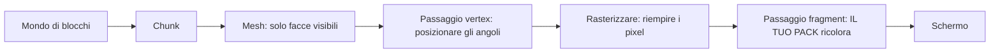

# Bloxd Shader Packs — Guida completa (Italiano)

🌐 [Tutte le lingue](../README.md) · In profondità: [English](GUIDE-EN.md#part-0--start-from-zero-how-rendering-and-bloxd-shaders-work) · [Français](GUIDE-FR.md)

**Leggi questo per primo.** Nessuna esperienza richiesta. In dieci minuti saprai come il gioco
disegna la sua immagine, cos'è uno shader ed esattamente cosa uno shader pack può e non può fare.

## 1. La versione da un minuto

- Bloxd.io è un gioco voxel: il mondo è fatto di cubi (blocchi).
- L'immagine sullo schermo è disegnata dalla scheda grafica (GPU), 60 o più volte al secondo.
- Uno **shader** è un minuscolo programma che gira sulla GPU e decide il colore dei pixel.
- Uno **shader pack** è un piccolo file `.zip` con codice shader. Il gioco lo carica e lascia che il
  tuo codice ricolori **blocchi, acqua e lava** mentre vengono disegnati.
- Non cambi il gioco. Cambi solo colori e luce, nel momento esatto in cui ogni pixel viene disegnato.

## 2. Come viene disegnata l'immagine (rendering web, passo dopo passo)

Il tuo schermo è una griglia di puntini chiamati **pixel** (ad esempio 1920 × 1080 = circa due milioni
di pixel). Un'immagine completa è un **frame**. Il gioco disegna un nuovo frame ancora e ancora: è così
che il movimento sembra fluido.

Due processori si dividono il lavoro:

| | CPU (processore principale) | GPU (scheda grafica) |
|---|---|---|
| Compito | logica del gioco, fisica, rete | disegnare milioni di pixel, molto veloce, in parallelo |
| Stile | pochi lavoratori, molto intelligenti | migliaia di lavoratori, ognuno molto semplice |

Sul web, la catena è questa:

1. Il gioco gira come JavaScript nel browser (Chrome o Edge recente è il migliore).
2. Il gioco parla con la GPU tramite **WebGPU**, la moderna API grafica del browser.
3. Dentro il browser, **Dawn** (con il suo compilatore **Tint**) traduce il linguaggio shader **WGSL**
   in istruzioni che la tua GPU capisce (Direct3D / Metal / Vulkan, a seconda del sistema).
4. La GPU esegue gli shader e mostra il frame finito sullo schermo.

Bloxd stesso è costruito con un motore voxel (**noa-engine**) sopra un framework 3D (**Babylon.js**).
Per ogni frame, la pipeline di disegno fa questo:

1. **Chunk.** Il mondo è tagliato in colonne di blocchi chiamate chunk. Solo i chunk vicino a te
   vengono preparati per il disegno.
2. **Meshing.** Per ogni chunk, il motore costruisce una *mesh*: una pelle di triangoli che copre solo
   le facce di blocco davvero visibili. Le facce nascoste vengono saltate.
3. **Atlas delle texture.** Ogni faccia di blocco prende la sua immagine da un'unica grande immagine,
   l'**atlas**, che contiene tutte le texture dei blocchi una accanto all'altra. Ogni faccia sa quale
   quadratino dell'atlas usare (le sue coordinate **UV**).
4. **Passaggio vertex.** La GPU esegue un *vertex shader* su ogni angolo (vertice) di ogni triangolo:
   mette l'angolo al posto giusto sullo schermo e passa i dati (coordinate di texture, valori di luce,
   direzione della faccia…).
5. **Rasterizzazione.** La GPU riempie ogni triangolo di pixel. Ogni pixel coperto diventa un
   **frammento**: un pixel candidato con dati interpolati.
6. **Passaggio fragment.** La GPU esegue un *fragment shader* per ogni frammento: qui si decide il
   colore finale del pixel. **Qui vivono gli shader pack di Bloxd.**
7. **Schermo.** Il frame finito viene mostrato. Poi tutto si ripete per il frame successivo.



Idea chiave: il tuo pack non vede mai «il mondo». Vede **un frammento alla volta** — un pixel di una
faccia di blocco — più alcuni dati su quel pixel. Tutto ciò che un pack fa deve essere calcolato da
questi dati locali.

## 3. Cos'è uno shader

Uno shader è una piccola funzione (un piccolo pezzo di codice) che la GPU esegue un numero enorme di
volte in parallelo — una volta per vertice, o una volta per frammento. Deve essere veloce e
autosufficiente: niente file, niente rete, nessuna memoria del frame precedente.

I pack di Bloxd si scrivono in **WGSL** (WebGPU Shading Language). Non scrivi uno shader intero. Il
motore ha già i suoi shader; ti lascia inserire il tuo codice in quattro punti fissi, chiamati
**hook** (Sezione 5). Pensa a quattro porte: il motore avanza nel suo codice di disegno e, a ogni
porta, chiede alla tua funzione: «ecco i dati di questo pixel — vuoi cambiare il colore?»

## 4. Cos'è uno shader pack di Bloxd

Un pack è un file `.zip` con:

```
pack.json     (piccolo file di metadati)
*.wgsl        (il tuo codice WGSL — un file o molti, in qualsiasi cartella)
```

`pack.json` ha bisogno solo di:

```json
{ "apiVersion": 2, "name": "Il Mio Pack", "author": "tu" }
```

- `apiVersion` deve essere il numero **2**. I vecchi pack v1 vengono rifiutati.
- Il caricatore trova **ogni** file `*.wgsl` nello zip e li unisce. Ordine e cartelle non contano.
- Limite totale WGSL: **256 KB**.

Per installare: Bloxd → `O` Impostazioni → Grafica → attiva **Use New WebGPU Renderer** → Shader Pack →
**Choose .zip** → **Apply**.

Un pack influenza solo **blocchi, acqua e lava**. Alcune modalità di gioco disattivano i pack del tutto.

## 5. I quattro hook (le tue uniche porte)

| Hook | Quando gira | Cosa controlli |
|---|---|---|
| `bloxdTerrainSurface` | per frammento, blocchi solidi, prima | colore base, trasparenza (alfa), bagliore proprio (emission) |
| `bloxdTerrainLight` | stesso frammento, subito dopo | colore finale illuminato dei blocchi |
| `bloxdLiquidSurface` | per frammento, acqua e lava, prima | colore base e alfa dei liquidi |
| `bloxdLiquidLight` | stesso frammento, subito dopo | colore finale illuminato dei liquidi |

Regole delle porte:

- Surface gira **prima** di light, nello stesso frammento. Puoi passare un valore da surface a light
  con una variabile a livello di modulo (`var<private>`).
- Parti sempre dal risultato predefinito del motore: `bloxdDefaultSurface(...)` o
  `bloxdDefaultLight(...)`, cambia ciò che serve, poi restituiscilo. Non costruire mai le struct di
  risultato da solo.
- Gli hook surface girano prima del test di ritaglio per trasparenza del motore: su foglie e blocchi
  ritagliati, `out.alpha` decide se il pixel resta o viene scartato; sui liquidi è il vero fattore di
  miscelazione; sui blocchi solidi normali l'alfa non fa nulla.
- Il bagliore proprio (`out.emission`) appartiene solo agli hook **surface**.
- Se scrivi il tuo colore finale in un hook light, applica la nebbia alla fine con
  `bloxdApplyFog(colour, light)` — la nebbia del motore è sempre nella scena, e saltarla fa brillare i
  blocchi lontani attraverso la nebbia.

## 6. Cosa ti dice il motore

Per ogni frammento, i tuoi hook ricevono dati. I campi più utili:

| Dato | Significato, in parole semplici |
|---|---|
| `colour` | il colore di texture del blocco in questo pixel (dall'atlas), prima delle tue modifiche |
| `blockId` | l'**id numerico** del blocco (un numero intero). Così tratti un tipo di blocco diversamente da un altro — tabella completa nella Parte VIII |
| `position` | dove si trova questo pixel nel mondo (x, y, z) |
| `normal` | dove punta la faccia (su, giù, nord…), come vettore |
| `skyLight` | quanta luce del cielo raggiunge questo blocco, da 0 a 1 — ma **con tone mapping**: cielo aperto ≈ 1.0, un livello perso sotto un albero ≈ 0.995 (vedi Sezione 7) |
| `blockLight` | luce di lampade, torce, lava… come colore (le lampade colorate esistono) |
| `heldLight` | luce dell'oggetto in mano al giocatore |
| `skyLightColour` | la tinta attuale del cielo (blu scuro di notte, calda al tramonto) |
| `litColour` | il colore illuminato del motore per questa superficie (utile come base) |
| `fogVisibility`, `fogColour` | quanto è annebbiato questo pixel e il colore della nebbia (arriva **nero** quando la nebbia è spenta — gestisci quel caso) |

Funzioni del motore che puoi chiamare:

| Funzione | Cosa ti dà |
|---|---|
| `bloxdDefaultSurface(in)` / `bloxdDefaultLight(surface, light)` | il risultato normale del motore — sempre il tuo punto di partenza |
| `bloxdApplyFog(colour, light)` | fonde correttamente il tuo colore nella nebbia |
| `bloxdSunDirection()` | vettore unitario verso il sole; `(0,0,0)` nei mondi senza sole terrestre; la luna è esattamente la direzione opposta |
| `bloxdTime()` | secondi — **torna a 0 ogni 3600 secondi** (`bloxdTimeWrap`). Vedi Sezione 7 |
| `bloxdEyePosition()` | la posizione della camera (per effetti di distanza) |
| `bloxdOriginOffset()` | il motore ricentra periodicamente le coordinate del mondo; somma questo offset a ogni motivo basato sulla posizione nel mondo, altrimenti il motivo salterà visibilmente |
| `bloxdFaceBlock(position, normal)` | la cella di blocco (coordinate intere) della faccia che stai disegnando — perfetta per variare a caso per blocco |
| `bloxdOpaqueBehind()` | solo liquidi: trova il primo blocco solido dietro la superficie del liquido — serve a misurare la profondità dell'acqua |

## 7. Le trappole in cui cadono tutti

**Il tempo riparte da zero.** `bloxdTime()` conta i secondi ma ricomincia a 3600. Se la tua animazione
usa il tempo grezzo, salterà una volta all'ora. Anima sempre con cicli interi dentro il wrap:

```wgsl
sin(6.2831853 * fract(bloxdTime() / bloxdTimeWrap * cycles + phase))
```

Scegli `cycles` come numero intero. Allora il valore al secondo 3600 uguale quello al secondo 0: nessun
salto, mai.

**skyLight ha il tone mapping.** Non è una luminosità lineare 0–1. Il motore comprime i livelli di luce
0–15 in una curva: il cielo aperto è ≈ 1.0 e perdere un livello si legge ancora ≈ 0.995. Se testi
`skyLight < 0.5` aspettandoti «in ombra», quasi nulla corrisponderà. Calibra le soglie sulla curva vera
(la Parte IV dà i valori misurati).

**La nebbia c'è sempre.** Anche quando non la vedi, il motore calcola la nebbia (a volte spinta molto
lontano). Se il tuo hook light restituisce un colore senza `bloxdApplyFog`, il terreno lontano sembrerà
troppo luminoso e bucherà la nebbia. Applica la nebbia per ultima, dopo il tuo lavoro sul colore.

**L'illuminazione può essere spenta.** Se un gioco o un'impostazione disattiva l'illuminazione,
`skyLight` può non essere inviato affatto e gli effetti guidati dal cielo non faranno silenziosamente
nulla. Scrivi gli effetti in modo che il pack resti bello anche senza.

## 8. Tutto ciò che un pack PUÒ fare

- Ricolorare qualsiasi blocco, acqua o lava — globalmente o per `blockId`.
- Far brillare le cose (`out.emission` negli hook surface): lava, minerali, lampade…
- Animare colore e alfa nel tempo (pulsazioni, lava che scorre, acqua che scintilla) — a prova di wrap
  (Sezione 7).
- Reagire al ciclo giorno/notte tramite `bloxdSunDirection()` e `skyLightColour` (tramonti caldi, tinte
  blu di luna).
- Aggiungere dettagli procedurali ancorati al mondo: variazione sottile per blocco con hash
  `bloxdFaceBlock`, tinte di nebbia per distanza, scurimento sott'acqua con la profondità di
  `bloxdOpaqueBehind()`.
- Correggere l'intera immagine per frammento: contrasto, saturazione, bilanciamento caldo/freddo —
  purché la nebbia venga applicata alla fine.
- Dipingere effetti *sulle* superfici: scintille sui minerali, scurimento «bagnato» vicino al livello
  dell'acqua, neve sulle facce rivolte in su (`normal.y`) e trucchi simili — tutto calcolato dai dati
  del frammento stesso.
- Usare la distanza (`bloxdEyePosition()`) per dissolvere effetti costosi o rumorosi (livello di
  dettaglio economico).

## 9. Cosa un pack NON può fare (limiti del motore)

- **Piante, erba e fiori** sono disegnati da una parte del motore che i pack non possono raggiungere.
  Non puoi ricolorarli né animarli.
- **Niente post-elaborazione.** Nessun accesso al frame finito, niente coordinate schermo, niente passi
  di sfocatura/bloom/vignetta.
- **Nessuna profondità di scena.** L'unica domanda «cosa c'è dietro» è `bloxdOpaqueBehind()` attraverso un
  liquido.
- **Niente mappe d'ombra reali né occlusione ambientale** oltre ciò che i valori di luce del motore già
  codificano.
- **Nessun nuovo oggetto o particella** nel mondo. Puoi solo dipingere su superfici già esistenti. (I pack
  furbi dipingono effetti sovrapposti sulle superfici — vedi le ricette — ma la geometria è sempre del
  motore.)
- **Niente texture o sampler** tuoi, niente fonti di dati extra: i tuoi unici input sono gli argomenti
  degli hook e le funzioni del motore.
- **Il movimento dei vertici** (piegare la geometria, onde che muovono gli angoli) esiste nel motore ma
  **gira solo in pochi giochi** — non contarci mai; fingi il movimento con animazione di colore/alfa.
- **Il cielo stesso** (disco solare, skybox, nuvole) è disegnato dal motore. I pack ricevono i *dati* del
  cielo (direzione, tinta) ma non disegnano il cielo.

Se un effetto richiede qualcosa di questa lista, oggi nessun pack può farlo — è comportamento provato del
motore, non una questione di abilità.

## 10. Il tuo primo pack in cinque passi

1. Crea `pack.json`:

```json
{ "apiVersion": 2, "name": "Il Mio Primo Pack", "author": "tu" }
```

2. Crea `shader.wgsl` accanto:

```wgsl
fn bloxdTerrainSurface(surface: BloxdSurfaceIn) -> BloxdSurface {
    var out = bloxdDefaultSurface(surface);
    out.colour = out.colour * vec3f(1.05, 1.0, 0.92);
    return out;
}

fn bloxdTerrainLight(surface: BloxdSurface, light: BloxdLightIn) -> BloxdLight {
    var out = bloxdDefaultLight(surface, light);
    _ = surface;
    return out;
}
```

Questo pack rende ogni blocco un po' più caldo (più rosso, meno blu) e mantiene l'illuminazione del
motore. La riga `_ = surface;` dice al compilatore «questo input è intenzionalmente inutilizzato» — WGSL
richiede questa forma semplice.

3. Comprimo i due file in uno zip, con `pack.json` alla radice dello zip (non in una sottocartella).
4. Nel gioco: Impostazioni → Grafica → **Use New WebGPU Renderer** acceso → Shader Pack → Choose .zip →
   Apply.
5. Guardati intorno: il mondo dovrebbe essere un po' più caldo. Cambia i tre numeri e ricarica per
   sperimentare.

Poi cresci passo dopo passo: un effetto alla volta, controllalo a mezzogiorno, al tramonto, di notte,
sott'acqua e in una caverna prima di aggiungere il prossimo.

## 11. Le nove regole ferree

Romperne una rompe il pack o lo fa rifiutare:

1. Non definire mai nulla con nome che inizia per `BLOXD_` — appartengono al motore.
2. Non costruire mai `BloxdSurface` / `BloxdLight` da solo — parti da `bloxdDefaultSurface` /
   `bloxdDefaultLight`.
3. `mod` è una parola riservata in WGSL — usa `%`.
4. Niente texture, niente sampler, niente entry point o attributi tuoi, niente UV di schermo.
5. Evita `discard` (rifiutato in modalità strict) — usa `out.alpha`.
6. Gli hook liquidi devono sempre produrre un alfa valido, in ogni variante.
7. Input inutilizzati: scrivi `_ = valore;` — la forma `let _ =` viene rifiutata.
8. WGSL totale ≤ 256 KB.
9. Il motore compila il tuo codice in **8 varianti** (strict/permissivo × illuminato/non illuminato ×
   terreno/liquido). Il codice deve compilare e comportarsi in tutte. Metti le parentesi nelle
   espressioni miste bit a bit/shift per il compilatore Tint del browser.

## 12. Mini glossario

| Parola | Significato |
|---|---|
| Frame | un'immagine completa sullo schermo |
| Pixel / frammento | un punto dell'immagine / un pixel candidato in colorazione |
| Vertice | un angolo di un triangolo |
| Mesh | la pelle di triangoli costruita dalle facce visibili di un chunk |
| Atlas (atlas delle texture) | l'unica grande immagine con tutte le texture dei blocchi |
| UV | coordinate che dicono quale parte dell'atlas usa una faccia |
| WGSL | il linguaggio shader di WebGPU — la lingua dei pack Bloxd |
| Hook | una delle quattro funzioni del motore che un pack può definire |
| skyLight / blockLight | luce del cielo / luce dei blocchi (lampade, lava) |
| Wrap (3600 s) | `bloxdTime()` che riparte da 0 ogni ora |
| Nebbia (fog) | il terreno lontano che si fonde nel colore della nebbia |
| Variante | uno degli 8 modi in cui il motore compila il tuo pack |

## 13. Approfondire (capitoli in inglese)

| Parte | File | Contenuto |
|---|---|---|
| I | [01-making](GUIDE-EN.md#part-i--making-a-pack) | formato del pack, caricamento multi-file, limiti, distribuzione |
| II | [02-api](GUIDE-EN.md#part-ii--the-api-contract) | il contratto completo di hook e struct |
| III | [03-recipes](GUIDE-EN.md#part-iii--recipes) | 12 ricette di produzione con codice WGSL |
| IV | [04-realism](GUIDE-EN.md#part-iv--measured-numbers-realism-that-survives-contact-with-the-game) | numeri misurati: luce, nebbia, ottica dell'acqua |
| V | [05-troubleshooting](GUIDE-EN.md#part-v--troubleshooting) | ogni guasto noto e la sua soluzione |
| VI | [06-implementation](GUIDE-EN.md#part-vi--implementation--local-validation) | validazione locale nelle 8 varianti |
| VII | [07-internals](GUIDE-EN.md#part-vii--engine-internals) | interni del motore (tempo, luce, cielo, caricatore) |
| VIII | [08-block-ids](GUIDE-EN.md#part-viii--the-numeric-block-id-table) | la tabella numerica completa degli id dei blocchi |
| IX | [09-sources](GUIDE-EN.md#part-ix--where-this-knowledge-comes-from-and-what-we-dont-know) | come ogni fatto di questa guida è stato stabilito |
| X | [10-constants](GUIDE-EN.md#part-x--the-constants-register-en) | ogni costante (551) con il suo ruolo |

Versione completa in francese: [fr](GUIDE-FR.md) · Tutte le lingue: [indice](../README.md). Licenza: MIT.
