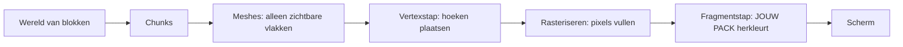

# Bloxd Shader Packs — Volledige gids (Nederlands)

🌐 [Alle talen](../README.md) · Diepgang: [English](../en/00-start.md) · [Français](../fr/README.md)

**Lees dit eerst.** Geen ervaring nodig. In tien minuten weet je hoe het spel zijn beeld tekent, wat
een shader is, en precies wat een shader pack wel en niet kan.

## 1. De versie van één minuut

- Bloxd.io is een voxelspel: de wereld bestaat uit kubussen (blokken).
- Het beeld op je scherm wordt getekend door je grafische kaart (GPU), 60 keer per seconde of meer.
- Een **shader** is een piepklein programma dat op de GPU draait en de kleur van pixels beslist.
- Een **shader pack** is een klein `.zip`-bestand met shadercode. Het spel laadt het en laat jouw code
  **blokken, water en lava** herkleuren terwijl ze worden getekend.
- Je verandert het spel niet. Je verandert alleen kleuren en licht, op het exacte moment dat elke pixel
  wordt getekend.

## 2. Hoe het beeld wordt getekend (webrendering, stap voor stap)

Je scherm is een raster van kleine puntjes, **pixels** genoemd (bijvoorbeeld 1920 × 1080 = ongeveer twee
miljoen pixels). Eén volledig beeld is een **frame**. Het spel tekent steeds opnieuw een nieuw frame —
daardoor ziet beweging er vloeiend uit.

Twee processors delen het werk:

| | CPU (hoofdprocessor) | GPU (grafische kaart) |
|---|---|---|
| Taak | spellogica, fysica, netwerk | miljoenen pixels tekenen, heel snel, parallel |
| Stijl | weinig werkers, heel slim | duizenden werkers, elk heel eenvoudig |

Op het web ziet de keten er zo uit:

1. Het spel draait als JavaScript in je browser (recente Chrome of Edge werkt het best).
2. Het spel praat met de GPU via **WebGPU**, de moderne grafische API van de browser.
3. In de browser vertaalt **Dawn** (met zijn compiler **Tint**) de shadertaal **WGSL** naar instructies
   die je GPU begrijpt (Direct3D / Metal / Vulkan, afhankelijk van je systeem).
4. De GPU voert de shaders uit en zet het voltooide frame op het scherm.

Bloxd zelf is gebouwd met een voxel-engine (**noa-engine**) bovenop een 3D-framework (**Babylon.js**).
Voor elk frame doet de tekenpijplijn dit:

1. **Chunks.** De wereld is in blokkolommen gesneden, chunks genoemd. Alleen chunks bij jou in de buurt
   worden voorbereid om te tekenen.
2. **Meshing.** Voor elke chunk bouwt de engine een *mesh*: een huid van driehoeken die alleen de echt
   zichtbare blokvlakken bedekt. Verborgen vlakken worden overgeslagen.
3. **Textuuratlas.** Elk blokvlak haalt zijn afbeelding uit één grote afbeelding, de **atlas**, die alle
   bloktexturen naast elkaar bevat. Elk vlak weet welk kleine vierkantje van de atlas het gebruikt (zijn
   **UV**-coördinaten).
4. **Vertexstap.** De GPU draait een *vertex shader* op elke hoek (vertex) van elke driehoek: hij plaatst
   de hoek op de juiste plek op je scherm en geeft gegevens door (textuurcoördinaten, lichtwaarden,
   vlakrichting…).
5. **Rasteriseren.** De GPU vult elke driehoek met pixels. Elke bedekte pixel wordt een **fragment**: een
   kandidaat-pixel met geïnterpoleerde gegevens.
6. **Fragmentstap.** De GPU draait een *fragment shader* voor elk fragment: hier wordt de uiteindelijke
   kleur van de pixel beslist. **Hier leven de shader packs van Bloxd.**
7. **Scherm.** Het voltooide frame wordt getoond. Daarna herhaalt alles zich voor het volgende frame.



Kernidee: je pack ziet nooit „de wereld". Het ziet **één fragment tegelijk** — één pixel van één blokvlak
— plus enkele gegevens over die pixel. Alles wat een pack doet, moet uit die lokale gegevens worden
berekend.

## 3. Wat een shader is

Een shader is een kleine functie (een klein stukje code) dat de GPU enorm vaak parallel uitvoert — één
keer per vertex, of één keer per fragment. Hij moet snel en zelfstandig zijn: geen bestanden, geen
netwerk, geen geheugen van het vorige frame.

Bloxd-packs worden geschreven in **WGSL** (WebGPU Shading Language). Je schrijft geen hele shader. De
engine heeft al zijn eigen shaders; hij laat je jouw code invoegen op vier vaste punten, **hooks** genoemd
(Sectie 5). Denk aan vier deuren: de engine loopt door zijn tekencode, en bij elke deur vraagt hij je
functie: „hier zijn de gegevens van deze pixel — wil je de kleur veranderen?"

## 4. Wat een Bloxd shader pack is

Een pack is een `.zip`-bestand met:

```
pack.json     (klein metadata-bestand)
*.wgsl        (jouw WGSL-code — één bestand of veel, in willekeurige mappen)
```

`pack.json` heeft alleen dit nodig:

```json
{ "apiVersion": 2, "name": "Mijn Pack", "author": "jij" }
```

- `apiVersion` moet het getal **2** zijn. Oude v1-packs worden geweigerd.
- De lader vindt **elk** `*.wgsl`-bestand in de zip en voegt ze samen. Volgorde en mappen doen er niet toe.
- Totale WGSL-limiet: **256 KB**.

Installeren: Bloxd → `O` Instellingen → Graphics → **Use New WebGPU Renderer** aan → Shader Pack →
**Choose .zip** → **Apply**.

Een pack beïnvloedt alleen **blokken, water en lava**. Sommige spelmodi schakelen packs volledig uit.

## 5. De vier hooks (je enige deuren)

| Hook | Wanneer hij draait | Wat je bestuurt |
|---|---|---|
| `bloxdTerrainSurface` | per fragment, vaste blokken, eerst | basiskleur, transparantie (alfa), eigen gloed (emission) |
| `bloxdTerrainLight` | hetzelfde fragment, meteen erna | uiteindelijke belichte kleur van blokken |
| `bloxdLiquidSurface` | per fragment, water en lava, eerst | basiskleur en alfa van vloeistoffen |
| `bloxdLiquidLight` | hetzelfde fragment, meteen erna | uiteindelijke belichte kleur van vloeistoffen |

Regels van de deuren:

- Surface draait **vóór** light, in hetzelfde fragment. Je kunt een waarde van surface naar light
  doorgeven met een variabele op moduleniveau (`var<private>`).
- Begin altijd bij het standaardresultaat van de engine: `bloxdDefaultSurface(...)` of
  `bloxdDefaultLight(...)`, verander wat je nodig hebt en geef het terug. Bouw de resultaat-structs nooit
  zelf.
- Surface-hooks draaien vóór de transparantie-uitsnijtest van de engine: bij bladeren en uitgesneden
  blokken beslist `out.alpha` of de pixel blijft of wordt weggegooid; bij vloeistoffen is het de echte
  mengfactor; bij gewone vaste blokken doet alfa niets.
- Eigen gloed (`out.emission`) hoort alleen in de **surface**-hooks.
- Schrijf je je eigen eindkleur in een light-hook, pas dan aan het einde zelf de mist toe met
  `bloxdApplyFog(colour, light)` — de mist van de engine is altijd in de scène, en zonder hem schijnen
  verre blokken door de mist heen.

## 6. Wat de engine je vertelt

Voor elk fragment ontvangen je hooks gegevens. De nuttigste velden:

| Gegeven | Betekenis, in eenvoudige woorden |
|---|---|
| `colour` | de textuurkleur van het blok op deze pixel (uit de atlas), vóór je wijzigingen |
| `blockId` | het **numerieke id** van het blok (een geheel getal). Zo behandel je het ene bloktype anders dan het andere — volledige tabel in Deel VIII |
| `position` | waar deze pixel in de wereld is (x, y, z) |
| `normal` | waarheen het vlak wijst (boven, onder, noord…), als vector |
| `skyLight` | hoeveel hemellicht dit blok bereikt, 0 tot 1 — maar **tone-mapped**: open hemel ≈ 1.0, één verloren lichtniveau onder een boom ≈ 0.995 (zie Sectie 7) |
| `blockLight` | licht van lampen, fakkels, lava… als kleur (gekleurde lampen bestaan) |
| `heldLight` | licht van het item in de hand van de speler |
| `skyLightColour` | de huidige tint van de hemel (donkerblauw 's nachts, warm bij zonsondergang) |
| `litColour` | de eigen belichte kleur van de engine voor dit oppervlak (handig als basis) |
| `fogVisibility`, `fogColour` | hoe mistig deze pixel is, en de mistkleur (komt **zwart** aan als mist uit staat — handel dat geval af) |

Enginefuncties die je kunt aanroepen:

| Functie | Wat hij je geeft |
|---|---|
| `bloxdDefaultSurface(in)` / `bloxdDefaultLight(surface, light)` | het normale resultaat van de engine — altijd je startpunt |
| `bloxdApplyFog(colour, light)` | mengt je kleur correct in de mist |
| `bloxdSunDirection()` | eenheidsvector naar de zon; `(0,0,0)` in werelden zonder aardse zon; de maan is exact de tegenovergestelde richting |
| `bloxdTime()` | seconden — **springt elke 3600 seconden terug naar 0** (`bloxdTimeWrap`). Zie Sectie 7 |
| `bloxdEyePosition()` | de camerapositie (voor afstandseffecten) |
| `bloxdOriginOffset()` | de engine herijkt periodiek de wereldcoördinaten; tel deze offset op bij elk wereldpatroon, anders springt je patroon zichtbaar |
| `bloxdFaceBlock(position, normal)` | de blokcel (gehele coördinaten) van het vlak dat je tekent — perfect voor willekeurige variatie per blok |
| `bloxdOpaqueBehind()` | alleen vloeistoffen: vindt het eerste vaste blok achter het vloeistofoppervlak — meet de waterdiepte |

## 7. De vallen waar iedereen in trapt

**De tijd springt terug.** `bloxdTime()` telt seconden maar begint opnieuw bij 3600. Gebruikt je animatie
ruwe tijd, dan springt ze één keer per uur. Animeer altijd met hele cycli binnen de wrap:

```wgsl
sin(6.2831853 * fract(bloxdTime() / bloxdTimeWrap * cycles + phase))
```

Kies `cycles` als geheel getal. Dan is de waarde op seconde 3600 gelijk aan die op seconde 0: geen sprong,
nooit.

**skyLight is tone-mapped.** Het is geen lineaire helderheid 0–1. De engine drukt de lichtniveaus 0–15 in
een curve samen: open hemel is ≈ 1.0 en één niveau verliezen leest nog ≈ 0.995. Test je `skyLight < 0.5`
voor „in de schaduw", dan matcht bijna niets. Kalibreer drempels op de echte curve (Deel IV geeft gemeten
waarden).

**Mist is er altijd.** Zelfs als je hem niet ziet, berekent de engine mist (soms heel ver weg geduwd).
Geeft je light-hook een kleur terug zonder `bloxdApplyFog`, dan lijkt ver terrein te helder en snijdt het
door de mist. Pas mist als laatste toe, na je kleurwerk.

**Belichting kan uit staan.** Schakelt een spel of instelling belichting uit, dan wordt `skyLight`
misschien helemaal niet gestuurd en doen hemel-effecten stilletjes niets. Schrijf effecten zo dat het pack
er ook zonder goed uitziet.

## 8. Alles wat een pack WEL kan

- Elk blok, water of lava herkleuren — globaal of per `blockId`.
- Dingen laten gloeien (`out.emission` in surface-hooks): lava, ertsen, lampen…
- Kleur en alfa in de tijd animeren (pulseren, stromende lava, glinsterend water) — wrap-veilig (Sectie 7).
- Reageren op de dag/nacht-cyclus via `bloxdSunDirection()` en `skyLightColour` (warme zonsondergangen,
  blauwe maanlichttinten).
- Wereldverankerde procedurele details toevoegen: subtiele variatie per blok met `bloxdFaceBlock`-hashes,
  misttinten per afstand, onderwater-verduistering met `bloxdOpaqueBehind()`-diepte.
- Het hele beeld per fragment graden: contrast, verzadiging, warm/koud-balans — zolang mist aan het einde
  wordt toegepast.
- Effecten *op* oppervlakken schilderen: glinstering op erts, „nat" ogende verduistering nabij de
  waterlijn, sneeuw op naar boven wijzende vlakken (`normal.y`) en soortgelijke trucs — allemaal berekend
  uit de gegevens van het fragment zelf.
- Afstand gebruiken (`bloxdEyePosition()`) om dure of lawaaierige effecten uit te faden (goedkoop
  detailniveau).

## 9. Wat een pack NIET kan (enginegrenzen)

- **Planten, gras en bloemen** worden getekend door een deel van de engine dat packs niet kunnen bereiken.
  Je kunt ze niet herkleuren of animeren.
- **Geen nabewerking.** Geen toegang tot het voltooide frame, geen schermcoördinaten, geen
  blur/bloom/vignet-passes.
- **Geen scènediepte.** De enige „wat zit erachter?"-vraag is `bloxdOpaqueBehind()` door een vloeistof.
- **Geen echte shadow maps of ambient occlusion** bovenop wat de lichtwaarden van de engine al bevatten.
- **Geen nieuwe objecten of deeltjes** in de wereld. Je kunt alleen schilderen op oppervlakken die al
  bestaan. (Slimme packs schilderen overlay-effecten op oppervlakken — zie de recepten — maar de geometrie
  is altijd van de engine.)
- **Geen eigen texturen of samplers**, geen extra gegevensbronnen: je enige invoer zijn de hook-argumenten
  en de enginefuncties.
- **Vertexbeweging** (geometrie buigen, golven die hoeken bewegen) bestaat in de engine maar **draait
  slechts in enkele spellen** — vertrouw er nooit op; fake beweging met kleur/alfa-animatie.
- **De hemel zelf** (zonneschijf, skybox, wolken) wordt door de engine getekend. Packs ontvangen
  hemel-*gegevens* (richting, tint) maar tekenen de hemel niet.

Heeft een effect iets van deze lijst nodig, dan kan vandaag geen enkel pack het — dat is bewezen
enginegedrag, geen kwestie van vaardigheid.

## 10. Je eerste pack in vijf stappen

1. Maak `pack.json`:

```json
{ "apiVersion": 2, "name": "Mijn Eerste Pack", "author": "jij" }
```

2. Maak daarnaast `shader.wgsl`:

```wgsl
fn bloxdTerrainSurface(surface: BloxdSurfaceIn) -> BloxdSurface {
    var out = bloxdDefaultSurface(surface);
    out.colour = out.colour * vec3f(1.05, 1.0, 0.92);
    return out;
}

fn bloxdTerrainLight(surface: BloxdSurface, light: BloxdLightIn) -> BloxdLight {
    var out = bloxdDefaultLight(surface, light);
    _ = surface;
    return out;
}
```

Dit pack maakt elk blok een beetje warmer (meer rood, minder blauw) en behoudt de belichting van de engine.
De regel `_ = surface;` vertelt de compiler „deze invoer is bewust ongebruikt" — WGSL vereist deze kale
vorm.

3. Zip de twee bestanden samen, met `pack.json` in de hoofdmap van de zip (niet in een submap).
4. In het spel: Instellingen → Graphics → **Use New WebGPU Renderer** aan → Shader Pack → Choose .zip → Apply.
5. Kijk rond: de wereld zou iets warmer moeten zijn. Verander de drie getallen en herlaad om te
   experimenteren.

Groei daarna stap voor stap: één effect tegelijk, controleer het 's middags, bij zonsondergang, 's nachts,
onder water en in een grot voordat je het volgende toevoegt.

## 11. De negen harde regels

Elke overtreding breekt het pack of laat het weigeren:

1. Definieer nooit iets met een naam die begint met `BLOXD_` — die zijn van de engine.
2. Bouw `BloxdSurface` / `BloxdLight` nooit zelf — begin bij `bloxdDefaultSurface` / `bloxdDefaultLight`.
3. `mod` is een gereserveerd woord in WGSL — gebruik `%`.
4. Geen texturen, geen samplers, geen eigen entry points of attributen, geen scherm-UV's.
5. Vermijd `discard` (geweigerd in strict-modus) — gebruik `out.alpha`.
6. Liquid-hooks moeten altijd een geldige alfa uitvoeren, in elke variant.
7. Ongebruikte invoer: schrijf `_ = waarde;` — de vorm `let _ =` wordt geweigerd.
8. Totale WGSL ≤ 256 KB.
9. De engine compileert je code in **8 varianten** (strict/permissief × belicht/onbelicht ×
   terrein/vloeistof). Je code moet in allemaal compileren en zich gedragen. Zet haakjes rond gemengde
   bitwise/shift-expressies voor de Tint-compiler van de browser.

## 12. Miniwoordenlijst

| Woord | Betekenis |
|---|---|
| Frame | één volledig beeld op het scherm |
| Pixel / fragment | één beeldpunt / een kandidaat-pixel die wordt gekleurd |
| Vertex | een hoek van een driehoek |
| Mesh | de driehoekshuid gebouwd uit de zichtbare vlakken van een chunk |
| Atlas (textuuratlas) | de ene grote afbeelding met alle bloktexturen |
| UV | coördinaten die zeggen welk deel van de atlas een vlak gebruikt |
| WGSL | de shadertaal van WebGPU — de taal van Bloxd-packs |
| Hook | één van de vier enginefuncties die je pack mag definiëren |
| skyLight / blockLight | licht van de hemel / licht van blokken (lampen, lava) |
| Wrap (3600 s) | `bloxdTime()` die elk uur opnieuw bij 0 begint |
| Mist (fog) | ver terrein dat overgaat in de mistkleur |
| Variant | één van de 8 manieren waarop de engine je pack compileert |

## 13. Dieper gaan (Engelse hoofdstukken)

| Deel | Bestand | Inhoud |
|---|---|---|
| I | [01-making](../en/01-making.md) | packformaat, meerbestands-laden, limieten, distributie |
| II | [02-api](../en/02-api.md) | het volledige hook- en structcontract |
| III | [03-recipes](../en/03-recipes.md) | 12 productierecepten met WGSL-code |
| IV | [04-realism](../en/04-realism.md) | gemeten getallen: licht, mist, wateroptica |
| V | [05-troubleshooting](../en/05-troubleshooting.md) | elke bekende storing en haar oplossing |
| VI | [06-implementation](../en/06-implementation.md) | lokale validatie in alle 8 varianten |
| VII | [07-internals](../en/07-internals.md) | engine-internals (tijd, licht, hemel, lader) |
| VIII | [08-block-ids](../en/08-block-ids.md) | de volledige numerieke blok-id-tabel |
| IX | [09-sources](../en/09-sources.md) | hoe elk feit in deze gids is vastgesteld |
| X | [10-constants](../en/10-constants.md) | elke constante (551) met haar rol |

Volledige Franse versie: [fr](../fr/README.md) · Alle talen: [index](../README.md). Licentie: MIT.
