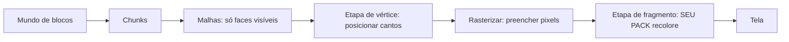

# Bloxd Shader Packs — Guia completo (Português)

🌐 [Todos os idiomas](../README.md) · Em profundidade: [English](../en/00-start.md) · [Français](../fr/README.md)

**Leia isto primeiro.** Nenhuma experiência necessária. Em dez minutos, você saberá como o jogo
desenha sua imagem, o que é um shader e exatamente o que um shader pack pode e não pode fazer.

## 1. A versão de um minuto

- Bloxd.io é um jogo voxel: o mundo é feito de cubos (blocos).
- A imagem na sua tela é desenhada pela sua placa de vídeo (GPU), 60 ou mais vezes por segundo.
- Um **shader** é um programinha que roda na GPU e decide a cor dos pixels.
- Um **shader pack** é um pequeno arquivo `.zip` com código de shader. O jogo o carrega e deixa seu
  código recolorir **blocos, água e lava** enquanto são desenhados.
- Você não muda o jogo. Você só muda cores e luz, no momento exato em que cada pixel é desenhado.

## 2. Como a imagem é desenhada (renderização web, passo a passo)

Sua tela é uma grade de pontinhos chamados **pixels** (por exemplo, 1920 × 1080 = cerca de dois
milhões de pixels). Uma imagem completa é um **frame**. O jogo desenha um novo frame de novo e de
novo — é isso que faz o movimento parecer suave.

Dois processadores dividem o trabalho:

| | CPU (processador principal) | GPU (placa de vídeo) |
|---|---|---|
| Trabalho | lógica do jogo, física, rede | desenhar milhões de pixels, muito rápido, em paralelo |
| Estilo | poucos trabalhadores, muito espertos | milhares de trabalhadores, cada um muito simples |

Na web, a cadeia é assim:

1. O jogo roda como JavaScript no seu navegador (Chrome ou Edge recente funciona melhor).
2. O jogo fala com a GPU através do **WebGPU**, a API gráfica moderna do navegador.
3. Dentro do navegador, o **Dawn** (com seu compilador **Tint**) traduz a linguagem de shader
   **WGSL** para instruções que sua GPU entende (Direct3D / Metal / Vulkan, conforme o sistema).
4. A GPU executa os shaders e coloca o frame pronto na tela.

O próprio Bloxd é construído com um motor voxel (**noa-engine**) sobre um framework 3D
(**Babylon.js**). Para cada frame, o pipeline de desenho faz isto:

1. **Chunks.** O mundo é cortado em colunas de blocos chamadas chunks. Apenas os chunks perto de
   você são preparados para desenho.
2. **Meshing.** Para cada chunk, o motor constrói uma *malha* (mesh): uma pele de triângulos que
   cobre apenas as faces de bloco realmente visíveis. Faces escondidas são puladas.
3. **Atlas de texturas.** Cada face de bloco pega sua imagem de uma única imagem grande, o **atlas**,
   que contém todas as texturas dos blocos lado a lado. Cada face sabe qual quadradinho do atlas usar
   (suas coordenadas **UV**).
4. **Etapa de vértice.** A GPU roda um *vertex shader* em cada canto (vértice) de cada triângulo: ele
   coloca o canto no lugar certo da sua tela e passa dados adiante (coordenadas de textura, valores de
   luz, direção da face…).
5. **Rasterização.** A GPU preenche cada triângulo com pixels. Cada pixel coberto vira um
   **fragmento**: um pixel candidato com dados interpolados.
6. **Etapa de fragmento.** A GPU roda um *fragment shader* para cada fragmento: é aqui que a cor final
   do pixel é decidida. **É aqui que vivem os shader packs do Bloxd.**
7. **Tela.** O frame pronto é exibido. Então tudo se repete para o próximo frame.



Ideia-chave: seu pack nunca vê «o mundo». Ele vê **um fragmento de cada vez** — um pixel de uma face
de bloco — mais alguns dados sobre esse pixel. Tudo que um pack faz precisa ser calculado a partir
desses dados locais.

## 3. O que é um shader

Um shader é uma pequena função (um pequeno pedaço de código) que a GPU executa um número enorme de
vezes em paralelo — uma vez por vértice, ou uma vez por fragmento. Ele precisa ser rápido e
autossuficiente: sem arquivos, sem rede, sem memória do frame anterior.

Os packs do Bloxd são escritos em **WGSL** (WebGPU Shading Language). Você não escreve um shader
inteiro. O motor já tem seus próprios shaders; ele deixa você inserir seu código em quatro pontos
fixos, chamados **hooks** (Seção 5). Pense em quatro portas: o motor avança pelo código de desenho e,
em cada porta, pergunta à sua função: «aqui estão os dados deste pixel — quer mudar a cor?»

## 4. O que é um shader pack do Bloxd

Um pack é um arquivo `.zip` com:

```
pack.json     (arquivinho de metadados)
*.wgsl        (seu código WGSL — um arquivo ou vários, em qualquer pasta)
```

`pack.json` só precisa disto:

```json
{ "apiVersion": 2, "name": "Meu Pack", "author": "você" }
```

- `apiVersion` deve ser o número **2**. Packs v1 antigos são rejeitados.
- O carregador encontra **todos** os arquivos `*.wgsl` do zip e os junta. A ordem e as pastas não
  importam.
- Limite total de WGSL: **256 KB**.

Para instalar: Bloxd → `O` Configurações → Gráficos → ativar **Use New WebGPU Renderer** → Shader Pack
→ **Choose .zip** → **Apply**.

Um pack só afeta **blocos, água e lava**. Alguns modos de jogo desativam os packs por completo.

## 5. Os quatro hooks (suas únicas portas)

| Hook | Quando roda | O que você controla |
|---|---|---|
| `bloxdTerrainSurface` | por fragmento, blocos sólidos, primeiro | cor base, transparência (alfa), brilho próprio (emission) |
| `bloxdTerrainLight` | o mesmo fragmento, logo depois | cor final iluminada dos blocos |
| `bloxdLiquidSurface` | por fragmento, água e lava, primeiro | cor base e alfa dos líquidos |
| `bloxdLiquidLight` | o mesmo fragmento, logo depois | cor final iluminada dos líquidos |

Regras das portas:

- Surface roda **antes** de light, no mesmo fragmento. Você pode passar um valor de surface para
  light com uma variável em nível de módulo (`var<private>`).
- Comece sempre do resultado padrão do motor: `bloxdDefaultSurface(...)` ou `bloxdDefaultLight(...)`,
  mude o que precisar e retorne. Nunca construa as structs de resultado você mesmo.
- Os hooks de surface rodam antes do teste de recorte por transparência do motor: em folhas e blocos
  recortados, `out.alpha` decide se o pixel fica ou é descartado; em líquidos, é o fator real de
  mistura; em blocos sólidos comuns, o alfa não faz nada.
- O brilho próprio (`out.emission`) pertence só aos hooks de **surface**.
- Se escrever sua própria cor final num hook de light, aplique a névoa você mesmo no fim com
  `bloxdApplyFog(colour, light)` — a névoa do motor está sempre na cena, e pulá-la faz blocos
  distantes brilharem através da névoa.

## 6. O que o motor te conta

Para cada fragmento, seus hooks recebem dados. Os campos mais úteis:

| Dado | Significado, em palavras simples |
|---|---|
| `colour` | a cor de textura do bloco neste pixel (do atlas), antes das suas mudanças |
| `blockId` | o **id numérico** do bloco (um número inteiro). É assim que você trata um tipo de bloco diferente de outro — tabela completa na Parte VIII |
| `position` | onde este pixel está no mundo (x, y, z) |
| `normal` | para onde a face aponta (cima, baixo, norte…), como vetor |
| `skyLight` | quanta luz do céu chega a este bloco, de 0 a 1 — mas **com tone mapping**: céu aberto ≈ 1.0, um nível perdido sob uma árvore ≈ 0.995 (ver Seção 7) |
| `blockLight` | luz de lâmpadas, tochas, lava… como cor (lâmpadas coloridas existem) |
| `heldLight` | luz do item na mão do jogador |
| `skyLightColour` | o tom atual do céu (azul-escuro à noite, quente ao pôr do sol) |
| `litColour` | a cor iluminada do próprio motor para esta superfície (útil como base) |
| `fogVisibility`, `fogColour` | o quanto este pixel está enevoado e a cor da névoa (chega **preta** quando a névoa está desligada — trate esse caso) |

Funções do motor que você pode chamar:

| Função | O que ela te dá |
|---|---|
| `bloxdDefaultSurface(in)` / `bloxdDefaultLight(surface, light)` | o resultado normal do motor — sempre seu ponto de partida |
| `bloxdApplyFog(colour, light)` | mistura sua cor na névoa corretamente |
| `bloxdSunDirection()` | vetor unitário em direção ao sol; `(0,0,0)` em mundos sem sol tipo Terra; a lua é exatamente a direção oposta |
| `bloxdTime()` | segundos — **volta a 0 a cada 3600 segundos** (`bloxdTimeWrap`). Ver Seção 7 |
| `bloxdEyePosition()` | a posição da câmera (para efeitos de distância) |
| `bloxdOriginOffset()` | o motor recentra as coordenadas do mundo de vez em quando; some esse offset a qualquer padrão baseado em posição no mundo, senão seu padrão vai pular visivelmente |
| `bloxdFaceBlock(position, normal)` | a célula de bloco (coordenadas inteiras) da face que você está desenhando — perfeita para variação aleatória por bloco |
| `bloxdOpaqueBehind()` | só líquidos: encontra o primeiro bloco sólido atrás da superfície do líquido — serve para medir a profundidade da água |

## 7. As armadilhas em que todos caem

**O tempo reinicia.** `bloxdTime()` conta segundos, mas recomeça do 3600. Se sua animação usar o tempo
bruto, ela vai pular uma vez por hora. Anime sempre com ciclos inteiros dentro do reinício (wrap):

```wgsl
sin(6.2831853 * fract(bloxdTime() / bloxdTimeWrap * cycles + phase))
```

Escolha `cycles` como número inteiro. Então o valor no segundo 3600 é igual ao do segundo 0: sem
pulos, nunca.

**skyLight tem tone mapping.** Não é um brilho linear 0–1. O motor comprime os níveis de luz 0–15 numa
curva: céu aberto é ≈ 1.0 e perder um nível ainda lê ≈ 0.995. Se você testar `skyLight < 0.5`
esperando «na sombra», quase nada vai combinar. Calibre os limites na curva real (a Parte IV traz
valores medidos).

**A névoa está sempre lá.** Mesmo quando você não a vê, o motor calcula névoa (às vezes empurrada para
muito longe). Se o seu hook de light retornar uma cor sem `bloxdApplyFog`, o terreno distante vai
parecer brilhante demais e furar a névoa. Aplique a névoa por último, depois do seu trabalho de cor.

**A iluminação pode estar desligada.** Se um jogo ou configuração desativa a iluminação, `skyLight`
pode nem ser enviado e efeitos guiados pelo céu silenciosamente não fazem nada. Escreva os efeitos de
modo que o pack continue bonito sem eles.

## 8. Tudo o que um pack PODE fazer

- Recolorir qualquer bloco, água ou lava — globalmente ou por `blockId`.
- Fazer coisas brilharem (`out.emission` nos hooks de surface): lava, minérios, lâmpadas…
- Animar cor e alfa ao longo do tempo (pulsar, lava fluindo, água cintilando) — à prova de reinício
  (Seção 7).
- Reagir ao ciclo dia/noite via `bloxdSunDirection()` e `skyLightColour` (pores do sol quentes, tons
  azuis de lua).
- Adicionar detalhe procedural ancorado no mundo: variação sutil por bloco com hashes
  `bloxdFaceBlock`, tons de névoa por distância, escurecimento subaquático com a profundidade de
  `bloxdOpaqueBehind()`.
- Gradar a imagem inteira por fragmento: contraste, saturação, equilíbrio quente/frio — desde que a
  névoa seja aplicada no fim.
- Pintar efeitos *sobre* superfícies: brilhos em minérios, escurecimento «molhado» perto do nível da
  água, neve em faces para cima (`normal.y`) e truques parecidos — tudo calculado a partir dos dados do
  próprio fragmento.
- Usar a distância (`bloxdEyePosition()`) para sumir com efeitos caros ou ruidosos (nível de detalhe
  barato).

## 9. O que um pack NÃO pode fazer (limites do motor)

- **Plantas, grama e flores** são desenhadas por uma parte do motor que os packs não alcançam. Você não
  pode recolori-las nem animá-las.
- **Sem pós-processamento.** Sem acesso ao frame pronto, sem coordenadas de tela, sem passes de
  desfoque/bloom/vinheta.
- **Sem profundidade de cena.** A única pergunta «o que há atrás» é `bloxdOpaqueBehind()` através de um
  líquido.
- **Sem mapas de sombra reais nem oclusão de ambiente** além do que os valores de luz do motor já
  codificam.
- **Sem objetos ou partículas novos** no mundo. Só dá para pintar sobre superfícies que já existem. (Packs
  espertos pintam efeitos sobrepostos em superfícies — veja as receitas — mas a geometria é sempre do
  motor.)
- **Sem texturas ou samplers** seus, sem fontes de dados extras: suas únicas entradas são os argumentos
  dos hooks e as funções do motor.
- **Movimento de vértices** (dobrar geometria, ondas que movem cantos) existe no motor, mas **só roda em
  poucos jogos** — nunca dependa dele; finja o movimento com animação de cor/alfa.
- **O céu em si** (disco do sol, skybox, nuvens) é desenhado pelo motor. Os packs recebem *dados* do céu
  (direção, tom), mas não desenham o céu.

Se um efeito precisa de algo desta lista, hoje nenhum pack consegue fazê-lo — é comportamento provado do
motor, não questão de habilidade.

## 10. Seu primeiro pack em cinco passos

1. Crie `pack.json`:

```json
{ "apiVersion": 2, "name": "Meu Primeiro Pack", "author": "você" }
```

2. Crie `shader.wgsl` ao lado dele:

```wgsl
fn bloxdTerrainSurface(surface: BloxdSurfaceIn) -> BloxdSurface {
    var out = bloxdDefaultSurface(surface);
    out.colour = out.colour * vec3f(1.05, 1.0, 0.92);
    return out;
}

fn bloxdTerrainLight(surface: BloxdSurface, light: BloxdLightIn) -> BloxdLight {
    var out = bloxdDefaultLight(surface, light);
    _ = surface;
    return out;
}
```

Este pack deixa todo bloco um pouco mais quente (mais vermelho, menos azul) e mantém a iluminação do
motor. A linha `_ = surface;` diz ao compilador «esta entrada é intencionalmente não usada» — o WGSL
exige essa forma simples.

3. Zipe os dois arquivos juntos, com o `pack.json` na raiz do zip (não numa subpasta).
4. No jogo: Configurações → Gráficos → **Use New WebGPU Renderer** ligado → Shader Pack → Choose .zip →
   Apply.
5. Olhe ao redor: o mundo deve estar um pouco mais quente. Mude os três números e recarregue para
   experimentar.

Depois cresça passo a passo: um efeito de cada vez, confira ao meio-dia, ao pôr do sol, à noite, debaixo
d'água e numa caverna antes de adicionar o próximo.

## 11. As nove regras duras

Quebrar qualquer uma quebra o pack ou faz ele ser rejeitado:

1. Nunca defina nada com nome começando em `BLOXD_` — são do motor.
2. Nunca construa `BloxdSurface` / `BloxdLight` você mesmo — parta de `bloxdDefaultSurface` /
   `bloxdDefaultLight`.
3. `mod` é palavra reservada no WGSL — use `%`.
4. Sem texturas, sem samplers, sem entry points ou atributos seus, sem UVs de tela.
5. Evite `discard` (rejeitado no modo estrito) — use `out.alpha`.
6. Hooks de líquido devem sempre gerar um alfa válido, em toda variante.
7. Entradas não usadas: escreva `_ = valor;` — a forma `let _ =` é rejeitada.
8. WGSL total ≤ 256 KB.
9. O motor compila seu código em **8 variantes** (estrito/permissivo × iluminado/não iluminado ×
   terreno/líquido). Seu código precisa compilar e se comportar em todas. Use parênteses em expressões
   mistas de bits/deslocamento para o compilador Tint do navegador.

## 12. Mini glossário

| Palavra | Significado |
|---|---|
| Frame | uma imagem completa na tela |
| Pixel / fragmento | um ponto da imagem / um pixel candidato sendo colorido |
| Vértice | um canto de um triângulo |
| Malha (mesh) | a pele de triângulos feita das faces visíveis de um chunk |
| Atlas (atlas de texturas) | a única imagem grande com todas as texturas dos blocos |
| UV | coordenadas que dizem que parte do atlas uma face usa |
| WGSL | a linguagem de shader do WebGPU — a língua dos packs do Bloxd |
| Hook | uma das quatro funções do motor que seu pack pode definir |
| skyLight / blockLight | luz do céu / luz de blocos (lâmpadas, lava) |
| Wrap (3600 s) | `bloxdTime()` voltando a 0 a cada hora |
| Névoa (fog) | terreno distante se fundindo na cor da névoa |
| Variante | uma das 8 formas como o motor compila seu pack |

## 13. Aprofundar (capítulos em inglês)

| Parte | Arquivo | Conteúdo |
|---|---|---|
| I | [01-making](../en/01-making.md) | formato do pack, vários arquivos, limites, distribuição |
| II | [02-api](../en/02-api.md) | o contrato completo de hooks e structs |
| III | [03-recipes](../en/03-recipes.md) | 12 receitas de produção com código WGSL |
| IV | [04-realism](../en/04-realism.md) | números medidos: luz, névoa, ótica da água |
| V | [05-troubleshooting](../en/05-troubleshooting.md) | cada falha conhecida e sua correção |
| VI | [06-implementation](../en/06-implementation.md) | validação local nas 8 variantes |
| VII | [07-internals](../en/07-internals.md) | internos do motor (tempo, luz, céu, carregador) |
| VIII | [08-block-ids](../en/08-block-ids.md) | a tabela numérica completa de ids de blocos |
| IX | [09-sources](../en/09-sources.md) | como cada fato deste guia foi estabelecido |
| X | [10-constants](../en/10-constants.md) | cada constante (551) com seu papel |

Versão completa em francês: [fr](../fr/README.md) · Todos os idiomas: [índice](../README.md). Licença: MIT.
