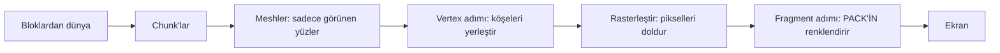

# Bloxd Shader Packs — Eksiksiz kılavuz (Türkçe)

🌐 [Tüm diller](../README.md) · Derinlemesine: [English](../en/00-start.md) · [Français](../fr/README.md)

**Önce bunu oku.** Deneyim gerekmez. On dakikada oyunun görüntüyü nasıl çizdiğini, shader'ın ne
olduğunu ve bir shader pack'in tam olarak ne yapıp ne yapamayacağını öğreneceksin.

## 1. Bir dakikalık özet

- Bloxd.io bir voxel oyunudur: dünya küplerden (bloklardan) oluşur.
- Ekranındaki görüntü, ekran kartın (GPU) tarafından saniyede 60 veya daha fazla kez çizilir.
- **Shader**, GPU üzerinde çalışan ve piksellerin rengine karar veren minicik bir programdır.
- **Shader pack**, shader kodu içeren küçük bir `.zip` dosyasıdır. Oyun onu yükler ve kodunun
  **blokları, suyu ve lavı** çizilirken yeniden renklendirmesine izin verir.
- Oyunu değiştirmezsin. Sadece renkleri ve ışığı değiştirirsin — her pikselin çizildiği tam anda.

## 2. Görüntü nasıl çizilir (web render, adım adım)

Ekranın, **piksel** denen minik noktalardan oluşan bir ızgaradır (örneğin 1920 × 1080 = yaklaşık
iki milyon piksel). Tam bir görüntü bir **frame**'dir (kare). Oyun tekrar tekrar yeni bir kare
çizer — hareketin akıcı görünmesini sağlayan budur.

İşi iki işlemci paylaşır:

| | CPU (ana işlemci) | GPU (ekran kartı) |
|---|---|---|
| Görev | oyun mantığı, fizik, ağ | milyonlarca pikseli çok hızlı, paralel çizmek |
| Tarz | az işçi, çok akıllı | binlerce işçi, her biri çok basit |

Web'de zincir şöyledir:

1. Oyun, tarayıcında JavaScript olarak çalışır (güncel Chrome veya Edge en iyisidir).
2. Oyun, GPU ile tarayıcının modern grafik API'si **WebGPU** üzerinden konuşur.
3. Tarayıcının içinde **Dawn** (derleyicisi **Tint** ile), shader dili **WGSL**'i GPU'nun
   anladığı komutlara çevirir (sistemine göre Direct3D / Metal / Vulkan).
4. GPU shader'ları çalıştırır ve bitmiş kareyi ekrana koyar.

Bloxd'ın kendisi, bir 3D framework'ü (**Babylon.js**) üzerinde bir voxel motoruyla
(**noa-engine**) yapılmıştır. Her karede çizim boru hattı şunu yapar:

1. **Chunk'lar.** Dünya, chunk denen blok sütunlarına kesilir. Sadece sana yakın chunk'lar
   çizime hazırlanır.
2. **Meshing.** Her chunk için motor bir *mesh* (örgü) kurar: sadece gerçekten görünen blok
   yüzlerini kaplayan üçgenlerden bir deri. Gizli yüzler atlanır.
3. **Doku atlası.** Her blok yüzü, resmini tüm blok dokularını yan yana içeren tek büyük
   resimden, **atlas**tan alır. Her yüz, atlasın hangi küçük karesini kullanacağını bilir
   (**UV** koordinatları).
4. **Vertex adımı.** GPU, her üçgenin her köşesinde (vertex) bir *vertex shader* çalıştırır:
   köşeyi ekranında doğru yere koyar ve verileri iletir (doku koordinatları, ışık değerleri,
   yüz yönü…).
5. **Rasterleştirme.** GPU her üçgeni piksellerle doldurur. Kapanan her piksel bir
   **fragment** (parça) olur: enterpolasyonlu verileri olan bir piksel adayı.
6. **Fragment adımı.** GPU her fragment için bir *fragment shader* çalıştırır: pikselin nihai
   rengine burada karar verilir. **Bloxd shader pack'leri burada yaşar.**
7. **Ekran.** Bitmiş kare gösterilir. Sonra her şey bir sonraki kare için tekrarlanır.



Ana fikir: pack'in asla "dünyayı" görmez. **Her seferinde tek bir fragment** görür — bir blok
yüzünün tek bir pikseli — artı o piksel hakkında bazı veriler. Bir pack'in yaptığı her şey, bu
yerel verilerden hesaplanmalıdır.

## 3. Shader nedir

Shader, GPU'nun paralel olarak muazzam sayıda kez çalıştırdığı küçük bir fonksiyondur (küçük bir
kod parçası) — vertex başına bir kez ya da fragment başına bir kez. Hızlı ve kendi kendine
yeten olmalıdır: dosya yok, ağ yok, önceki karenin hafızası yok.

Bloxd pack'leri **WGSL** (WebGPU Shading Language) ile yazılır. Bütün bir shader yazmazsın.
Motorun zaten kendi shader'ları var; kodunu **hook** (kanca) denen dört sabit noktaya eklemene
izin verir (Bölüm 5). Dört kapı gibi düşün: motor çizim kodunda ilerler ve her kapıda
fonksiyonuna sorar: "işte bu pikselin verileri — rengi değiştirmek ister misin?"

## 4. Bloxd shader pack nedir

Pack, içinde şunlar olan bir `.zip` dosyasıdır:

```
pack.json     (küçük meta veri dosyası)
*.wgsl        (WGSL kodun — bir dosya veya çok, herhangi bir klasör)
```

`pack.json` sadece şuna ihtiyaç duyar:

```json
{ "apiVersion": 2, "name": "Pack'im", "author": "sen" }
```

- `apiVersion`, **2** sayısı olmalıdır. Eski v1 pack'leri reddedilir.
- Yükleyici, zip'teki **tüm** `*.wgsl` dosyalarını bulur ve birleştirir. Sıra ve klasörler
  önemli değildir.
- Toplam WGSL boyutu sınırı: **256 KB**.

Kurulum: Bloxd → `O` Ayarlar → Grafik → **Use New WebGPU Renderer** açık → Shader Pack →
**Choose .zip** → **Apply**.

Bir pack sadece **blokları, suyu ve lavı** etkiler. Bazı oyun modları pack'leri tamamen devre
dışı bırakır.

## 5. Dört hook (tek kapıların)

| Hook | Ne zaman çalışır | Neyi kontrol edersin |
|---|---|---|
| `bloxdTerrainSurface` | fragment başına, katı bloklar, ilk | temel renk, şeffaflık (alfa), kendi parlaklığı (emission) |
| `bloxdTerrainLight` | aynı fragment, hemen sonra | blokların nihai aydınlatılmış rengi |
| `bloxdLiquidSurface` | fragment başına, su ve lav, ilk | sıvıların temel rengi ve alfası |
| `bloxdLiquidLight` | aynı fragment, hemen sonra | sıvıların nihai aydınlatılmış rengi |

Kapıların kuralları:

- Surface, light'tan **önce**, aynı fragment içinde çalışır. Modül düzeyinde bir değişkenle
  (`var<private>`) surface'tan light'a değer geçirebilirsin.
- Her zaman motorun varsayılan sonucundan başla: `bloxdDefaultSurface(...)` veya
  `bloxdDefaultLight(...)`, gerekeni değiştir, sonra geri döndür. Sonuç struct'larını asla
  kendin kurma.
- Surface hook'ları, motorun şeffaflık kesme testinden önce çalışır: yapraklarda ve kesik
  bloklarda `out.alpha`, pikselin kalıp kalmayacağına karar verir; sıvılarda gerçek karıştırma
  faktörüdür; sıradan katı bloklarda alfa hiçbir şey yapmaz.
- Kendi parlaklığı (`out.emission`) sadece **surface** hook'larına aittir.
- Bir light hook'unda kendi nihai rengini yazarsan, sisi sonunda `bloxdApplyFog(colour, light)`
  ile kendin uygula — motorun sisi her zaman sahnededir ve atlamak, uzak blokların sisin
  içinden parlamasına yol açar.

## 6. Motor sana ne söyler

Her fragment için hook'ların veri alır. En yararlı alanlar:

| Veri | Basit kelimelerle anlamı |
|---|---|
| `colour` | bu pikseldeki blok doku rengi (atlastan), senin değişikliklerinden önce |
| `blockId` | bloğun **sayısal kimliği** (tam sayı). Bir blok türünü diğerinden farklı işlemenin yolu budur — tam tablo Bölüm VIII'de |
| `position` | bu pikselin dünyadaki yeri (x, y, z) |
| `normal` | yüzün baktığı yön (yukarı, aşağı, kuzey…), vektör olarak |
| `skyLight` | bu bloğa ulaşan gökyüzü ışığı, 0 ile 1 arası — ama **tone-mapped**: açık gökyüzü ≈ 1.0, ağaç altında kaybedilen bir ışık seviyesi ≈ 0.995 (Bölüm 7'ye bak) |
| `blockLight` | lambaların, meşalelerin, lavın ışığı… renk olarak (renkli lambalar vardır) |
| `heldLight` | oyuncunun elindeki eşyanın ışığı |
| `skyLightColour` | gökyüzünün güncel tonu (geceleri koyu mavi, gün batımında sıcak) |
| `litColour` | motorun bu yüzey için kendi aydınlatılmış rengi (temel olarak yararlı) |
| `fogVisibility`, `fogColour` | bu pikselin sis derecesi ve sis rengi (sis kapalıyken **siyah** gelir — o durumu yönet) |

Çağırabileceğin motor fonksiyonları:

| Fonksiyon | Sana ne verir |
|---|---|
| `bloxdDefaultSurface(in)` / `bloxdDefaultLight(surface, light)` | motorun normal sonucu — her zaman başlangıç noktan |
| `bloxdApplyFog(colour, light)` | rengini sise doğru şekilde karıştırır |
| `bloxdSunDirection()` | güneşe giden birim vektör; Dünya benzeri güneşi olmayan dünyalarda `(0,0,0)`; ay tam ters yöndedir |
| `bloxdTime()` | saniyeler — **her 3600 saniyede 0'a geri sarar** (`bloxdTimeWrap`). Bölüm 7'ye bak |
| `bloxdEyePosition()` | kamera konumu (mesafe efektleri için) |
| `bloxdOriginOffset()` | motor dünya koordinatlarını periyodik olarak yeniden temellendirir; bu ofseti dünya konumuna dayalı her desene ekle, yoksa desen görünür şekilde sıçrar |
| `bloxdFaceBlock(position, normal)` | çizdiğin yüzün blok hücresi (tam sayı koordinatlar) — blok başına rastgele çeşitlilik için mükemmel |
| `bloxdOpaqueBehind()` | sadece sıvılar: sıvı yüzeyinin arkasındaki ilk katı bloğu bulur — su derinliğini ölçer |

## 7. Herkesin düştüğü tuzaklar

**Zaman geri sarar.** `bloxdTime()` saniyeleri sayar ama 3600'de yeniden başlar. Animasyonun
ham zamanı kullanırsa, saatte bir kez atlama yapar. Her zaman wrap içinde tam döngülerle anime et:

```wgsl
sin(6.2831853 * fract(bloxdTime() / bloxdTimeWrap * cycles + phase))
```

`cycles` değerini tam sayı seç. O zaman 3600. saniyedeki değer 0. saniyedeki değere eşit olur:
atlama yok, asla.

**skyLight tone-mapped'dir.** Doğrusal 0–1 parlaklık değildir. Motor, 0–15 ışık seviyelerini
bir eğriye sıkıştırır: açık gökyüzü ≈ 1.0 ve bir seviye kaybetmek hâlâ ≈ 0.995 okunur.
`skyLight < 0.5` testini "gölgede" diye yaparsan neredeyse hiçbir şey eşleşmez. Eşikleri
gerçek eğri üzerinde kalibre et (Bölüm IV ölçülmüş değerler verir).

**Sis her zaman oradadır.** Onu göremesen bile motor sisi hesaplar (bazen çok uzağa itilmiş).
Light hook'un `bloxdApplyFog` olmadan renk döndürürse, uzak arazi çok parlak görünür ve sisi
deler. Sisi en son, renk çalışmandan sonra uygula.

**Aydınlatma kapalı olabilir.** Bir oyun veya ayar aydınlatmayı kapatırsa, `skyLight` hiç
gönderilmeyebilir ve gökyüzü tabanlı efektler sessizce hiçbir şey yapmaz. Efektleri, pack
onsuz da güzel görünecek şekilde yaz.

## 8. Bir pack her şeyi YAPABİLİR

- Herhangi bir bloğu, suyu veya lavı yeniden renklendirmek — genel ya da `blockId` başına.
- Şeyleri parlatmak (surface hook'larında `out.emission`): lav, cevherler, lambalar…
- Rengi ve alfayı zamanla anime etmek (nabız, akan lav, ışıldayan su) — wrap'e dayanıklı
  (Bölüm 7).
- `bloxdSunDirection()` ve `skyLightColour` ile gündüz/gece döngüsüne tepki vermek (sıcak gün
  batımları, mavi ay ışığı tonları).
- Dünyaya bağlı prosedürel detay eklemek: `bloxdFaceBlock` hash'leriyle blok başına ince
  çeşitlilik, mesafe sis tonları, `bloxdOpaqueBehind()` derinliğiyle su altında kararma.
- Tüm görüntüyü fragment başına grade'lemek: kontrast, doygunluk, sıcak/soğuk dengesi — sis
  sonda uygulanmak şartıyla.
- Efektleri yüzeylerin *üzerine* boyamak: cevherlerde pırıltılar, su seviyesi yakınında
  "ıslak" kararma, yukarı bakan yüzlerde kar (`normal.y`) ve benzeri numaralar — hepsi
  fragmentin kendi verisinden hesaplanır.
- Pahalı veya gürültülü efektleri mesafeyle (`bloxdEyePosition()`) soldurmak (ucuz detay
  seviyesi).

## 9. Bir pack NE YAPAMAZ (motor sınırları)

- **Bitkiler, ot ve çiçekler**, motorun pack'lerin ulaşamadığı bir kısmı tarafından çizilir.
  Onları renklendiremez veya anime edemezsin.
- **Post-processing yok.** Bitmiş kareye erişim yok, ekran koordinatı yok, blur/bloom/vinyet
  geçişleri yok.
- **Sahne derinliği yok.** Tek "arkasında ne var" sorgusu, bir sıvının içinden
  `bloxdOpaqueBehind()`'dur.
- **Gerçek gölge haritaları veya ambient occlusion yok**, motorun ışık değerlerinin zaten
  kodladığının ötesinde.
- **Dünyada yeni nesne veya parçacık yok.** Sadece zaten var olan yüzeyleri boyayabilirsin.
  (Zeki pack'ler yüzeylere bindirme efektleri boyar — tariflere bak — ama geometri her zaman
  motorundur.)
- **Kendi dokuların veya sampler'ların yok**, ekstra veri akışı yok: tek girdilerin hook
  argümanları ve motor fonksiyonlarıdır.
- **Vertex hareketi** (geometriyi bükmek, köşeleri oynatan dalgalar) motorda vardır ama
  **sadece birkaç oyunda çalışır** — ona asla güvenme; hareketi renk/alfa animasyonuyla taklit et.
- **Gökyüzünün kendisi** (güneş diski, skybox, bulutlar) motor tarafından çizilir. Pack'ler
  gökyüzü *verisi* (yön, ton) alır ama gökyüzünü çizmez.

Bir efekt bu listeden bir şeye ihtiyaç duyuyorsa, bugün hiçbir pack onu yapamaz — bu,
kanıtlanmış motor davranışıdır, yetenek meselesi değildir.

## 10. İlk pack'in, beş adımda

1. `pack.json` oluştur:

```json
{ "apiVersion": 2, "name": "İlk Pack'im", "author": "sen" }
```

2. Yanına `shader.wgsl` oluştur:

```wgsl
fn bloxdTerrainSurface(surface: BloxdSurfaceIn) -> BloxdSurface {
    var out = bloxdDefaultSurface(surface);
    out.colour = out.colour * vec3f(1.05, 1.0, 0.92);
    return out;
}

fn bloxdTerrainLight(surface: BloxdSurface, light: BloxdLightIn) -> BloxdLight {
    var out = bloxdDefaultLight(surface, light);
    _ = surface;
    return out;
}
```

Bu pack her bloğu biraz daha sıcak yapar (daha kırmızı, daha az mavi) ve motorun aydınlatmasını
korur. `_ = surface;` satırı derleyiciye "bu girdi kasıtlı olarak kullanılmıyor" der — WGSL bu
sade şekli ister.

3. İki dosyayı birlikte zip'le; `pack.json` zip'in kökünde olsun (alt klasörde değil).
4. Oyunda: Ayarlar → Grafik → **Use New WebGPU Renderer** açık → Shader Pack → Choose .zip →
   Apply.
5. Etrafa bak: dünya biraz daha sıcak görünmeli. Üç sayıyı değiştir ve denemek için yeniden
   yükle.

Sonra adım adım büyü: her seferinde tek efekt; sıradakini eklemeden önce öğlen, gün batımında,
gece, su altında ve bir mağarada kontrol et.

## 11. Dokuz sert kural

Herhangi birini kırmak pack'i bozar veya reddettirir:

1. Adı `BLOXD_` ile başlayan hiçbir şey tanımlama — onlar motorundur.
2. `BloxdSurface` / `BloxdLight`'ı asla kendin kurma — `bloxdDefaultSurface` /
   `bloxdDefaultLight`'tan başla.
3. `mod`, WGSL'de ayrılmış bir kelimedir — `%` kullan.
4. Doku yok, sampler yok, kendi entry point'ların veya attribute'ların yok, ekran UV'si yok.
5. `discard`'dan kaçın (strict modda reddedilir) — `out.alpha` kullan.
6. Sıvı hook'ları her zaman, her varyantta geçerli bir alfa çıktısı vermelidir.
7. Kullanılmayan girdiler: `_ = değer;` yaz — `let _ =` şekli reddedilir.
8. Toplam WGSL ≤ 256 KB.
9. Motor, kodunu **8 varyantta** derler (strict/izin veren × aydınlatmalı/aydınlatmasız ×
   arazi/sıvı). Kodun hepsinde derlenmeli ve davranmalıdır. Tarayıcının Tint derleyicisi için
   karışık bitsel/kaydırma ifadelerini parantezle.

## 12. Mini sözlük

| Kelime | Anlamı |
|---|---|
| Frame | ekranda tam bir görüntü |
| Piksel / fragment | görüntünün tek noktası / renklendirilmekte olan piksel adayı |
| Vertex | bir üçgenin köşesi |
| Mesh | bir chunk'ın görünen yüzlerinden inşa edilmiş üçgen derisi |
| Atlas (doku atlası) | tüm blok dokularını içeren tek büyük resim |
| UV | bir yüzün atlasın hangi kısmını kullandığını söyleyen koordinatlar |
| WGSL | WebGPU'nun shader dili — Bloxd pack'lerinin dili |
| Hook | pack'in tanımlayabileceği dört motor fonksiyonundan biri |
| skyLight / blockLight | gökyüzü ışığı / blok ışığı (lambalar, lav) |
| Wrap (3600 sn) | `bloxdTime()` her saat 0'a geri döner |
| Sis (fog) | uzak arazinin sis rengine karışması |
| Varyant | motorun pack'ini derlediği 8 yoldan biri |

## 13. Derine inmek (İngilizce bölümler)

| Bölüm | Dosya | İçerik |
|---|---|---|
| I | [01-making](../en/01-making.md) | pack formatı, çok dosyalı yükleme, sınırlar, dağıtım |
| II | [02-api](../en/02-api.md) | hook ve struct sözleşmesinin tamamı |
| III | [03-recipes](../en/03-recipes.md) | WGSL kodlu 12 üretim tarifi |
| IV | [04-realism](../en/04-realism.md) | ölçülmüş sayılar: ışık, sis, su optiği |
| V | [05-troubleshooting](../en/05-troubleshooting.md) | bilinen her arıza ve çözümü |
| VI | [06-implementation](../en/06-implementation.md) | 8 varyantta yerel doğrulama |
| VII | [07-internals](../en/07-internals.md) | motorun içerikleri (zaman, ışık, gökyüzü, yükleyici) |
| VIII | [08-block-ids](../en/08-block-ids.md) | sayısal blok kimliği tablosunun tamamı |
| IX | [09-sources](../en/09-sources.md) | bu kılavuzdaki her bilginin nasıl kanıtlandığı |
| X | [10-constants](../en/10-constants.md) | her sabit (551) rolüyle |

Fransızca tam sürüm: [fr](../fr/README.md) · Tüm diller: [index](../README.md). Lisans: MIT.
